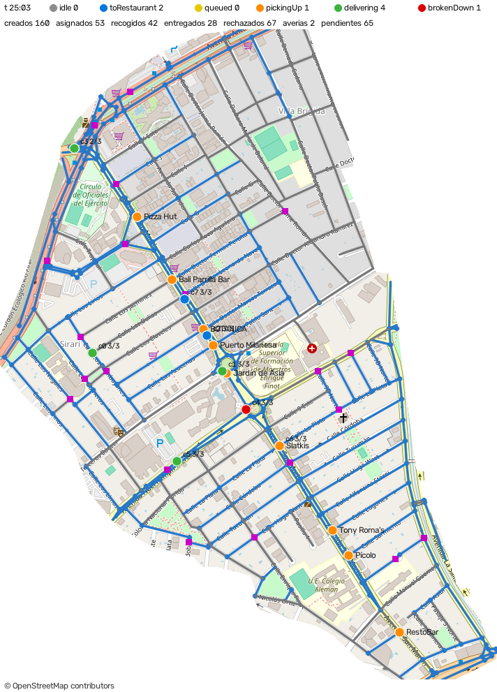
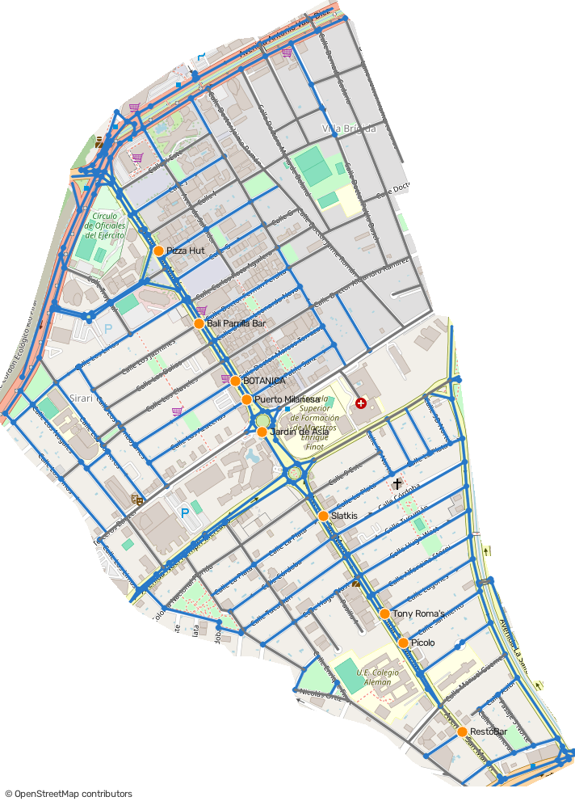
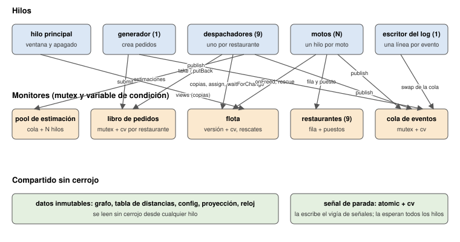
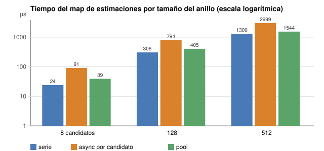
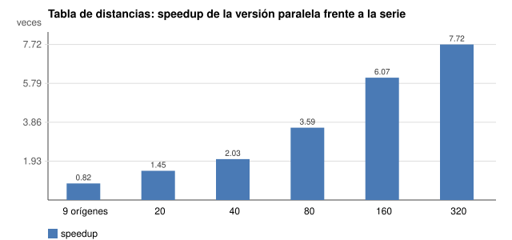
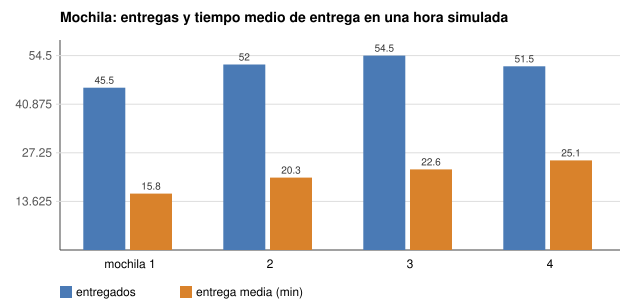
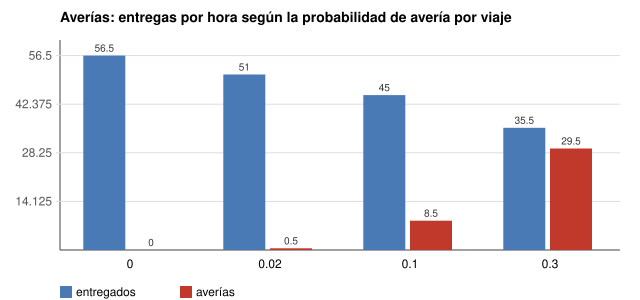

# Informe final: Equipetrol Delivery

Diego Lewensztain. LIA-221 Computación Concurrente, Paralela y Distribuida. Octubre de 2026.

## 1. Qué hice

Una simulación en C++17 de una empresa de delivery en moto en la zona Equipetrol de Santa Cruz.
Los pedidos llegan solos, un despachador por restaurante decide qué moto lleva cada uno, las motos
circulan por calles reales sacadas de OpenStreetMap, hacen fila en los restaurantes, entregan, se
averían y se pasan los pedidos entre ellas. Todo se ve en una ventana y queda registrado en un log
que un verificador revisa línea por línea.



El programa está en el repositorio, repartido en 57 pull requests pequeños, uno por tema. El
README tiene la explicación de cada módulo, el esquema de hilos y el mapa de conceptos. Este
informe resume lo que pide la tarea DP.12: cómo se compila, cómo está armado, qué dijeron las
herramientas y qué salió de los experimentos.

## 2. Cómo se compila y se corre

```sh
mkdir build && cd build
cmake .. && make
./delivery_sim ../config/equipetrol.json
```

Con `cmake -DENABLE_TSAN=ON ..` se construye lo mismo con ThreadSanitizer, y con
`-DENABLE_ASAN=ON` con AddressSanitizer. Las dos opciones no se pueden combinar. `ctest` corre
las 30 pruebas: 24 unitarias, una por módulo, y seis que corren el programa completo o el
verificador. La ventana se abre siempre, como pide el enunciado; las pruebas usan `--no-window`
para no abrir ventanas en el evaluador. Si CMake no encuentra OpenCV, el programa se construye sin
ventana y todo lo demás funciona igual.

Al arrancar, el programa escribe en `stderr` cuántos nodos, calles y restaurantes cargó, cuánto
tardó la tabla de distancias y de cuántos hilos es el pool. Al terminar escribe el resumen en
`stdout` y en `stderr` un desglose: cuántos pedidos se asignaron, cuántos reintentos hubo, cuántas
averías y rescates, y cuántos pedidos quedaron en el libro y en las mochilas.

## 3. El mapa

La imagen es de OpenStreetMap, recortada al polígono de la zona entre el Segundo y el Cuarto
Anillo. La red de calles se sacó de los datos de OpenStreetMap con un script propio: 320
intersecciones, 472 segmentos (314 de un solo sentido) y nueve restaurantes reales de la Avenida
San Martín, ubicados en el nodo más cercano de la avenida. Las motos se mueven solo por esos
segmentos y respetan el sentido.



## 4. Cómo está armado

La regla que seguí: un hilo por cosa que espera y se coordina, y nada compartido salvo detrás de
un mutex o inmutable. El esquema completo, con cada canal y cada método, está en el README; este
es el resumen.



| Hilo | Cuántos | Qué hace | En qué duerme |
|---|---|---|---|
| generador | 1 | Crea los pedidos en ráfagas y los deja en el libro. | En la señal de parada hasta la próxima ráfaga. |
| despachador | uno por restaurante | Toma pedidos de su cola, estima a los candidatos y reserva la mejor moto. | En su cola del libro; si no hay moto, en la flota hasta que algo cambie. |
| moto | uno por moto | Va al restaurante, hace fila, recoge, entrega, se avería, rescata. | En su variable de condición si no tiene nada; en la señal de parada mientras viaja. |
| escritor del log | 1 | Escribe una línea JSON por evento y lleva el resumen. | En la cola de eventos. |
| vigía de señales | 1 | Convierte SIGINT y SIGTERM en la orden de parar. | En un pipe que escribe el manejador de señal. |
| pool de estimación | según el hardware, de 2 a 32 | Calcula las estimaciones que le mandan los despachadores. | En su cola de trabajos. |
| principal | 1 | Arranca todo, dibuja, y apaga en orden. | Entre cuadros, 33 ms. |

Lo que más me costó fue que nadie espere dando vueltas. Cada hilo duerme en una variable de
condición o en la señal de parada, y siempre con un predicado, así un despertar sin novedad no hace
daño. El apagado los despierta en orden para poder unirlos: primero se pide parar, se une el
generador para que no entren más pedidos, se registra `simulationStopping`, se cierra el libro para
que los despachadores salgan de su espera, se despiertan las filas y la flota para que salgan las
motos, y al final se cierra el log. Con ocho motos tarda milisegundos; el límite es 5 segundos.

Cómo se decide quién lleva un pedido: el despachador pide una copia de cada moto (dónde va a quedar
libre y cuándo, cuánto lleva en la mochila), busca candidatos en anillos de radio creciente
alrededor del restaurante, calcula una estimación de entrega por candidato en paralelo y se queda
con la mejor. Después intenta reservar esa moto. Si otro despachador se le adelantó, vuelve a
empezar con copias nuevas. Eso es una carrera real entre despachadores y se resuelve sin un cerrojo
global sobre la flota: la reserva es atómica en cada moto.

Cómo se maneja una avería: la moto queda parada cinco minutos simulados. Los pedidos que aún no
había recogido vuelven al libro para que se reasignen. Los que ya llevaba se quedan en su mochila y
la flota manda a la moto libre más cercana a buscarlos; el traspaso entre las dos mochilas toma los
dos cerrojos a la vez. Si la averiada se repara antes de que llegue la otra, entrega ella misma y
el traspaso no toma nada.

## 5. Dónde está cada concepto

El mapa de conceptos del README tiene las dieciséis filas con archivo y método. Algunos que me
parecen los más importantes, dichos en simple:

- Los pedidos son objetos que solo se pueden mover, no copiar. Así un pedido está en el libro, o en
  la mano de un despachador, o en una mochila, pero nunca en dos lugares. Lo garantiza el compilador.
- Lo que otros hilos necesitan de una moto sale por copia: el despachador estima sobre una copia y
  la ventana dibuja copias. Nadie retiene el cerrojo de una moto mientras calcula o dibuja. La
  posición en el mapa la calcula la ventana a partir del viaje, que es un objeto inmutable compartido
  con `shared_ptr`.
- Las estimaciones van al pool como tareas que devuelven un `future`. El despachador espera hasta
  `quoteTimeoutMs` y las que llegan tarde se ignoran; una estimación que falla llega como excepción
  y no tumba nada.
- El traspaso entre dos motos toma los dos cerrojos a la vez con `std::scoped_lock`. Si dos
  rescates se cruzan, no se bloquean.
- Los contadores de cada moto van en su propia línea de caché. Medido con ocho hilos: entre 10 y
  23 veces más rápido que con los contadores pegados, sin cambiar una instrucción.
- Un mutex por moto, por restaurante y para el libro; nunca uno global. Dos despachadores que
  asignan a motos distintas no se estorban.

## 6. Herramientas

Las dos corridas están guardadas sin editar en `tools/reports/`, con la máquina, el compilador y
el commit en la cabecera y el comando para repetirlas.

| Herramienta | Versión | Comando | Resultado |
|---|---|---|---|
| ThreadSanitizer | Apple clang 21.0.0, macOS, Apple M5 Pro | `sh tools/run_tsan.sh` | 0 reportes en tres pasos: 30 min simulados con ráfagas y 30 % de averías, SIGINT a mitad, y la prueba de estrés con 24 motos y avería en cada viaje. Los tres logs pasan el verificador. |
| AddressSanitizer + LeakSanitizer | g++ 12.2, Debian 12 en Docker, Linux 6.12 | `sh tools/run_asan_linux.sh` | 0 errores de memoria y 0 fugas en toda la suite de pruebas y los mismos tres pasos. En macOS LeakSanitizer no existe; por eso Linux. |

La prueba de estrés merece una línea aparte: 24 motos, 400 pedidos, dos restaurantes en una ciudad
de cinco nodos, y probabilidad de avería 1. Todo viaje termina en avería, así que se encadenan
liberaciones, reasignaciones, rescates que también se averían y reparaciones. En una corrida típica
hay unas 380 averías, 650 reasignaciones y 55 rescates, y el apagado termina en un milisegundo.
Bajo ThreadSanitizer no reporta nada.

Las herramientas no reportaron nada en la versión final. Lo que sí encontraron, antes, fueron las
pruebas y el verificador del log:

- El hilo de la moto no se despertaba si le asignaban un pedido antes de que empezara a esperar.
  Comparaba contra el tamaño de la mochila al momento de dormirse en vez de contra lo que había
  dejado. Lo encontró la primera prueba del hilo.
- El programa abortaba al rechazar por `noCourier` un pedido que había vuelto al libro por una
  avería. Lo encontró la primera corrida de una hora simulada. Ahora un pedido liberado vuelve a
  `created` y no se rechaza, porque ya fue aceptado.
- El verificador contaba en la mochila de la moto averiada los pedidos que había liberado y marcaba
  cuatro pedidos en una mochila de tres. Era el verificador el que estaba mal, no el programa. Al
  corregirlo apareció otro error suyo, que encontró un log real y no un caso construido.
- Una prueba fallaba una vez de cada doce cuando la máquina estaba cargada: medía algo a los
  30 ms de un tramo que duraba 100 ms. Se alargó el tramo.

Una cosa que aprendí con `std::async`: el `future` que devuelve espera a que la tarea termine
cuando se destruye. Así que "ignorar una estimación tardía" con `async` no era ignorarla del todo,
el despachador se quedaba esperando igual. Con el pool los futures vienen de `packaged_task` y no
tienen ese problema. Fue una de las razones del cambio de diseño.

## 7. Experimentos

Los reportes completos están en `tools/reports/exp_despacho.md` y `tools/reports/exp_sistema.md`.
Todos se corrieron con `tools/run_experiments.py`, un script que lanza varias simulaciones en
paralelo con las mismas semillas, verifica cada log y arma la tabla.

### 7.1 Despacho: estimar en serie, con un hilo por candidato o en el pool

Qué cambié: cómo se calculan las estimaciones de un anillo. Qué mantuve: la ciudad, las semillas,
el algoritmo de anillos y el reduce. Qué medí: el tiempo del map de estimaciones para anillos de
distintos tamaños, y la simulación completa con cada variante.



| Candidatos | Serie | `async` por candidato | Pool |
|---|---|---|---|
| 8 | 24 µs | 91 µs | 39 µs |
| 128 | 306 µs | 794 µs | 405 µs |
| 512 | 1300 µs | 2999 µs | 1544 µs |

Una estimación cuesta de 2 a 4 µs y repartirla cuesta unos 3 µs por tarea en el pool y 6 con
`async`. Por eso la serie gana con esta ciudad. La ley de Amdahl a secas predice un speedup
cercano al número de hilos, porque casi todo el map es paralelizable; lo que la fórmula no tiene es
el costo fijo de repartir cada tarea, y acá ese costo es del tamaño del trabajo. Con estimaciones
más caras el paralelismo paga: a 22 µs por estimación el pool va 1,5 veces más rápido, y a 86 µs,
casi 2. En la simulación completa las tres variantes entregan lo mismo; solo cambia el número de
reintentos del despachador, que sube con el map más lento.

El cambio de diseño fue de `async` a pool. Antes: 91 µs por map de 8 y una estimación colgada
retenía al despachador. Después: 39 µs, ningún hilo nuevo por pedido y la llamada vuelve al vencer
el plazo aunque la tarea siga. Conclusión honesta: para esta ciudad lo más rápido sería en serie,
pero el enunciado exige estimaciones concurrentes con plazo, y el pool es la forma de cumplirlo sin
pagar hilos nuevos por pedido. Si la ciudad fuera diez veces más grande, el pool ganaría también
en tiempo.

### 7.2 Tabla de distancias: serie o paralela

Al arrancar, el programa calcula la distancia de cada restaurante a todos los nodos (un Dijkstra
por origen). Qué cambié: el número de orígenes y si se calcula en serie o repartido en tareas con
`std::async`. Qué medí: el tiempo de construir la tabla.



Con los 9 restaurantes del config no vale la pena: 0,8 veces, porque repartir 9 Dijkstra de 10 µs
cuesta más que hacerlos. Con cientos de orígenes sí: 7,7 veces con los 320 nodos y 18 tareas. El
barrido de tareas con 320 orígenes llega a 8,9 veces con 18 tareas y baja a 7 con 36, así que el
programa no usa más tareas que hilos tiene la máquina. Es el único punto del programa donde el
paralelismo de datos da un speedup grande, y en el arranque real con 9 restaurantes es neutro. Lo
dejo así: el patrón está, y con una ciudad grande importa.

### 7.3 Puestos, mochila y averías

Una hora simulada, dos semillas, configuración de ejemplo, cambiando una cosa a la vez.





| Qué cambié | Efecto |
|---|---|
| Puestos de recogida 1 a 4 | Nada medible. Con 8 motos para 9 restaurantes casi nunca hay dos en la misma fila. El monitor del restaurante importa para la corrección, no para el rendimiento de este config. |
| Mochila 1 a 4 | Menos rechazos (317 a 286) pero cada pedido tarda más (15,8 a 25,1 min), porque la moto recoge todo lo asignado antes de entregar. |
| Averías 0 a 30 % | Entregas de 56 a 35, tiempo medio de 22 a 28 min, 28 reasignaciones por hora. Las cuentas cuadran en todos los casos y todos los logs pasan el verificador. |

Lo que saqué de esto: la configuración de ejemplo está limitada por la flota, no por la
concurrencia. Ni más puestos ni más mochila la destraban. La mejora que más cambiaría los tiempos
no es de hilos sino de política: entregar lo recogido antes de ir por un pedido cuya preparación
aún tarda.

## 8. Dependencias

| Qué | Versión usada |
|---|---|
| CMake | 4.4.4 (mínimo 3.11) |
| make | GNU make 3.81 |
| Compilador | Apple clang 21.0.0 en macOS; g++ 12.2.0 en Linux |
| OpenCV | 5.0.0, solo para la ventana; opcional en CMake |
| nlohmann/json | 3.12.0, copiada en `third_party/` |
| Python | 3.9 o superior, solo librería estándar, para el verificador y los experimentos |
| Docker | 29.7.2 con Debian 12, solo para la corrida de memoria en Linux |

No se usa nada más: ni OpenMP, ni TBB, ni Boost. Toda la concurrencia es `std::thread`,
`std::mutex`, `std::condition_variable`, `std::atomic`, `std::async`, `std::packaged_task` y
`std::scoped_lock`.

## 9. Supuestos que tomé

Dos cosas del enunciado no estaban definidas y las resolví así, documentado en el código:

- "Un viaje" para la probabilidad de avería es cada trayecto completo, al restaurante o al
  cliente. Si toca, la avería cae en un tramo al azar del trayecto, así siempre ocurre en una
  intersección.
- Una moto averiada vuelve al servicio después de 5 minutos simulados. Es una constante porque la
  configuración no tiene ese campo. Sin recuperación, con probabilidad 1 la flota entera quedaría
  fuera de servicio en minutos.

Y una decisión sobre `noCourier`: un pedido que ya fue asignado y vuelve al libro por una avería
no se rechaza por tiempo. El sistema ya lo aceptó; espera moto sin plazo.

## 10. Qué me llevo

- Concurrencia y paralelismo son dos cosas distintas. Casi todo el programa es concurrencia: hilos
  que esperan y se coordinan. Paralelismo de verdad, que acelere, hay en un solo lugar, y solo
  cuando el trabajo es grande.
- Repartir trabajo tiene un costo fijo. Si cada pedazo cuesta menos que repartirlo, el paralelismo
  pierde. Lo medí tres veces y las tres dio lo mismo.
- Las copias valen más que los cerrojos. Cada vez que un hilo necesitaba algo de otro, lo mejor
  fue darle una copia y soltar el cerrojo enseguida.
- Las pruebas encontraron todos los fallos reales. Los sanitizers confirmaron que no quedaba nada,
  pero no encontraron ninguno por su cuenta.
