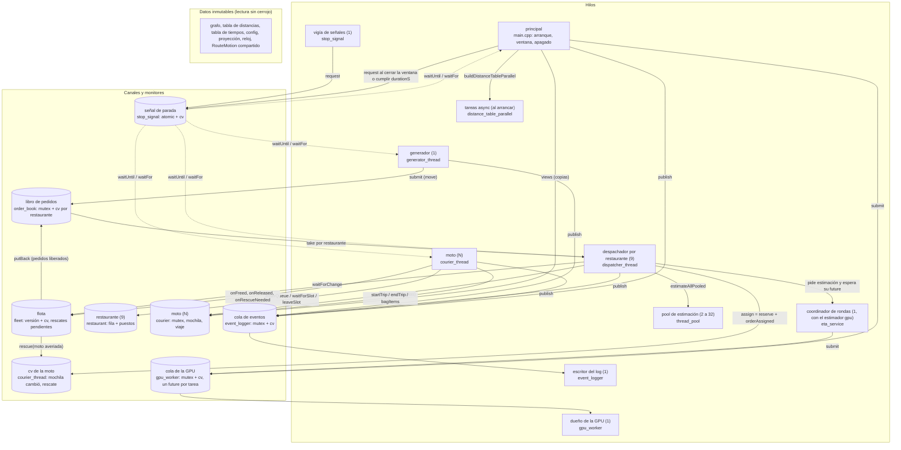
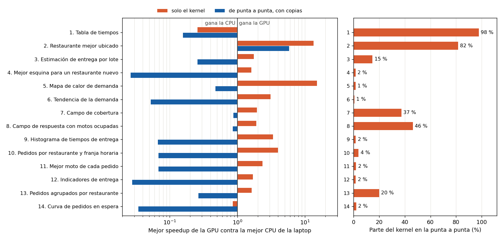

# Equipetrol Delivery

Simulación concurrente de despacho de pedidos en la Zona Equipetrol, Santa Cruz de la Sierra.
Proyecto final del curso LIA-221 Computación Concurrente, Paralela y Distribuida.

- [INFORME.pdf](INFORME.pdf): la simulación concurrente, sus herramientas y experimentos.
- [INFORME_GPU.pdf](INFORME_GPU.pdf): las 14 aplicaciones de GPU y sus mediciones.
- [docs/detalle.md](docs/detalle.md): los módulos, el mapa de conceptos con sus dieciséis filas y
  el detalle de cada experimento y de cada aplicación.

## Requisitos

- CMake 3.11 o superior, `make`, un compilador con C++17 (g++ 7 o clang equivalente) y Python 3.
- Nada más que instalar: la única biblioteca externa viene en `third_party/`.

Opcionales:

| Qué | Para qué | Sin eso |
|---|---|---|
| OpenCV | La ventana del mapa | Todo corre igual, sin ventana |
| GPU NVIDIA y CUDA toolkit (probado con CUDA 12.1) | Los kernels, parte B | Las 14 aplicaciones corren en sus versiones de CPU |
| `pandas` y `matplotlib` | Las tablas y gráficos, paso 9 | Los que están en `tools/reports/gpu/` ya vienen generados |
| Docker | AddressSanitizer en Linux, parte C | Se omite ese paso |

## Paso a paso

### A. En cualquier máquina, sin GPU

1. Clonar y compilar. Tarda menos de un minuto.

   ```sh
   git clone https://github.com/Wylewis/COMPUTACI-N-CONCURRENTE-PARALELA-Y-DISTRIBU-DA.git
   cd COMPUTACI-N-CONCURRENTE-PARALELA-Y-DISTRIBU-DA
   git checkout bloque-2
   mkdir -p build && cd build
   cmake .. && make -j8
   ```

   Los pasos 2 a 9 se corren desde `build`.

2. Correr la simulación. Abre la ventana del mapa, dura una hora simulada (un minuto real), imprime
   el resumen en una línea JSON y deja `events.log`. Se corta antes con Ctrl+C, con `q` o cerrando
   la ventana. La tecla `h` muestra el mapa de calor de demanda y la tecla `c` el campo de
   cobertura de las motos libres.

   ```sh
   ./delivery_sim ../config/equipetrol.json
   ```

3. Verificar el log de esa corrida, pedido por pedido. Termina con `check_log: sin errores`.

   ```sh
   python3 ../tools/check_log.py events.log --config ../config/equipetrol.json
   ```

4. Correr las 49 pruebas automáticas (47 sin OpenCV). Termina con `100% tests passed`. En macOS
   tarda un minuto. En Linux sin GPU pasa de diez minutos, porque las pruebas de los kernels
   corren sobre la emulación; compilado con CUDA (parte B) tarda medio minuto.

   ```sh
   ctest --output-on-failure
   ```

5. Pedidos urgentes: correr el escenario (un minuto), verificar el log contra el resumen y mostrar
   los dos casos de prioridad.

   ```sh
   ./delivery_sim ../config/urgentes_3_motos.json --no-window --log urgentes.log > resumen.txt
   python3 ../tools/check_log.py urgentes.log --summary resumen.txt --config ../config/urgentes_3_motos.json
   python3 ../tools/urgent_cases.py urgentes.log
   ```

6. Escala de ciudad: 4774 esquinas, 200 restaurantes y 3000 motos, sin ventana. Tarda diez
   segundos y cada aplicación de GPU imprime su resultado, calculado con la versión de CPU.

   ```sh
   ./delivery_sim ../config/ciudad.json --headless --estimator table
   ```

7. Sacar los indicadores de esa corrida: pedidos asignados y entregados por hora y demora de
   despacho.

   ```sh
   python3 ../tools/gpu_sim_metrics.py events.log
   ```

8. Medir una aplicación. Tarda veinte segundos y escribe `resultados.csv`, con una fila por
   corrida y la columna `correct` en `yes`. Sin `--bench-apps` mide las 14.

   ```sh
   ./delivery_sim ../config/ciudad.json --headless --bench resultados.csv --bench-apps through_restaurant
   ```

9. Rehacer las tablas y gráficos con las mediciones guardadas en el repositorio. Deja en
   `graficos/` el resumen de las 14 aplicaciones, el roofline y la tabla de una aplicación que
   cruza la medición del paso 8 con la de la GPU.

   ```sh
   mkdir -p graficos
   python3 ../tools/gpu_summary.py --reports ../tools/reports/gpu --out graficos
   python3 ../tools/gpu_roofline.py --reports ../tools/reports/gpu --out graficos
   python3 ../tools/gpu_report.py --app through_restaurant --laptop resultados.csv --gpu ../tools/reports/gpu/through_restaurant/pc.csv --out graficos
   ```

### B. Con una GPU NVIDIA

Desde la raíz del repositorio, en otra carpeta de compilación.

1. Compilar los kernels con `nvcc`:

   ```sh
   mkdir -p build/gpu && cd build/gpu
   cmake -DUSE_CUDA=ON ../.. && make -j8
   ```

2. Ver la tarjeta y la ocupación de cada kernel:

   ```sh
   ./delivery_sim ../../config/ciudad.json --gpu-info
   ```

3. Comprobar que cada kernel da el mismo resultado que su versión de CPU, y revisar uno con las
   herramientas de CUDA:

   ```sh
   ctest --output-on-failure
   compute-sanitizer --tool memcheck ./through_restaurant_test
   compute-sanitizer --tool racecheck ./through_restaurant_test
   ```

4. Correr la ciudad con los kernels: las estimaciones del despacho y las 14 aplicaciones se
   calculan en la tarjeta.

   ```sh
   ./delivery_sim ../../config/ciudad.json --headless --backend gpu --estimator gpu
   ```

5. Medir CPU contra GPU, con diez repeticiones y el barrido de hilos. El CSV suma las versiones
   `gpu_kernel` (solo el kernel) y `gpu_e2e` (kernel más copias).

   ```sh
   ./delivery_sim ../../config/ciudad.json --headless --bench pc.csv --bench-apps through_restaurant --bench-reps 10 --bench-sweep
   ```

### C. Herramientas de concurrencia y memoria

Opcional, desde la raíz del repositorio. La primera construye con ThreadSanitizer en `build/tsan`
y corre tres escenarios; la segunda necesita Docker y corre AddressSanitizer con LeakSanitizer en
Linux. Las dos dejan su reporte en `tools/reports/`.

```sh
sh tools/run_tsan.sh
sh tools/run_asan_linux.sh
```

## Flags del programa

| Flag | Qué hace |
|---|---|
| `--log <ruta>` | Cambia el archivo del log de eventos; por defecto `events.log`. |
| `--no-window` o `--headless` | Corre sin la ventana del mapa. |
| `--estimator <nombre>` | Cómo se estiman las entregas: `serial`, `async`, `pool` (por defecto), `table` (tabla de tiempos en CPU) o `gpu` (por rondas en la tarjeta). |
| `--backend cpu` o `gpu` | Con `gpu` las aplicaciones usan sus kernels; por defecto, las versiones de CPU. |
| `--bench <csv>` | Modo de medición. Opciones: `--bench-apps <a,b>`, `--bench-reps <n>`, `--bench-sweep`, `--bench-threads <n>`, `--bench-max-items <n>`, `--bench-once`, `--bench-cold`. |
| `--gpu-info` | Imprime el dispositivo y la ocupación de cada kernel, y termina. |

## Esquema del programa

Hilos, canales y datos compartidos tal como están en el código. Cada caja de hilo nombra el módulo
que lo implementa; cada canal es un monitor (mutex y variable de condición) o un dato inmutable.



Los datos inmutables (grafo, tabla de distancias, tabla de tiempos, configuración, proyección,
reloj una vez arrancado, y cada `RouteMotion` compartido por `shared_ptr`) los leen todos los hilos
sin cerrojo; no se dibujan sus aristas para no cruzar el diagrama.

Ningún hilo toca la GPU salvo su dueño: los demás le dejan el trabajo en una cola y esperan el
resultado por un `future`, así las motos siguen andando y la ventana se sigue dibujando mientras
corre un kernel.

| Hilo | Cuántos | Duerme en | Despierta por | Produce |
|---|---|---|---|---|
| principal | 1 | `waitKey` entre cuadros, o `StopSignal::waitUntil` sin ventana | fin de `durationS`, señal, ventana cerrada | cuadros; el apagado ordenado |
| generador | 1 | `StopSignal::waitUntil` hasta la próxima ráfaga | el reloj simulado o la parada | pedidos al libro, `orderCreated`, `orderRejected` |
| despachador | uno por restaurante | `OrderBook::take` (su cola) y `Fleet::waitForChange` (sin moto, con plazo) | pedido nuevo, entrega o reparación, cierre del libro, parada | reservas en las motos, `orderAssigned`, `orderReassigned`, `orderRejected` (`noCourier`) |
| moto | `fleet.couriers` | su cv (mochila vacía), `Restaurant::waitForSlot`, `StopSignal::waitUntil` por tramo y espera | asignación o rescate, turno en la fila, el reloj simulado, la parada | viajes, recogidas, entregas, averías, traspasos y sus eventos |
| escritor del log | 1 | cv de la cola de eventos | eventos publicados o cierre | líneas JSON del log y el resumen |
| vigía de señales | 1 | `read` sobre un pipe | `SIGINT` o `SIGTERM` (el manejador escribe un byte) | `StopSignal::request` |
| pool de estimación | 2 a 32 según el hardware | cv de la cola del pool | tareas enviadas o `stop` | estimaciones por `future` |
| tareas async | tantas como orígenes, solo al arrancar | ninguna (fan-out/fan-in) | se unen al terminar | filas de la tabla de distancias |
| coordinador de rondas | 1, solo con el estimador `gpu` | cv de su cola de pedidos | un pedido que espera estimación, o la parada | una ronda: junta los pedidos pendientes, saca una copia de la flota y manda un solo lanzamiento |
| dueño de la GPU | 1 | cv de la cola de la GPU | una tarea enviada, o la parada | el resultado de cada kernel, por `future` |

Orden de arranque: tabla de tiempos, restaurante mejor ubicado y mejor esquina para un restaurante
nuevo (las tres antes de arrancar el reloj), y después flota, despachadores y generador. Orden de apagado: `stop.request`, unir el
generador, `simulationStopping`, cerrar el libro, unir despachadores, unir flota (despierta filas y
cv de flota), vaciar el libro, cerrar el log. Ningún hilo espera a otro que dependa de uno que aún
no se despertó, y ningún monitor llama a otro bajo su cerrojo salvo el traspaso entre dos motos,
que toma los dos con `std::scoped_lock`.

## Pedidos urgentes

Algunos pedidos son urgentes y el despachador los atiende antes. Un normal que espera más de
`agingMs` envejece y pasa primero, para que nadie espere para siempre: el orden es envejecido,
urgente, normal, y dentro de cada nivel el más antiguo. Lo decide `OrderBook::take` bajo el candado
del libro. Si no hay moto con lugar, el despachador devuelve el pedido y duerme hasta que algo
cambie; no gira. Se activa con `urgentProbability` y `agingMs` en `orders` del config, y se
comprueba con el paso 5.

## Las 14 aplicaciones de GPU

Dos por cada concepto del curso, del 03 al 09. Cada una tiene su versión de CPU de un hilo, su
versión multihilo, su kernel en `src/gpu/` y una prueba en `tests/gpu/` de que dan lo mismo. El
nombre es el que recibe `--bench-apps` y el de su carpeta en `tools/reports/gpu/`.

| Concepto | Aplicación | Dónde entra en el programa | Nombre |
|---|---|---|---|
| 03, tiling y memoria compartida | Tabla de tiempos de todos contra todos | Al arrancar; la usan las estimaciones | `travel_table` |
| 03, tiling y memoria compartida | Restaurante mejor ubicado | Al arrancar, después de la tabla | `through_restaurant` |
| 04, accesos agrupados | Estimación de entrega por lote | El despacho, con `--estimator table` o `gpu` | `eta_batch` |
| 04, accesos agrupados | Mejor esquina para un restaurante nuevo | Al arrancar, después de la tabla | `round_trip_reach` |
| 05, convolución | Mapa de calor de demanda | La ventana (tecla `h`) y el resumen final | `demand_heatmap` |
| 05, convolución | Tendencia de la demanda | El resumen final | `demand_trend` |
| 06, stencil | Campo de cobertura de las motos libres | La ventana (tecla `c`) y el resumen final | `coverage_field` |
| 06, stencil | Campo de respuesta con motos ocupadas | El resumen final | `response_field` |
| 07, histograma | Histograma de tiempos de entrega | El resumen final | `delivery_histogram` |
| 07, histograma | Pedidos por restaurante y franja horaria | El resumen final | `restaurant_slots` |
| 08, reducción | Mejor moto de cada pedido | Cada ronda del estimador `gpu` | `dispatch_argmin` |
| 08, reducción | Indicadores de entrega | El resumen final | `delivery_kpis` |
| 09, scan | Pedidos agrupados por restaurante | Cada ronda del estimador `gpu` | `group_orders` |
| 09, scan | Curva de pedidos en espera | El resumen final | `backlog_curve` |

## Cómo se mide y qué salió

El modo de medición corre cada aplicación en varios tamaños y en cuatro versiones. Hace una
corrida de calentamiento y diez medidas, con las versiones intercaladas, y comprueba el resultado
en todas. Se informa la mediana.

| Versión | Qué mide |
|---|---|
| `cpu_1` | La versión de CPU con un hilo. |
| `cpu_n` | La versión multihilo sobre el pool. |
| `gpu_kernel` | Solo los kernels, con eventos CUDA. |
| `gpu_e2e` | De punta a punta: los kernels más las copias y la reserva de memoria. |

La CPU se midió en una laptop (Apple M5 Pro, 18 núcleos) y la GPU en una PC (RTX 3060 Ti). Sin GPU
el CSV trae solo las versiones de CPU, porque los tiempos de la emulación no dicen nada de una
tarjeta.



- En el programa conviene la CPU en 13 de las 14: los datos son chicos y viven en la CPU, y
  llevarlos a la tarjeta y traer el resultado cuesta más que el cálculo.
- El kernel solo le gana a la mejor CPU en 12 de las 14 cuando hay muchos datos.
- Con las copias incluidas la GPU gana en una, el restaurante mejor ubicado, desde 512 esquinas y
  hasta 5,8 veces: hay mucho cálculo por cada byte que sube y casi nada que bajar.
- Con el sistema completo, en una hora simulada de la ciudad, el estimador `gpu` entrega un 13 %
  más de pedidos que el `table` y baja la demora de despacho de 2,5 s a 0,9 s.

La tabla completa está en `tools/reports/gpu/resumen.md`, el experimento de cada aplicación en su
`analisis.md` y las conclusiones en [INFORME_GPU.pdf](INFORME_GPU.pdf).

## Dónde está cada cosa

| Carpeta | Qué tiene |
|---|---|
| `src/` | La simulación: hilos, monitores, despacho, ventana y medidor. |
| `src/gpu/` | Los kernels (`.cu`) y sus versiones de CPU. |
| `tests/` | Una prueba por módulo; en `tests/gpu/`, las de CPU contra GPU. |
| `config/` | Las configuraciones: `equipetrol.json`, `ciudad.json` y las dos de pedidos urgentes. |
| `tools/` | El verificador del log, los scripts de mediciones y los de los sanitizadores. |
| `tools/reports/` | Los reportes sin editar; en `gpu/`, una carpeta por aplicación con sus CSV, gráficos y `analisis.md`. |
| `ec2/common/` | La emulación de CUDA con la que los `.cu` compilan sin GPU. |

## Atribución del mapa

Los datos y la imagen del mapa provienen de OpenStreetMap, publicados bajo la licencia ODbL.
© OpenStreetMap contributors
