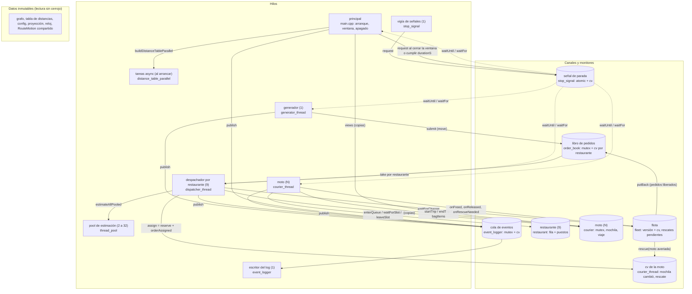

# Equipetrol Delivery

Simulación concurrente de despacho de pedidos en la Zona Equipetrol, Santa Cruz de la Sierra.
Proyecto final del curso LIA-221 Computación Concurrente, Paralela y Distribuida.

El informe final, con las herramientas, los experimentos y las dependencias, está en [INFORME.pdf](INFORME.pdf).

## Pasos para correr todo

Hace falta CMake 3.11 o superior, `make`, un compilador con C++17 (g++ 7 o clang equivalente) y
Python 3 con su librería estándar. OpenCV es opcional: con él se abre la ventana del mapa; sin él
todo lo demás funciona igual. No hay nada más que instalar: la única biblioteca externa viene en
`third_party/`.

1. Compilar, desde la raíz del repositorio:

   ```sh
   mkdir -p build && cd build
   cmake .. && make
   ```

2. Correr la simulación con la ventana del mapa. Dura una hora simulada, un minuto real, y al
   terminar imprime el resumen en una línea JSON y deja `events.log` en `build`. Se puede cortar
   antes con Ctrl+C o cerrando la ventana.

   ```sh
   ./delivery_sim ../config/equipetrol.json
   ```

3. Verificar que el log de esa corrida cumple las reglas, pedido por pedido:

   ```sh
   python3 ../tools/check_log.py events.log --config ../config/equipetrol.json
   ```

   Termina con `check_log: sin errores`.

4. Correr las 30 pruebas automáticas:

   ```sh
   ctest --output-on-failure
   ```

   Termina con `100% tests passed, 0 tests failed out of 30`.

5. Correr el escenario de pedidos urgentes, verificar el log con el resumen y mostrar los dos casos
   de prioridad en el log:

   ```sh
   ./delivery_sim ../config/urgentes_3_motos.json --no-window --log urgentes.log > resumen.txt
   python3 ../tools/check_log.py urgentes.log --summary resumen.txt --config ../config/urgentes_3_motos.json
   python3 ../tools/urgent_cases.py urgentes.log
   ```

6. Opcional, las herramientas de concurrencia y memoria, desde la raíz del repositorio. La primera
   construye con ThreadSanitizer en `build/tsan` y corre tres escenarios; la segunda necesita Docker
   y corre AddressSanitizer con LeakSanitizer en Linux. Las dos dejan su reporte en `tools/reports/`.

   ```sh
   sh tools/run_tsan.sh
   sh tools/run_asan_linux.sh
   ```

Todo lo que sigue es el detalle de cada parte.

## Compilación

```sh
mkdir build && cd build
cmake .. && make
./delivery_sim ../config/equipetrol.json
```

Los flags opcionales son `--log <ruta>`, que cambia el archivo del log de eventos (por defecto
`events.log`), y `--no-window`, que corre sin la ventana del mapa (es lo que usan las pruebas).

## Pruebas y herramientas

```sh
ctest --output-on-failure            # 30 pruebas: una por módulo más configuración, simulación y verificador
cmake -DENABLE_TSAN=ON .. && make    # o -DENABLE_ASAN=ON; no se combinan
sh tools/run_tsan.sh                 # corrida completa con ThreadSanitizer; reporte en tools/reports/
sh tools/run_asan_linux.sh           # AddressSanitizer y LeakSanitizer en Linux con Docker
python3 tools/check_log.py events.log --config config/equipetrol.json
```

`tools/check_log.py` verifica un log y su resumen contra las reglas de las secciones 4, 6 y 7 del
enunciado. Los reportes sin editar de las dos herramientas están en `tools/reports/`.

## Esquema del programa

Hilos, canales y datos compartidos tal como están en el código. Cada caja de hilo nombra el módulo
que lo implementa; cada canal es un monitor (mutex y variable de condición) o un dato inmutable.



Los datos inmutables (grafo, tabla de distancias, configuración, proyección, reloj una vez
arrancado, y cada `RouteMotion` compartido por `shared_ptr`) los leen todos los hilos sin cerrojo;
no se dibujan sus aristas para no cruzar el diagrama.

| Hilo | Cuántos | Duerme en | Despierta por | Produce |
|---|---|---|---|---|
| principal | 1 | `waitKey` entre cuadros, o `StopSignal::waitUntil` sin ventana | fin de `durationS`, señal, ventana cerrada | cuadros; el apagado ordenado |
| generador | 1 | `StopSignal::waitUntil` hasta la próxima ráfaga | el reloj simulado o la parada | pedidos al libro, `orderCreated`, `orderRejected` |
| despachador | uno por restaurante | `OrderBook::take` (su cola) y `Fleet::waitForChange` (sin moto, con plazo) | pedido nuevo, entrega o reparación, cierre del libro, parada | reservas en las motos, `orderAssigned`, `orderReassigned`, `orderRejected` (`noCourier`) |
| moto | `fleet.couriers` | su cv (mochila vacía), `Restaurant::waitForSlot`, `StopSignal::waitUntil` por tramo y espera | asignación o rescate, turno en la fila, el reloj simulado, la parada | viajes, recogidas, entregas, averías, traspasos y sus eventos |
| escritor del log | 1 | cv de la cola de eventos | eventos publicados o cierre | líneas JSON del log y el resumen |
| vigía de señales | 1 | `read` sobre un pipe | `SIGINT` o `SIGTERM` (el manejador escribe un byte) | `StopSignal::request` |
| pool de estimación | 2 a 32 según el hardware | cv de la cola del pool | tareas enviadas o `stop` | estimaciones por `future` |
| tareas async | tantas como orígenes, solo al arrancar | ninguna (fan-out/fan-in) | se unen al terminar | filas de la tabla de distancias |

Orden de arranque: flota, despachadores, generador. Orden de apagado: `stop.request`, unir el
generador, `simulationStopping`, cerrar el libro, unir despachadores, unir flota (despierta filas y
cv de flota), vaciar el libro, cerrar el log. Ningún hilo espera a otro que dependa de uno que aún
no se despertó, y ningún monitor llama a otro bajo su cerrojo salvo el traspaso entre dos motos,
que toma los dos con `std::scoped_lock`.
## Módulos

Cada módulo tiene su prueba en `tests/` y su explicación en [INFORME.pdf](INFORME.pdf) y en el mapa
de conceptos de abajo. El código no lleva comentarios a propósito: esta tabla y el mapa son la
explicación.

| Módulo | Qué hace |
|---|---|
| `config` | Lee y valida el JSON (sección 5 del enunciado); sale con error antes de simular si algo falta o apunta a un nodo inexistente. |
| `order` | El pedido: estados `created → assigned → pickedUp → delivered`, `rejected`, `pending`; solo movible, así existe en un único lugar a la vez. |
| `sim_clock` | Reloj simulado sobre `steady_clock` con `timeScale`; inmutable tras arrancar. |
| `event_log`, `event_logger` | Los eventos de la sección 6.2 (`orderCreated` lleva `urgent`) y el resumen 6.3 más `urgentCreated`, `urgentDelivered` y `avgUrgentDeliveryMs`; una cola productor-consumidor con un solo hilo escritor, una línea JSON por evento. |
| `graph`, `distance_table`, `distance_table_parallel` | Grafo dirigido de calles con Dijkstra; tabla de distancias en serie y en paralelo (una tarea `std::async` por grupo de orígenes, escrituras disjuntas). |
| `map_projection`, `route_motion` | Lat/lon a píxel; posición de una moto sobre su ruta en cualquier instante, objeto inmutable compartido por `shared_ptr`. |
| `order_generator`, `generator_thread` | Pedidos a intervalos exponenciales con ráfagas, urgentes con `urgentProbability`, reproducibles por semilla; el hilo que los mete al libro durmiendo en la señal de parada. |
| `order_book` | Monitor con un mutex y una cola por restaurante con su variable de condición; límite `maxPending` global; posición en cola por scan exclusivo. `take` elige por prioridad bajo el candado (envejecido, urgente, normal; dentro de cada nivel el más antiguo), `nextWakeMs` da el próximo plazo de la cola y `takeExpired` saca los vencidos. |
| `estimate`, `dispatch_select` | Estimación de entrega como función pura sobre una copia de la moto; selección por anillos de radio creciente con map (serie, `async` o pool) y reduce. |
| `dispatcher_thread` | Un hilo por restaurante: rechaza los vencidos de su cola, toma por prioridad, copia la flota, estima en el pool, reserva; reintenta si otro ganó la moto; sin moto devuelve el pedido al libro y duerme hasta que algo cambie o venza el próximo plazo. |
| `courier`, `courier_thread` | La moto como monitor (mochila con reserva atómica, copias para estimar y dibujar, traspaso con `scoped_lock`) y su hilo (duerme en su cv, viaja tramo a tramo, hace fila, recoge, entrega el destino más cercano, se avería y rescata). |
| `restaurant`, `restaurants` | Monitor con `pickupSlots` puestos y fila por orden de llegada; espera prevista por scan. |
| `fleet` | Dueña de motos e hilos; copias de la flota; versión más cv para esperar sin sondeo; elección de la moto de rescate. |
| `breakdown` | Sorteo de averías con un generador por moto derivado de la semilla; recuperación tras `kRepairMs`. |
| `thread_pool`, `hardware` | Pool con cola, `packaged_task` y `notify_all` al parar; tamaño por `hardware_concurrency` acotado entre 2 y 32. |
| `stop_signal` | Bandera atómica más cv; SIGINT/SIGTERM convertidos en la orden de parar por un pipe y un hilo vigía. |
| `live_counters` | Contadores por moto, cada uno en su línea de caché, con `fetch_add` relajado. |
| `window`, `fleet_view` | Ventana OpenCV: capa estática (mapa, calles, restaurantes, atribución) y capa viva (motos por estado, entregas, panel de la sección 6.3), siempre desde copias. |
| `main` | Arranque (flota, despachadores, generador), bucle de dibujo y apagado ordenado en menos de 5 s. |

## Mapa de conceptos

Las dieciséis filas de la sección 10 del enunciado. Para cada una, el archivo y el lugar donde se usa
el concepto, y por qué es el correcto ahí y qué saldría mal sin él.

| Carpeta · concepto | Archivo y lugar | Por qué es el correcto ahí |
|---|---|---|
| 01 · Creación explícita de hilos y un destino deliberado (join) para cada hilo | `generator_thread.cpp`, `dispatcher_thread.cpp`, `courier_thread.cpp`, `event_logger.cpp`, `stop_signal.cpp` (`SignalWatcher`), `thread_pool.cpp`: cada uno crea su `std::thread` en `start()` y lo une en `join()`, que también llama el destructor; `main.cpp` fija el orden de los `join` en el apagado | Cada hilo tiene un dueño que lo une antes de destruir lo que el hilo usa. Sin eso, un hilo abandonado tocaría objetos ya destruidos al salir, y el enunciado exige que ninguno quede abandonado. |
| 01 · Una decisión que depende del paralelismo disponible | `hardware.cpp`: `recommendedPoolSize()` dimensiona el pool con `hardware_concurrency` acotado entre 2 y 32 (`main.cpp`), y `defaultTaskCount()` reparte la tabla de distancias en tantas tareas como hilos (`distance_table_parallel.cpp`) | Más tareas que núcleos solo añaden cambios de contexto (el barrido del experimento baja de 8,9x a 7,0x con 36 tareas); menos desaprovechan la máquina. Un número fijo sería correcto solo en la máquina donde se escribió. |
| 02 · Datos a un hilo por valor, por referencia y por move, cada uno donde es la elección correcta | Por referencia: `CourierThread` recibe `Courier&`, `Graph&`, `Restaurants&`, objetos que viven más que el hilo. Por valor: las tareas de estimación capturan su `CourierSnapshot` (`dispatch_select.cpp`, `[one, c]`) y una copia del pedido en `shared_ptr` (`dispatcher_thread.cpp`). Por move: `GeneratorThread` mueve la ráfaga al libro con `submit(OrderBatch&&)` | Una referencia a algo que muere antes que el hilo es un puntero colgante: una estimación tardía leería un pedido ya movido a la moto. Copiar lo que vive menos y referenciar lo que vive más es la regla. |
| 02 · Pedidos que viajan por el sistema mediante move semantics, existiendo en un solo lugar a la vez | `order.h`: `Order` es solo movible (copia borrada). `order_book.cpp` (`submit`, `take`, `putBack`), `courier.cpp` (`reserve`, `removeOrder`, `takeBag`, `takeOverFrom`) lo mueven de un dueño al siguiente | Si el pedido se copiara, podría estar en el libro y en una mochila a la vez, que es exactamente lo que la sección 4 prohíbe; el compilador lo impide. |
| 03 · Funciones miembro de objetos compartidos ejecutándose en hilos; contenedores de hilos | Cada hilo corre una función miembro (`[this] { run(); }`); `thread_pool.cpp` guarda sus trabajadores en un `std::vector<std::thread>` y `fleet.cpp` las motos y sus hilos en vectores de `unique_ptr` | El objeto vive más que su hilo porque el destructor une antes de liberar los miembros; el contenedor permite arrancar y unir N hilos con un bucle, con N decidido en tiempo de ejecución. |
| 03 · Propiedad compartida que garantiza el tiempo de vida; ningún puntero crudo propietario | `courier.h`: el viaje en curso es `std::shared_ptr<const RouteMotion>`, compartido entre la moto y las copias que dibuja la ventana; `thread_pool.h`: la `packaged_task` va en `shared_ptr` para que la cola la copie; `fleet.cpp` y `restaurants.cpp` poseen con `unique_ptr` | La ventana puede seguir dibujando un viaje cuando la moto ya empezó otro: el objeto vive mientras alguien lo use y se libera solo. Con un puntero crudo habría que decidir quién borra, y acertar siempre. |
| 04 · Tareas que devuelven un resultado a través de un future, con política de lanzamiento explícita | `distance_table_parallel.cpp` y `dispatch_select.cpp` (`estimateAllAsync`): `std::async(std::launch::async, …)`; `thread_pool.h`: `submit` devuelve el `future` de una `packaged_task` | `launch::async` garantiza un hilo; con la política por defecto la tarea podría ser diferida y ejecutarse en el `get()`, en el hilo del despachador, que es lo contrario de lo que se quiere. |
| 04 · Un par promise/future como canal de un solo uso entre dos hilos | `thread_pool.h` y `dispatch_select.cpp` (`collect`): cada estimación es una `packaged_task` (una promesa con su callable) cuyo `future` el despachador consume una sola vez con `get()` | El resultado cruza del hilo del pool al despachador exactamente una vez, con el valor o con la excepción; una cola o una variable compartida obligarían a sincronizar a mano un dato que se produce una sola vez. |
| 04 · Una espera con límite de tiempo, y una excepción que cruza de un hilo a otro | `dispatch_select.cpp` (`collect`): `wait_until(deadline)` con un único instante para todos los futures y `get()` que relanza el `EstimateError` lanzado en el hilo de la tarea; `fleet.cpp` (`waitForChange` con plazo) y `stop_signal.h` (`waitUntil`) usan `wait_until` con `steady_clock` | El enunciado pide `quoteTimeoutMs` y que un fallo de estimación llegue como error: el `future` transporta la excepción y el plazo acota la espera. Con `system_clock` un cambio de hora movería los plazos. |
| 05 · Un argumento escrito, por cada objeto compartido, de por qué no es posible un data race sobre él | La tabla de abajo, y las secciones de cada módulo en este README | Sin el argumento se confía en que "se ve bien"; ThreadSanitizer confirma, pero no explica. |
| 05 · Un tipo que es seguro copiar o mover porque sus funciones miembro especiales son correctas | `order.h`: `Order` con copia borrada y move por defecto; `courier.h`, `restaurant.h`, `fleet.h`, `thread_pool.h`, `courier_thread.h`: copia borrada porque contienen un mutex o un hilo; `CourierSnapshot`, `CourierView`, `BagItem`: copiables porque solo tienen valores y un `shared_ptr<const>` | Copiar un objeto con mutex duplicaría un cerrojo que protege un estado que no se duplica; borrar la copia lo hace imposible. Las copias que sí existen son las que la ventana y la estimación necesitan. |
| 06 · Exclusión mutua solo mediante locks ligados a un ámbito; secciones críticas cortas | `std::lock_guard` y `std::unique_lock` en todos los monitores; `order_book.cpp` y `fleet.cpp` notifican fuera del cerrojo; `event_logger.cpp` intercambia la cola bajo el cerrojo y escribe fuera; `courier_thread.cpp` (`SlotGuard`) devuelve el puesto del restaurante en toda salida | Un `lock` manual se olvida en un `return` temprano o en una excepción y deja el cerrojo tomado para siempre; el RAII lo suelta siempre. Las secciones cortas evitan que la E/S o un Dijkstra retengan a los demás. |
| 06 · Una operación que necesita dos locks a la vez, y la razón por la que no puede producir deadlock | `courier.cpp` (`takeOverFrom`): `std::scoped_lock lock(mutex_, broken.mutex_)` toma los dos cerrojos de las mochilas con el algoritmo de `std::lock`, sin orden fijo y sin interbloqueo aunque dos rescates se crucen; en el resto del programa ningún monitor llama a otro bajo su cerrojo | Tomarlos uno tras otro permitiría que dos traspasos cruzados se esperaran mutuamente; el traspaso debe ser todo o nada para que ningún observador vea un pedido en dos mochilas o en ninguna. |
| 07 · Objetos monitor: datos compartidos a los que no se puede acceder sin su lock | `order_book`, `restaurant`, `courier`, `fleet`, `event_logger`, `thread_pool`: datos privados, un mutex, y métodos públicos que lo toman; lo que sale, sale por copia o por move | Si el estado fuera accesible desde fuera, cada llamante tendría que recordar el cerrojo; el monitor lo garantiza en un solo lugar y las copias evitan retenerlo mientras se estima o se dibuja. |
| 07 · Hilos que se bloquean hasta que se cumple una condición, despertados por otro hilo, robustos ante despertares que no traen novedades y ante un despertar final para el apagado | Todas las esperas usan `wait` con predicado: `courier_thread.cpp` (mochila cambió o rescate), `restaurant.cpp` (`waitForSlot`), `order_book.cpp` (`take`), `fleet.cpp` (`waitForChange` compara versiones), `thread_pool.cpp`, `event_logger.cpp`, `stop_signal.h`; el apagado despierta con `close`, `wake`, `stop` y `notify_all` | El predicado vuelve inofensivo un despertar espurio o uno sin novedad; comparar versiones evita el despertar perdido; sin el despertar final, un hilo dormido en una fila o en la flota nunca terminaría y el apagado no cumpliría los 5 s. |

Objetos compartidos y por qué no hay data race sobre ellos:

| Objeto | Argumento |
|---|---|
| grafo, tabla de distancias, configuración, proyección, reloj arrancado | Inmutables después de construirse en el hilo principal, antes de arrancar los demás; solo lecturas concurrentes. |
| `RouteMotion` de cada viaje | Inmutable; se comparte por `shared_ptr<const>`, así nadie puede escribirlo. |
| libro de pedidos | Un solo mutex para todo el estado; los pedidos entran y salen por move, nunca hay dos dueños. |
| cada moto (`Courier`) | Todo acceso bajo su mutex; lo que otros hilos necesitan sale por copia (`estimateSnapshot`, `view`, `bagItems`). |
| restaurante | Fila y puestos bajo un mutex; el puesto se devuelve con RAII. |
| flota | La lista de motos es inmutable tras construir; la versión y los rescates pendientes van bajo su mutex. |
| cola de eventos y archivo del log | La cola bajo mutex; el archivo lo escribe solo el hilo escritor; el resumen se lee después de `close`. |
| contadores en vivo | Atómicos con un único escritor cada uno; la ventana solo lee; cada uno en su línea de caché. |
| señal de parada | Un `atomic<bool>` que solo pasa de falso a verdadero, más una cv para despertar. |
| cola del pool | Bajo mutex; la `packaged_task` se mueve al trabajador y su `future` tiene un solo consumidor. |
## Experimentos

`tools/run_experiments.py` corre `delivery_sim` con varias configuraciones derivadas de una base, en
procesos paralelos, y agrega los resultados en una tabla Markdown con el JSON crudo al lado:

```sh
python3 tools/run_experiments.py --bin build/delivery_sim --config config/equipetrol.json \
    --vary fleet.bagCapacity=1,2,3,4 --seeds 42,7,2024 --duration 1800 --scale 600 \
    --jobs 4 --out tools/reports/exp_bag.md
```

`--vary` toma una ruta de clave del config y los valores a probar, y se puede repetir para combinar
varias claves; `--set` fija otras claves en todas las corridas. Cada combinación se corre una vez
por semilla, con `--no-window`; de cada corrida se toman el resumen final, el mensaje de cierre
(asignados, reintentos, estimaciones tardías, averías, rescates) y el tiempo real, y el log se
verifica con `check_log.py`. La tabla muestra las medias por configuración y cuántas corridas
terminaron bien; `ctest` incluye una corrida mínima del corredor.

### Experimento de despacho

`tools/reports/exp_despacho.md` compara el map de estimaciones en serie, con una tarea `std::async`
por candidato y sobre el pool. `dispatch_bench` (se construye con `make dispatch_bench`) mide el map
aislado para anillos de 1 a 512 candidatos y para estimaciones artificialmente caras, y el corredor
de experimentos corre la simulación completa con cada variante usando la clave de configuración
`dispatch.estimator` (`serial`, `async` o `pool`; por defecto `pool`). El reporte incluye el
análisis con la ley de Amdahl con sobrecarga y el cambio de diseño de `async` a pool con su antes y
después.

### Experimentos del sistema

`tools/reports/exp_sistema.md` reúne cuatro experimentos: la tabla de distancias en serie frente a
paralela por número de orígenes y el barrido de tareas (`distance_bench`, se construye con
`make distance_bench`), y los puestos de recogida, la capacidad de la mochila y la probabilidad de
avería variados uno a uno con el corredor sobre una hora simulada. El corredor admite `*` en la
ruta de la clave para aplicar un valor a todos los elementos de una lista (`restaurants.*.pickupSlots`).
## Pedidos urgentes

Extensión del enunciado: algunos pedidos son urgentes y el despachador los atiende antes; un
normal que espera más de `agingMs` envejece y pasa a tratarse con prioridad. Dos propiedades
opcionales en `orders` del config, con valor por defecto 0: `urgentProbability` (en [0, 1]) y
`agingMs` (entero simulado, 0 = sin envejecimiento).

- El orden lo decide `OrderBook::take` bajo el candado del libro, en el momento de sacar: primero
  los envejecidos (normales con `ahora − creación ≥ agingMs`), después los urgentes, después los
  normales; dentro de cada nivel el más antiguo, y a igual instante el id menor. Que el envejecido
  vaya por encima del urgente es una decisión propia: el envejecimiento existe para que nadie
  espere para siempre.
- Si no hay moto con lugar, el despachador devuelve el pedido al libro y duerme en la flota hasta
  que entre un pedido, una moto libere lugar, venza el próximo plazo de su cola (el
  `acceptTimeoutMs` o el envejecimiento más cercano, calculado por el libro) o se pida parar. Al
  despertar rechaza con `noCourier` los vencidos que nunca tuvieron moto y vuelve a elegir.
- `orderCreated` lleva `"urgent": true|false`; el resumen agrega `urgentCreated`,
  `urgentDelivered` y `avgUrgentDeliveryMs`, y `check_log.py` los recalcula desde el log.

### Cómo comprobarlo

Dos configuraciones listas, derivadas de `config/equipetrol.json`: `config/urgentes_3_motos.json`
(`urgentProbability` 0.3, `agingMs` 300000, 3 motos, para que se forme cola) y
`config/urgentes_1_moto.json` (lo mismo con 1 moto y mochila 1, sin fin por tiempo). Desde `build`:

```sh
./delivery_sim ../config/urgentes_3_motos.json --no-window --log urgentes.log > resumen.txt
python3 ../tools/check_log.py urgentes.log --summary resumen.txt --config ../config/urgentes_3_motos.json
python3 ../tools/urgent_cases.py urgentes.log
```

La primera línea corre una hora simulada (un minuto real) y deja el log y el resumen; la segunda
verifica el log y recalcula los tres contadores de urgentes; la tercera busca y muestra los dos
casos de prioridad: un urgente creado después de un normal y asignado mientras ese normal
seguía esperando, y un normal envejecido asignado mientras un urgente más nuevo seguía esperando. Para ver los urgentes
en el log, `grep '"urgent":true' urgentes.log`.

Para comprobar que el despachador duerme y no gira, con una sola moto y cola de pedidos:

```sh
./delivery_sim ../config/urgentes_1_moto.json --no-window --log una.log &
sleep 10; ps -o %cpu,time -p $!; kill -INT $!
```

El uso de CPU del proceso queda en 0 %; la señal lo cierra en milisegundos y el log pasa el
verificador. Con ThreadSanitizer, `cmake -DENABLE_TSAN=ON .. && make` en otra carpeta y los mismos
comandos. Las corridas hechas con estos comandos, incluidas las de ThreadSanitizer, están sin editar en
`tools/reports/variante_a_20261024.txt`.

## Mapa y datos

La imagen es de OpenStreetMap, recortada al polígono de la zona entre el Segundo y el Cuarto Anillo
(`data/equipetrol_zone.json`), 712×991 píxeles, con sus límites en `config/equipetrol.json`. La red
de calles se extrajo de OpenStreetMap: 320 intersecciones, 472 segmentos (314 de un solo sentido) y
nueve restaurantes reales de la Av. San Martín. Los scripts que la generan, solo con la librería
estándar de Python:

```sh
python3 tools/make_map.py --zone data/equipetrol_zone.json --zoom 16 --out data/equipetrol.png
python3 tools/extract_network.py --zone data/equipetrol_zone.json --out data/equipetrol_network.json
python3 tools/make_config.py
```

## Dependencias

- cmake ≥ 3.11
- make
- g++ ≥ 7 o clang equivalente, con soporte C++17
- nlohmann/json 3.12.0 (incluida en `third_party/nlohmann/`, licencia MIT; no requiere instalación)
## Atribución del mapa

Los datos y la imagen del mapa provienen de OpenStreetMap, publicados bajo la licencia ODbL.
© OpenStreetMap contributors
