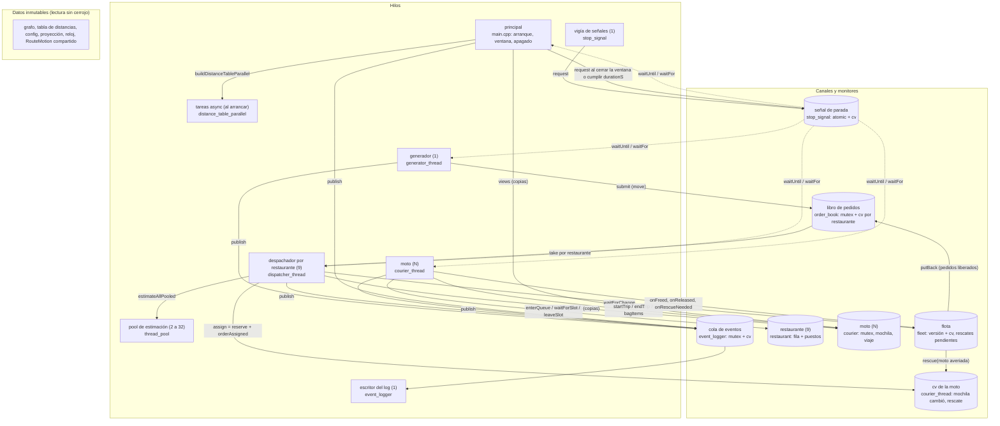

# Equipetrol Delivery

Simulación concurrente de despacho de pedidos en la Zona Equipetrol, Santa Cruz de la Sierra.
Proyecto final del curso LIA-221 Computación Concurrente, Paralela y Distribuida.

## Esquema del programa

Hilos, canales y datos compartidos tal como están en el código. Cada caja de hilo nombra el módulo
que lo implementa; cada canal es un monitor (mutex y variable de condición) o un dato inmutable.



Los datos inmutables (grafo, tabla de distancias, configuración, proyección, reloj una vez
arrancado, y cada `RouteMotion` compartido por `shared_ptr`) los leen todos los hilos sin cerrojo;
no se dibujan sus aristas para no cruzar el diagrama.

| Hilo | Cuántos | Duerme en | Despierta por | Produce |
|---|---|---|---|---|
| principal | 1 | `waitKey` entre cuadros, o `StopSignal::waitUntil` sin ventana | fin de `durationS`, señal, ventana cerrada | cuadros; el apagado ordenado |
| generador | 1 | `StopSignal::waitUntil` hasta la próxima ráfaga | el reloj simulado o la parada | pedidos al libro, `orderCreated`, `orderRejected` |
| despachador | uno por restaurante | `OrderBook::take` (su cola) y `Fleet::waitForChange` (sin moto, con plazo) | pedido nuevo, entrega o reparación, cierre del libro, parada | reservas en las motos, `orderAssigned`, `orderReassigned`, `orderRejected` (`noCourier`) |
| moto | `fleet.couriers` | su cv (mochila vacía), `Restaurant::waitForSlot`, `StopSignal::waitUntil` por tramo y espera | asignación o rescate, turno en la fila, el reloj simulado, la parada | viajes, recogidas, entregas, averías, traspasos y sus eventos |
| escritor del log | 1 | cv de la cola de eventos | eventos publicados o cierre | líneas JSON del log y el resumen |
| vigía de señales | 1 | `read` sobre un pipe | `SIGINT` o `SIGTERM` (el manejador escribe un byte) | `StopSignal::request` |
| pool de estimación | 2 a 32 según el hardware | cv de la cola del pool | tareas enviadas o `stop` | estimaciones por `future` |
| tareas async | tantas como orígenes, solo al arrancar | ninguna (fan-out/fan-in) | se unen al terminar | filas de la tabla de distancias |

Orden de arranque: flota, despachadores, generador. Orden de apagado: `stop.request`, unir el
generador, `simulationStopping`, cerrar el libro, unir despachadores, unir flota (despierta filas y
cv de flota), vaciar el libro, cerrar el log. Ningún hilo espera a otro que dependa de uno que aún
no se despertó, y ningún monitor llama a otro bajo su cerrojo salvo el traspaso entre dos motos,
que toma los dos con `std::scoped_lock`.

## Compilación

```sh
mkdir build && cd build
cmake .. && make
./delivery_sim ../config/equipetrol.json
```

Los flags opcionales son `--log <ruta>`, que cambia el archivo del log de eventos (por defecto
`events.log`), y `--no-window`, que corre sin la ventana del mapa (es lo que usan las pruebas).

### Validación del archivo de configuración

El programa rechaza el archivo, con un mensaje en stderr y estado de salida distinto de cero y sin
iniciar ninguna simulación, cuando:

- falta el argumento, el archivo no se puede leer o el JSON está mal formado;
- falta una propiedad obligatoria o tiene un tipo inválido;
- `nodes` está vacío, o una calle, un restaurante o `fleet.startNode` apunta a un nodo que no existe;
- un valor sale del rango que declara la tabla de la sección 5: `fleet.couriers`, `fleet.bagCapacity`,
  `orders.burstMax` y `pickupSlots` deben ser ≥ 1, y `breakdownProbability` estar entre 0 y 1;
- `prepTimeMs` no es un array `[min, max]`;
- la imagen `map.image` no se puede leer.

No se comprueba nada más, para no rechazar archivos válidos que sigan el formato del enunciado.
Un archivo mínimo y válido está en `tests/config/minimal.json`; los casos inválidos están en
`tests/invalid/` y `ctest` los ejecuta con `tests/run_config_tests.sh`.

### Proyección del mapa

El módulo `map_projection` convierte latitud y longitud a píxeles de la imagen y viceversa con los
límites de `map.bounds`: la esquina noroeste es el píxel (0, 0) y la sureste es (ancho, alto). Como
la imagen se recortó exactamente a esos límites, la conversión es lineal en cada eje. Es lo que la
ventana usa para dibujar restaurantes, motos y puntos de entrega en su posición real.

### Tabla de distancias

El módulo `distance_table` calcula una vez, al arrancar, la distancia más corta desde cada
restaurante hasta todos los nodos (un Dijkstra uno-a-todos por restaurante). Después cada consulta
es una lectura. La función `computeRow` es la unidad de trabajo: una fila por origen, lo que
permite construir la tabla en paralelo repartiendo los orígenes entre tareas. La tabla es inmutable
y se consulta desde cualquier hilo sin cerrojo.

La tabla se construye en paralelo (`distance_table_parallel`): los orígenes se reparten entre
tantas tareas como núcleos informe `hardware_concurrency`, cada tarea lanzada con `std::async`
calcula las filas de su grupo y las escribe en posiciones disjuntas de un vector ya dimensionado,
sin ningún cerrojo, y al final se esperan todas las tareas. Si una tarea lanza una excepción, llega
a quien construye la tabla a través de su future. El test compara la tabla paralela con la serial
celda por celda y mide los tiempos de ambas.

### Pool de hilos

El módulo `thread_pool` crea N hilos una sola vez y los reutiliza: los trabajos entran a una cola
protegida por un mutex y una variable de condición, cada hilo duerme sin consumir CPU hasta que
haya trabajo, y cada trabajo enviado con `submit` devuelve un future con su resultado o con la
excepción que lanzó (`packaged_task`). El mutex cubre solo la cola; los trabajos corren fuera del
cerrojo. `stop` termina lo pendiente, despierta a todos los hilos y hace `join`. Es la base de las
estimaciones concurrentes del despachador.

El tamaño del pool lo decide el módulo `hardware`: un hilo por hilo de hardware según
`hardware_concurrency`, nunca menos de 2 (para que haya concurrencia real aunque la máquina tenga
un núcleo o no informe) ni más de 32 (los candidatos de un pedido son pocas decenas). El programa
registra la decisión al arrancar. El mismo módulo decide cuántas tareas usan los precálculos.

### Parada y señales

El módulo `stop_signal` tiene la orden de parar compartida por todos los hilos. Leerla es una
bandera atómica; esperarla es una variable de condición, así los hilos duermen sin CPU y una sola
llamada a `request` los despierta a todos. Toda espera de tiempo simulado (un viaje, una
preparación) se hace con `waitUntil`, que termina al vencer el plazo o al pedirse la parada, lo que
ocurra primero. `SignalWatcher` convierte SIGINT y SIGTERM en esa orden: el manejador de señal solo
escribe un byte en un pipe, lo único seguro dentro de un manejador, y un hilo vigía que duerme en
`read` sobre ese pipe pide la parada al recibirlo.

### Movimiento de las motos

El módulo `route_motion` describe el viaje de una moto por una ruta a `fleet.speedKmh`, a partir
de un instante simulado de salida. Con eso, la posición en cualquier instante se calcula
(`positionAt`) sin que el repartidor tenga que actualizarla cuadro a cuadro: la ventana consulta
el viaje y dibuja el punto avanzando suave por la calle. También da la duración de cada tramo, que
es lo que el repartidor espera entre nodo y nodo.

### Estimación de entrega

El módulo `estimate` calcula, como función pura, cuándo entregaría un repartidor un pedido si lo
tomara ahora: trayecto hasta el restaurante desde el nodo donde quedará libre, espera hasta que el
pedido esté preparado, recogida (60 s simulados), trayecto hasta el cliente y entrega en la puerta
(60 s simulados). Recibe una copia de los datos del repartidor, así la tarea que estima no comparte
nada con el hilo de la moto. Si la mochila está llena o no hay ruta, lanza `EstimateError`: ese es
el error que el despachador recibe de una estimación fallida y sobrevive.

### Estado del repartidor

El módulo `courier` guarda el estado de una moto: inactiva, yendo al restaurante, en fila,
recogiendo, llevando pedidos o averiada; el nodo donde está; el viaje en curso; y la mochila. Es
un monitor con su propio mutex, porque lo tocan varios hilos (el de la moto, los despachadores y la
ventana) y cada moto es independiente de las demás: un cerrojo por moto deja que dos despachadores
asignen a motos distintas a la vez. La mochila ocupa lugar desde la asignación (reserva), así dos
despachadores no pueden asignarle entre los dos más de `bagCapacity` pedidos; comprobar si hay
lugar y guardar el pedido es un único paso bajo el cerrojo. Un pedido entra y sale de la mochila
por `std::move`. Lo que necesitan otros hilos sale como copia: `estimateSnapshot` da el nodo donde
quedará libre y cuándo (el destino y la llegada del viaje en curso, o su nodo y ahora), y `view`
da lo que la ventana dibuja. El viaje es un `RouteMotion` inmutable compartido con `shared_ptr`,
así la ventana calcula la posición en cualquier instante sin volver a tomar el cerrojo. Entre los
pedidos ya recogidos, `nearestDelivery` elige el destino más cercano por calles desde el nodo actual.

### Selección del repartidor

El módulo `dispatch_select` decide a qué moto se le ofrece un pedido, trabajando solo sobre copias
(`CourierSnapshot`) y sin cerrojos. Alrededor del restaurante traza anillos de radio creciente
(300 m, 600 m, 1200 m, …, hasta cubrir a toda la flota), midiendo en línea recta hasta el nodo
donde cada moto quedará libre. En cada anillo aplica un map (una estimación de entrega por moto con
lugar en la mochila; las que no tienen ruta se descartan) y un reduce (la de menor hora de entrega,
y en empate el id menor, para que el resultado sea determinista). El primer anillo con alguna
estimación válida decide: una moto más rápida pero más lejana no se considera, que es la regla de
los apuntes. Cada moto se estima una sola vez porque los anillos son disjuntos. El resultado trae
el radio, los anillos recorridos y cuántas estimaciones costó, para los experimentos.
El map de cada anillo es intercambiable: `selectCourier` acepta un `Mapper`, y `estimateAllAsync`
es el concurrente: una tarea por candidato con `std::async(launch::async)`, espera de los resultados
hasta `dispatch.quoteTimeoutMs` (tiempo real), las que llegan tarde se ignoran y una estimación que
lanza `EstimateError` se descarta como error, sin tumbar al despachador. `estimateAllPooled` hace
lo mismo enviando las tareas al pool de estimación en vez de crear un hilo por candidato; sus
futures vienen de `packaged_task` y no se unen al destruirse, así una tarea tardía sigue en el pool
sin retener al despachador. El despachador usa el map sobre el pool, pasa a las tareas una copia
del pedido (una tardía puede seguir viva cuando el original ya se movió a la moto) y cuenta las
tardías.

### Restaurante

El módulo `restaurant` es el restaurante como monitor: `pickupSlots` puestos de recogida y una fila
por orden de llegada. Un repartidor entra en la fila (`enterQueue`, que devuelve su posición),
espera a ser el primero y a que haya un puesto libre (`waitForSlot`, dormido en la variable de
condición del restaurante), recoge y deja el puesto (`leaveSlot`), lo que despierta al siguiente.
La parada saca de la fila a quien esperaba. La espera de preparación del pedido es asunto del
repartidor, fuera de la fila, para no ocupar un puesto antes de tiempo. `expectedStartMs` da la
espera prevista de cada uno en la fila con un scan exclusivo de los tiempos de servicio repartido
entre los puestos, y `snapshot` copia la fila para la ventana. El `scan` de `scan.h` pasa a ser
genérico para servir tanto a posiciones como a tiempos.

### Sorteo de averías

El módulo `breakdown` decide si una moto se avería en un viaje. Cada moto tiene su propio generador,
derivado de la semilla global y de su índice con `std::seed_seq`, así el sorteo no comparte estado
entre hilos y la misma semilla reproduce las mismas averías para el mismo ritmo de viajes. Se
sortea una vez por viaje con `incidents.breakdownProbability` y, si toca, un tramo del viaje al
azar donde ocurre, para que la avería caiga "en un punto aleatorio del trayecto". Una moto averiada
vuelve al servicio tras `kRepairMs` (5 min simulados), un valor fijo porque la configuración del
enunciado no lo contempla. La avería en el hilo de la moto llega en el PR siguiente.

### Ventana

El módulo `window` dibuja el mapa con OpenCV. `MapWindow` carga la imagen de `map.image`, construye la
proyección a partir de `map.bounds` y pinta la capa estática una sola vez: las calles (doble sentido
en gris, sentido único en azul), los restaurantes (círculo naranja con su nombre) y la atribución de
OpenStreetMap en una banda al pie. `frame()` devuelve una copia de esa capa para dibujar encima la
flota en cada cuadro, y `show()` la muestra y espera unos milisegundos, devolviendo `false` si se
cierra la ventana o se pulsa `q` o Esc. El dibujo no toca ningún dato compartido: recibe copias.
OpenCV es opcional en la compilación: si CMake no lo encuentra, `delivery_sim` se construye sin
ventana (`HAVE_OPENCV` no definido) y el resto funciona igual.

### Contadores en vivo

El módulo `live_counters` guarda los contadores en vivo de cada moto (entregas, recogidas, averías)
en una estructura alineada a su propia línea de caché (`alignas(128)`, el tamaño de línea de Apple
Silicon, que cubre también los 64 bytes de x86). Cada hilo de moto incrementa solo los suyos con
`fetch_add` relajado, y la ventana los lee cuando quiere con `snapshot`. Sin la alineación, los
contadores de motos vecinas compartirían línea y cada incremento de una invalidaría la línea de la
otra (false sharing): la prueba mide ambas disposiciones con ocho hilos. La flota es dueña de los
contadores y se los da a cada hilo antes de arrancar. `main` arma por cuadro los contadores de la
sección 6.3 (creados y rechazados del generador, asignados y sin repartidor de los despachadores,
recogidos, entregados y averías de la flota, pendientes por diferencia) y la ventana los muestra en
la segunda línea de la banda superior.

### Capa viva de la flota

El módulo `fleet_view` dibuja sobre un cuadro de la ventana lo que cambia: cada moto como un círculo
con el color de su estado (gris inactiva, azul yendo al restaurante, amarillo en fila, naranja
recogiendo, verde entregando, rojo averiada) y la etiqueta `id ocupados/capacidad`; su posición sale
del viaje compartido (`RouteMotion::positionAt`) si está en uno, o de su nodo si no; los puntos de
entrega de los pedidos que lleva, como cuadrados magenta; y una banda superior con el tiempo
simulado y el conteo de motos por estado. Todo a partir de `CourierView`, la copia que da la flota:
el dibujo no toma ningún cerrojo ni interpola nada que no esté ya en la copia.

### Registro de restaurantes

`restaurants` guarda un `Restaurant` por entrada de la configuración, por id, y despierta a todos al
parar. El hilo de la moto y la flota lo reciben por referencia.

### Flota

El módulo `fleet` agrupa las motos y sus hilos: crea `couriers` repartidores `c0…cN-1` en el nodo de
partida con la mochila de la configuración, los arranca y los une. Ofrece copias de toda la flota
(`snapshots` para estimar, `views` para dibujar) y la asignación por id. Lleva además una versión
que cada entrega incrementa: un despachador que no encontró moto duerme en `waitForChange` hasta
que la flota cambie o se pida parar, sin sondear. El aviso llega del hilo de la moto por un gancho
`onFreed` que la flota instala antes de arrancar.

### Hilo despachador

El módulo `dispatcher_thread` es el despachador de un restaurante. Toma pedidos de su cola del libro
(y duerme ahí si no hay), copia la flota, elige con `selectCourier` y asigna. Si nadie puede
tomarlo, anota la versión de la flota que vio y duerme hasta que cambie o hasta que venza
`acceptTimeoutMs` contado desde la creación del pedido; si vence sin moto, lo rechaza con `noCourier`
(`orderRejected`). Ninguna espera activa.
Si la reserva falla porque otro despachador ganó esa moto entre la copia y la reserva, reintenta con
copias frescas. Al pedir parar devuelve al libro el pedido que tenía en la mano, así cuenta como
`pending`. Lleva contadores de asignaciones, reintentos y esperas para los experimentos.

### Hilo del repartidor

El módulo `courier_thread` es el hilo de cada moto. Sin pedidos duerme en su propia variable de
condición, sin consumir CPU; `assign` reserva el pedido, publica `orderAssigned` y lo despierta,
todo bajo el mutex del hilo para que ningún evento posterior del pedido se adelante en el log. Con
pedidos, va al restaurante del más antiguo, espera fuera de la fila a que estén listos los que lleva
de ese restaurante, hace fila por un puesto de recogida (`Queued`), recoge uno a uno con 60 s
simulados de mostrador cada uno (`PickingUp`) y suelta el puesto; después entrega los recogidos
empezando por el destino más cercano por calles, con 60 s en la puerta. El puesto se devuelve
también si la parada interrumpe la recogida (RAII). Si el sorteo de averías toca en un
tramo, al terminar ese tramo la moto queda `BrokenDown` en el nodo, publica `courierBreakdown`,
devuelve los pedidos aún no recogidos (sus reservas se liberan y vuelven al libro para que otro
los tome, lo que se registra como `orderReassigned` al asignarse de nuevo), espera `kRepairMs` y
vuelve al servicio avisando a la flota. Una moto averiada no se considera en la selección: la copia
para estimar la marca como tal. Si además lleva pedidos ya recogidos, pide
rescate: la flota elige la moto más cercana en línea recta con lugar en la mochila y le encarga ir
hasta la averiada, que se trata como un punto de recogida; al llegar, el traspaso entre las dos
mochilas es atómico (`std::scoped_lock` sobre los dos mutex) y publica `orderReassigned` por pedido.
Si ninguna moto puede, el rescate queda pendiente y se reintenta en cada cambio de la flota; si la
averiada se repara antes, entrega ella misma. La rescatista que no llega (se avería ella) devuelve el
encargo a la flota. Cada tramo y cada espera es un `StopSignal::waitUntil`
sobre el instante simulado: no hay sondeo y la parada lo interrumpe en el acto, dejándolo en el
último nodo alcanzado. La fila y los puestos de recogida llegan con el monitor del restaurante.

### Ejecución y apagado

`main` arma la simulación completa: carga y valida la configuración, construye el grafo y la tabla de
distancias, crea el reloj simulado, el log, el libro de pedidos, el generador, los restaurantes, la
flota (con el sorteo de averías y la devolución de reservas al libro) y un despachador por
restaurante. Arranca la flota, los despachadores y el generador, imprime la línea de inicio y espera
con la señal de parada hasta que se cumpla `durationS` o llegue SIGINT/SIGTERM, lo que ocurra
primero. El apagado es ordenado: se pide parar; se une el generador (nadie crea más pedidos); se
registra `simulationStopping`; se cierra el libro, con lo que los despachadores devuelven el pedido
que tuvieran en la mano y terminan; la flota saca a las motos de filas y viajes y las une; lo que
quedó en el libro y en las mochilas cuenta como `pending`; se cierra el log y se imprime el resumen.
Con ventana (la opción por defecto cuando se compiló con OpenCV), el hilo principal dibuja un cuadro
por iteración (`MapWindow::frame`, la capa viva de `fleet_view` desde `Fleet::views`) y espera unos
33 ms entre cuadros: esa es la única pausa periódica del programa y solo regula la tasa de cuadros.
Cerrar la ventana o pulsar `q` o Esc pide la parada ordenada igual que una señal. Con `--no-window`
el hilo principal espera dormido en la señal de parada hasta el fin, y así corren las pruebas.
Todas las demás esperas son sobre variables de condición o sobre la señal de parada: no hay sondeo.

### Generación de pedidos

El módulo `order_generator` produce la secuencia de pedidos a partir de `orders.seed`, con un
único generador aleatorio y un orden fijo de sorteos, así la misma semilla da exactamente la misma
secuencia. Las llegadas siguen intervalos exponenciales con media `meanIntervalMs`; una de cada
cinco llegadas es una ráfaga de 2 a `burstMax` pedidos en el mismo instante. Cada pedido recibe
un restaurante y un nodo de entrega al azar, y su hora de preparación lista dentro de `prepTimeMs`.
Si no existe camino dirigido del restaurante a la entrega, el pedido nace rechazado con
`unreachable`. Con el config de Equipetrol, cerca del 3 % de los pedidos son `unreachable`.

### Libro de pedidos

El módulo `order_book` es el único lugar donde esperan los pedidos aún no asignados. Es un monitor
con un solo mutex, porque el límite `orders.maxPending` es global y comprobar si hay lugar e insertar
deben ser un único paso; dentro hay una cola por restaurante con su propia variable de condición,
así el despachador de cada restaurante duerme hasta que llega un pedido suyo. Al recibir una ráfaga,
los pedidos que ya venían rechazados por `unreachable` pasan sin ocupar lugar, los demás entran
mientras haya lugar y el resto se rechaza con `queueFull`. La posición de cada pedido en la cola de
su restaurante se calcula con un scan exclusivo (`scan.h`) sobre la ráfaga: por restaurante, un
vector de ceros y unos y su suma prefija. Cada cola se atiende por antigüedad; un pedido devuelto
tras una avería vuelve al frente.

### Log de eventos y resumen

El log (`events.log` o la ruta de `--log`) lleva un objeto JSON por línea, con `t` en milisegundos
simulados y solo los campos que corresponden a cada evento, por ejemplo:

```json
{"t":15230,"event":"orderCreated","order":"o17","restaurant":"r3"}
{"t":15410,"event":"orderAssigned","order":"o17","courier":"c5"}
{"t":322900,"event":"orderRejected","order":"o21","reason":"unreachable"}
```

Los contadores del resumen final se actualizan al escribir cada línea, así que el resumen coincide
con el log por construcción: `created = delivered + rejected + pending`, y `avgDeliveryMs` y
`maxDeliveryMs` se miden desde `orderCreated` hasta `orderDelivered`.

El módulo `event_logger` pone ese log detrás de una cola productor-consumidor: todos los hilos
publican eventos con `publish`, y un único hilo escritor los saca y los escribe con `EventLog`. El
mutex cubre solo la cola; el escritor toma todo lo pendiente de una vez y escribe a disco fuera del
cerrojo, así quien publica nunca espera al disco. `close` escribe lo pendiente, une el hilo y deja
el resumen definitivo.

### Verificador del log

`tools/check_log.py` comprueba un log y su resumen contra las reglas de las secciones 4, 6 y 7,
como lo hará el programa de los evaluadores:

```sh
python3 tools/check_log.py events.log --summary resumen.json --config config/equipetrol.json
```

Revisa que cada línea sea un objeto JSON con exactamente las propiedades de su evento; que cada
pedido siga `created → assigned → pickedUp → delivered` sin saltos ni retrocesos y termine en un
solo estado final; que `t` nunca disminuya para un pedido; que cada pedido tenga un único
repartidor a la vez y los traspasos vayan del repartidor actual a otro; que `courierBreakdown`
libere las reservas no recogidas de esa moto (salen de su mochila y solo pueden volver por
`orderReassigned` a otra o por `orderAssigned` a la misma al repararse); con `--config`, que
ninguna mochila supere `bagCapacity` ni ningún restaurante tenga más repartidores recogiendo que
`pickupSlots`; que no se creen pedidos después de `simulationStopping`; y con `--summary`, que
cada contador del resumen sea igual a las líneas del log. Sale con 0 si no hay errores.

Con ThreadSanitizer (carreras de datos) o con AddressSanitizer (errores y fugas de memoria). Las
dos opciones instrumentan `delivery_sim` y todas las pruebas, y no pueden combinarse:

```sh
cmake -DENABLE_TSAN=ON .. && make
cmake -DENABLE_ASAN=ON .. && make
```

LeakSanitizer viene incluido con AddressSanitizer en Linux; en macOS con Apple Silicon no está
disponible, así que la detección de fugas se hace en Linux.

`tools/run_tsan.sh` hace la corrida completa bajo ThreadSanitizer y guarda la salida sin editar en
`tools/reports/tsan_<fecha>.txt`: construye `build/tsan`, corre la simulación con ráfagas y averías
frecuentes hasta el fin por tiempo, la repite con SIGINT a mitad, corre la prueba de estrés de
averías simultáneas, verifica cada log con `check_log.py` y cierra con el conteo de reportes del
sanitizer, de salidas con error y de logs con errores. Sale con 1 si cualquiera de los tres no es
cero. El reporte comprometido en el repositorio es la evidencia de la sección 11.

`tools/run_asan_linux.sh` hace lo mismo para la memoria, en Linux dentro de Docker, porque
LeakSanitizer no existe en macOS con Apple Silicon: construye la imagen de `tools/docker/Dockerfile.asan`
(Debian con `g++`, CMake y Python, sin OpenCV), compila el proyecto con `-DENABLE_ASAN=ON` en el
contenedor con el repositorio montado en solo lectura, corre toda la suite de `ctest` y los mismos
tres pasos con `ASAN_OPTIONS=detect_leaks=1`, y guarda `tools/reports/asan_linux_<fecha>.txt`
con el conteo de errores del sanitizer, de salidas con error y de logs con errores.

Pruebas unitarias (se construyen con `make` dentro de `build/`):

```sh
ctest --output-on-failure
```

Entre ellas, `tests/run_sim_tests.sh` corre el programa completo con configs derivados del de
Equipetrol y verifica cada corrida con `check_log.py`: fin por tiempo cumplido (con `queueFull`),
fin por SIGINT en menos de 5 s, fin por SIGTERM, y un ciclo completo de 40 minutos simulados en un
segundo real con preparación corta y averías frecuentes, que exige entregas, recogidas, averías y
reasignaciones reales y que el resumen cuadre con el log.

`tests/run_stress_test.sh` corre `breakdown_stress_test`: 24 motos, 400 pedidos, dos restaurantes y
probabilidad de avería 1, así todo viaje termina en avería y se encadenan liberaciones,
reasignaciones, rescates que también se averían y reparaciones. Exige que el apagado termine en
menos de 5 s, que los contadores cuadren, que lo pendiente esté en el libro o en una mochila, y
verifica el log con `check_log.py`. Es la prueba que se corre bajo ThreadSanitizer para buscar
carreras en el traspaso y las averías simultáneas.

## Mapa de conceptos

Las dieciséis filas de la sección 10 del enunciado. Para cada una, el archivo y el lugar donde se usa
el concepto, y por qué es el correcto ahí y qué saldría mal sin él.

| Carpeta · concepto | Archivo y lugar | Por qué es el correcto ahí |
|---|---|---|
| 01 · Creación explícita de hilos y un destino deliberado (join) para cada hilo | `generator_thread.cpp`, `dispatcher_thread.cpp`, `courier_thread.cpp`, `event_logger.cpp`, `stop_signal.cpp` (`SignalWatcher`), `thread_pool.cpp`: cada uno crea su `std::thread` en `start()` y lo une en `join()`, que también llama el destructor; `main.cpp` fija el orden de los `join` en el apagado | Cada hilo tiene un dueño que lo une antes de destruir lo que el hilo usa. Sin eso, un hilo abandonado tocaría objetos ya destruidos al salir, y el enunciado exige que ninguno quede abandonado. |
| 01 · Una decisión que depende del paralelismo disponible | `hardware.cpp`: `recommendedPoolSize()` dimensiona el pool con `hardware_concurrency` acotado entre 2 y 32 (`main.cpp`), y `defaultTaskCount()` reparte la tabla de distancias en tantas tareas como hilos (`distance_table_parallel.cpp`) | Más tareas que núcleos solo añaden cambios de contexto (el barrido del experimento baja de 8,9x a 7,0x con 36 tareas); menos desaprovechan la máquina. Un número fijo sería correcto solo en la máquina donde se escribió. |
| 02 · Datos a un hilo por valor, por referencia y por move, cada uno donde es la elección correcta | Por referencia: `CourierThread` recibe `Courier&`, `Graph&`, `Restaurants&`, objetos que viven más que el hilo. Por valor: las tareas de estimación capturan su `CourierSnapshot` (`dispatch_select.cpp`, `[one, c]`) y una copia del pedido en `shared_ptr` (`dispatcher_thread.cpp`). Por move: `GeneratorThread` mueve la ráfaga al libro con `submit(OrderBatch&&)` | Una referencia a algo que muere antes que el hilo es un puntero colgante: una estimación tardía leería un pedido ya movido a la moto. Copiar lo que vive menos y referenciar lo que vive más es la regla. |
| 02 · Pedidos que viajan por el sistema mediante move semantics, existiendo en un solo lugar a la vez | `order.h`: `Order` es solo movible (copia borrada). `order_book.cpp` (`submit`, `take`, `putBack`), `courier.cpp` (`reserve`, `removeOrder`, `takeBag`, `takeOverFrom`) lo mueven de un dueño al siguiente | Si el pedido se copiara, podría estar en el libro y en una mochila a la vez, que es exactamente lo que la sección 4 prohíbe; el compilador lo impide. |
| 03 · Funciones miembro de objetos compartidos ejecutándose en hilos; contenedores de hilos | Cada hilo corre una función miembro (`[this] { run(); }`); `thread_pool.cpp` guarda sus trabajadores en un `std::vector<std::thread>` y `fleet.cpp` las motos y sus hilos en vectores de `unique_ptr` | El objeto vive más que su hilo porque el destructor une antes de liberar los miembros; el contenedor permite arrancar y unir N hilos con un bucle, con N decidido en tiempo de ejecución. |
| 03 · Propiedad compartida que garantiza el tiempo de vida; ningún puntero crudo propietario | `courier.h`: el viaje en curso es `std::shared_ptr<const RouteMotion>`, compartido entre la moto y las copias que dibuja la ventana; `thread_pool.h`: la `packaged_task` va en `shared_ptr` para que la cola la copie; `fleet.cpp` y `restaurants.cpp` poseen con `unique_ptr` | La ventana puede seguir dibujando un viaje cuando la moto ya empezó otro: el objeto vive mientras alguien lo use y se libera solo. Con un puntero crudo habría que decidir quién borra, y acertar siempre. |
| 04 · Tareas que devuelven un resultado a través de un future, con política de lanzamiento explícita | `distance_table_parallel.cpp` y `dispatch_select.cpp` (`estimateAllAsync`): `std::async(std::launch::async, …)`; `thread_pool.h`: `submit` devuelve el `future` de una `packaged_task` | `launch::async` garantiza un hilo; con la política por defecto la tarea podría ser diferida y ejecutarse en el `get()`, en el hilo del despachador, que es lo contrario de lo que se quiere. |
| 04 · Un par promise/future como canal de un solo uso entre dos hilos | `thread_pool.h` y `dispatch_select.cpp` (`collect`): cada estimación es una `packaged_task` (una promesa con su callable) cuyo `future` el despachador consume una sola vez con `get()` | El resultado cruza del hilo del pool al despachador exactamente una vez, con el valor o con la excepción; una cola o una variable compartida obligarían a sincronizar a mano un dato que se produce una sola vez. |
| 04 · Una espera con límite de tiempo, y una excepción que cruza de un hilo a otro | `dispatch_select.cpp` (`collect`): `wait_until(deadline)` con un único instante para todos los futures y `get()` que relanza el `EstimateError` lanzado en el hilo de la tarea; `fleet.cpp` (`waitForChange` con plazo) y `stop_signal.h` (`waitUntil`) usan `wait_until` con `steady_clock` | El enunciado pide `quoteTimeoutMs` y que un fallo de estimación llegue como error: el `future` transporta la excepción y el plazo acota la espera. Con `system_clock` un cambio de hora movería los plazos. |
| 05 · Un argumento escrito, por cada objeto compartido, de por qué no es posible un data race sobre él | La tabla de abajo, y las secciones de cada módulo en este README | Sin el argumento se confía en que "se ve bien"; ThreadSanitizer confirma, pero no explica. |
| 05 · Un tipo que es seguro copiar o mover porque sus funciones miembro especiales son correctas | `order.h`: `Order` con copia borrada y move por defecto; `courier.h`, `restaurant.h`, `fleet.h`, `thread_pool.h`, `courier_thread.h`: copia borrada porque contienen un mutex o un hilo; `CourierSnapshot`, `CourierView`, `BagItem`: copiables porque solo tienen valores y un `shared_ptr<const>` | Copiar un objeto con mutex duplicaría un cerrojo que protege un estado que no se duplica; borrar la copia lo hace imposible. Las copias que sí existen son las que la ventana y la estimación necesitan. |
| 06 · Exclusión mutua solo mediante locks ligados a un ámbito; secciones críticas cortas | `std::lock_guard` y `std::unique_lock` en todos los monitores; `order_book.cpp` y `fleet.cpp` notifican fuera del cerrojo; `event_logger.cpp` intercambia la cola bajo el cerrojo y escribe fuera; `courier_thread.cpp` (`SlotGuard`) devuelve el puesto del restaurante en toda salida | Un `lock` manual se olvida en un `return` temprano o en una excepción y deja el cerrojo tomado para siempre; el RAII lo suelta siempre. Las secciones cortas evitan que la E/S o un Dijkstra retengan a los demás. |
| 06 · Una operación que necesita dos locks a la vez, y la razón por la que no puede producir deadlock | `courier.cpp` (`takeOverFrom`): `std::scoped_lock lock(mutex_, broken.mutex_)` toma los dos cerrojos de las mochilas con el algoritmo de `std::lock`, sin orden fijo y sin interbloqueo aunque dos rescates se crucen; en el resto del programa ningún monitor llama a otro bajo su cerrojo | Tomarlos uno tras otro permitiría que dos traspasos cruzados se esperaran mutuamente; el traspaso debe ser todo o nada para que ningún observador vea un pedido en dos mochilas o en ninguna. |
| 07 · Objetos monitor: datos compartidos a los que no se puede acceder sin su lock | `order_book`, `restaurant`, `courier`, `fleet`, `event_logger`, `thread_pool`: datos privados, un mutex, y métodos públicos que lo toman; lo que sale, sale por copia o por move | Si el estado fuera accesible desde fuera, cada llamante tendría que recordar el cerrojo; el monitor lo garantiza en un solo lugar y las copias evitan retenerlo mientras se estima o se dibuja. |
| 07 · Hilos que se bloquean hasta que se cumple una condición, despertados por otro hilo, robustos ante despertares que no traen novedades y ante un despertar final para el apagado | Todas las esperas usan `wait` con predicado: `courier_thread.cpp` (mochila cambió o rescate), `restaurant.cpp` (`waitForSlot`), `order_book.cpp` (`take`), `fleet.cpp` (`waitForChange` compara versiones), `thread_pool.cpp`, `event_logger.cpp`, `stop_signal.h`; el apagado despierta con `close`, `wake`, `stop` y `notify_all` | El predicado vuelve inofensivo un despertar espurio o uno sin novedad; comparar versiones evita el despertar perdido; sin el despertar final, un hilo dormido en una fila o en la flota nunca terminaría y el apagado no cumpliría los 5 s. |

Objetos compartidos y por qué no hay data race sobre ellos:

| Objeto | Argumento |
|---|---|
| grafo, tabla de distancias, configuración, proyección, reloj arrancado | Inmutables después de construirse en el hilo principal, antes de arrancar los demás; solo lecturas concurrentes. |
| `RouteMotion` de cada viaje | Inmutable; se comparte por `shared_ptr<const>`, así nadie puede escribirlo. |
| libro de pedidos | Un solo mutex para todo el estado; los pedidos entran y salen por move, nunca hay dos dueños. |
| cada moto (`Courier`) | Todo acceso bajo su mutex; lo que otros hilos necesitan sale por copia (`estimateSnapshot`, `view`, `bagItems`). |
| restaurante | Fila y puestos bajo un mutex; el puesto se devuelve con RAII. |
| flota | La lista de motos es inmutable tras construir; la versión y los rescates pendientes van bajo su mutex. |
| cola de eventos y archivo del log | La cola bajo mutex; el archivo lo escribe solo el hilo escritor; el resumen se lee después de `close`. |
| contadores en vivo | Atómicos con un único escritor cada uno; la ventana solo lee; cada uno en su línea de caché. |
| señal de parada | Un `atomic<bool>` que solo pasa de falso a verdadero, más una cv para despertar. |
| cola del pool | Bajo mutex; la `packaged_task` se mueve al trabajador y su `future` tiene un solo consumidor. |

## Experimentos

`tools/run_experiments.py` corre `delivery_sim` con varias configuraciones derivadas de una base, en
procesos paralelos, y agrega los resultados en una tabla Markdown con el JSON crudo al lado:

```sh
python3 tools/run_experiments.py --bin build/delivery_sim --config config/equipetrol.json \
    --vary fleet.bagCapacity=1,2,3,4 --seeds 42,7,2024 --duration 1800 --scale 600 \
    --jobs 4 --out tools/reports/exp_bag.md
```

`--vary` toma una ruta de clave del config y los valores a probar, y se puede repetir para combinar
varias claves; `--set` fija otras claves en todas las corridas. Cada combinación se corre una vez
por semilla, con `--no-window`; de cada corrida se toman el resumen final, el mensaje de cierre
(asignados, reintentos, estimaciones tardías, averías, rescates) y el tiempo real, y el log se
verifica con `check_log.py`. La tabla muestra las medias por configuración y cuántas corridas
terminaron bien; `ctest` incluye una corrida mínima del corredor.

### Experimento de despacho

`tools/reports/exp_despacho.md` compara el map de estimaciones en serie, con una tarea `std::async`
por candidato y sobre el pool. `dispatch_bench` (se construye con `make dispatch_bench`) mide el map
aislado para anillos de 1 a 512 candidatos y para estimaciones artificialmente caras, y el corredor
de experimentos corre la simulación completa con cada variante usando la clave de configuración
`dispatch.estimator` (`serial`, `async` o `pool`; por defecto `pool`). El reporte incluye el
análisis con la ley de Amdahl con sobrecarga y el cambio de diseño de `async` a pool con su antes y
después.

### Experimentos del sistema

`tools/reports/exp_sistema.md` reúne cuatro experimentos: la tabla de distancias en serie frente a
paralela por número de orígenes y el barrido de tareas (`distance_bench`, se construye con
`make distance_bench`), y los puestos de recogida, la capacidad de la mochila y la probabilidad de
avería variados uno a uno con el corredor sobre una hora simulada. El corredor admite `*` en la
ruta de la clave para aplicar un valor a todos los elementos de una lista (`restaurants.*.pickupSlots`).

## Dependencias

- cmake ≥ 3.11
- make
- g++ ≥ 7 o clang equivalente, con soporte C++17
- nlohmann/json 3.12.0 (incluida en `third_party/nlohmann/`, licencia MIT; no requiere instalación)

## Mapa

La zona de trabajo de la simulación es la franja de Equipetrol a lo largo de la Av. San
Martín, desde el Segundo Anillo (Av. Cristóbal de Mendoza) hasta el Cuarto Anillo (Av.
Antonio Vaca Díez), cruzada por el Tercer Anillo (Av. Noel Kempff Mercado) y limitada al
este por la Av. La Salle. Está definida por un polígono de 58 vértices en `data/equipetrol_zone.json`.

La imagen de fondo `data/equipetrol.png` es el recorte de OpenStreetMap a ese polígono:
todo lo que queda fuera de la zona está pintado de blanco. Tamaño: 712 × 991 píxeles,
zoom 16.

Bounding box geográfico de la imagen, igual al del polígono (grados decimales, también en
`data/equipetrol_bounds.json`):

| Lado  | Valor       |
|-------|-------------|
| north | -17.752704  |
| south | -17.772971  |
| west  | -63.203708  |
| east  | -63.188420  |

La imagen se genera con `tools/make_map.py`, que solo necesita Python 3 (sin librerías
externas): descarga los tiles de OpenStreetMap que cubren el bounding box del polígono, los
une, recorta el resultado exactamente a esos límites y pinta de blanco el exterior del
polígono. Cualquier latitud y longitud dentro de la zona se convierte a píxel con una
interpolación lineal sobre los cuatro valores de arriba.

```sh
python3 tools/make_map.py --zone data/equipetrol_zone.json --zoom 16 --out data/equipetrol.png
```

## Red de calles

`tools/extract_network.py` construye la red de calles de la zona a partir de OpenStreetMap,
también con solo Python 3:

```sh
python3 tools/extract_network.py --zone data/equipetrol_zone.json --out data/equipetrol_network.json
```

Descarga de la API de OpenStreetMap todos los elementos del rectángulo envolvente de la zona
(la respuesta se guarda en `tools/osm_cache/` para repetir la extracción sin red), conserva las
vías transitables en moto cuyos nodos caen dentro del polígono, y produce en
`data/equipetrol_network.json`:

- `nodes`: las intersecciones y, en calles curvas, los quiebres donde el trazado se aparta más
  de 12 m de la recta (`--tolerance`), para que una moto dibujada entre dos nodos nunca cruce
  una manzana;
- `streets`: un segmento por cada par de nodos consecutivos, con `oneWay` según la etiqueta
  `oneway` de OpenStreetMap; las rotondas son siempre de un solo sentido;
- `restaurantCandidates`: los restaurantes reales de la zona con su nodo más cercano, de donde
  se eligen los del archivo de configuración.

Solo se conserva la componente conexa más grande. Con `--prune-unreachable` se conservan además
solo los nodos con ida y vuelta respetando sentidos, descartando los callejones de un solo sentido
cortados por el borde de la zona.

## Modelo de la ciudad

`config/equipetrol.json` es el archivo de configuración principal. Lo genera `tools/make_config.py`
a partir de la red extraída y de los límites del mapa:

```sh
python3 tools/make_config.py
```

Contiene los 320 nodos y 472 segmentos de `data/equipetrol_network.json`, y nueve restaurantes
reales de la Av. San Martín, tomados de OpenStreetMap y ubicados en el nodo más cercano de la
avenida, repartidos desde el Cuarto Anillo hasta el Segundo: Pizza Hut, Jardín de Asia,
Bali Parrilla Bar, Botánica, Puerto Milanesa, Slatkis, Tony Roma's, Pícolo y RestoBar. La flota
parte del nodo de la avenida más cercano a su punto medio. Los demás valores (flota, pedidos,
despacho, incidentes y simulación) son los del ejemplo de la sección 5 del enunciado.

### Rutas

El módulo `graph` convierte nodos y calles en un grafo dirigido: una calle de doble sentido
aporta dos aristas y una de sentido único, una. El peso de cada arista es la distancia geodésica
entre sus nodos. Las rutas se calculan con Dijkstra respetando los sentidos, y un punto de
entrega es `unreachable` cuando no existe camino dirigido desde el restaurante hasta él. Con el
config de Equipetrol, desde el punto de partida de la flota se alcanzan 310 de los 320 nodos; los
10 restantes son callejones de un solo sentido cortados por el borde de la zona.

## Atribución del mapa

Los datos y la imagen del mapa provienen de OpenStreetMap, publicados bajo la licencia ODbL.
© OpenStreetMap contributors
