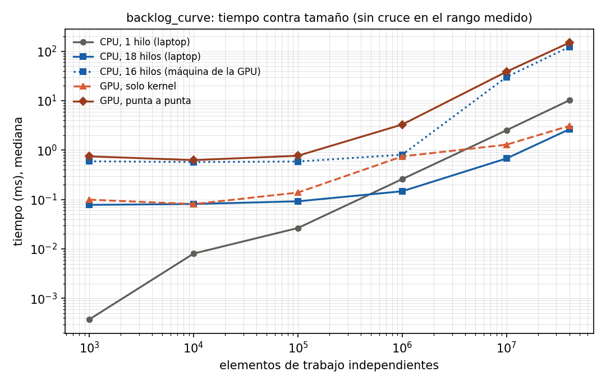
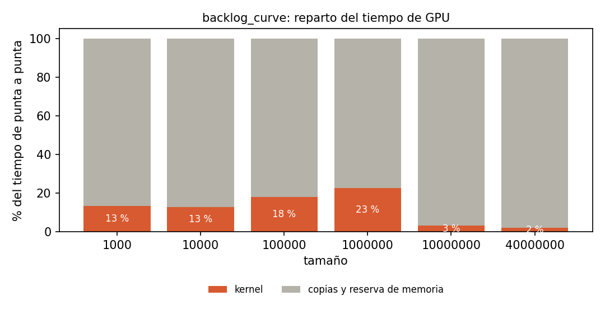
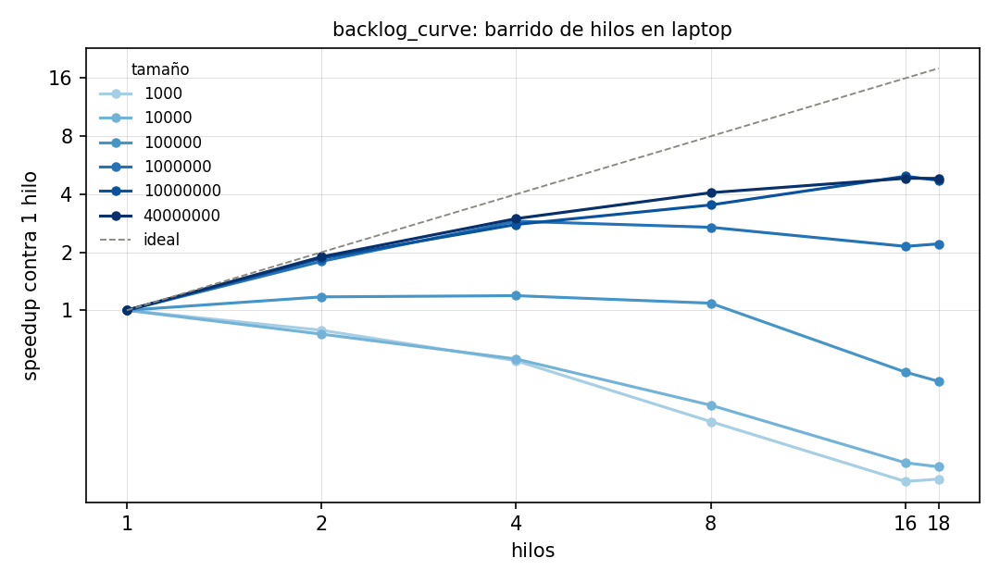

# Curva de pedidos en espera: ¿vale la pena la GPU?

Concepto del curso: 09, scan (suma acumulada) por secciones y en varios niveles. Segunda
aplicación de ese concepto; la primera fue agrupar los pedidos por restaurante. Código:
`src/gpu/backlog_curve.*`. Datos: `mac.csv`, `pc.csv`. Tabla y gráficos: `tabla.md`.

## La tarea

Saber cuántos pedidos había en espera en cada segundo de la simulación. Un pedido está en espera
desde que se crea hasta que se entrega o se rechaza. Se arma un arreglo con un lugar por segundo:
cada pedido creado suma uno en su segundo y cada pedido cerrado resta uno en el suyo. La suma
acumulada de ese arreglo es la curva: el valor en cada segundo es la cantidad de pedidos en
espera en ese momento. De la curva salen el pico y cuándo ocurrió.

A primera vista no es paralela: cada valor depende de todos los anteriores. El scan la vuelve
paralela porque la suma es asociativa: se acumula por partes y después se corrige cada parte con
el total de las anteriores.

## Montaje

El mismo de los experimentos anteriores: CPU del veredicto en el MacBook Pro con Apple M5 Pro (18
núcleos, enchufado, `-O3`); GPU en la PC con Ryzen 7 3700X y RTX 3060 Ti (CUDA 12.1, `-O3`,
sm_86), que además mide las mismas versiones de CPU.

```sh
./delivery_sim ../config/ciudad.json --headless --bench <maquina>.csv --bench-apps backlog_curve --bench-reps 10 --bench-sweep
./delivery_sim ../config/ciudad.json --gpu-info
python3 tools/gpu_report.py --app backlog_curve --laptop mac.csv --gpu pc.csv --out tools/reports/gpu/backlog_curve
```

Seis tamaños, de mil a 40 millones de segundos: más de cuatro órdenes de magnitud. En cada
segundo entran entre 0 y 3 pedidos y salen entre 0 y 3, sin que la espera baje de cero. Una
corrida de calentamiento y 10 medidas intercaladas, con la tarjeta despierta antes de cada medida
de GPU. El tiempo de punta a punta de la GPU cuenta también la reserva del arreglo de salida en
la CPU, igual que las versiones de CPU.

## Diseño

- **Secciones de 256.** Cada bloque carga 256 valores en shared memory, los acumula ahí y deja
  aparte el total de su sección.
- **Varios niveles.** Los totales de las secciones se acumulan con el mismo kernel, y así hasta
  que entran en una sola sección. Después otro kernel le suma a cada sección el acumulado de las
  anteriores. Con 40 millones de segundos son cuatro niveles y siete lanzamientos.
- **Dos formas de acumular dentro de la sección**, que es la comparación del concepto:
  - **Kogge-Stone:** 8 pasos; en cada uno, cada posición suma la que está a 1, 2, 4… lugares
    atrás. Todos los hilos trabajan en todos los pasos: unas 1800 sumas por sección.
  - **Brent-Kung:** primero sube un árbol de sumas y después lo baja repartiendo los parciales.
    Son 15 pasos, pero solo unas 500 sumas por sección: en cada paso trabajan pocos hilos.
- **Barreras.** En Kogge-Stone cada hilo lee, espera en la barrera y recién después escribe, para
  que nadie lea un valor a medio actualizar. En Brent-Kung las posiciones que se leen y las que
  se escriben en un mismo paso nunca coinciden, y alcanza con una barrera por paso.

La versión multihilo de CPU usa la misma idea en dos pasadas: cada hilo suma su parte, se
acumulan esos totales, y después cada hilo acumula su parte partiendo del total anterior.

**En el programa:** el registro de eventos guarda la hora de cada pedido creado y de cada pedido
entregado o rechazado. Al terminar la simulación se arma el arreglo de cambios, se calcula la
curva y se imprimen el pico de pedidos en espera, el minuto en que ocurrió y cuántos quedaron al
cierre. Se calcula en CPU con un hilo, o en la tarjeta con `--backend gpu`.

## Corrección

- Las 600 filas de `pc.csv` y las 420 de `mac.csv` tienen `correct = yes`: la curva idéntica a la
  de CPU de un hilo, valor por valor, con los dos kernels.
- `tests/gpu/backlog_curve_test.cpp`: un caso a mano con seis pedidos; tamaños antes, en y
  después del borde de una sección; tamaños que obligan a dos y tres niveles; cambios negativos;
  y que el último valor de la curva sea la cantidad de pedidos que quedaron sin cerrar.
- `compute-sanitizer`: memcheck 0 errores, racecheck 0 hallazgos.
- ThreadSanitizer en la laptop, sobre la suite completa: 0 reportes.
- **Contra un cálculo independiente.** El resumen del programa cuenta los pedidos pendientes como
  creados menos entregados menos rechazados. En una hora de `config/equipetrol.json`, con la curva
  en CPU y en la tarjeta, el último valor de la curva coincide con ese número (73 en las dos
  corridas) y el log pasa el verificador.

## Resultados

Medianas en ms. La tabla completa está en `tabla.md`.

| Segundos | CPU 1 hilo, laptop | CPU 18 hilos, laptop | GPU kernel | GPU punta a punta | Kernel contra la mejor CPU | Punta a punta contra la mejor CPU |
|---|---|---|---|---|---|---|
| Mil | 0,0004 | 0,078 | 0,099 | 0,749 | 0,00x | 0,00x |
| 10 mil | 0,0081 | 0,081 | 0,081 | 0,628 | 0,10x | 0,01x |
| 100 mil | 0,027 | 0,092 | 0,138 | 0,770 | 0,19x | 0,03x |
| 1 millón | 0,259 | 0,147 | 0,746 | 3,296 | 0,15x | 0,03x |
| 10 millones | 2,530 | 0,678 | 1,290 | 38,7 | 0,50x | 0,02x |
| 40 millones | 10,2 | 2,643 | 3,094 | 149,7 | 0,85x | 0,02x |



- **El kernel no le gana a la laptop en ningún tamaño.** Se acerca al crecer: 0,50 veces con 10
  millones y 0,85 con 40 millones.
- **De punta a punta no hay cruce**, y la distancia es grande: la GPU queda unas 57 veces más
  lenta que la laptop con 40 millones. El kernel es el 2 % del tiempo.
- **En la misma máquina tampoco hay cruce**: 0,80 veces con 40 millones.

| Segundos | CPU 1 hilo, PC | CPU 16 hilos, PC | GPU kernel | GPU punta a punta | Kernel contra la mejor CPU | Punta a punta contra la mejor CPU |
|---|---|---|---|---|---|---|
| Mil | 0,0014 | 0,594 | 0,099 | 0,749 | 0,01x | 0,00x |
| 10 mil | 0,0050 | 0,573 | 0,081 | 0,628 | 0,06x | 0,01x |
| 100 mil | 0,040 | 0,588 | 0,138 | 0,770 | 0,29x | 0,05x |
| 1 millón | 0,687 | 0,808 | 0,746 | 3,296 | 0,62x | 0,14x |
| 10 millones | 30,4 | 30,2 | 1,290 | 38,7 | 23,41x | 0,78x |
| 40 millones | 120,8 | 122,7 | 3,094 | 149,7 | 38,89x | 0,80x |



Aquí suben y bajan arreglos del mismo tamaño: con 40 millones de segundos, 160 MB de ida y 160 MB
de vuelta, más la reserva de otros 160 MB en la CPU para recibir la curva.

**Lo que pasa en la CPU de la PC.** De 1 a 10 millones de segundos el tiempo de un hilo salta de
0,7 a 30 ms, 44 veces más para 10 veces más datos, y sumar hilos no lo mejora. No es la suma
acumulada: es la reserva del arreglo de salida. Desde ese tamaño el sistema entrega memoria nueva
en cada llamada, y en el contenedor de la PC eso cuesta más que el cálculo. La laptop no tiene
ese salto. La GPU de punta a punta paga lo mismo para recibir el resultado, y por eso el kernel
solo gana 39 veces en la misma máquina y la ronda completa no gana.

### Kogge-Stone contra Brent-Kung

Tiempo de los kernels en la PC, en ms.

| Segundos | Kogge-Stone | Brent-Kung | Brent-Kung contra Kogge-Stone | Niveles |
|---|---|---|---|---|
| Mil | 0,099 | 0,260 | 0,38x | 2 |
| 10 mil | 0,081 | 0,082 | 0,99x | 2 |
| 100 mil | 0,138 | 0,136 | 1,02x | 3 |
| 1 millón | 0,746 | 0,678 | 1,10x | 3 |
| 10 millones | 1,290 | 1,471 | 0,88x | 3 |
| 40 millones | 3,094 | 3,902 | 0,79x | 4 |

Hasta un millón de segundos no hay un ganador claro. Con mil, la mediana de Brent-Kung salió
alta, pero su mínimo, 0,085 ms, es como el de Kogge-Stone, 0,074 ms: es la dispersión de medidas
tan cortas. Con 10 y 40 millones, Brent-Kung es un 14 y un 26 % más lento, aunque hace menos de
un tercio de las sumas. En la tarjeta los hilos no escasean: lo que cuesta es la cantidad de
pasos, y Brent-Kung necesita casi el doble, 15 contra 8. Hacer menos sumas no ahorra nada cuando
los hilos que no suman igual tienen que esperar en la barrera.



En la laptop la versión multihilo conviene desde un millón de segundos y llega a unas 4 veces
con 16 hilos. Recorre los datos dos veces, así que con un solo hilo es más lenta que la versión
simple.

## Análisis

**Paralelismo disponible.** Un elemento de trabajo por segundo de simulación. Cada bloque atiende
256 y la tarjeta aloja 228 bloques a la vez: se llena con unos 58 000 segundos. Una hora de
simulación son 3600.

**Sobrecostos.** Dominan en todos los tamaños. El piso es de 0,6 a 0,7 ms. Con 40 millones de
segundos el kernel tarda 3,1 ms y la punta a punta 150 ms: subir 160 MB, bajar 160 MB y reservar
la memoria para recibirlos. Además cada nivel reserva memoria en la tarjeta para sus totales:
`nsys` cuenta 83 reservas en una corrida de los seis tamaños.

**Límite por memoria.** Por cada valor hay una suma y varios accesos a memoria: está limitado por
memoria. Con 40 millones de segundos el kernel lee y escribe los 160 MB dos veces, una en el scan
por secciones y otra al sumar los totales anteriores: 640 MB en 3,1 ms, unos 207 GB/s, el 46 %
del ancho de banda nominal. La CPU tiene el mismo límite: un hilo de la laptop mueve 320 MB en
10,2 ms.

**Eficiencia de ejecución.** `--gpu-info`: 6 bloques por multiprocesador y ocupación del 100 % en
los tres kernels, limitada por los hilos. Kogge-Stone usa 14 registros por hilo y Brent-Kung 20;
los dos, 1024 bytes de shared memory. En Kogge-Stone no hay divergencia que importe. En
Brent-Kung sí: en cada paso trabaja solo una parte de los hilos. Son los primeros del bloque, así
que los demás warps quedan sin trabajo, pero igual esperan en la barrera.

**Contención y sincronización.** No hay atómicos: cada hilo escribe en su posición. La
sincronización son las barreras: 17 por bloque en Kogge-Stone y 16 en Brent-Kung.

**Corrección bajo paralelismo.** La suma de enteros es asociativa, así que acumular por secciones
y corregir después da exactamente lo mismo que acumular en orden. El riesgo es leer una posición
que otro hilo está escribiendo en el mismo paso; racecheck confirma que no pasa en ninguno de los
dos kernels.

## Veredicto

- **Curva sobre datos que están en la CPU: CPU, siempre.** Un hilo de la laptop acumula 40
  millones de valores en 10 ms y 16 hilos en 2,6 ms; ni el kernel solo llega a eso.
- **En el programa: CPU con un hilo.** Una hora de simulación son 3600 valores y tarda unos pocos
  microsegundos.
- **Es el peor caso para la tarjeta de los medidos hasta ahora.** Hay muy poco cálculo por dato y
  el resultado es tan grande como la entrada, así que todo lo que sube tiene que bajar.
- **Dentro de la GPU, Kogge-Stone.** Con secciones de 256 es igual o más rápido que Brent-Kung.
- **El scan en GPU conviene como paso intermedio**, cuando el resultado se queda en la tarjeta
  para otro kernel, como en el agrupado por restaurante, y no cuando hay que bajarlo entero.

## Amenazas a la validez

- **Dos máquinas.** El veredicto contra la laptop compara una CPU mucho más rápida que la de la
  PC. Por eso se informa también la comparación en la misma máquina.
- **La reserva de memoria pesa mucho en la PC.** Desde 10 millones de segundos, los tiempos de
  CPU de la PC y la punta a punta de la GPU miden sobre todo cuánto cuesta reservar el arreglo de
  salida dentro del contenedor sobre WSL2. En otra instalación ese costo sería menor y la
  comparación en la misma máquina cambiaría.
- **Los tamaños grandes no salen del programa.** 40 millones de segundos son más de un año de
  simulación; son datos generados para ver hasta dónde llega cada versión.
- **Medidas muy cortas.** Con mil segundos la CPU tarda menos de un microsegundo, cerca de la
  resolución del reloj.
- **La PC no estaba en reposo.** Se usaron medianas de 10 repeticiones y la tarjeta estaba en
  régimen en las 120 medidas.
