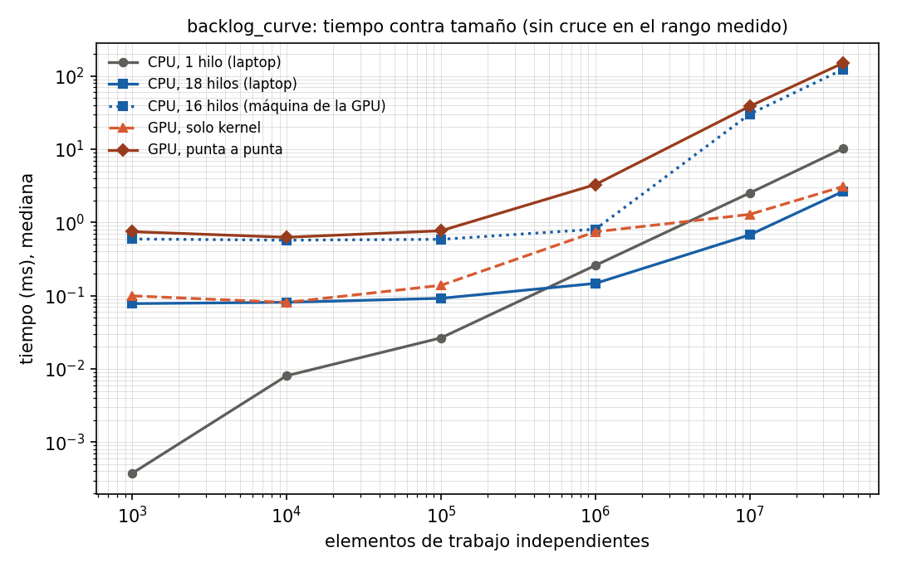
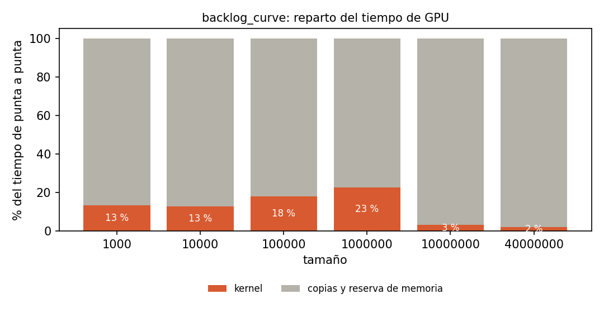
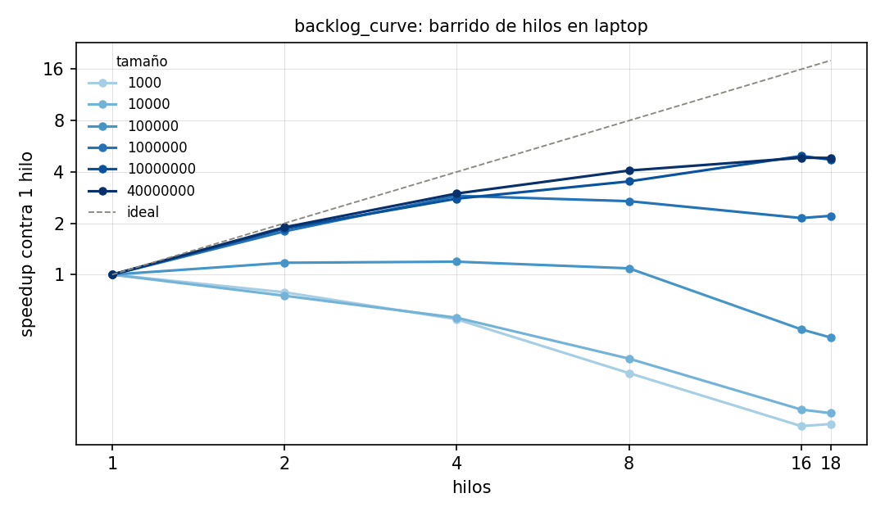

# backlog_curve: CPU contra GPU

Generado por `tools/gpu_report.py` a partir de `mac.csv` y `pc.csv`. 10 repeticiones medidas por versión y tamaño, después de una de calentamiento.

### Veredicto: la GPU contra la CPU de la laptop

| Tamaño | CPU 1 hilo (ms) | CPU 18 hilos (ms) | GPU kernel (ms) | GPU punta a punta (ms) | Mejor CPU | Speedup de la GPU contra la mejor CPU (kernel / punta a punta) | ¿Correcto? |
|---|---|---|---|---|---|---|---|
| 1000 | 0.000 (0.000–0.000) | 0.078 (0.070–0.091) | 0.099 (0.074–0.271) | 0.749 (0.649–1.092) | 0.000 (1 hilo) | 0.00x / 0.00x | sí |
| 10000 | 0.008 (0.003–0.009) | 0.081 (0.072–0.095) | 0.081 (0.073–0.268) | 0.628 (0.612–1.014) | 0.008 (1 hilo) | 0.10x / 0.01x | sí |
| 100000 | 0.027 (0.025–0.027) | 0.092 (0.073–0.133) | 0.138 (0.133–0.211) | 0.770 (0.754–0.884) | 0.027 (1 hilo) | 0.19x / 0.03x | sí |
| 1000000 | 0.259 (0.250–0.272) | 0.147 (0.135–0.196) | 0.746 (0.616–0.908) | 3.296 (2.814–3.796) | 0.112 (4 hilos) | 0.15x / 0.03x | sí |
| 10000000 | 2.530 (2.517–2.559) | 0.678 (0.640–0.742) | 1.290 (1.237–1.355) | 38.716 (38.385–40.855) | 0.646 (16 hilos) | 0.50x / 0.02x | sí |
| 40000000 | 10.205 (10.105–11.224) | 2.643 (2.546–2.851) | 3.094 (2.888–3.169) | 149.653 (146.085–174.619) | 2.639 (16 hilos) | 0.85x / 0.02x | sí |

Tiempos de CPU: laptop. Mediana de las repeticiones y, entre paréntesis, mínimo y máximo.

Cruce de punta a punta contra la mejor CPU de la laptop: **no hay cruce en el rango medido**; la CPU gana en todos los tamaños.

### Misma máquina: la GPU contra la CPU de su propia máquina

| Tamaño | CPU 1 hilo (ms) | CPU 16 hilos (ms) | GPU kernel (ms) | GPU punta a punta (ms) | Mejor CPU | Speedup de la GPU contra la mejor CPU (kernel / punta a punta) | ¿Correcto? |
|---|---|---|---|---|---|---|---|
| 1000 | 0.001 (0.001–0.003) | 0.594 (0.579–0.639) | 0.099 (0.074–0.271) | 0.749 (0.649–1.092) | 0.001 (1 hilo) | 0.01x / 0.00x | sí |
| 10000 | 0.005 (0.004–0.005) | 0.573 (0.570–0.622) | 0.081 (0.073–0.268) | 0.628 (0.612–1.014) | 0.005 (1 hilo) | 0.06x / 0.01x | sí |
| 100000 | 0.040 (0.039–0.041) | 0.588 (0.563–0.610) | 0.138 (0.133–0.211) | 0.770 (0.754–0.884) | 0.040 (1 hilo) | 0.29x / 0.05x | sí |
| 1000000 | 0.687 (0.628–0.789) | 0.808 (0.680–0.970) | 0.746 (0.616–0.908) | 3.296 (2.814–3.796) | 0.459 (2 hilos) | 0.62x / 0.14x | sí |
| 10000000 | 30.429 (29.903–31.548) | 30.232 (29.966–31.794) | 1.290 (1.237–1.355) | 38.716 (38.385–40.855) | 30.186 (8 hilos) | 23.41x / 0.78x | sí |
| 40000000 | 120.752 (119.222–196.815) | 122.738 (120.906–156.426) | 3.094 (2.888–3.169) | 149.653 (146.085–174.619) | 120.330 (4 hilos) | 38.89x / 0.80x | sí |

Tiempos de CPU: máquina de la GPU. Mediana de las repeticiones y, entre paréntesis, mínimo y máximo.

Cruce de punta a punta contra la mejor CPU de la misma máquina: **no hay cruce en el rango medido**.

### Variantes de GPU

Mediana en ms de cada variante medida en la misma corrida.

| Tamaño | `gpu_kernel` | `gpu_e2e` | `gpu_e2e_brentkung` | `gpu_kernel_brentkung` |
|---|---|---|---|---|
| 1000 | 0.099 | 0.749 | 0.990 | 0.260 |
| 10000 | 0.081 | 0.628 | 0.618 | 0.082 |
| 100000 | 0.138 | 0.770 | 0.756 | 0.136 |
| 1000000 | 0.746 | 3.296 | 2.820 | 0.678 |
| 10000000 | 1.290 | 38.716 | 38.507 | 1.471 |
| 40000000 | 3.094 | 149.653 | 148.705 | 3.902 |

### Barrido de hilos, laptop

Speedup de la versión multihilo contra ella misma con 1 hilo.

| Tamaño | 1 hilo | 2 hilos | 4 hilos | 8 hilos | 16 hilos | 18 hilos |
|---|---|---|---|---|---|---|
| 1000 | 1.00x | 0.79x | 0.55x | 0.26x | 0.13x | 0.13x |
| 10000 | 1.00x | 0.75x | 0.56x | 0.32x | 0.16x | 0.15x |
| 100000 | 1.00x | 1.17x | 1.19x | 1.09x | 0.48x | 0.43x |
| 1000000 | 1.00x | 1.79x | 2.90x | 2.69x | 2.15x | 2.21x |
| 10000000 | 1.00x | 1.86x | 2.79x | 3.52x | 4.96x | 4.72x |
| 40000000 | 1.00x | 1.89x | 2.99x | 4.07x | 4.84x | 4.83x |

### Barrido de hilos, máquina de la GPU

Speedup de la versión multihilo contra ella misma con 1 hilo.

| Tamaño | 1 hilo | 2 hilos | 4 hilos | 8 hilos | 16 hilos |
|---|---|---|---|---|---|
| 1000 | 1.00x | 1.07x | 0.54x | 0.35x | 0.20x |
| 10000 | 1.00x | 1.14x | 0.58x | 0.36x | 0.21x |
| 100000 | 1.00x | 1.53x | 0.76x | 0.46x | 0.28x |
| 1000000 | 1.00x | 1.63x | 1.62x | 1.34x | 0.93x |
| 10000000 | 1.00x | 1.06x | 1.07x | 1.08x | 1.08x |
| 40000000 | 1.00x | 1.06x | 1.07x | 1.06x | 1.05x |

### Gráficos

