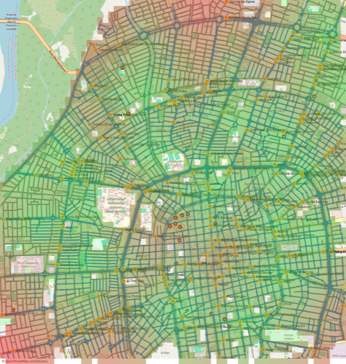
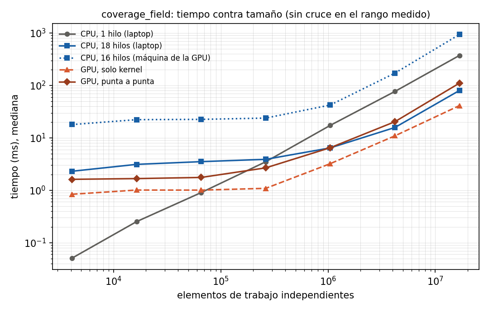
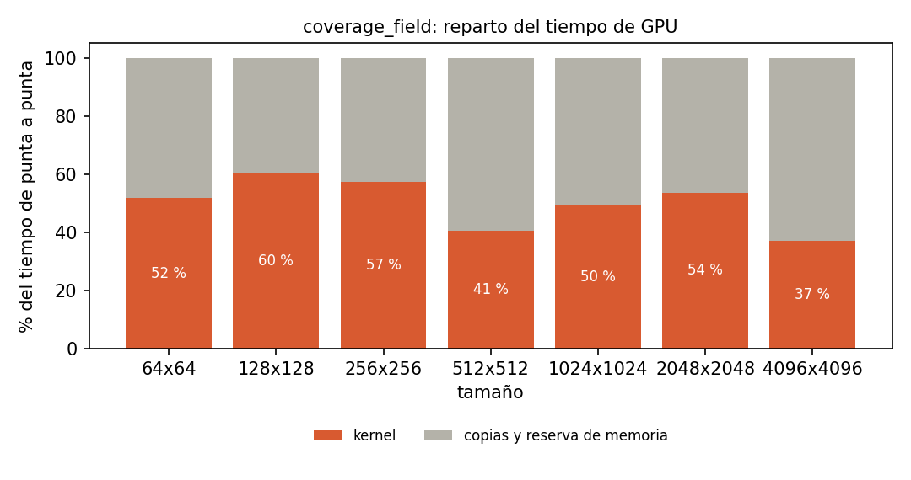
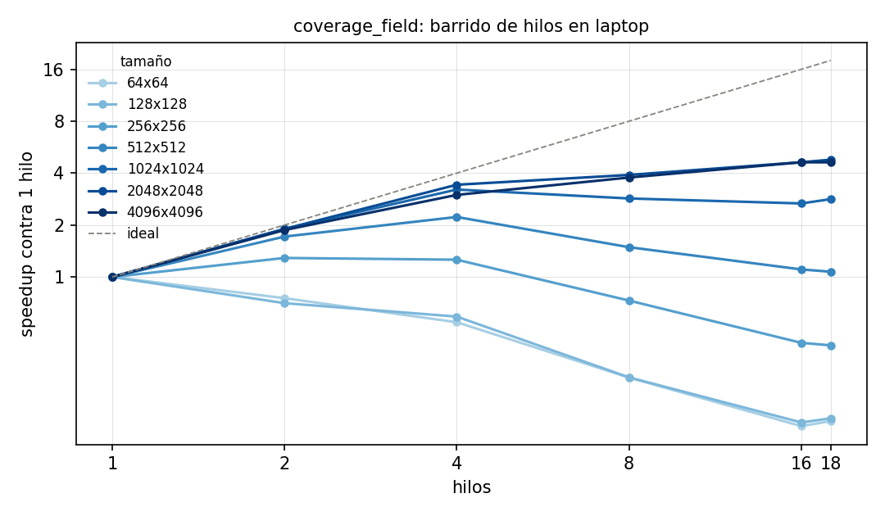

# Campo de cobertura de las motos libres: ¿vale la pena la GPU?

Concepto del curso: 06, stencil con dos arreglos que se intercambian y tiles en shared memory.
Primera aplicación de ese concepto. Código: `src/gpu/coverage_field.*` y `drawCoverage` en
`src/fleet_view.cpp`. Datos: `mac.csv`, `pc.csv`. Tabla y gráficos: `tabla.md`.

## La tarea

Saber, para cada zona de la ciudad, cuánto tardaría en llegar la moto libre más cercana. La
ciudad se parte en una cuadrícula; las celdas con una moto libre valen cero y las demás empiezan
sin valor. En cada pasada, cada celda toma el menor entre su valor y el de sus cuatro vecinas más
el tiempo de cruzar una celda. Se repite hasta que una pasada no cambia nada. Las celdas por las
que no pasa ninguna calle no se actualizan nunca, así que el tiempo rodea las manzanas sin calle.

Es paralela en datos porque, dentro de una pasada, cada celda se calcula solo con los valores de
la pasada anterior. Entre pasadas sí hay orden: la información avanza una celda por pasada.

## Montaje

El mismo de los experimentos anteriores: CPU del veredicto en el MacBook Pro con Apple M5 Pro (18
núcleos, enchufado, `-O3`); GPU en la PC con Ryzen 7 3700X y RTX 3060 Ti (CUDA 12.1, `-O3`,
sm_86), que además mide las mismas versiones de CPU.

```sh
./delivery_sim ../config/ciudad.json --headless --bench <maquina>.csv --bench-apps coverage_field --bench-reps 10 --bench-sweep
./delivery_sim ../config/ciudad.json --gpu-info
python3 tools/gpu_report.py --app coverage_field --laptop mac.csv --gpu pc.csv --out tools/reports/gpu/coverage_field
```

Siete cuadrículas, de 64 × 64 a 4096 × 4096: de 4096 a 16,8 millones de celdas. La de 64 × 64 es
la que usa el programa. En todas, una de cada siete celdas no tiene calle y hay una moto libre
cada 1024 celdas, así que la cantidad de pasadas casi no depende del tamaño: entre 60 y 94. Una
corrida de calentamiento y 10 medidas intercaladas, con la tarjeta despierta antes de cada medida
de GPU. El tiempo de punta a punta de la GPU cuenta también la reserva del arreglo de salida en
la CPU, igual que las versiones de CPU.

## Diseño

- **Dos arreglos que se intercambian.** Cada pasada lee uno y escribe el otro. Actualizar sobre
  el mismo arreglo sería una carrera: una celda leería vecinas ya actualizadas y otras no.
- **Kernel sin tiles:** un hilo por celda, en bloques de 16 × 16; lee su valor y el de sus cuatro
  vecinas de memoria global.
- **Kernel con tiles:** cada bloque carga un tile de 16 × 16 en shared memory, espera en la
  barrera y calcula las 14 × 14 celdas de adentro; el borde del tile solo se lee.
- **Pasos distintos en cada eje.** Cruzar una celda de lado no cuesta lo mismo que cruzarla de
  arriba abajo, porque las celdas no son cuadradas. Además, con dos coeficientes distintos una
  prueba detecta un kernel que confunda filas con columnas.
- **Convergencia con una reducción.** Cada 16 pasadas, un tercer kernel compara los dos arreglos:
  cada bloque reduce en shared memory si alguna de sus celdas cambió y suma uno a un contador.
  Solo baja ese número. La tarjeta puede hacer hasta 15 pasadas de más; la CPU revisa en cada
  pasada porque le sale gratis.
- **Enteros.** Los tiempos van en milisegundos enteros, así que la tarjeta y la CPU tienen que
  dar exactamente lo mismo, sin tolerancia.

**En el programa:** la cuadrícula es la misma de 64 × 64 del mapa de calor. Al arrancar se marcan
las celdas por las que pasa alguna calle. En la ventana, la tecla `c` muestra u oculta la capa,
que se recalcula dos veces por segundo con las motos libres de ese momento. Al terminar se informa
la zona peor cubierta con las motos libres del cierre. Corre en CPU, o en la tarjeta con
`--backend gpu`.



La imagen es la capa sobre el mapa de la ciudad con 25 motos libres de ejemplo: verde donde hay
una cerca, rojo donde la más cercana está lejos. Las manzanas sin calle quedan sin pintar.

## Corrección

- Las 770 filas de `pc.csv` y las 560 de `mac.csv` tienen `correct = yes`: cada medida
  se compara, celda por celda y sin tolerancia, con el campo de la versión de un hilo.
- `tests/gpu/coverage_field_test.cpp`: con una sola moto en el centro cada celda queda a 3 por
  columna y 5 por fila; un muro obliga a rodearlo; las celdas sin calle no cambian; y en
  cuadrículas que no son múltiplos del tile las cinco versiones coinciden.
- **Un algoritmo distinto como árbitro.** Dijkstra sobre la misma cuadrícula llega al mismo campo
  que las pasadas. Si las pasadas pararan antes de tiempo, no coincidirían.
- `compute-sanitizer`: memcheck 0 errores, racecheck 0 hallazgos.
- ThreadSanitizer en la laptop, sobre la suite completa: 0 reportes.
- Simulación de ciudad con el campo en CPU y en la tarjeta: las dos dan la misma zona peor
  cubierta, fila 0 y columna 62, a 654 s, y el log pasa el verificador.

## Resultados

Medianas en ms. La tabla completa está en `tabla.md`.

| Cuadrícula | Pasadas | CPU 1 hilo, laptop | CPU 18 hilos, laptop | GPU kernel | GPU punta a punta | Kernel contra la mejor CPU | Punta a punta contra la mejor CPU |
|---|---|---|---|---|---|---|---|
| 64 × 64 | 60 | 0,051 | 2,304 | 0,839 | 1,617 | 0,06x | 0,03x |
| 128 × 128 | 77 | 0,252 | 3,117 | 1,010 | 1,669 | 0,25x | 0,15x |
| 256 × 256 | 76 | 0,902 | 3,515 | 1,006 | 1,756 | 0,90x | 0,51x |
| 512 × 512 | 75 | 3,495 | 3,889 | 1,088 | 2,674 | 1,72x | 0,70x |
| 1024 × 1024 | 92 | 17,3 | 6,432 | 3,219 | 6,486 | 1,76x | 0,87x |
| 2048 × 2048 | 88 | 76,7 | 15,7 | 10,9 | 20,3 | 1,44x | 0,78x |
| 4096 × 4096 | 94 | 372,7 | 80,0 | 41,2 | 110,5 | 1,94x | 0,72x |



- **De punta a punta no hay cruce contra la laptop, pero es de las aplicaciones que más se
  acercan**: 0,87 veces en 1024 × 1024, 0,78 en 2048 × 2048 y 0,72 en 4096 × 4096, donde la
  tarjeta tarda 110,5 ms y los 18 hilos de la laptop 80,0 ms.
- **El kernel gana desde 512 × 512**, entre 1,4 y 1,9 veces. Es poca ventaja comparada con la
  convolución, porque aquí cada celda hace muy poco cálculo: cinco lecturas y tres comparaciones.
- **Con cuadrículas chicas el kernel no baja de 1 ms.** Son entre 64 y 96 pasadas, cada una un
  lanzamiento, y cada uno cuesta unos 13 microsegundos aunque la cuadrícula sea mínima. La
  laptop con un hilo resuelve 64 × 64 en 0,05 ms, 16 veces más rápido que el kernel solo.

### Misma máquina

| Cuadrícula | CPU 1 hilo, PC | CPU 16 hilos, PC | GPU kernel | GPU punta a punta | Punta a punta contra la mejor CPU de la PC | Parte del kernel en la punta a punta |
|---|---|---|---|---|---|---|
| 64 × 64 | 0,263 | 17,9 | 0,839 | 1,617 | 0,16x | 52 % |
| 128 × 128 | 1,109 | 22,2 | 1,010 | 1,669 | 0,66x | 60 % |
| 256 × 256 | 3,940 | 22,5 | 1,006 | 1,756 | 2,24x | 57 % |
| 512 × 512 | 14,9 | 23,8 | 1,088 | 2,674 | 4,61x | 41 % |
| 1024 × 1024 | 73,5 | 42,3 | 3,219 | 6,486 | 5,23x | 50 % |
| 2048 × 2048 | 328,7 | 171,5 | 10,9 | 20,3 | 7,77x | 54 % |
| 4096 × 4096 | 1392,6 | 936,9 | 41,2 | 110,5 | 8,14x | 37 % |



- **Contra la CPU de su propia máquina el cruce está en 256 × 256** y la ventaja llega a 8,1
  veces en 4096 × 4096.
- **El kernel es entre el 37 y el 60 % del tiempo de punta a punta.** En las aplicaciones de un
  solo lanzamiento era menos del 10 %. La diferencia es que aquí los datos suben una vez y se
  usan en unas 90 pasadas: las copias se reparten entre todas.
- **En 4096 × 4096 la parte del kernel baja al 37 %.** De 2048 × 2048 a 4096 × 4096 el kernel se
  cuadruplica, de 10,9 a 41,2 ms, pero la punta a punta se quintuplica, de 20,3 a 110,5 ms: lo
  que crece de más es reservar y copiar los 64 MB del resultado.
- `nsys` sobre una corrida de todas las cuadrículas: 1259 lanzamientos de kernel con una mediana
  de 9 microsegundos cada uno, y el tiempo grande sigue en `cudaMemcpy` y `cudaMalloc`.

### Con tiles o sin tiles

| Cuadrícula | Kernel sin tiles | Kernel con tiles | Con tiles contra sin tiles | Sin tiles, microsegundos por pasada | Sin tiles, nanosegundos por celda y pasada |
|---|---|---|---|---|---|
| 64 × 64 | 0,839 | 0,826 | 1,02x | 13,1 | 3,200 |
| 128 × 128 | 1,010 | 1,027 | 0,98x | 12,6 | 0,770 |
| 256 × 256 | 1,006 | 0,997 | 1,01x | 12,6 | 0,192 |
| 512 × 512 | 1,088 | 1,183 | 0,92x | 13,6 | 0,052 |
| 1024 × 1024 | 3,219 | 4,156 | 0,77x | 33,5 | 0,032 |
| 2048 × 2048 | 10,9 | 14,2 | 0,77x | 113,6 | 0,027 |
| 4096 × 4096 | 41,2 | 56,0 | 0,74x | 429,0 | 0,026 |

- **Los tiles no ayudan en este stencil; desde 1024 × 1024 lo hacen un 25 % más lento.**
- **Por qué.** Sin tiles cada celda lee cinco valores de memoria global, pero los hilos vecinos
  leen casi las mismas posiciones y esas lecturas ya salen agrupadas. Con tiles cada bloque lanza
  256 hilos para calcular 196 celdas, así que hacen falta un 31 % más de bloques, y además cada
  bloque espera en una barrera. El tile ahorra lecturas repetidas solo si hay muchas por celda:
  con cinco no compensa.
- **El kernel está limitado por memoria.** Con 4096 × 4096 tarda 0,026 nanosegundos por celda y
  pasada: unos 38 mil millones de celdas por segundo. Cada celda mueve unos 9 bytes entre leer y
  escribir, cerca de 350 GB/s, y la tarjeta da 448 GB/s. Casi no hay cálculo que acelerar.
- **Ocupación** (`--gpu-info`): los tres kernels llegan al 100 %, limitados por hilos; el kernel
  con tiles usa 1024 bytes de shared memory por bloque.
- Por eso el programa usa el kernel sin tiles.

### ¿Y un algoritmo mejor en CPU?

Las pasadas no son la única forma de calcular este campo. Dijkstra visita cada celda una sola
vez, así que hace menos trabajo. Se midió en un hilo, como referencia (`cpu_ref_dijkstra`).

| Cuadrícula | Pasadas, 1 hilo | Dijkstra, 1 hilo | Pasadas, mejor número de hilos |
|---|---|---|---|
| 64 × 64 | 0,051 | 0,139 | 0,051 |
| 128 × 128 | 0,252 | 0,635 | 0,252 |
| 256 × 256 | 0,902 | 3,010 | 0,902 |
| 512 × 512 | 3,495 | 13,3 | 1,873 |
| 1024 × 1024 | 17,3 | 58,9 | 5,658 |
| 2048 × 2048 | 76,7 | 265,9 | 15,7 |
| 4096 × 4096 | 372,7 | 1342,3 | 79,9 |

- **En estas cuadrículas las pasadas le ganan a Dijkstra**, entre 2,5 y 3,8 veces con un hilo. Hay
  muchas motos libres repartidas, así que el campo converge en menos de 100 pasadas, y cada pasada
  es un recorrido en orden que el procesador hace muy rápido. Dijkstra salta por la memoria.
- **No vale siempre.** La cantidad de pasadas es la distancia, en celdas, de la celda más lejana a
  su moto. Con una sola moto libre en una esquina de 4096 × 4096 harían falta miles de pasadas y
  Dijkstra ganaría.



- **En la laptop el multihilo solo sirve desde 512 × 512** y llega a 4,7 veces con 18 hilos en
  4096 × 4096. Cada pasada reparte trabajo al pool y espera; con cuadrículas chicas ese reparto,
  repetido 60 veces, cuesta más que la pasada. No pasa de 4,7 porque el límite es la memoria.
- **En la PC el multihilo rinde menos todavía**: no pasa de 1,6 veces en 4096 × 4096.
- Por eso en el programa, con 64 × 64, la versión de CPU es la de un hilo.

## Veredicto

**En el programa, CPU con un hilo.** Con la cuadrícula de 64 × 64 un hilo tarda 0,05 ms y la
tarjeta 1,6 ms: son tan pocas celdas que manda el costo fijo de cada lanzamiento.

**Con cuadrículas grandes, depende de contra qué CPU.** Contra la CPU de su propia máquina la
tarjeta gana de punta a punta desde 256 × 256 y hasta 8 veces. Contra los 18 hilos de la laptop
no llega a ganar: queda entre 0,7 y 0,9 veces desde 1024 × 1024, aunque el kernel solo es hasta
1,9 veces más rápido. Es de las aplicaciones que más se acercan, y la razón es que el trabajo es
iterativo: se sube una vez y se calcula muchas.

**Sin tiles.** Para un stencil de cinco puntos en dos dimensiones, cargar el tile en shared memory
cuesta más de lo que ahorra.

## Amenazas a la validez

- **Dos máquinas.** El veredicto contra la laptop compara una CPU mucho más rápida que la de la
  PC. Por eso se informa también la comparación en la misma máquina.
- **La reserva de memoria pesa mucho en la PC.** En 4096 × 4096, reservar los 64 MB del resultado
  dentro del contenedor sobre WSL2 cuesta decenas de milisegundos. En otra instalación ese costo
  sería menor y la punta a punta quedaría más cerca de la laptop.
- **Una sola forma de repartir las motos.** Con una moto libre cada 1024 celdas el campo converge
  en menos de 100 pasadas. Con menos motos harían falta más pasadas y cambiarían todas las cifras.
