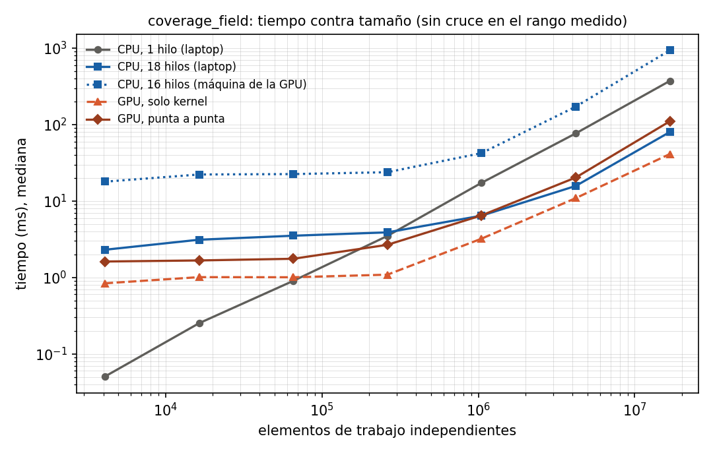
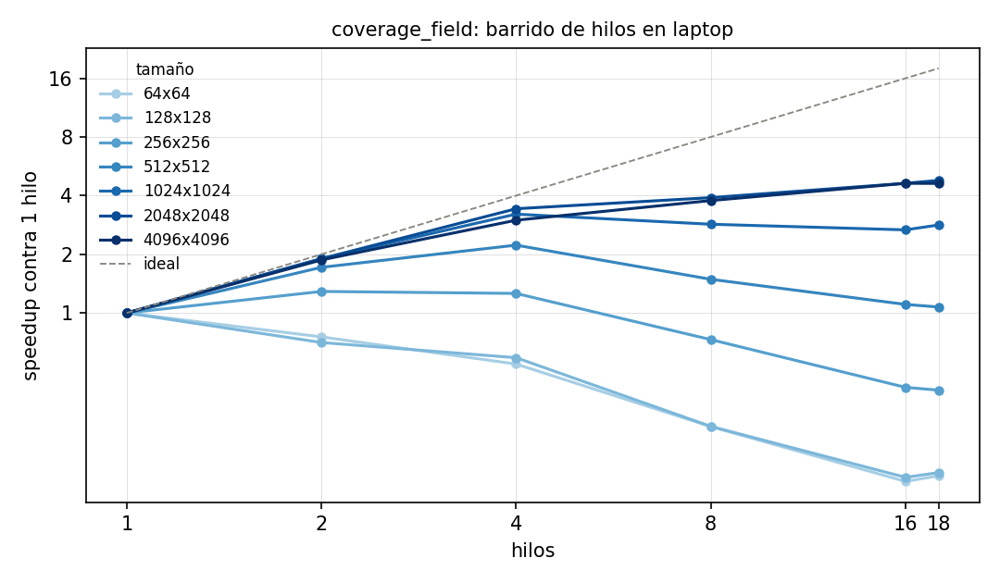

# coverage_field: CPU contra GPU

Generado por `tools/gpu_report.py` a partir de `mac.csv` y `pc.csv`. 10 repeticiones medidas por versión y tamaño, después de una de calentamiento.

### Veredicto: la GPU contra la CPU de la laptop

| Tamaño | CPU 1 hilo (ms) | CPU 18 hilos (ms) | GPU kernel (ms) | GPU punta a punta (ms) | Mejor CPU | Speedup de la GPU contra la mejor CPU (kernel / punta a punta) | ¿Correcto? |
|---|---|---|---|---|---|---|---|
| 64x64 | 0.051 (0.050–0.057) | 2.304 (2.232–2.503) | 0.839 (0.784–2.989) | 1.617 (1.452–3.890) | 0.051 (1 hilo) | 0.06x / 0.03x | sí |
| 128x128 | 0.252 (0.245–0.267) | 3.117 (2.938–3.339) | 1.010 (0.976–1.114) | 1.669 (1.627–1.972) | 0.252 (1 hilo) | 0.25x / 0.15x | sí |
| 256x256 | 0.902 (0.897–1.017) | 3.515 (3.375–4.007) | 1.006 (0.925–1.134) | 1.756 (1.636–1.885) | 0.902 (1 hilo) | 0.90x / 0.51x | sí |
| 512x512 | 3.495 (3.483–3.565) | 3.889 (3.660–3.966) | 1.088 (1.030–1.425) | 2.674 (2.531–3.046) | 1.873 (4 hilos) | 1.72x / 0.70x | sí |
| 1024x1024 | 17.305 (17.124–17.641) | 6.432 (6.304–8.093) | 3.219 (3.197–3.297) | 6.486 (6.448–6.836) | 5.658 (4 hilos) | 1.76x / 0.87x | sí |
| 2048x2048 | 76.653 (76.110–79.676) | 15.739 (15.474–16.449) | 10.904 (10.693–11.846) | 20.287 (19.436–21.124) | 15.739 (18 hilos) | 1.44x / 0.78x | sí |
| 4096x4096 | 372.680 (369.259–381.266) | 80.033 (79.244–83.081) | 41.180 (41.172–41.289) | 110.490 (108.319–111.686) | 79.941 (16 hilos) | 1.94x / 0.72x | sí |

Tiempos de CPU: laptop. Mediana de las repeticiones y, entre paréntesis, mínimo y máximo.

Cruce de punta a punta contra la mejor CPU de la laptop: **no hay cruce en el rango medido**; la CPU gana en todos los tamaños.

### Misma máquina: la GPU contra la CPU de su propia máquina

| Tamaño | CPU 1 hilo (ms) | CPU 16 hilos (ms) | GPU kernel (ms) | GPU punta a punta (ms) | Mejor CPU | Speedup de la GPU contra la mejor CPU (kernel / punta a punta) | ¿Correcto? |
|---|---|---|---|---|---|---|---|
| 64x64 | 0.263 (0.255–0.287) | 17.905 (17.227–19.341) | 0.839 (0.784–2.989) | 1.617 (1.452–3.890) | 0.263 (1 hilo) | 0.31x / 0.16x | sí |
| 128x128 | 1.109 (1.097–1.139) | 22.226 (22.119–23.621) | 1.010 (0.976–1.114) | 1.669 (1.627–1.972) | 1.109 (1 hilo) | 1.10x / 0.66x | sí |
| 256x256 | 3.940 (3.905–3.949) | 22.499 (22.172–23.081) | 1.006 (0.925–1.134) | 1.756 (1.636–1.885) | 3.940 (1 hilo) | 3.92x / 2.24x | sí |
| 512x512 | 14.875 (14.799–15.251) | 23.804 (23.590–25.587) | 1.088 (1.030–1.425) | 2.674 (2.531–3.046) | 12.326 (4 hilos) | 11.33x / 4.61x | sí |
| 1024x1024 | 73.529 (73.198–75.124) | 42.302 (41.336–46.077) | 3.219 (3.197–3.297) | 6.486 (6.448–6.836) | 33.909 (8 hilos) | 10.54x / 5.23x | sí |
| 2048x2048 | 328.671 (325.807–339.948) | 171.470 (164.758–194.717) | 10.904 (10.693–11.846) | 20.287 (19.436–21.124) | 157.593 (8 hilos) | 14.45x / 7.77x | sí |
| 4096x4096 | 1392.632 (1345.992–1439.975) | 936.883 (930.862–941.071) | 41.180 (41.172–41.289) | 110.490 (108.319–111.686) | 899.400 (4 hilos) | 21.84x / 8.14x | sí |

Tiempos de CPU: máquina de la GPU. Mediana de las repeticiones y, entre paréntesis, mínimo y máximo.

Cruce de punta a punta contra la mejor CPU de la misma máquina: **256x256** (65536 elementos).

### Variantes de GPU

Mediana en ms de cada variante medida en la misma corrida.

| Tamaño | `gpu_kernel` | `gpu_e2e` | `gpu_e2e_tiled` | `gpu_kernel_tiled` |
|---|---|---|---|---|
| 64x64 | 0.839 | 1.617 | 1.506 | 0.826 |
| 128x128 | 1.010 | 1.669 | 1.624 | 1.027 |
| 256x256 | 1.006 | 1.756 | 1.675 | 0.997 |
| 512x512 | 1.088 | 2.674 | 2.598 | 1.183 |
| 1024x1024 | 3.219 | 6.486 | 6.971 | 4.156 |
| 2048x2048 | 10.904 | 20.287 | 23.054 | 14.191 |
| 4096x4096 | 41.180 | 110.490 | 125.040 | 55.950 |

### Barrido de hilos, laptop

Speedup de la versión multihilo contra ella misma con 1 hilo.

| Tamaño | 1 hilo | 2 hilos | 4 hilos | 8 hilos | 16 hilos | 18 hilos |
|---|---|---|---|---|---|---|
| 64x64 | 1.00x | 0.75x | 0.55x | 0.26x | 0.14x | 0.15x |
| 128x128 | 1.00x | 0.71x | 0.59x | 0.26x | 0.14x | 0.15x |
| 256x256 | 1.00x | 1.29x | 1.26x | 0.73x | 0.42x | 0.40x |
| 512x512 | 1.00x | 1.71x | 2.23x | 1.49x | 1.11x | 1.07x |
| 1024x1024 | 1.00x | 1.90x | 3.21x | 2.85x | 2.67x | 2.83x |
| 2048x2048 | 1.00x | 1.90x | 3.43x | 3.91x | 4.63x | 4.79x |
| 4096x4096 | 1.00x | 1.87x | 2.99x | 3.77x | 4.63x | 4.62x |

### Barrido de hilos, máquina de la GPU

Speedup de la versión multihilo contra ella misma con 1 hilo.

| Tamaño | 1 hilo | 2 hilos | 4 hilos | 8 hilos | 16 hilos |
|---|---|---|---|---|---|
| 64x64 | 1.00x | 1.12x | 0.57x | 0.34x | 0.20x |
| 128x128 | 1.00x | 1.11x | 0.69x | 0.43x | 0.24x |
| 256x256 | 1.00x | 1.24x | 0.96x | 0.61x | 0.37x |
| 512x512 | 1.00x | 1.56x | 1.57x | 1.25x | 0.82x |
| 1024x1024 | 1.00x | 1.70x | 2.29x | 2.43x | 1.95x |
| 2048x2048 | 1.00x | 1.52x | 1.79x | 2.23x | 2.05x |
| 4096x4096 | 1.00x | 1.48x | 1.56x | 1.53x | 1.50x |

### Gráficos

