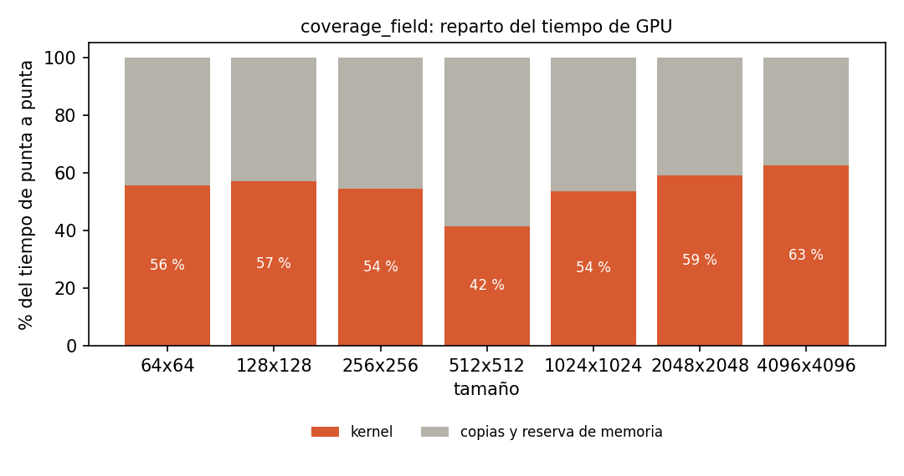

# coverage_field: CPU contra GPU

Generado por `tools/gpu_report.py` a partir de `mac.csv` y `pc.csv`. 10 repeticiones medidas por versión y tamaño, después de una de calentamiento.

### Veredicto: la GPU contra la CPU de la laptop

| Tamaño | CPU 1 hilo (ms) | CPU 18 hilos (ms) | GPU kernel (ms) | GPU punta a punta (ms) | Mejor CPU | Speedup de la GPU contra la mejor CPU (kernel / punta a punta) | ¿Correcto? |
|---|---|---|---|---|---|---|---|
| 64x64 | 0.051 (0.050–0.057) | 2.304 (2.232–2.503) | 0.859 (0.708–1.060) | 1.547 (1.370–1.974) | 0.051 (1 hilo) | 0.06x / 0.03x | sí |
| 128x128 | 0.252 (0.245–0.267) | 3.117 (2.938–3.339) | 0.992 (0.931–1.643) | 1.740 (1.635–2.573) | 0.252 (1 hilo) | 0.25x / 0.14x | sí |
| 256x256 | 0.902 (0.897–1.017) | 3.515 (3.375–4.007) | 1.003 (0.897–2.738) | 1.843 (1.607–3.559) | 0.902 (1 hilo) | 0.90x / 0.49x | sí |
| 512x512 | 3.495 (3.483–3.565) | 3.889 (3.660–3.966) | 1.124 (1.054–3.329) | 2.702 (2.537–5.262) | 1.873 (4 hilos) | 1.67x / 0.69x | sí |
| 1024x1024 | 17.305 (17.124–17.641) | 6.432 (6.304–8.093) | 3.219 (3.134–3.464) | 5.990 (5.688–6.311) | 5.658 (4 hilos) | 1.76x / 0.94x | sí |
| 2048x2048 | 76.653 (76.110–79.676) | 15.739 (15.474–16.449) | 10.719 (10.689–10.806) | 18.141 (17.897–18.699) | 15.739 (18 hilos) | 1.47x / 0.87x | sí |
| 4096x4096 | 372.680 (369.259–381.266) | 80.033 (79.244–83.081) | 41.244 (41.181–41.375) | 65.792 (65.341–67.663) | 79.941 (16 hilos) | 1.94x / 1.22x | sí |

Tiempos de CPU: MacBook Pro, Apple M5 Pro. Mediana de las repeticiones y, entre paréntesis, mínimo y máximo.

Cruce de punta a punta contra la mejor CPU de la laptop: **4096x4096** (16777216 elementos).

### Misma máquina: la GPU contra la CPU de su propia máquina

| Tamaño | CPU 1 hilo (ms) | CPU 16 hilos (ms) | GPU kernel (ms) | GPU punta a punta (ms) | Mejor CPU | Speedup de la GPU contra la mejor CPU (kernel / punta a punta) | ¿Correcto? |
|---|---|---|---|---|---|---|---|
| 64x64 | 0.262 (0.257–0.274) | 17.724 (17.414–18.538) | 0.859 (0.708–1.060) | 1.547 (1.370–1.974) | 0.262 (1 hilo) | 0.31x / 0.17x | sí |
| 128x128 | 1.127 (1.112–1.262) | 22.541 (22.185–23.586) | 0.992 (0.931–1.643) | 1.740 (1.635–2.573) | 1.127 (1 hilo) | 1.14x / 0.65x | sí |
| 256x256 | 4.044 (4.012–4.153) | 22.866 (22.756–25.198) | 1.003 (0.897–2.738) | 1.843 (1.607–3.559) | 4.044 (1 hilo) | 4.03x / 2.19x | sí |
| 512x512 | 15.452 (15.164–17.482) | 24.774 (23.894–26.044) | 1.124 (1.054–3.329) | 2.702 (2.537–5.262) | 12.596 (4 hilos) | 11.20x / 4.66x | sí |
| 1024x1024 | 74.864 (74.547–76.743) | 42.187 (41.330–45.022) | 3.219 (3.134–3.464) | 5.990 (5.688–6.311) | 35.520 (4 hilos) | 11.04x / 5.93x | sí |
| 2048x2048 | 316.059 (312.570–324.970) | 177.585 (172.516–200.457) | 10.719 (10.689–10.806) | 18.141 (17.897–18.699) | 168.420 (8 hilos) | 15.71x / 9.28x | sí |
| 4096x4096 | 1388.013 (1358.598–1419.461) | 925.870 (916.117–950.066) | 41.244 (41.181–41.375) | 65.792 (65.341–67.663) | 884.682 (4 hilos) | 21.45x / 13.45x | sí |

Tiempos de CPU: PC, Ryzen 7 3700X. Mediana de las repeticiones y, entre paréntesis, mínimo y máximo.

Cruce de punta a punta contra la mejor CPU de la misma máquina: **256x256** (65536 elementos).

### Variantes de GPU

Mediana en ms de cada variante medida en la misma corrida.

| Tamaño | `gpu_kernel` | `gpu_e2e` | `gpu_e2e_tiled` | `gpu_kernel_tiled` |
|---|---|---|---|---|
| 64x64 | 0.859 | 1.547 | 1.401 | 0.806 |
| 128x128 | 0.992 | 1.740 | 1.581 | 0.965 |
| 256x256 | 1.003 | 1.843 | 1.633 | 0.954 |
| 512x512 | 1.124 | 2.702 | 2.607 | 1.196 |
| 1024x1024 | 3.219 | 5.990 | 6.576 | 4.154 |
| 2048x2048 | 10.719 | 18.141 | 21.347 | 14.135 |
| 4096x4096 | 41.244 | 65.792 | 80.216 | 55.402 |

### Barrido de hilos, MacBook Pro, Apple M5 Pro

Speedup de la versión multihilo contra ella misma con 1 hilo.

| Tamaño | 1 hilo | 2 hilos | 4 hilos | 8 hilos | 16 hilos | 18 hilos |
|---|---|---|---|---|---|---|
| 64x64 | 1.00x | 0.75x | 0.55x | 0.26x | 0.14x | 0.15x |
| 128x128 | 1.00x | 0.71x | 0.59x | 0.26x | 0.14x | 0.15x |
| 256x256 | 1.00x | 1.29x | 1.26x | 0.73x | 0.42x | 0.40x |
| 512x512 | 1.00x | 1.71x | 2.23x | 1.49x | 1.11x | 1.07x |
| 1024x1024 | 1.00x | 1.90x | 3.21x | 2.85x | 2.67x | 2.83x |
| 2048x2048 | 1.00x | 1.90x | 3.43x | 3.91x | 4.63x | 4.79x |
| 4096x4096 | 1.00x | 1.87x | 2.99x | 3.77x | 4.63x | 4.62x |

### Barrido de hilos, PC, Ryzen 7 3700X

Speedup de la versión multihilo contra ella misma con 1 hilo.

| Tamaño | 1 hilo | 2 hilos | 4 hilos | 8 hilos | 16 hilos |
|---|---|---|---|---|---|
| 64x64 | 1.00x | 1.12x | 0.59x | 0.36x | 0.20x |
| 128x128 | 1.00x | 1.12x | 0.66x | 0.42x | 0.24x |
| 256x256 | 1.00x | 1.25x | 0.96x | 0.61x | 0.37x |
| 512x512 | 1.00x | 1.57x | 1.57x | 1.26x | 0.80x |
| 1024x1024 | 1.00x | 1.72x | 2.36x | 2.32x | 1.98x |
| 2048x2048 | 1.00x | 1.49x | 1.71x | 2.00x | 1.90x |
| 4096x4096 | 1.00x | 1.48x | 1.60x | 1.54x | 1.53x |

### Gráficos

