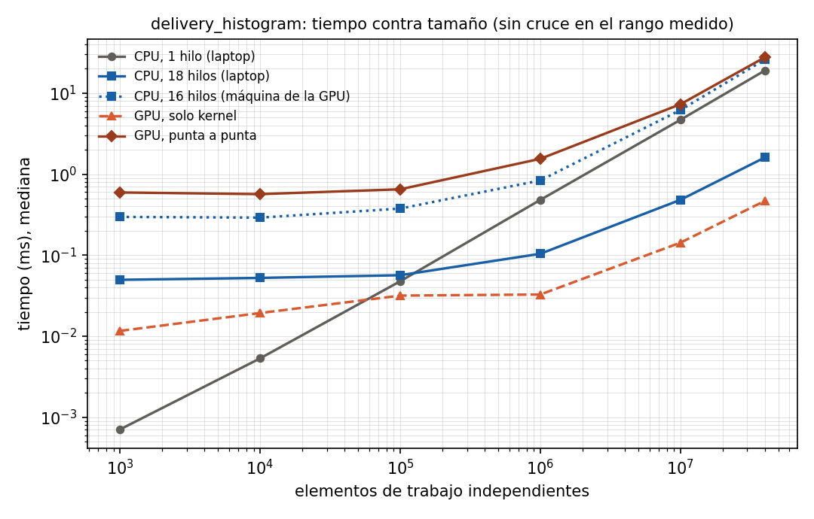
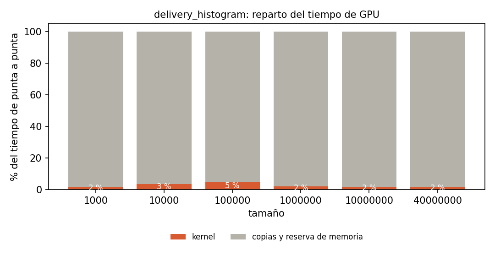

# Histograma de tiempos de entrega: ¿vale la pena la GPU?

Concepto del curso: 07, histograma con atómicos y privatización. Primera aplicación de ese
concepto. Código: `src/gpu/delivery_histogram.*`. Datos: `mac.csv`, `pc.csv`. Tabla y gráficos:
`tabla.md`.

## La tarea

Tomar el tiempo de entrega de cada pedido y contar cuántos caen en cada minuto: un tramo por
minuto. Del histograma salen la mediana y los percentiles sin ordenar los datos.

Es paralela en datos porque cada entrega se clasifica sola. Lo que comparten todos los hilos son
los contadores, y ahí está el problema del concepto: muchos hilos sumando al mismo contador.

## Montaje

El mismo de los experimentos anteriores: CPU del veredicto en el MacBook Pro con Apple M5 Pro (18
núcleos, enchufado, `-O3`); GPU en la PC con Ryzen 7 3700X y RTX 3060 Ti (CUDA 12.1, `-O3`,
sm_86), que además mide las mismas versiones de CPU.

```sh
./delivery_sim ../config/ciudad.json --headless --bench <maquina>.csv --bench-apps delivery_histogram --bench-reps 10 --bench-sweep
./delivery_sim ../config/ciudad.json --gpu-info
python3 tools/gpu_report.py --app delivery_histogram --laptop mac.csv --gpu pc.csv --out tools/reports/gpu/delivery_histogram
```

Seis tamaños, de mil a 40 millones de entregas: más de cuatro órdenes de magnitud. 120 tramos.
Los tiempos van de 10 a 40 minutos con forma de campana, así que la mayoría cae en unos pocos
tramos del centro: es el caso difícil para los atómicos. Una corrida de calentamiento y 10
medidas intercaladas, con la tarjeta despierta antes de cada medida de GPU.

## Diseño

Dos kernels para lo mismo, que es la comparación del concepto:

- **Atómicos globales.** Cada hilo clasifica sus entregas y suma con `atomicAdd` directamente en
  los contadores de memoria global. Todos los hilos de la tarjeta pelean por los mismos 120
  contadores.
- **Contadores privados.** Cada bloque tiene su propio histograma en shared memory. Sus hilos
  suman ahí, y al final el bloque vuelca sus totales a los contadores globales. Las sumas dentro
  del bloque siguen siendo atómicas, pero solo compiten los 256 hilos del bloque y sobre memoria
  rápida.

En los dos, un bloque de 256 hilos atiende 16 384 entregas, 64 por hilo, leídas de forma que los
hilos de un warp tomen posiciones seguidas. Con contadores privados cada bloque hace como mucho
120 sumas atómicas globales en vez de 16 384.

La versión multihilo de CPU usa la misma idea: cada hilo cuenta en un histograma propio y al final
se suman.

**En el programa:** el registro de eventos guarda el tiempo de cada entrega, y al terminar la
simulación se imprime el histograma con la mediana, el p90, el p99 y el minuto más cargado. Se
calcula en CPU, o en la tarjeta con `--backend gpu`.

## Corrección

- Las 600 filas de `pc.csv` y las 420 de `mac.csv` tienen `correct = yes`: conteos idénticos a los
  de CPU de un hilo, con los dos kernels.
- `tests/gpu/delivery_histogram_test.cpp`: un caso a mano con los bordes de cada tramo, valores
  negativos y fuera de rango; tamaños que caen antes, en y después del borde de un bloque; todas
  las entregas en el mismo minuto; y que el total sea el número de entregas.
- `compute-sanitizer`: memcheck 0 errores, racecheck 0 hallazgos.
- ThreadSanitizer en la laptop, sobre la suite completa: 0 reportes.
- Simulación de una hora de `config/equipetrol.json` con el histograma en CPU y en la tarjeta: el
  log pasa el verificador en las dos.

## Resultados

Medianas en ms. La tabla completa está en `tabla.md`.

| Entregas | CPU 1 hilo, laptop | CPU 18 hilos, laptop | GPU kernel | GPU punta a punta | Kernel contra la mejor CPU | Punta a punta contra la mejor CPU |
|---|---|---|---|---|---|---|
| Mil | 0,001 | 0,050 | 0,012 | 0,595 | 0,06x | 0,00x |
| 10 mil | 0,005 | 0,052 | 0,019 | 0,567 | 0,28x | 0,01x |
| 100 mil | 0,048 | 0,057 | 0,032 | 0,651 | 0,89x | 0,04x |
| 1 millón | 0,482 | 0,104 | 0,033 | 1,548 | 3,18x | 0,07x |
| 10 millones | 4,689 | 0,482 | 0,143 | 7,299 | 3,38x | 0,07x |
| 40 millones | 19,007 | 1,606 | 0,468 | 27,664 | 3,32x | 0,06x |



- **El kernel le gana a la laptop desde un millón de entregas**, unas 3,3 veces.
- **De punta a punta no hay cruce.** La GPU queda entre 15 y 18 veces más lenta que la laptop en
  los tamaños grandes. El kernel es el 2 % del tiempo: el resto es subir los datos, 160 MB con 40
  millones de entregas. Bajan solo 480 bytes.
- **En la misma máquina tampoco hay cruce**, aunque se acerca: 0,94 veces con 40 millones.



### Atómicos globales contra contadores privados

Tiempo del kernel en la PC, en ms.

| Entregas | Atómicos globales | Contadores privados | Cuánto gana privatizar | Contadores privados contra la mejor CPU de la laptop | Atómicos globales contra la mejor CPU de la laptop |
|---|---|---|---|---|---|
| Mil | 0,024 | 0,012 | 2,10x | 0,06x | 0,03x |
| 10 mil | 0,021 | 0,019 | 1,09x | 0,28x | 0,25x |
| 100 mil | 0,036 | 0,032 | 1,13x | 0,89x | 0,79x |
| 1 millón | 0,264 | 0,033 | 8,06x | 3,18x | 0,39x |
| 10 millones | 2,640 | 0,143 | 18,48x | 3,38x | 0,18x |
| 40 millones | 12,314 | 0,468 | 26,31x | 3,32x | 0,13x |

Con pocos datos da igual. Desde un millón de entregas, privatizar gana por 8 veces, y con 40
millones por 26. Con atómicos globales el kernel ni siquiera le gana a la laptop: la contención
se come toda la ventaja de la tarjeta.

## Análisis

**Paralelismo disponible.** Un elemento de trabajo por entrega. Cada bloque atiende 16 384 y la
tarjeta aloja 228 bloques a la vez, así que se llena recién con unos 3,7 millones de entregas.
Una simulación del programa produce decenas o cientos.

**Sobrecostos.** Dominan en todos los tamaños. El piso es de 0,6 ms con mil entregas, y con 40
millones la subida de 160 MB cuesta unos 22 ms según `nsys`, contra 0,47 ms de kernel.

**Límite por memoria.** Por cada entrega el kernel lee 4 bytes y hace una división y una suma:
está limitado por memoria. Con contadores privados lee 160 MB en 0,468 ms, 342 GB/s, cerca del
76 % del ancho de banda nominal de la tarjeta. La lectura es seguida, sin tráfico desperdiciado.

**Eficiencia de ejecución.** `--gpu-info`: 6 bloques por multiprocesador y ocupación del 100 % en
los dos kernels, limitada por los hilos. Contadores privados: 24 registros por hilo y 1024 bytes
de shared memory. Atómicos globales: 22 registros. No hay divergencia por datos; solo el último
bloque tiene hilos sin entregas.

**Contención y sincronización.** Es lo que decide entre los dos kernels. Con atómicos globales,
58 368 hilos compiten por 120 contadores, y los datos en campana concentran casi todo en una
treintena. Con contadores privados la contención queda dentro del bloque, hay dos barreras, y a
memoria global llegan 137 veces menos sumas atómicas.

**Corrección bajo paralelismo.** Los conteos son sumas de enteros: no dependen del orden. Sin el
atómico se perderían sumas cuando dos hilos leen el mismo valor viejo; racecheck confirma que no
pasa.

## Veredicto

- **Histograma sobre datos que están en la CPU: CPU, siempre.** Un hilo de la laptop cuenta 40
  millones de entregas en 19 ms y 18 hilos en 1,6 ms; a la GPU solo subirlos le cuesta 22 ms.
- **En el tamaño del enunciado y en la ciudad: CPU.** Con cientos de entregas un hilo tarda menos
  de un microsegundo.
- **La GPU valdría la pena si los datos ya estuvieran en la tarjeta.** El kernel con contadores
  privados es 3,3 veces más rápido que 18 hilos de la laptop, y solo bajan los contadores.
- **Si se usa GPU, con contadores privados.** Con atómicos globales el kernel pierde hasta contra
  la CPU.

## Amenazas a la validez

- **Dos máquinas.** El veredicto compara la CPU de la laptop con la GPU de la PC; `tabla.md` trae
  también la comparación en la misma máquina, que llega a lo mismo.
- **Una sola forma de los datos.** La campana concentra las entregas en pocos tramos, que es el
  peor caso para los atómicos globales. Con datos repartidos parejo la diferencia entre los dos
  kernels sería menor.
- **Tarjeta a régimen.** Las medidas se toman después de despertar la tarjeta.
- **En el programa el histograma es chico.** Una hora simulada del enunciado da unas 50 entregas:
  el efecto en la simulación no se puede medir.
- **La PC no estaba en reposo** y corre en un contenedor sobre WSL2. `ncu` no perfila ahí; la
  ocupación sale de `--gpu-info` y el reparto del tiempo de eventos CUDA y de `nsys`.
