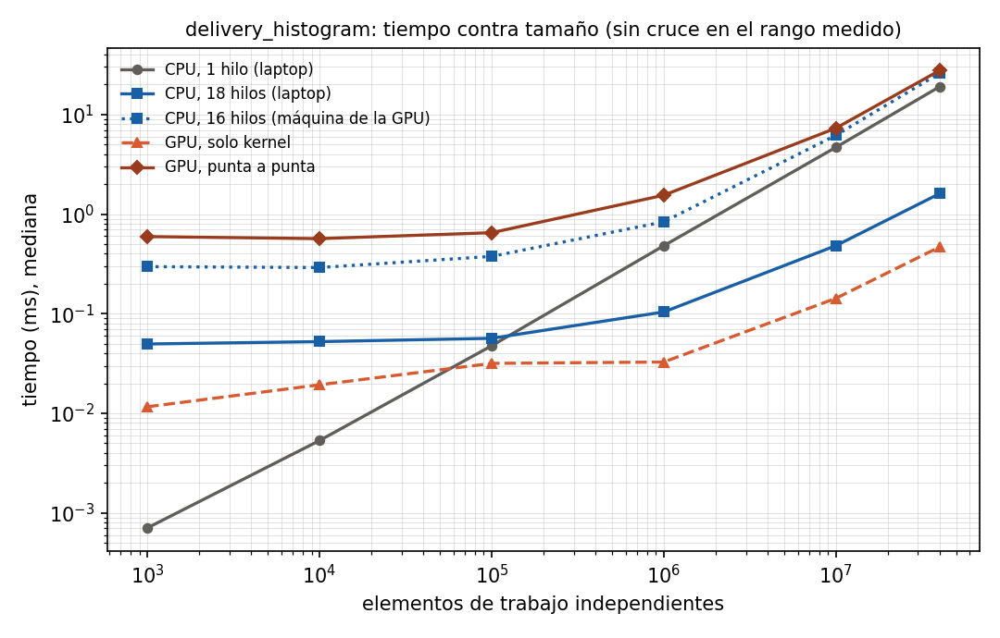
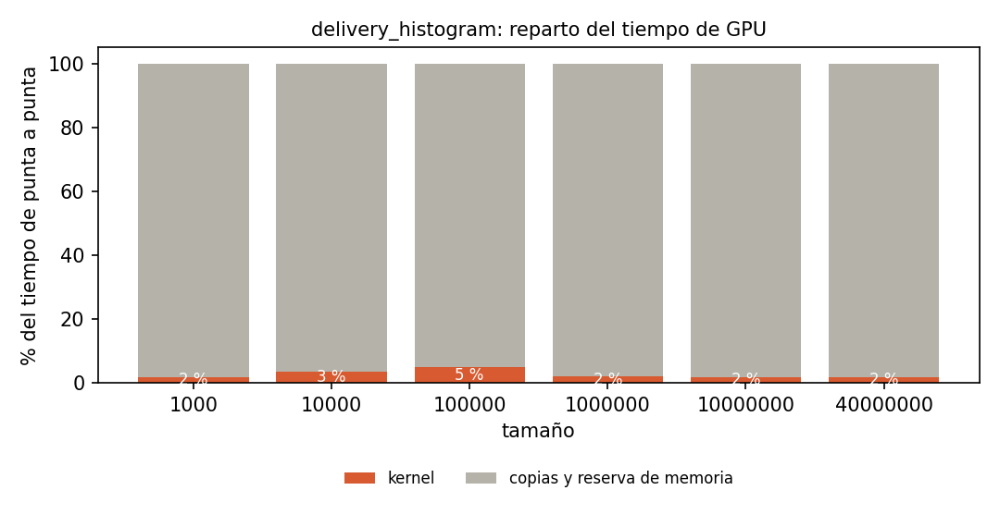
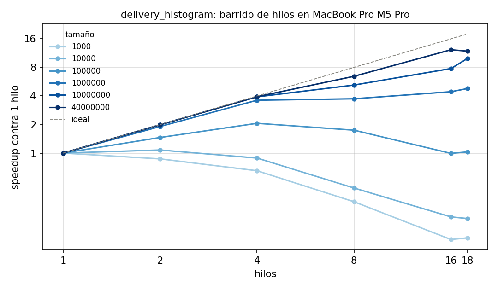

# delivery_histogram: CPU contra GPU

Generado por `tools/gpu_report.py` a partir de `mac.csv` y `pc.csv`. 10 repeticiones medidas por versión y tamaño, después de una de calentamiento.

### Veredicto: la GPU contra la CPU de la laptop

| Tamaño | CPU 1 hilo (ms) | CPU 18 hilos (ms) | GPU kernel (ms) | GPU punta a punta (ms) | Mejor CPU | Speedup de la GPU contra la mejor CPU (kernel / punta a punta) | ¿Correcto? |
|---|---|---|---|---|---|---|---|
| 1000 | 0.001 (0.001–0.001) | 0.050 (0.036–0.068) | 0.012 (0.008–0.016) | 0.595 (0.538–0.850) | 0.001 (1 hilo) | 0.06x / 0.00x | sí |
| 10000 | 0.005 (0.005–0.006) | 0.052 (0.046–0.078) | 0.019 (0.018–0.026) | 0.567 (0.551–0.801) | 0.005 (1 hilo) | 0.28x / 0.01x | sí |
| 100000 | 0.048 (0.046–0.051) | 0.057 (0.039–0.078) | 0.032 (0.031–0.032) | 0.651 (0.638–0.670) | 0.028 (4 hilos) | 0.89x / 0.04x | sí |
| 1000000 | 0.482 (0.461–0.523) | 0.104 (0.093–0.112) | 0.033 (0.032–0.128) | 1.548 (1.352–1.966) | 0.104 (18 hilos) | 3.18x / 0.07x | sí |
| 10000000 | 4.689 (4.551–4.805) | 0.482 (0.367–0.603) | 0.143 (0.136–0.209) | 7.299 (7.032–9.922) | 0.482 (18 hilos) | 3.38x / 0.07x | sí |
| 40000000 | 19.007 (18.673–19.074) | 1.606 (1.340–2.214) | 0.468 (0.450–0.507) | 27.664 (25.162–30.819) | 1.553 (16 hilos) | 3.32x / 0.06x | sí |

Tiempos de CPU: MacBook Pro M5 Pro. Mediana de las repeticiones y, entre paréntesis, mínimo y máximo.

Cruce de punta a punta contra la mejor CPU de la laptop: **no hay cruce en el rango medido**; la CPU gana en todos los tamaños.

### Misma máquina: la GPU contra la CPU de su propia máquina

| Tamaño | CPU 1 hilo (ms) | CPU 16 hilos (ms) | GPU kernel (ms) | GPU punta a punta (ms) | Mejor CPU | Speedup de la GPU contra la mejor CPU (kernel / punta a punta) | ¿Correcto? |
|---|---|---|---|---|---|---|---|
| 1000 | 0.004 (0.004–0.004) | 0.297 (0.274–0.326) | 0.012 (0.008–0.016) | 0.595 (0.538–0.850) | 0.004 (1 hilo) | 0.35x / 0.01x | sí |
| 10000 | 0.039 (0.039–0.043) | 0.291 (0.283–0.316) | 0.019 (0.018–0.026) | 0.567 (0.551–0.801) | 0.039 (1 hilo) | 2.01x / 0.07x | sí |
| 100000 | 0.390 (0.385–0.421) | 0.376 (0.339–0.405) | 0.032 (0.031–0.032) | 0.651 (0.638–0.670) | 0.193 (8 hilos) | 6.09x / 0.30x | sí |
| 1000000 | 4.491 (3.909–5.102) | 0.837 (0.758–0.970) | 0.033 (0.032–0.128) | 1.548 (1.352–1.966) | 0.837 (16 hilos) | 25.55x / 0.54x | sí |
| 10000000 | 48.105 (46.839–49.155) | 6.188 (5.326–6.807) | 0.143 (0.136–0.209) | 7.299 (7.032–9.922) | 6.188 (16 hilos) | 43.32x / 0.85x | sí |
| 40000000 | 196.257 (177.487–198.317) | 25.956 (21.416–29.453) | 0.468 (0.450–0.507) | 27.664 (25.162–30.819) | 25.956 (16 hilos) | 55.47x / 0.94x | sí |

Tiempos de CPU: PC Ryzen 7 3700X + RTX 3060 Ti. Mediana de las repeticiones y, entre paréntesis, mínimo y máximo.

Cruce de punta a punta contra la mejor CPU de la misma máquina: **no hay cruce en el rango medido**.

### Variantes de GPU

Mediana en ms de cada variante medida en la misma corrida.

| Tamaño | `gpu_kernel` | `gpu_e2e` | `gpu_e2e_atomic` | `gpu_kernel_atomic` |
|---|---|---|---|---|
| 1000 | 0.012 | 0.595 | 0.711 | 0.024 |
| 10000 | 0.019 | 0.567 | 0.567 | 0.021 |
| 100000 | 0.032 | 0.651 | 0.637 | 0.036 |
| 1000000 | 0.033 | 1.548 | 1.667 | 0.264 |
| 10000000 | 0.143 | 7.299 | 9.393 | 2.640 |
| 40000000 | 0.468 | 27.664 | 38.959 | 12.314 |

### Barrido de hilos, MacBook Pro M5 Pro

Speedup de la versión multihilo contra ella misma con 1 hilo.

| Tamaño | 1 hilo | 2 hilos | 4 hilos | 8 hilos | 16 hilos | 18 hilos |
|---|---|---|---|---|---|---|
| 1000 | 1.00x | 0.87x | 0.65x | 0.31x | 0.12x | 0.13x |
| 10000 | 1.00x | 1.08x | 0.89x | 0.43x | 0.21x | 0.20x |
| 100000 | 1.00x | 1.46x | 2.06x | 1.74x | 0.99x | 1.03x |
| 1000000 | 1.00x | 1.91x | 3.61x | 3.73x | 4.43x | 4.79x |
| 10000000 | 1.00x | 1.99x | 3.91x | 5.21x | 7.78x | 9.92x |
| 40000000 | 1.00x | 1.99x | 3.93x | 6.45x | 12.27x | 11.87x |

### Barrido de hilos, PC Ryzen 7 3700X + RTX 3060 Ti

Speedup de la versión multihilo contra ella misma con 1 hilo.

| Tamaño | 1 hilo | 2 hilos | 4 hilos | 8 hilos | 16 hilos |
|---|---|---|---|---|---|
| 1000 | 1.00x | 1.35x | 0.51x | 0.39x | 0.22x |
| 10000 | 1.00x | 1.28x | 0.77x | 0.54x | 0.33x |
| 100000 | 1.00x | 1.81x | 2.12x | 2.37x | 1.22x |
| 1000000 | 1.00x | 1.82x | 3.26x | 4.13x | 5.22x |
| 10000000 | 1.00x | 1.99x | 3.85x | 4.68x | 7.54x |
| 40000000 | 1.00x | 1.99x | 3.79x | 4.67x | 7.17x |

### Gráficos

