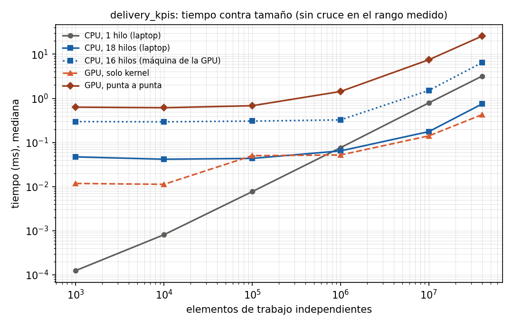
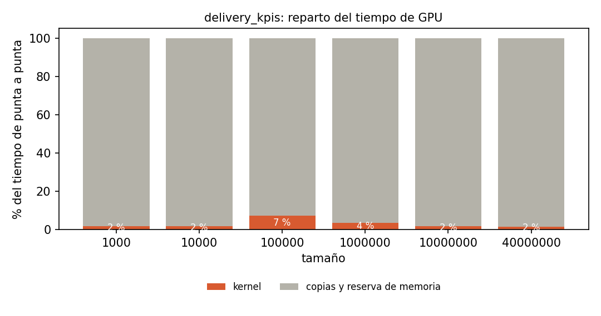
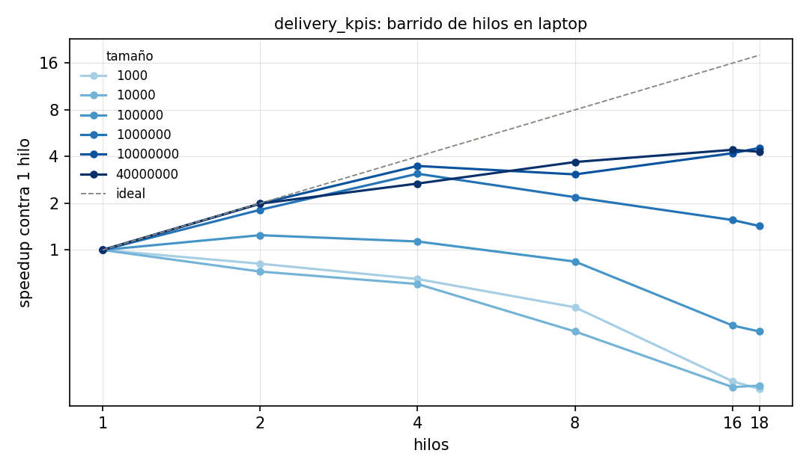

# Indicadores de entrega: ¿vale la pena la GPU?

Concepto del curso: 08, reducción con árbol en shared memory y varios datos por hilo. Segunda
aplicación de ese concepto; la primera fue la mejor moto de cada pedido. Código:
`src/gpu/delivery_kpis.*`. Datos: `mac.csv`, `pc.csv`. Tabla y gráficos: `tabla.md`.

## La tarea

Resumir los tiempos de entrega de la simulación en tres números: la suma, de donde sale el
promedio; el máximo, que es la entrega más lenta; y cuántas pasaron de 45 minutos. Las tres son
reducciones y se calculan juntas, en una sola lectura de los datos.

Es paralela en datos porque sumar, tomar el máximo y contar son operaciones asociativas: se puede
reducir cada parte por separado y después combinar los parciales en cualquier orden.

## Montaje

El mismo de los experimentos anteriores: CPU del veredicto en el MacBook Pro con Apple M5 Pro (18
núcleos, enchufado, `-O3`); GPU en la PC con Ryzen 7 3700X y RTX 3060 Ti (CUDA 12.1, `-O3`,
sm_86), que además mide las mismas versiones de CPU.

```sh
./delivery_sim ../config/ciudad.json --headless --bench <maquina>.csv --bench-apps delivery_kpis --bench-reps 10 --bench-sweep
./delivery_sim ../config/ciudad.json --gpu-info
python3 tools/gpu_report.py --app delivery_kpis --laptop mac.csv --gpu pc.csv --out tools/reports/gpu/delivery_kpis
```

Seis tamaños, de mil a 40 millones de entregas: más de cuatro órdenes de magnitud. Los tiempos van
de 10 a 55 minutos con forma de campana. Una corrida de calentamiento y 10 medidas intercaladas,
con la tarjeta despierta antes de cada medida de GPU.

## Diseño

- **Un parcial con los tres indicadores.** Suma en 64 bits, máximo y cantidad de tardías viajan
  juntos en una estructura de 16 bytes, así los datos se leen una sola vez.
- **Varios datos por hilo.** Cada bloque tiene 256 hilos y cada hilo reduce primero 64 entregas
  en sus registros. El hilo `t` lee las posiciones `t`, `t + 256`, `t + 512`…, así los hilos de
  un warp leen posiciones seguidas.
- **Árbol en shared memory.** Cada hilo deja su parcial en un arreglo de 256 lugares y el bloque
  lo reduce en 8 pasos, con una barrera entre pasos. El paso se achica a la mitad cada vez, así
  los hilos que trabajan quedan juntos al principio del bloque.
- **Segundo nivel.** Cada bloque escribe su parcial en memoria global y otro kernel reduce esos
  parciales con el mismo árbol, hasta que queda uno. Baja una sola estructura: 16 bytes.
- **La variante.** El mismo kernel con un dato por hilo: todo pasa por el árbol y hacen falta 64
  veces más bloques. Es la comparación del concepto.

La versión multihilo de CPU hace lo mismo: cada hilo reduce su parte y al final se combinan.

**En el programa:** al terminar la simulación se imprimen el promedio, la entrega más lenta y
cuántas pasaron de 45 minutos. Se calcula en CPU con un hilo, o en la tarjeta con `--backend gpu`.

## Corrección

- Las 600 filas de `pc.csv` y las 420 de `mac.csv` tienen `correct = yes`: los tres indicadores
  idénticos a los de CPU de un hilo, sin tolerancia, porque son enteros.
- `tests/gpu/delivery_kpis_test.cpp`: un caso a mano con una entrega justo en el límite de 45
  minutos; una suma que no entra en 32 bits; valores negativos, para ver que el máximo no parte de
  cero; tamaños antes, en y después del borde de un bloque; y casos que obligan a dos y tres
  niveles de reducción.
- `compute-sanitizer`: memcheck 0 errores, racecheck 0 hallazgos.
- ThreadSanitizer en la laptop, sobre la suite completa: 0 reportes.
- **Contra un cálculo independiente.** El registro de eventos lleva su propio promedio y máximo,
  que actualiza con cada entrega. En una hora de `config/equipetrol.json`, con la reducción en CPU
  y en la tarjeta, los dos coinciden al milisegundo con los de la reducción, y el log pasa el
  verificador.

## Resultados

Medianas en ms. La tabla completa está en `tabla.md`.

| Entregas | CPU 1 hilo, laptop | CPU 18 hilos, laptop | GPU kernel | GPU punta a punta | Kernel contra la mejor CPU | Punta a punta contra la mejor CPU |
|---|---|---|---|---|---|---|
| Mil | 0,0001 | 0,047 | 0,012 | 0,632 | 0,01x | 0,00x |
| 10 mil | 0,0008 | 0,042 | 0,011 | 0,613 | 0,07x | 0,00x |
| 100 mil | 0,0077 | 0,044 | 0,050 | 0,681 | 0,15x | 0,01x |
| 1 millón | 0,076 | 0,064 | 0,052 | 1,431 | 0,57x | 0,02x |
| 10 millones | 0,790 | 0,176 | 0,141 | 7,496 | 1,25x | 0,02x |
| 40 millones | 3,181 | 0,744 | 0,427 | 25,7 | 1,69x | 0,03x |



- **El kernel le gana a la laptop desde 10 millones de entregas**: 1,25 veces, y 1,69 veces con
  40 millones. Es menos que en el histograma (3,3 veces) porque aquí la CPU también va muy
  rápido: el compilador vectoriza el lazo y un solo hilo procesa 12 600 millones de entregas por
  segundo.
- **De punta a punta no hay cruce.** La GPU queda unas 35 veces más lenta que la laptop con 40
  millones. El kernel es el 1,7 % del tiempo: el resto es subir 160 MB.
- **En la misma máquina tampoco hay cruce**: 0,23 veces con 40 millones. Sin contar las copias,
  el kernel le gana 13,6 veces a la CPU de la PC.

| Entregas | CPU 1 hilo, PC | CPU 16 hilos, PC | GPU kernel | GPU punta a punta | Kernel contra la mejor CPU | Punta a punta contra la mejor CPU |
|---|---|---|---|---|---|---|
| Mil | 0,0004 | 0,297 | 0,012 | 0,632 | 0,03x | 0,00x |
| 10 mil | 0,0027 | 0,294 | 0,011 | 0,613 | 0,24x | 0,00x |
| 100 mil | 0,025 | 0,305 | 0,050 | 0,681 | 0,49x | 0,04x |
| 1 millón | 0,250 | 0,325 | 0,052 | 1,431 | 3,69x | 0,13x |
| 10 millones | 3,543 | 1,512 | 0,141 | 7,496 | 10,71x | 0,20x |
| 40 millones | 13,8 | 6,431 | 0,427 | 25,7 | 13,62x | 0,23x |



### Un dato por hilo contra 64 datos por hilo

Tiempo del kernel en la PC, en ms.

| Entregas | Un dato por hilo | 64 datos por hilo | Cuánto gana | Lanzamientos con un dato por hilo | Lanzamientos con 64 |
|---|---|---|---|---|---|
| Mil | 0,014 | 0,012 | 1,22x | 2 | 1 |
| 10 mil | 0,013 | 0,011 | 1,19x | 2 | 1 |
| 100 mil | 0,054 | 0,050 | 1,08x | 3 | 2 |
| 1 millón | 0,073 | 0,052 | 1,40x | 3 | 2 |
| 10 millones | 0,346 | 0,141 | 2,45x | 3 | 2 |
| 40 millones | 1,432 | 0,427 | 3,35x | 4 | 2 |

Con pocos datos da casi igual, porque manda el costo de lanzar. Desde 10 millones, reducir 64
datos por hilo antes del árbol gana 2,5 veces, y con 40 millones 3,4. Con un dato por hilo, cada
entrega ocupa un lugar de shared memory y pasa por los ocho pasos del árbol; con 64, solo uno de cada 64
parciales llega al árbol y el resto del trabajo se hace en registros.



En la laptop la versión multihilo recién conviene desde un millón de entregas y llega a 4,5 veces
con 18 hilos. No escala más porque el lazo está limitado por la memoria, no por el cómputo.

## Análisis

**Paralelismo disponible.** Un elemento de trabajo por entrega. Cada bloque atiende 16 384 y la
tarjeta aloja 228 bloques a la vez, así que se llena recién con unos 3,7 millones de entregas.
Una simulación del programa produce como mucho miles.

**Sobrecostos.** Dominan en todos los tamaños. El piso es de 0,6 ms con mil entregas, y con 40
millones lo que no es kernel suma 25,3 ms, casi todo la subida de 160 MB, contra 0,43 ms de
kernel. Bajan 16 bytes.

**Límite por memoria.** Por cada entrega el kernel lee 4 bytes y hace una suma, una comparación
y un conteo: está limitado por memoria. Lee 160 MB en 0,427 ms, 375 GB/s, el 84 % del ancho de
banda nominal de la tarjeta. La CPU tiene el mismo límite: un hilo de la laptop va a 50 GB/s y
con 16 hilos llega a unos 220 GB/s.

**Eficiencia de ejecución.** `--gpu-info`: 6 bloques por multiprocesador y ocupación del 100 % en
los dos kernels, limitada por los hilos. El de reducción usa 20 registros por hilo y el que
combina parciales 36; los dos, 4096 bytes de shared memory. No hay divergencia por datos: el
máximo y el conteo se calculan sin saltos. En el árbol, la mitad de los hilos queda sin trabajo
en cada paso, pero son siempre los del final del bloque, así que los warps enteros se apagan.

**Contención y sincronización.** No hay atómicos. Cada hilo escribe solo en su lugar de shared
memory y cada bloque en su lugar de memoria global. La sincronización es la barrera entre pasos
del árbol: nueve por bloque.

**Corrección bajo paralelismo.** La suma de enteros, el máximo y el conteo son asociativos y
conmutativos, así que el orden en que se combinan no cambia el resultado y la tarjeta da
exactamente lo mismo que la CPU. Sin la barrera, un hilo leería un parcial que su vecino todavía
no terminó de escribir; racecheck confirma que no pasa. La suma va en 64 bits porque 40 millones
de entregas de media hora no entran en 32.

## Veredicto

- **Indicadores sobre datos que están en la CPU: CPU, siempre.** Un hilo de la laptop reduce 40
  millones de entregas en 3,2 ms y 16 hilos en 0,7 ms; a la GPU solo subirlos le cuesta 25 ms.
- **En el programa: CPU con un hilo.** Con cientos o miles de entregas tarda menos de un
  microsegundo, y repartirlo entre hilos lo haría más lento.
- **La GPU valdría la pena si los datos ya estuvieran en la tarjeta.** El kernel gana desde 10
  millones de entregas. Tendría sentido encadenado a otro kernel que ya subió los tiempos, como
  el histograma, que lee el mismo arreglo.
- **Dentro de la GPU, varios datos por hilo.** Es hasta 3,4 veces más rápido que un dato por hilo
  y no cuesta nada.

## Amenazas a la validez

- **Dos máquinas.** El veredicto contra la laptop compara una CPU mucho más rápida que la de la
  PC. Por eso se informa también la comparación en la misma máquina.
- **Los tamaños grandes no salen del programa.** Una simulación produce como mucho miles de
  entregas; los millones son datos generados para ver hasta dónde llega cada versión.
- **Medidas muy cortas.** Con mil y diez mil entregas la CPU tarda menos de un microsegundo y el
  kernel unos 10 microsegundos, cerca de la resolución del reloj y del costo de lanzar.
- **La PC no estaba en reposo** y corre en un contenedor sobre WSL2. Se usaron medianas de 10
  repeticiones y la tarjeta estaba en régimen en las 120 medidas.
