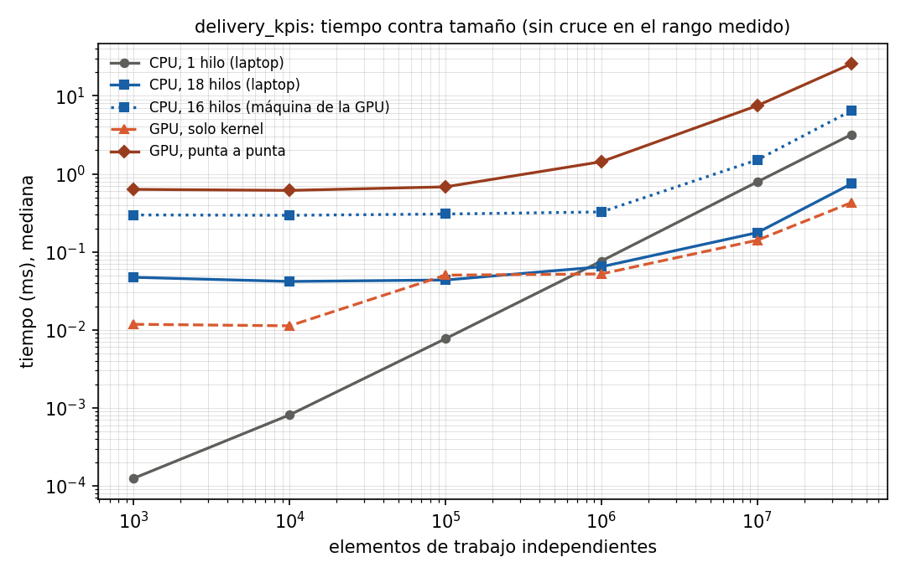
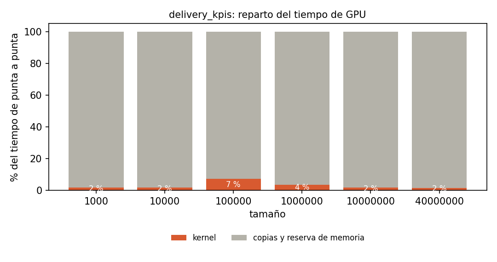
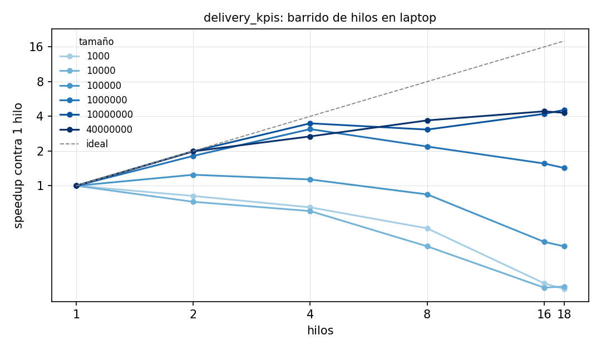

# delivery_kpis: CPU contra GPU

Generado por `tools/gpu_report.py` a partir de `mac.csv` y `pc.csv`. 10 repeticiones medidas por versión y tamaño, después de una de calentamiento.

### Veredicto: la GPU contra la CPU de la laptop

| Tamaño | CPU 1 hilo (ms) | CPU 18 hilos (ms) | GPU kernel (ms) | GPU punta a punta (ms) | Mejor CPU | Speedup de la GPU contra la mejor CPU (kernel / punta a punta) | ¿Correcto? |
|---|---|---|---|---|---|---|---|
| 1000 | 0.000 (0.000–0.000) | 0.047 (0.038–0.066) | 0.012 (0.007–0.086) | 0.632 (0.585–1.006) | 0.000 (1 hilo) | 0.01x / 0.00x | sí |
| 10000 | 0.001 (0.001–0.001) | 0.042 (0.032–0.061) | 0.011 (0.009–0.093) | 0.613 (0.597–0.844) | 0.001 (1 hilo) | 0.07x / 0.00x | sí |
| 100000 | 0.008 (0.007–0.008) | 0.044 (0.029–0.057) | 0.050 (0.045–0.066) | 0.681 (0.656–0.728) | 0.008 (1 hilo) | 0.15x / 0.01x | sí |
| 1000000 | 0.076 (0.074–0.081) | 0.064 (0.051–0.076) | 0.052 (0.050–0.106) | 1.431 (1.393–1.768) | 0.030 (4 hilos) | 0.57x / 0.02x | sí |
| 10000000 | 0.790 (0.766–0.862) | 0.176 (0.158–0.208) | 0.141 (0.136–0.219) | 7.496 (7.145–8.019) | 0.176 (18 hilos) | 1.25x / 0.02x | sí |
| 40000000 | 3.181 (3.099–3.303) | 0.744 (0.677–0.805) | 0.427 (0.422–0.448) | 25.707 (24.918–25.834) | 0.722 (16 hilos) | 1.69x / 0.03x | sí |

Tiempos de CPU: laptop. Mediana de las repeticiones y, entre paréntesis, mínimo y máximo.

Cruce de punta a punta contra la mejor CPU de la laptop: **no hay cruce en el rango medido**; la CPU gana en todos los tamaños.

### Misma máquina: la GPU contra la CPU de su propia máquina

| Tamaño | CPU 1 hilo (ms) | CPU 16 hilos (ms) | GPU kernel (ms) | GPU punta a punta (ms) | Mejor CPU | Speedup de la GPU contra la mejor CPU (kernel / punta a punta) | ¿Correcto? |
|---|---|---|---|---|---|---|---|
| 1000 | 0.000 (0.000–0.001) | 0.297 (0.285–0.386) | 0.012 (0.007–0.086) | 0.632 (0.585–1.006) | 0.000 (1 hilo) | 0.03x / 0.00x | sí |
| 10000 | 0.003 (0.003–0.003) | 0.294 (0.287–0.338) | 0.011 (0.009–0.093) | 0.613 (0.597–0.844) | 0.003 (1 hilo) | 0.24x / 0.00x | sí |
| 100000 | 0.025 (0.025–0.047) | 0.305 (0.288–0.327) | 0.050 (0.045–0.066) | 0.681 (0.656–0.728) | 0.025 (1 hilo) | 0.49x / 0.04x | sí |
| 1000000 | 0.250 (0.248–0.277) | 0.325 (0.300–0.368) | 0.052 (0.050–0.106) | 1.431 (1.393–1.768) | 0.192 (4 hilos) | 3.69x / 0.13x | sí |
| 10000000 | 3.543 (3.482–4.243) | 1.512 (1.328–1.640) | 0.141 (0.136–0.219) | 7.496 (7.145–8.019) | 1.512 (16 hilos) | 10.71x / 0.20x | sí |
| 40000000 | 13.787 (13.475–14.145) | 6.431 (6.270–6.755) | 0.427 (0.422–0.448) | 25.707 (24.918–25.834) | 5.820 (4 hilos) | 13.62x / 0.23x | sí |

Tiempos de CPU: máquina de la GPU. Mediana de las repeticiones y, entre paréntesis, mínimo y máximo.

Cruce de punta a punta contra la mejor CPU de la misma máquina: **no hay cruce en el rango medido**.

### Variantes de GPU

Mediana en ms de cada variante medida en la misma corrida.

| Tamaño | `gpu_kernel` | `gpu_e2e` | `gpu_e2e_fine` | `gpu_kernel_fine` |
|---|---|---|---|---|
| 1000 | 0.012 | 0.632 | 0.622 | 0.014 |
| 10000 | 0.011 | 0.613 | 0.602 | 0.013 |
| 100000 | 0.050 | 0.681 | 0.696 | 0.054 |
| 1000000 | 0.052 | 1.431 | 1.486 | 0.073 |
| 10000000 | 0.141 | 7.496 | 7.472 | 0.346 |
| 40000000 | 0.427 | 25.707 | 25.876 | 1.432 |

### Barrido de hilos, laptop

Speedup de la versión multihilo contra ella misma con 1 hilo.

| Tamaño | 1 hilo | 2 hilos | 4 hilos | 8 hilos | 16 hilos | 18 hilos |
|---|---|---|---|---|---|---|
| 1000 | 1.00x | 0.82x | 0.65x | 0.43x | 0.14x | 0.13x |
| 10000 | 1.00x | 0.73x | 0.60x | 0.30x | 0.13x | 0.13x |
| 100000 | 1.00x | 1.25x | 1.13x | 0.84x | 0.33x | 0.30x |
| 1000000 | 1.00x | 1.81x | 3.10x | 2.19x | 1.56x | 1.43x |
| 10000000 | 1.00x | 1.99x | 3.48x | 3.07x | 4.20x | 4.54x |
| 40000000 | 1.00x | 1.99x | 2.68x | 3.69x | 4.42x | 4.29x |

### Barrido de hilos, máquina de la GPU

Speedup de la versión multihilo contra ella misma con 1 hilo.

| Tamaño | 1 hilo | 2 hilos | 4 hilos | 8 hilos | 16 hilos |
|---|---|---|---|---|---|
| 1000 | 1.00x | 1.62x | 0.55x | 0.36x | 0.20x |
| 10000 | 1.00x | 1.23x | 0.56x | 0.38x | 0.21x |
| 100000 | 1.00x | 1.16x | 0.73x | 0.51x | 0.28x |
| 1000000 | 1.00x | 1.64x | 1.65x | 1.22x | 0.98x |
| 10000000 | 1.00x | 1.82x | 2.14x | 2.41x | 2.45x |
| 40000000 | 1.00x | 1.86x | 2.38x | 2.26x | 2.15x |

### Gráficos

