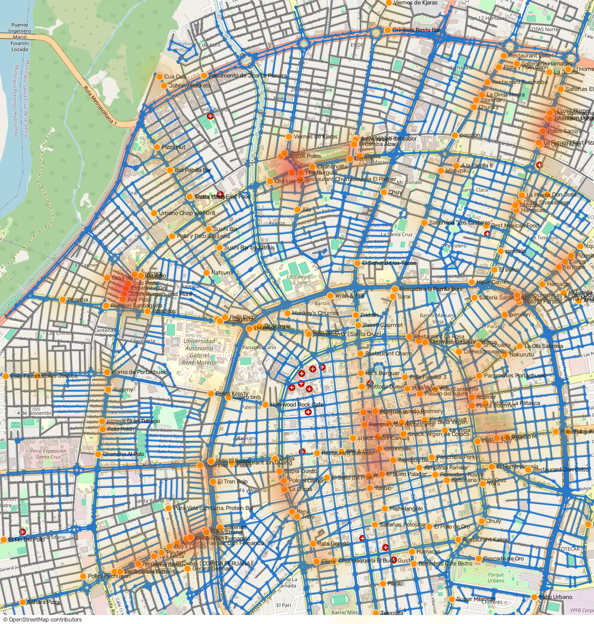
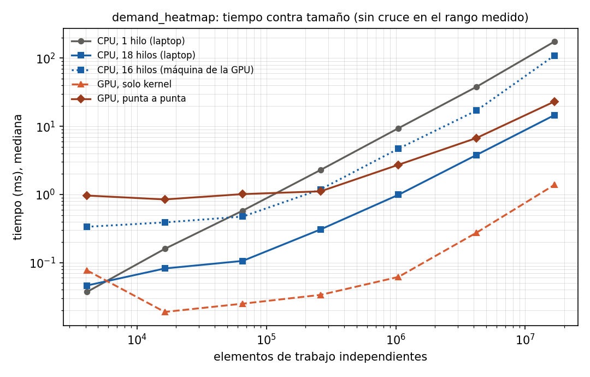
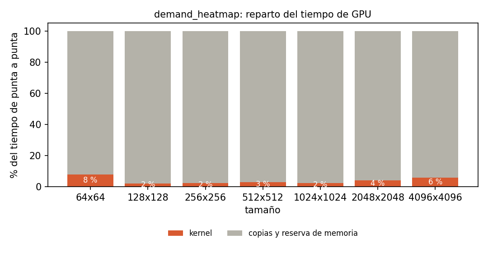

# Mapa de calor de demanda: ¿vale la pena la GPU?

Concepto del curso: 05, convolución con el filtro en memoria constante. Primera aplicación de ese
concepto. Código: `src/gpu/demand_heatmap.*`, `src/demand_log.h` y `drawHeatmap` en
`src/fleet_view.cpp`. Datos: `mac.csv`, `pc.csv`. Tabla y gráficos: `tabla.md`.

## La tarea

Repartir en una cuadrícula sobre el mapa los restaurantes de los pedidos recientes, y suavizar esa
cuadrícula para que se vea como zonas de demanda y no como puntos sueltos. El suavizado es una
convolución: cada celda pasa a ser un promedio ponderado de ella y sus vecinas en un cuadrado de
7 × 7, con pesos gaussianos que suman uno.

Es paralela en datos porque cada celda de salida se calcula solo con la cuadrícula de entrada:
ninguna espera el resultado de otra.

## Montaje

El mismo de los experimentos anteriores: CPU del veredicto en el MacBook Pro con Apple M5 Pro (18
núcleos, enchufado, `-O3`); GPU en la PC con Ryzen 7 3700X y RTX 3060 Ti (CUDA 12.1, `-O3`,
sm_86), que además mide las mismas versiones de CPU.

```sh
./delivery_sim ../config/ciudad.json --headless --bench <maquina>.csv --bench-apps demand_heatmap --bench-reps 10 --bench-sweep
./delivery_sim ../config/ciudad.json --gpu-info
python3 tools/gpu_report.py --app demand_heatmap --laptop mac.csv --gpu pc.csv --out tools/reports/gpu/demand_heatmap
```

Siete cuadrículas, de 64 × 64 a 4096 × 4096: de 4096 a 16,8 millones de celdas, más de tres
órdenes de magnitud. La de 64 × 64 es la que usa el programa. Una corrida de calentamiento y 10
medidas intercaladas, con la tarjeta despierta antes de cada medida de GPU.

## Diseño

- **Un hilo por celda de salida**, en bloques de 16 × 16. Cada hilo recorre sus 49 vecinas,
  multiplica cada una por su peso y suma.
- **Los pesos en memoria constante.** Son 49 números que no cambian durante el lanzamiento y que
  leen todos los hilos. Se suben con `cudaMemcpyToSymbol` y el kernel los lee sin recibirlos como
  parámetro. Para medir qué aporta, hay un segundo kernel igual que los lee de memoria global.
- **Bordes.** Las vecinas que caen fuera del mapa cuentan como cero: cerca del borde se pierde
  algo de demanda, nunca se inventa.
- **El conteo previo se hace en CPU.** Repartir los pedidos en celdas es un histograma chico; lo
  que va a la tarjeta es la cuadrícula ya contada.

**En el programa:** el generador avisa cada pedido creado y un registro guarda cuándo y en qué
restaurante. En la ventana, la tecla `h` muestra u oculta la capa, que se recalcula dos veces por
segundo con los pedidos de los últimos diez minutos simulados. Al terminar se informa la zona de
mayor demanda de toda la corrida. El suavizado corre en CPU, o en la tarjeta con `--backend gpu`.



La imagen es la capa dibujada sobre el mapa de la ciudad con una demanda de ejemplo, de 1 a 12
pedidos por restaurante.

## Corrección

- **Tolerancia.** Son números decimales, y la tarjeta puede fundir cada multiplicación con su suma
  en una sola operación con un solo redondeo, así que el resultado no es idéntico bit a bit. Se
  acepta una diferencia de una parte en diez mil por celda. Un peso mal ubicado o una vecina de
  más cambian el resultado mucho más que eso. Las dos versiones de CPU sí se comparan exactas.
- Las 700 filas de `pc.csv` y las 490 de `mac.csv` tienen `correct = yes`.
- `tests/gpu/demand_heatmap_test.cpp`: los pesos suman uno y son simétricos; un solo pedido en el
  centro deja exactamente la forma del filtro; cuadrículas de tamaños que no son múltiplos del
  bloque; y suavizar no agrega demanda.
- `compute-sanitizer`: memcheck 0 errores, racecheck 0 hallazgos.
- ThreadSanitizer en la laptop, sobre la suite completa: 0 reportes.
- Simulación de ciudad con el suavizado en CPU y en la tarjeta: las dos dan la misma zona de
  mayor demanda, fila 29 y columna 13, y el log pasa el verificador.

## Resultados

Medianas en ms. La tabla completa está en `tabla.md`.

| Cuadrícula | CPU 1 hilo, laptop | CPU 18 hilos, laptop | GPU kernel | GPU punta a punta | Kernel contra la mejor CPU | Punta a punta contra la mejor CPU |
|---|---|---|---|---|---|---|
| 64 × 64 | 0,037 | 0,046 | 0,077 | 0,966 | 0,31x | 0,02x |
| 128 × 128 | 0,160 | 0,082 | 0,019 | 0,847 | 2,78x | 0,06x |
| 256 × 256 | 0,580 | 0,106 | 0,025 | 1,014 | 4,24x | 0,10x |
| 512 × 512 | 2,293 | 0,308 | 0,034 | 1,113 | 9,12x | 0,28x |
| 1024 × 1024 | 9,400 | 0,991 | 0,062 | 2,733 | 15,69x | 0,36x |
| 2048 × 2048 | 37,946 | 3,800 | 0,275 | 6,737 | 13,81x | 0,56x |
| 4096 × 4096 | 174,671 | 14,580 | 1,383 | 23,072 | 10,54x | 0,63x |



- **El kernel le gana a la laptop desde 128 × 128**, y por mucho: entre 9 y 16 veces desde
  512 × 512. Es la mayor ventaja de kernel de todas las aplicaciones medidas hasta ahora.
- **De punta a punta no hay cruce contra la laptop**, pero se acerca al crecer: 0,28, 0,36, 0,56 y
  0,63 veces en los cuatro tamaños mayores.
- **En la misma máquina el cruce está en 512 × 512**, 262 000 celdas, y llega a 4,7 veces con
  4096 × 4096.
- **El kernel es entre el 2 y el 8 % del tiempo de punta a punta.** El resto es subir la
  cuadrícula y bajar el resultado, 64 MB cada uno en el tamaño mayor.



### Pesos en memoria constante contra memoria global

Tiempo del kernel en la PC, en ms.

| Cuadrícula | Pesos en memoria global | Pesos en memoria constante | Cuánto gana la memoria constante |
|---|---|---|---|
| 64 × 64 | 0,053 | 0,077 | 0,68x |
| 128 × 128 | 0,049 | 0,019 | 2,57x |
| 256 × 256 | 0,058 | 0,025 | 2,33x |
| 512 × 512 | 0,070 | 0,034 | 2,07x |
| 1024 × 1024 | 0,106 | 0,062 | 1,71x |
| 2048 × 2048 | 0,443 | 0,275 | 1,61x |
| 4096 × 4096 | 2,264 | 1,383 | 1,64x |

Con los pesos en memoria constante el kernel va entre 1,6 y 2,6 veces más rápido desde
128 × 128. Cada hilo lee 49 pesos; en memoria global son 49 lecturas más por celda, y en memoria
constante la tarjeta los sirve desde una caché dedicada. En la cuadrícula de 64 × 64 la diferencia
está dentro del ruido.

## Análisis

**Paralelismo disponible.** Una celda por hilo. La tarjeta aloja 58 368 hilos: la cuadrícula del
programa, de 4096 celdas, usa el 7 %, y recién con 256 × 256 queda llena.

**Sobrecostos.** Deciden el resultado de punta a punta. El piso es de 0,85 ms aunque la cuadrícula
sea chica, y en las grandes pesan las dos copias: `nsys` da 11 ms para la mayor.

**Límite por memoria o por cómputo.** Por celda el kernel hace 49 multiplicaciones y 49 sumas, y
el tráfico propio de la celda son 8 bytes: 4 de entrada y 4 de salida. Son unas 12 operaciones
por byte, la intensidad más alta de las aplicaciones hechas. Pero las 49 lecturas de vecinas van
a memoria global; como las celdas contiguas comparten casi todas sus vecinas, las resuelve la
caché de la tarjeta. Llevar cada pedazo con su borde a shared memory, la convolución por tiles,
es el paso siguiente natural y no se hizo.

**Eficiencia de ejecución.** `--gpu-info`: 6 bloques por multiprocesador y ocupación del 100 %
en los dos kernels, limitada por los hilos; 21 registros por hilo con pesos en memoria constante
y 26 con pesos en memoria global; sin shared memory. La divergencia está solo en el marco de tres
celdas del borde, donde algunas vecinas se saltan.

**Contención y sincronización.** Ninguna dentro del kernel: cada hilo escribe su celda y no hay
barreras ni atómicos. En el programa, el registro de pedidos es un monitor con su mutex, y el
suavizado pasa por el hilo dueño de la GPU.

**Corrección bajo paralelismo.** El resultado de cada celda no depende del orden de los hilos. Lo
que cambia entre CPU y GPU es el redondeo, cubierto por la tolerancia.

**Efecto en el programa.** La capa usa 64 × 64 celdas. Un hilo de la laptop la suaviza en 0,04 ms;
la GPU tarda cerca de 1 ms de punta a punta. A 30 cuadros por segundo ninguna de las dos pesa en
el dibujo de la ventana.

## Veredicto

- **En el programa, CPU.** Con 64 × 64 celdas un hilo es más de 20 veces más rápido que la ida y
  vuelta a la tarjeta.
- **Contra la laptop, CPU en todo el rango medido**, aunque el kernel es hasta 16 veces más
  rápido: las copias se llevan más del 90 % del tiempo.
- **En la misma máquina, GPU desde 512 × 512.**
- **La GPU pasaría a convenir si la cuadrícula no viajara**: si el conteo se hiciera en la tarjeta
  y la capa se dibujara desde ahí, quedaría solo el kernel.
- **Si se usa GPU, con los pesos en memoria constante.**

## Amenazas a la validez

- **Dos máquinas.** El veredicto compara la CPU de la laptop con la GPU de la PC; `tabla.md` trae
  también la comparación en la misma máquina, que da otra respuesta porque el Ryzen es más lento.
- **Un solo tamaño de filtro.** Todo se midió con 7 × 7. Con filtros más grandes crece el cómputo
  por celda y la GPU debería mejorar; no se midió.
- **Cuadrículas grandes sin uso en el programa.** Sirven para ubicar el cruce, pero el mapa no
  necesita más de 64 × 64.
- **La imagen de la capa usa demanda de ejemplo**, no una corrida.
- **Tarjeta a régimen.** Las medidas se toman después de despertar la tarjeta.
- **La PC no estaba en reposo** y corre en un contenedor sobre WSL2. `ncu` no perfila ahí; la
  ocupación sale de `--gpu-info` y el reparto del tiempo de eventos CUDA y de `nsys`.
