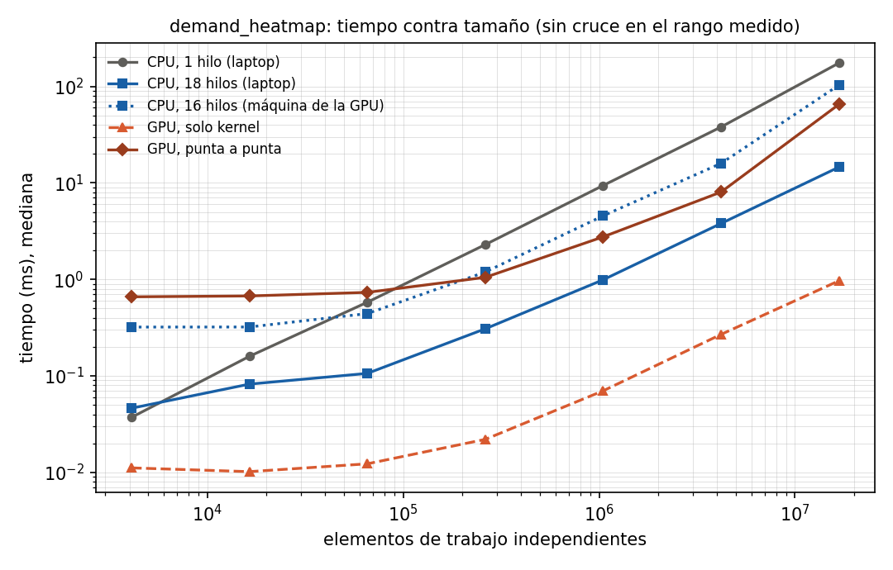
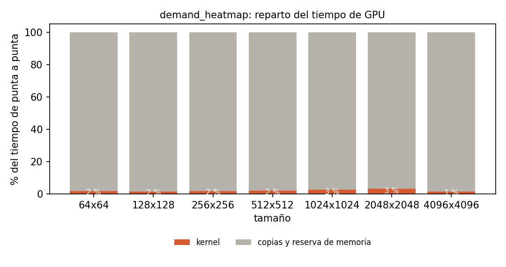
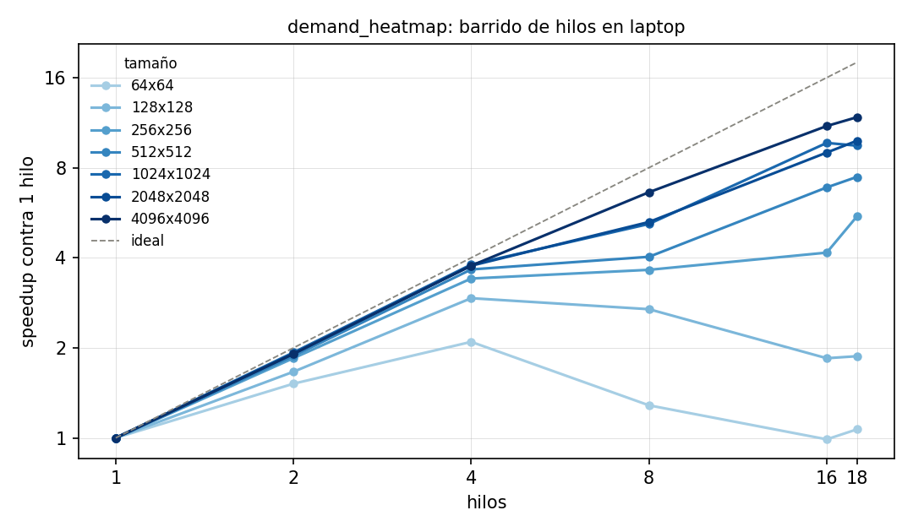

# demand_heatmap: CPU contra GPU

Generado por `tools/gpu_report.py` a partir de `mac.csv` y `pc.csv`. 10 repeticiones medidas por versión y tamaño, después de una de calentamiento.

### Veredicto: la GPU contra la CPU de la laptop

| Tamaño | CPU 1 hilo (ms) | CPU 18 hilos (ms) | GPU kernel (ms) | GPU punta a punta (ms) | Mejor CPU | Speedup de la GPU contra la mejor CPU (kernel / punta a punta) | ¿Correcto? |
|---|---|---|---|---|---|---|---|
| 64x64 | 0.037 (0.036–0.038) | 0.046 (0.040–0.067) | 0.011 (0.009–0.034) | 0.660 (0.634–0.945) | 0.024 (4 hilos) | 2.11x / 0.04x | sí |
| 128x128 | 0.160 (0.148–0.173) | 0.082 (0.063–0.091) | 0.010 (0.009–0.011) | 0.674 (0.644–0.682) | 0.053 (4 hilos) | 5.16x / 0.08x | sí |
| 256x256 | 0.580 (0.572–0.612) | 0.106 (0.101–0.116) | 0.012 (0.011–0.079) | 0.734 (0.703–1.054) | 0.106 (18 hilos) | 8.64x / 0.14x | sí |
| 512x512 | 2.293 (2.264–2.344) | 0.308 (0.288–0.383) | 0.022 (0.021–0.085) | 1.050 (0.942–1.460) | 0.308 (18 hilos) | 13.98x / 0.29x | sí |
| 1024x1024 | 9.400 (9.238–9.561) | 0.991 (0.814–1.106) | 0.070 (0.058–0.075) | 2.761 (2.579–2.984) | 0.970 (16 hilos) | 13.84x / 0.35x | sí |
| 2048x2048 | 37.946 (37.777–38.107) | 3.800 (3.733–4.316) | 0.269 (0.230–0.279) | 8.039 (7.902–8.925) | 3.800 (18 hilos) | 14.11x / 0.47x | sí |
| 4096x4096 | 174.671 (173.278–177.440) | 14.580 (14.075–22.212) | 0.969 (0.962–0.985) | 65.185 (64.504–67.075) | 14.580 (18 hilos) | 15.05x / 0.22x | sí |

Tiempos de CPU: laptop. Mediana de las repeticiones y, entre paréntesis, mínimo y máximo.

Cruce de punta a punta contra la mejor CPU de la laptop: **no hay cruce en el rango medido**; la CPU gana en todos los tamaños.

### Misma máquina: la GPU contra la CPU de su propia máquina

| Tamaño | CPU 1 hilo (ms) | CPU 16 hilos (ms) | GPU kernel (ms) | GPU punta a punta (ms) | Mejor CPU | Speedup de la GPU contra la mejor CPU (kernel / punta a punta) | ¿Correcto? |
|---|---|---|---|---|---|---|---|
| 64x64 | 0.105 (0.104–0.114) | 0.321 (0.302–0.329) | 0.011 (0.009–0.034) | 0.660 (0.634–0.945) | 0.105 (1 hilo) | 9.38x / 0.16x | sí |
| 128x128 | 0.431 (0.419–0.449) | 0.321 (0.295–0.408) | 0.010 (0.009–0.011) | 0.674 (0.644–0.682) | 0.205 (8 hilos) | 20.08x / 0.30x | sí |
| 256x256 | 1.751 (1.716–1.797) | 0.443 (0.412–0.498) | 0.012 (0.011–0.079) | 0.734 (0.703–1.054) | 0.443 (16 hilos) | 36.01x / 0.60x | sí |
| 512x512 | 7.048 (6.944–7.129) | 1.192 (1.143–1.249) | 0.022 (0.021–0.085) | 1.050 (0.942–1.460) | 1.192 (16 hilos) | 54.15x / 1.14x | sí |
| 1024x1024 | 28.378 (27.662–29.147) | 4.562 (3.214–4.626) | 0.070 (0.058–0.075) | 2.761 (2.579–2.984) | 4.562 (16 hilos) | 65.05x / 1.65x | sí |
| 2048x2048 | 111.809 (110.976–114.739) | 15.931 (15.629–19.665) | 0.269 (0.230–0.279) | 8.039 (7.902–8.925) | 15.931 (16 hilos) | 59.15x / 1.98x | sí |
| 4096x4096 | 491.784 (490.264–498.039) | 103.154 (99.149–112.036) | 0.969 (0.962–0.985) | 65.185 (64.504–67.075) | 103.154 (16 hilos) | 106.49x / 1.58x | sí |

Tiempos de CPU: máquina de la GPU. Mediana de las repeticiones y, entre paréntesis, mínimo y máximo.

Cruce de punta a punta contra la mejor CPU de la misma máquina: **512x512** (262144 elementos).

### Variantes de GPU

Mediana en ms de cada variante medida en la misma corrida.

| Tamaño | `gpu_kernel` | `gpu_e2e` | `gpu_e2e_globalweights` | `gpu_kernel_globalweights` |
|---|---|---|---|---|
| 64x64 | 0.011 | 0.660 | 0.610 | 0.012 |
| 128x128 | 0.010 | 0.674 | 0.647 | 0.016 |
| 256x256 | 0.012 | 0.734 | 0.710 | 0.016 |
| 512x512 | 0.022 | 1.050 | 1.336 | 0.031 |
| 1024x1024 | 0.070 | 2.761 | 2.726 | 0.103 |
| 2048x2048 | 0.269 | 8.039 | 8.354 | 0.425 |
| 4096x4096 | 0.969 | 65.185 | 66.020 | 1.680 |

### Barrido de hilos, laptop

Speedup de la versión multihilo contra ella misma con 1 hilo.

| Tamaño | 1 hilo | 2 hilos | 4 hilos | 8 hilos | 16 hilos | 18 hilos |
|---|---|---|---|---|---|---|
| 64x64 | 1.00x | 1.52x | 2.09x | 1.29x | 0.99x | 1.07x |
| 128x128 | 1.00x | 1.66x | 2.93x | 2.69x | 1.85x | 1.88x |
| 256x256 | 1.00x | 1.85x | 3.41x | 3.65x | 4.16x | 5.50x |
| 512x512 | 1.00x | 1.88x | 3.66x | 4.03x | 6.87x | 7.45x |
| 1024x1024 | 1.00x | 1.93x | 3.80x | 5.19x | 9.68x | 9.48x |
| 2048x2048 | 1.00x | 1.91x | 3.76x | 5.27x | 8.99x | 9.84x |
| 4096x4096 | 1.00x | 1.91x | 3.77x | 6.62x | 11.03x | 11.80x |

### Barrido de hilos, máquina de la GPU

Speedup de la versión multihilo contra ella misma con 1 hilo.

| Tamaño | 1 hilo | 2 hilos | 4 hilos | 8 hilos | 16 hilos |
|---|---|---|---|---|---|
| 64x64 | 1.00x | 1.49x | 1.58x | 0.95x | 0.52x |
| 128x128 | 1.00x | 1.87x | 2.44x | 2.51x | 1.60x |
| 256x256 | 1.00x | 1.87x | 3.04x | 3.97x | 4.16x |
| 512x512 | 1.00x | 1.89x | 3.55x | 5.04x | 6.02x |
| 1024x1024 | 1.00x | 1.95x | 3.83x | 5.05x | 6.18x |
| 2048x2048 | 1.00x | 1.91x | 3.66x | 4.85x | 6.96x |
| 4096x4096 | 1.00x | 1.83x | 3.06x | 3.75x | 4.78x |

### Gráficos

