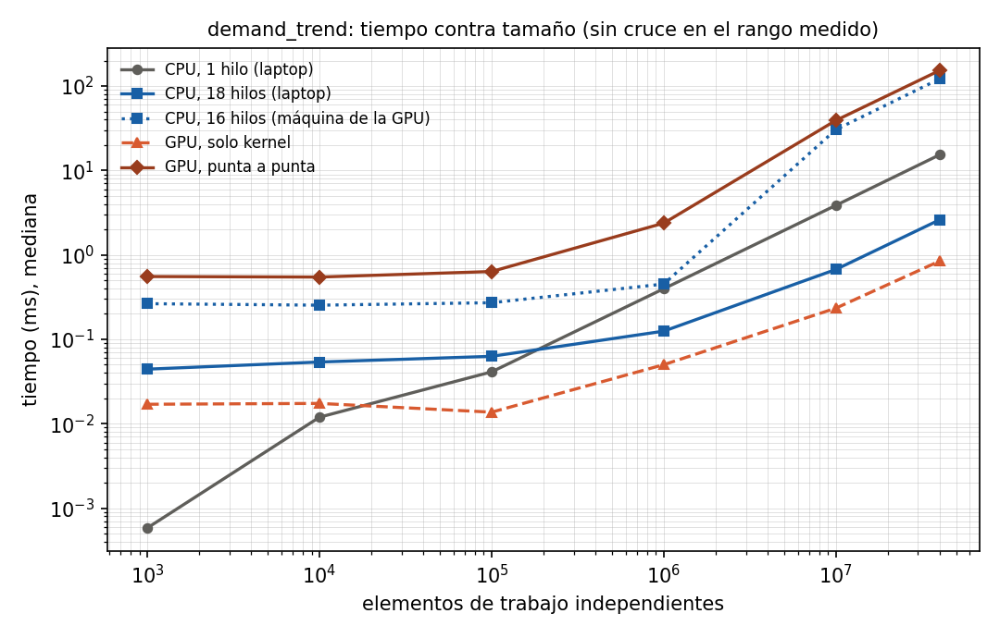
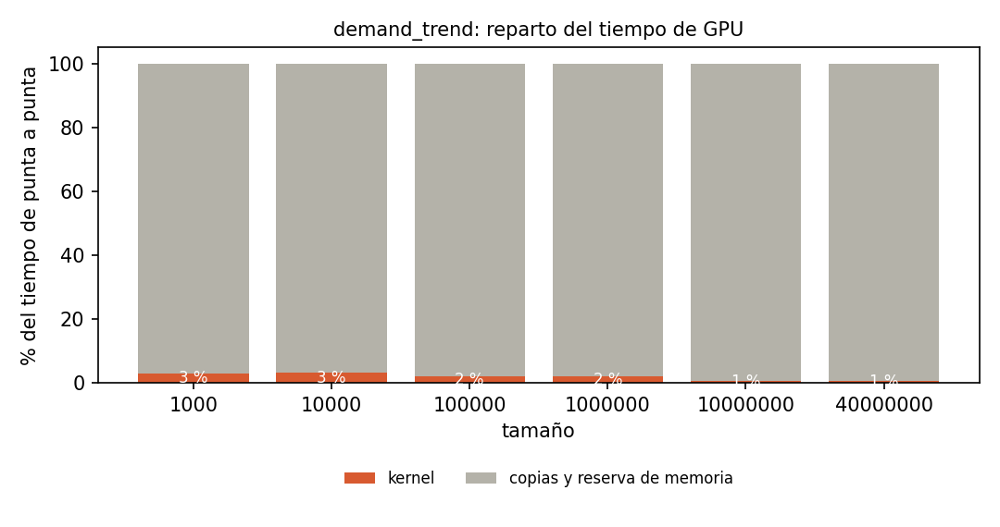
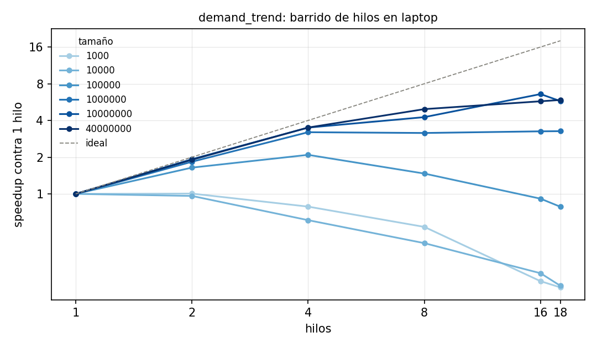

# Tendencia de la demanda: ¿vale la pena la GPU?

Concepto del curso: 05, convolución, aquí de una dimensión y con un tile con borde en shared
memory. Segunda aplicación de ese concepto; la primera fue el mapa de calor de demanda. Código:
`src/gpu/demand_trend.*`. Datos: `mac.csv`, `pc.csv`. Tabla y gráficos: `tabla.md`.

## La tarea

La cantidad de pedidos por minuto sube y baja mucho de un minuto al siguiente. Para ver la
tendencia se suaviza esa serie en el tiempo: cada minuto pasa a ser un promedio ponderado de él y
de los siete minutos de cada lado, 15 valores, con pesos gaussianos que suman uno. Es una
convolución de una dimensión. De la serie suavizada sale el momento de mayor demanda sostenida,
que no siempre coincide con el minuto suelto más cargado.

Es paralela en datos porque cada minuto de salida se calcula solo con la serie de entrada.

## Montaje

El mismo de los experimentos anteriores: CPU del veredicto en el MacBook Pro con Apple M5 Pro (18
núcleos, enchufado, `-O3`); GPU en la PC con Ryzen 7 3700X y RTX 3060 Ti (CUDA 12.1, `-O3`,
sm_86), que además mide las mismas versiones de CPU.

```sh
./delivery_sim ../config/ciudad.json --headless --bench <maquina>.csv --bench-apps demand_trend --bench-reps 10 --bench-sweep
./delivery_sim ../config/ciudad.json --gpu-info
python3 tools/gpu_report.py --app demand_trend --laptop mac.csv --gpu pc.csv --out tools/reports/gpu/demand_trend
```

Seis tamaños, de mil a 40 millones de minutos. Una corrida de calentamiento y 10 medidas
intercaladas, con la tarjeta despierta antes de cada medida de GPU. El tiempo de punta a punta de
la GPU cuenta también la reserva del arreglo de salida en la CPU, igual que las versiones de CPU.

## Diseño

- **Un hilo por minuto de salida**, en bloques de 256. Los 15 pesos van en memoria constante,
  como en el mapa de calor.
- **Kernel sin tile:** cada hilo lee sus 15 vecinos directamente de memoria global.
- **Kernel con tile:** cada bloque carga primero en shared memory sus 256 valores más un borde de
  7 a cada lado, 270 en total. Los 14 primeros hilos cargan además el borde derecho. Después de
  la barrera, cada hilo calcula leyendo solo del tile. Es lo que quedó sin hacer en el mapa de
  calor.
- **Bordes.** Los vecinos que caen fuera de la serie cuentan como cero.

**En el programa:** al terminar la simulación se cuentan los pedidos creados en cada minuto, se
suaviza la serie y se imprimen el pico sostenido y, para comparar, el minuto suelto más cargado.
Se calcula en CPU con un hilo, o en la tarjeta con `--backend gpu`.

## Corrección

- **Tolerancia.** Son números decimales y la tarjeta puede fundir cada multiplicación con su suma
  en una sola operación con un solo redondeo. Se acepta una diferencia de una parte en diez mil
  por valor. Las dos versiones de CPU sí se comparan exactas.
- Las 600 filas de `pc.csv` y las 420 de `mac.csv` tienen `correct = yes`.
- `tests/gpu/demand_trend_test.cpp`: los pesos suman uno y son simétricos; un solo minuto con
  pedidos deja exactamente la forma de los pesos; en el borde se pierde demanda y no se inventa;
  tamaños menores que el filtro y antes, en y después del borde de un bloque; y suavizar no
  agrega pedidos.
- `compute-sanitizer`: memcheck 0 errores, racecheck 0 hallazgos.
- ThreadSanitizer en la laptop, sobre la suite completa: 0 reportes.
- Una hora de `config/equipetrol.json` con la tendencia en CPU y en la tarjeta: las dos dan el
  mismo pico sostenido, 10,1 pedidos por minuto alrededor del minuto 9, y el log pasa el
  verificador.

## Resultados

Medianas en ms. La tabla completa está en `tabla.md`.

| Minutos | CPU 1 hilo, laptop | CPU 18 hilos, laptop | GPU kernel | GPU punta a punta | Kernel contra la mejor CPU | Punta a punta contra la mejor CPU |
|---|---|---|---|---|---|---|
| Mil | 0,0006 | 0,044 | 0,017 | 0,554 | 0,03x | 0,00x |
| 10 mil | 0,012 | 0,054 | 0,017 | 0,546 | 0,55x | 0,02x |
| 100 mil | 0,041 | 0,063 | 0,014 | 0,635 | 1,72x | 0,04x |
| 1 millón | 0,397 | 0,125 | 0,050 | 2,377 | 2,50x | 0,05x |
| 10 millones | 3,864 | 0,672 | 0,234 | 39,2 | 2,52x | 0,02x |
| 40 millones | 15,3 | 2,602 | 0,844 | 152,7 | 3,08x | 0,02x |



- **El kernel le gana a la laptop desde 100 mil minutos**: 1,7 veces ahí, 2,5 con uno y con 10
  millones y 3,1 con 40 millones.
- **De punta a punta no hay cruce.** La GPU queda unas 59 veces más lenta que la laptop con 40
  millones: el kernel es menos del 1 % del tiempo.
- **En la misma máquina tampoco hay cruce**: 0,79 veces con 40 millones.

| Minutos | CPU 1 hilo, PC | CPU 16 hilos, PC | GPU kernel | GPU punta a punta | Kernel contra la mejor CPU | Punta a punta contra la mejor CPU |
|---|---|---|---|---|---|---|
| Mil | 0,0022 | 0,264 | 0,017 | 0,554 | 0,13x | 0,00x |
| 10 mil | 0,012 | 0,254 | 0,017 | 0,546 | 0,70x | 0,02x |
| 100 mil | 0,116 | 0,271 | 0,014 | 0,635 | 8,01x | 0,17x |
| 1 millón | 1,384 | 0,452 | 0,050 | 2,377 | 8,35x | 0,18x |
| 10 millones | 38,4 | 30,5 | 0,234 | 39,2 | 128,98x | 0,77x |
| 40 millones | 152,3 | 121,4 | 0,844 | 152,7 | 142,65x | 0,79x |



Como en la curva de pedidos en espera, el resultado es tan grande como la entrada: con 40 millones
de minutos suben 160 MB, bajan 160 MB y hay que reservar otros 160 MB en la CPU para recibirlos.
En la PC esa reserva es lo que más cuesta desde 10 millones, y por eso sus tiempos de CPU saltan
de 1,4 a 38 ms entre uno y 10 millones.

### Con tile o sin tile

Tiempo del kernel en la PC, en ms.

| Minutos | Sin tile | Con tile | Con tile contra sin tile |
|---|---|---|---|
| Mil | 0,017 | 0,017 | 1,01x |
| 10 mil | 0,017 | 0,017 | 1,01x |
| 100 mil | 0,014 | 0,016 | 0,84x |
| 1 millón | 0,050 | 0,047 | 1,06x |
| 10 millones | 0,234 | 0,257 | 0,91x |
| 40 millones | 0,844 | 1,374 | 0,61x |

El tile en shared memory no ayuda. Hasta un millón de minutos los dos kernels dan lo mismo,
dentro de la dispersión. Con 10 millones el de tile es un 10 % más lento, y con 40 millones su
mediana es un 63 % mayor, con medidas muy dispersas, de 0,96 a 7,8 ms; aun su mejor medida es
peor que la mediana del kernel sin tile.

La razón es que el tile resuelve un problema que aquí no existe. Los 15 vecinos de un hilo se
solapan casi por completo con los de sus hilos vecinos, así que el bloque entero lee 270 valores
seguidos y la caché de la tarjeta ya los sirve bien. Copiarlos antes a shared memory agrega una
pasada de copia y una barrera sin quitar lecturas a memoria global.



En la laptop la versión multihilo conviene desde 100 mil minutos y llega a unas 6 veces con 18
hilos.

## Análisis

**Paralelismo disponible.** Un elemento de trabajo por minuto. La tarjeta aloja 58 368 hilos, así
que se llena con esa cantidad de minutos. Una hora de simulación son 60.

**Sobrecostos.** Dominan en todos los tamaños. El piso es de 0,55 ms. Con 40 millones de minutos
el kernel tarda 0,84 ms y la punta a punta 153 ms.

**Límite por memoria o por cómputo.** Por valor el kernel hace 15 multiplicaciones y 15 sumas y
mueve 8 bytes propios: unas 4 operaciones por byte, la tercera parte que en el mapa de calor. Con
tan poco cálculo pasa a estar limitado por memoria: con 40 millones mueve 320 MB en 0,84 ms, 379
GB/s, el 85 % del ancho de banda nominal. Por eso la ventaja sobre la laptop es de 3 veces y no
de 16 como en la convolución de dos dimensiones.

**Eficiencia de ejecución.** `--gpu-info`: 6 bloques por multiprocesador y ocupación del 100 % en
los dos kernels, limitada por los hilos. Sin tile, 19 registros por hilo y nada de shared memory;
con tile, 28 registros y 1080 bytes. La divergencia está solo en los 7 valores de cada extremo de
la serie y, con tile, en los 14 hilos que cargan el borde derecho.

**Contención y sincronización.** Sin atómicos. El kernel sin tile no tiene barreras; el de tile,
una, entre cargar y calcular.

**Corrección bajo paralelismo.** Cada valor de salida no depende del orden de los hilos. Sin la
barrera, un hilo podría leer del tile una posición que otro todavía no cargó; racecheck confirma
que no pasa. Lo que cambia entre CPU y GPU es el redondeo, cubierto por la tolerancia.

## Veredicto

- **Tendencia sobre datos que están en la CPU: CPU, siempre.** 18 hilos de la laptop suavizan 40
  millones de minutos en 2,6 ms; la GPU, con las copias y la reserva, tarda 153 ms.
- **En el programa: CPU con un hilo.** Una hora de simulación son 60 valores.
- **Dentro de la GPU, sin tile.** Con un filtro de 15 vecinos seguidos la caché alcanza, y el
  tile solo agrega trabajo.
- **La GPU valdría la pena como paso intermedio**, con la serie ya en la tarjeta y el resultado
  usado ahí mismo: el kernel gana desde 100 mil minutos.

## Amenazas a la validez

- **Dos máquinas.** El veredicto contra la laptop compara una CPU mucho más rápida que la de la
  PC. Por eso se informa también la comparación en la misma máquina.
- **La reserva de memoria pesa mucho en la PC.** Desde 10 millones de minutos, los tiempos de CPU
  de la PC y la punta a punta de la GPU miden sobre todo cuánto cuesta reservar el arreglo de
  salida dentro del contenedor sobre WSL2.
- **La medida del kernel con tile en 40 millones es inestable**: entre 0,96 y 7,8 ms en diez
  repeticiones. La conclusión no depende de ella, porque su mínimo ya es peor que el otro kernel.
- **Los tamaños grandes no salen del programa.** 40 millones de minutos son 76 años; son datos
  generados para ver hasta dónde llega cada versión.
- **Un solo ancho de filtro.** Con filtros mucho más anchos el tile podría empezar a convenir; no
  se midió.
