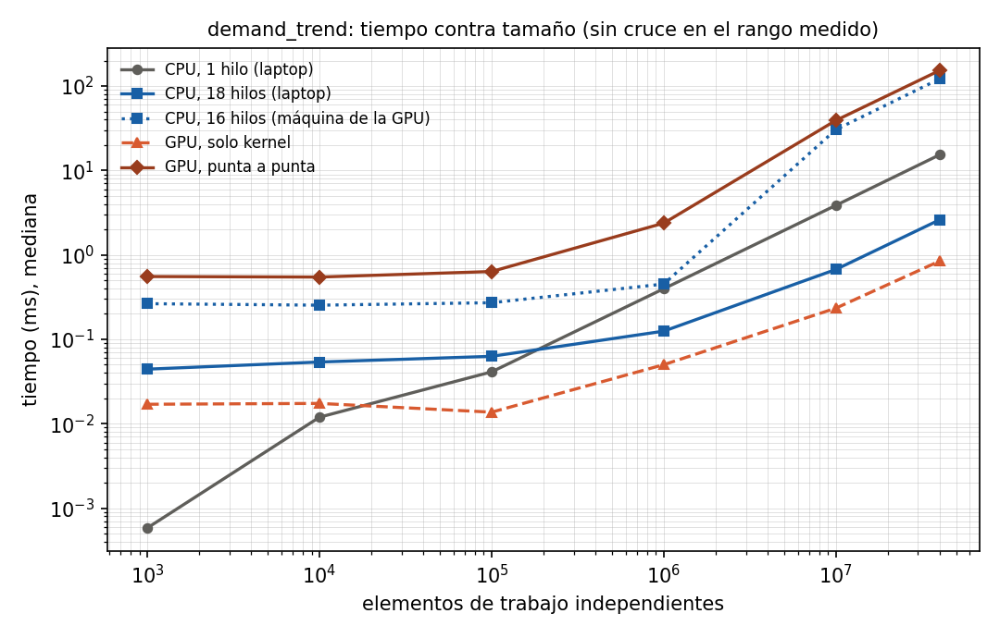
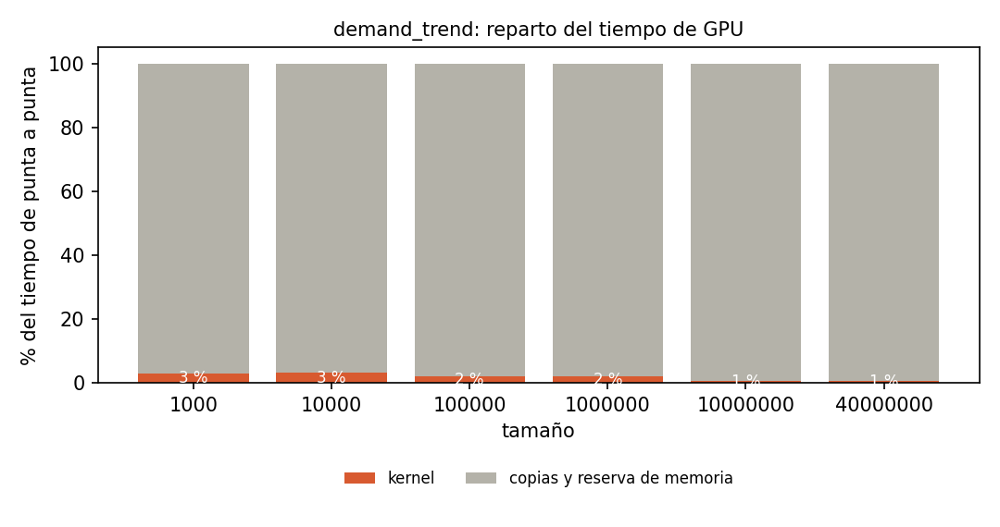
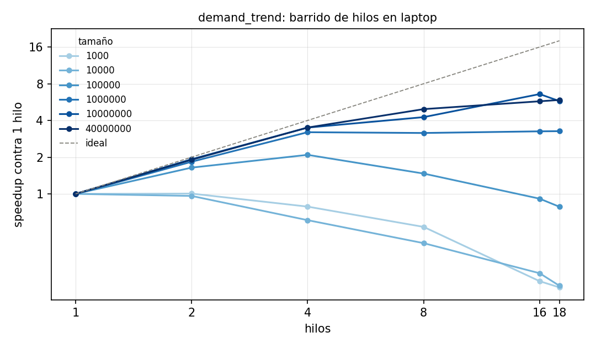

# demand_trend: CPU contra GPU

Generado por `tools/gpu_report.py` a partir de `mac.csv` y `pc.csv`. 10 repeticiones medidas por versión y tamaño, después de una de calentamiento.

### Veredicto: la GPU contra la CPU de la laptop

| Tamaño | CPU 1 hilo (ms) | CPU 18 hilos (ms) | GPU kernel (ms) | GPU punta a punta (ms) | Mejor CPU | Speedup de la GPU contra la mejor CPU (kernel / punta a punta) | ¿Correcto? |
|---|---|---|---|---|---|---|---|
| 1000 | 0.001 (0.001–0.001) | 0.044 (0.031–0.066) | 0.017 (0.006–0.030) | 0.554 (0.524–0.804) | 0.001 (1 hilo) | 0.03x / 0.00x | sí |
| 10000 | 0.012 (0.009–0.019) | 0.054 (0.042–0.078) | 0.017 (0.009–0.036) | 0.546 (0.532–0.600) | 0.009 (1 hilos) | 0.55x / 0.02x | sí |
| 100000 | 0.041 (0.039–0.050) | 0.063 (0.040–0.081) | 0.014 (0.008–0.017) | 0.635 (0.607–0.702) | 0.024 (4 hilos) | 1.72x / 0.04x | sí |
| 1000000 | 0.397 (0.394–0.418) | 0.125 (0.097–0.140) | 0.050 (0.024–0.059) | 2.377 (2.289–2.608) | 0.125 (18 hilos) | 2.50x / 0.05x | sí |
| 10000000 | 3.864 (3.781–4.116) | 0.672 (0.548–1.132) | 0.234 (0.208–0.244) | 39.164 (38.685–40.165) | 0.589 (16 hilos) | 2.52x / 0.02x | sí |
| 40000000 | 15.311 (15.249–15.429) | 2.602 (2.538–2.809) | 0.844 (0.816–0.854) | 152.733 (151.258–160.903) | 2.602 (18 hilos) | 3.08x / 0.02x | sí |

Tiempos de CPU: laptop. Mediana de las repeticiones y, entre paréntesis, mínimo y máximo.

Cruce de punta a punta contra la mejor CPU de la laptop: **no hay cruce en el rango medido**; la CPU gana en todos los tamaños.

### Misma máquina: la GPU contra la CPU de su propia máquina

| Tamaño | CPU 1 hilo (ms) | CPU 16 hilos (ms) | GPU kernel (ms) | GPU punta a punta (ms) | Mejor CPU | Speedup de la GPU contra la mejor CPU (kernel / punta a punta) | ¿Correcto? |
|---|---|---|---|---|---|---|---|
| 1000 | 0.002 (0.002–0.003) | 0.264 (0.247–0.282) | 0.017 (0.006–0.030) | 0.554 (0.524–0.804) | 0.002 (1 hilo) | 0.13x / 0.00x | sí |
| 10000 | 0.012 (0.012–0.013) | 0.254 (0.247–0.274) | 0.017 (0.009–0.036) | 0.546 (0.532–0.600) | 0.012 (1 hilo) | 0.70x / 0.02x | sí |
| 100000 | 0.116 (0.115–0.127) | 0.271 (0.261–0.314) | 0.014 (0.008–0.017) | 0.635 (0.607–0.702) | 0.110 (4 hilos) | 8.01x / 0.17x | sí |
| 1000000 | 1.384 (1.353–1.548) | 0.452 (0.411–0.500) | 0.050 (0.024–0.059) | 2.377 (2.289–2.608) | 0.418 (8 hilos) | 8.35x / 0.18x | sí |
| 10000000 | 38.389 (38.087–40.468) | 30.474 (30.089–30.939) | 0.234 (0.208–0.244) | 39.164 (38.685–40.165) | 30.179 (4 hilos) | 128.98x / 0.77x | sí |
| 40000000 | 152.315 (151.543–153.373) | 121.404 (120.852–121.950) | 0.844 (0.816–0.854) | 152.733 (151.258–160.903) | 120.367 (4 hilos) | 142.65x / 0.79x | sí |

Tiempos de CPU: máquina de la GPU. Mediana de las repeticiones y, entre paréntesis, mínimo y máximo.

Cruce de punta a punta contra la mejor CPU de la misma máquina: **no hay cruce en el rango medido**.

### Variantes de GPU

Mediana en ms de cada variante medida en la misma corrida.

| Tamaño | `gpu_kernel` | `gpu_e2e` | `gpu_e2e_tiled` | `gpu_kernel_tiled` |
|---|---|---|---|---|
| 1000 | 0.017 | 0.554 | 0.545 | 0.017 |
| 10000 | 0.017 | 0.546 | 0.551 | 0.017 |
| 100000 | 0.014 | 0.635 | 0.632 | 0.016 |
| 1000000 | 0.050 | 2.377 | 2.067 | 0.047 |
| 10000000 | 0.234 | 39.164 | 39.083 | 0.257 |
| 40000000 | 0.844 | 152.733 | 156.582 | 1.374 |

### Barrido de hilos, laptop

Speedup de la versión multihilo contra ella misma con 1 hilo.

| Tamaño | 1 hilo | 2 hilos | 4 hilos | 8 hilos | 16 hilos | 18 hilos |
|---|---|---|---|---|---|---|
| 1000 | 1.00x | 1.01x | 0.79x | 0.54x | 0.19x | 0.17x |
| 10000 | 1.00x | 0.96x | 0.61x | 0.39x | 0.22x | 0.18x |
| 100000 | 1.00x | 1.64x | 2.09x | 1.47x | 0.91x | 0.78x |
| 1000000 | 1.00x | 1.83x | 3.20x | 3.16x | 3.26x | 3.27x |
| 10000000 | 1.00x | 1.92x | 3.50x | 4.26x | 6.58x | 5.77x |
| 40000000 | 1.00x | 1.90x | 3.50x | 4.95x | 5.74x | 5.89x |

### Barrido de hilos, máquina de la GPU

Speedup de la versión multihilo contra ella misma con 1 hilo.

| Tamaño | 1 hilo | 2 hilos | 4 hilos | 8 hilos | 16 hilos |
|---|---|---|---|---|---|
| 1000 | 1.00x | 1.40x | 0.60x | 0.37x | 0.24x |
| 10000 | 1.00x | 1.45x | 0.66x | 0.44x | 0.29x |
| 100000 | 1.00x | 1.44x | 1.62x | 0.78x | 0.66x |
| 1000000 | 1.00x | 1.73x | 2.58x | 2.93x | 2.71x |
| 10000000 | 1.00x | 1.19x | 1.27x | 1.26x | 1.26x |
| 40000000 | 1.00x | 1.19x | 1.27x | 1.27x | 1.26x |

### Gráficos

