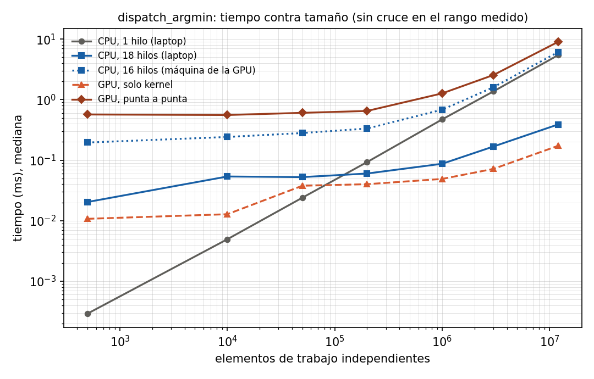
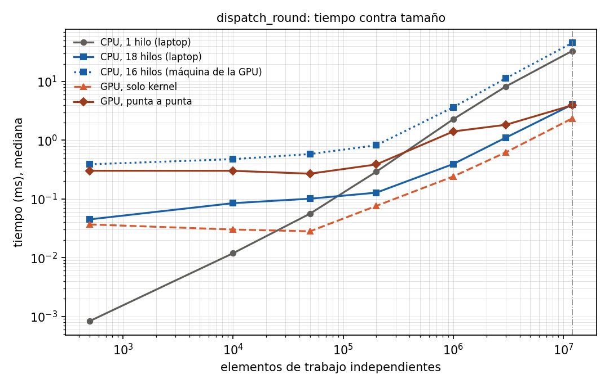
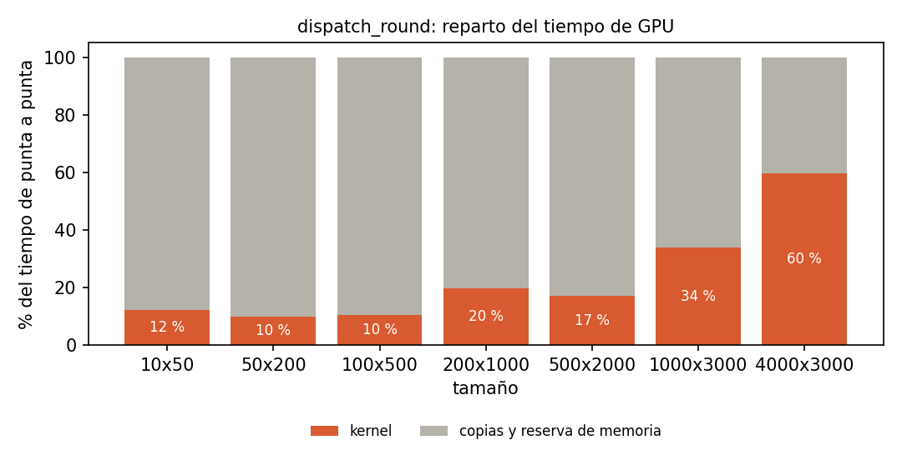

# La mejor moto de cada pedido: ¿vale la pena la GPU?

Concepto del curso: 08, reducción. Primera aplicación de ese concepto. Código:
`src/gpu/argmin_rows.*`, `EtaBatchGpu::runBest` en `src/gpu/eta_batch.cu` y `src/eta_service.*`.
Datos: `mac.csv`, `pc.csv`, `pc_reposo.csv`. Tablas y gráficos: `reduccion_tabla.md` (la reducción
sola) y `ronda_tabla.md` (la ronda completa).

## La tarea

De la matriz de estimaciones, pedidos × motos, sacar para cada pedido la moto que lo entrega
antes. Es el mínimo de cada fila, junto con la columna donde está.

Es paralela en datos porque el mínimo es asociativo y conmutativo: se puede partir la fila en
trozos, sacar el mínimo de cada trozo y juntar los resultados en cualquier orden. Además las filas
no se miran entre sí. Con 151 pedidos en una ronda y 3000 motos son 453 000 comparaciones.

El motivo para hacerla en la tarjeta salió del experimento anterior
(`tools/reports/gpu/eta_batch/analisis.md`): el kernel de estimación ganaba, pero bajar la matriz
entera a la CPU costaba más que calcularla. Si la elección se hace en la tarjeta, por ronda baja
una clave por pedido y no la matriz.

## Montaje

El mismo de los experimentos anteriores: los tiempos de CPU del veredicto salen del MacBook Pro
con Apple M5 Pro (18 núcleos, enchufado, `-O3`), y los de GPU de la PC con Ryzen 7 3700X y RTX
3060 Ti (CUDA 12.1, `-O3`, sm_86), que además mide las mismas versiones de CPU.

```sh
./delivery_sim ../config/ciudad.json --headless --bench <maquina>.csv --bench-apps dispatch_argmin,dispatch_round --bench-reps 10 --bench-sweep
./delivery_sim ../config/ciudad.json --gpu-info
python3 tools/gpu_report.py --app dispatch_argmin --prefix reduccion_ --laptop mac.csv --gpu pc.csv --out tools/reports/gpu/dispatch_argmin
python3 tools/gpu_report.py --app dispatch_round --prefix ronda_ --laptop mac.csv --gpu pc.csv --out tools/reports/gpu/dispatch_argmin
```

Se miden dos cosas:

- `dispatch_argmin`: la reducción sola. La matriz ya está calculada en la CPU; la GPU la recibe,
  reduce y devuelve una clave por pedido.
- `dispatch_round`: la ronda completa, como corre en el programa. En CPU, estimar y después
  elegir. En GPU, el kernel de estimación y el de reducción seguidos sobre la tarjeta.

Siete tamaños, de 10 pedidos × 50 motos a 4000 × 3000: de 500 a 12 millones de pares, más de
cuatro órdenes de magnitud. El mayor es el tope de la configuración de ciudad: `maxPending` 4000
con las 3000 motos. Una corrida de calentamiento y 10 medidas intercaladas. Cada corrida compara
las claves con las de CPU de un hilo.

## Diseño

- **Un bloque por pedido, 256 hilos.** El hilo `t` recorre las motos `t`, `t + 256`, `t + 512`…
  y se queda con la mejor de las suyas. Los 32 hilos de un warp leen 32 motos vecinas: 128 bytes
  seguidos por pasada. Con 3000 motos cada hilo mira 12.
- **Árbol en memoria compartida.** Cada hilo deja su candidato en un arreglo compartido de 256
  claves. Después vienen 8 niveles: en cada uno la mitad de abajo se compara con la de arriba y
  se queda con la menor, con una barrera entre niveles. El hilo 0 escribe el resultado.
- **Clave de 64 bits.** La hora de entrega va en los 32 bits altos y la moto en los bajos.
  Comparar dos claves compara primero la hora y, si empatan, la moto. El mínimo es único, así que
  no depende del orden en que se junten los candidatos.
- **Desempate rotado.** Cuando la flota arranca junta, muchas motos empatan. Si todos los pedidos
  desempataran por la moto de índice menor, toda la ronda elegiría la misma. Cada pedido de la
  ronda rota los índices con un desplazamiento distinto antes de armar la clave, y los empates se
  reparten.
- **Dos kernels encadenados.** La matriz de estimaciones se queda en la tarjeta, en un espacio que
  se reserva una vez y se reutiliza entre rondas. Sube lo mismo que antes, motos y pedidos, y baja
  una clave por pedido: 8 bytes en vez de 4 por cada moto.
- **Qué pasa con los lugares de las mochilas.** Antes el coordinador tenía la matriz y, si la
  mejor moto ya estaba prometida, pasaba a la segunda. Ahora solo tiene la mejor de cada pedido.
  Sigue descontando los lugares que promete dentro de la ronda; si la moto elegida ya no tiene
  lugar, ese pedido no recibe moto y vuelve a pedir estimación en la ronda siguiente.

## Corrección

- Las 1400 filas de `pc.csv`, las 1260 de `pc_reposo.csv` y las 980 de `mac.csv` tienen
  `correct = yes`. Las claves de GPU son idénticas a las de CPU.
- `tests/gpu/argmin_rows_test.cpp`: un caso a mano, filas con empates, filas donde ninguna moto
  sirve, anchos que no son múltiplos de 256 y el desempate rotado.
  `tests/gpu/eta_service_test.cpp`: una ronda de 19 pedidos sobre 12 lugares promete exactamente
  12 y manda los otros 7 a reintentar.
- `compute-sanitizer` sobre las dos pruebas: memcheck 0 errores, racecheck 0 hallazgos.
- ThreadSanitizer en la laptop, sobre la suite completa: 0 reportes.
- Simulación de ciudad con el estimador en GPU, cortada con SIGINT: cierra en 0,39 s y el log pasa
  el verificador.

## Resultados

Medianas en ms. Las tablas completas, con mínimos y máximos, están en `reduccion_tabla.md` y
`ronda_tabla.md`.

### La reducción sola

| Pedidos × motos | CPU 1 hilo, laptop | CPU 18 hilos, laptop | GPU kernel | GPU punta a punta | Kernel contra la mejor CPU | Punta a punta contra la mejor CPU |
|---|---|---|---|---|---|---|
| 10 × 50 | 0,000 | 0,020 | 0,011 | 0,569 | 0,03x | 0,00x |
| 100 × 500 | 0,024 | 0,053 | 0,038 | 0,606 | 0,46x | 0,03x |
| 200 × 1000 | 0,093 | 0,060 | 0,040 | 0,650 | 0,97x | 0,06x |
| 500 × 2000 | 0,472 | 0,087 | 0,049 | 1,270 | 1,78x | 0,07x |
| 1000 × 3000 | 1,369 | 0,168 | 0,072 | 2,552 | 2,34x | 0,07x |
| 4000 × 3000 | 5,438 | 0,389 | 0,173 | 9,005 | 2,25x | 0,04x |



- **El kernel empata con la laptop en 200 × 1000 y le gana desde 500 × 2000**: unas 2,3 veces con
  3 y con 12 millones de pares. Contra los 16 hilos del Ryzen son 35 veces.
- **De punta a punta pierde siempre, y por mucho**: entre 15 y 23 veces más lenta que la laptop
  en los tamaños grandes, y tampoco hay cruce en la misma máquina. El kernel es el 2 % del
  tiempo; el resto es subir la matriz, 48 MB en el tamaño mayor.

Reducir en la tarjeta una matriz que está en la CPU no tiene sentido: la CPU la reduce en menos
tiempo del que tarda en mandarla. La reducción vale cuando el dato ya está en la tarjeta.

### La ronda completa

| Pedidos × motos | CPU 1 hilo, laptop | CPU 18 hilos, laptop | GPU kernel | GPU punta a punta | Kernel contra la mejor CPU | Punta a punta contra la mejor CPU |
|---|---|---|---|---|---|---|
| 10 × 50 | 0,001 | 0,045 | 0,037 | 0,303 | 0,02x | 0,00x |
| 100 × 500 | 0,056 | 0,101 | 0,028 | 0,269 | 1,47x | 0,15x |
| 200 × 1000 | 0,291 | 0,128 | 0,076 | 0,387 | 1,37x | 0,27x |
| 500 × 2000 | 2,285 | 0,394 | 0,242 | 1,413 | 1,63x | 0,28x |
| 1000 × 3000 | 8,263 | 1,110 | 0,624 | 1,835 | 1,78x | 0,61x |
| 4000 × 3000 | 33,210 | 4,045 | 2,355 | 3,949 | 1,72x | 1,02x |



- **Contra la laptop hay cruce recién en 4000 × 3000**, y es un empate: 1,02 veces. Con rondas
  seguidas, que es como trabaja el programa cuando hay cola, la GPU queda 1,27 veces por delante.
- **En las rondas que el programa arma hoy gana la laptop.** La ronda más grande de la simulación
  tuvo 151 pedidos, 453 000 pares. En ese rango la GPU de punta a punta rinde entre 0,27 y 0,28
  veces lo que rinde la laptop.
- **En la misma máquina el cruce baja a 100 × 500**, 50 000 pares. Contra los 16 hilos del Ryzen
  la GPU de punta a punta es 2,1 veces más rápida con 200 000 pares y 11,5 veces con 12 millones.

### Qué cambió al no bajar la matriz

Tiempos de punta a punta en la PC, en ms.

| Pedidos × motos | Baja la matriz y elige la CPU | Elige la tarjeta | Elige la tarjeta, rondas seguidas | Mejor CPU de la laptop |
|---|---|---|---|---|
| 100 × 500 | 0,449 | 0,269 | 0,230 | 0,041 |
| 200 × 1000 | 1,098 | 0,387 | 0,265 | 0,105 |
| 500 × 2000 | 5,355 | 1,413 | 0,939 | 0,394 |
| 1000 × 3000 | 14,520 | 1,835 | 1,269 | 1,110 |
| 4000 × 3000 | 52,656 | 3,949 | 3,180 | 4,045 |

La primera columna es el camino del experimento anterior: estimar en la tarjeta, bajar la matriz
y elegir en un hilo de la CPU. Elegir en la tarjeta baja la ronda de 14,5 a 1,8 ms con 3 millones
de pares y de 52,7 a 3,9 ms con 12 millones. Por ronda bajan 32 KB en vez de 48 MB.

Era lo que el experimento anterior anticipaba, y se cumple: el cruce de punta a punta en la misma
máquina pasó de un millón de pares a 50 000, y contra la laptop pasó de no existir a aparecer en
el tope de la configuración.



### La tarjeta en reposo

La primera medición de este experimento dio un kernel 12 veces más lento de lo esperado en el
tamaño mayor. No era el kernel:

| Pedidos × motos | Kernel, tarjeta en reposo entre medidas (`pc_reposo.csv`) | Kernel, tarjeta despierta (`pc.csv`) | Kernel, rondas seguidas (`pc.csv`) |
|---|---|---|---|
| 500 × 2000 | 0,241 | 0,242 | 0,218 |
| 1000 × 3000 | 2,208 | 0,624 | 0,594 |
| 4000 × 3000 | 28,757 | 2,355 | 2,276 |

Entre una medida de GPU y la siguiente corren las versiones de CPU, que en el tamaño mayor tardan
casi un segundo con el barrido de hilos. En ese rato la tarjeta queda sin trabajo y baja de
frecuencia. `nvidia-smi` la muestra en reposo en estado P8, con el núcleo a 210 MHz y la memoria a
405 MHz, y con carga en P0, a 1980 y 7001 MHz. El kernel que llega después de la pausa corre con
la tarjeta lenta.

En `pc.csv` cada repetición incluye una variante que lanza 16 rondas seguidas y mide la última.
Con esa carga dentro de cada repetición la medida normal de la misma corrida vuelve a lo que
corresponde por escala: 2,4 ms para cuatro veces el trabajo que cuesta 0,6. `pc_reposo.csv`
es la corrida sin esa variante y queda como evidencia.

## Análisis

**Paralelismo disponible.** Hay dos niveles. Entre filas: un bloque por pedido, sin dependencia
entre ellos. Dentro de la fila: 256 hilos con un trozo cada uno. La tarjeta aloja 228 bloques a
la vez, 6 por cada uno de sus 38 multiprocesadores, así que con más de 228 pedidos está llena.
Con filas cortas sobra: con 50 motos, 206 de los 256 hilos de cada bloque no tienen nada que
mirar y solo aportan la clave neutra.

**Sobrecostos.** La ronda en GPU tiene un piso de 0,25 a 0,3 ms aunque no haya casi nada que
calcular: siete u ocho reservas, otras tantas copias chicas, dos lanzamientos y la espera. `nsys` muestra que
cada llamada cuesta microsegundos, con mediana de 4 µs por reserva y 24 µs por copia; el piso es
la suma de todas más la ida y vuelta al controlador. En la reducción sola el sobrecosto es otro y
mucho mayor: subir la matriz.

**Límite por memoria.** La reducción hace una comparación por cada 4 bytes leídos: está limitada
por memoria. Con 12 millones de pares lee 48 MB en 0,173 ms, 277 GB/s, cerca del 60 % del ancho
de banda nominal de la tarjeta, 448 GB/s. Las lecturas son seguidas dentro de cada warp, así que
no hay tráfico desperdiciado como en la lectura dispersa de la tabla de tiempos. En la ronda
completa la reducción es la parte chica: 0,17 de los 2,36 ms del kernel. El resto es la
estimación, que sigue frenada por esa lectura dispersa.

**Eficiencia de ejecución.** `--gpu-info`: 32 registros por hilo, 2048 bytes de memoria
compartida por bloque (256 claves de 8 bytes), 6 bloques por multiprocesador y ocupación del
100 %, limitada por los hilos. La divergencia está en el árbol: en cada nivel trabaja la mitad de
los hilos que en el anterior, y desde el cuarto nivel solo queda activo parte del primer warp.
Los demás hilos no calculan nada pero siguen llegando a cada barrera.

**Contención y sincronización.** Nueve barreras por bloque: una después de recorrer y una por
nivel del árbol. Sin atómicos: cada hilo escribe solo su posición del arreglo compartido, y en
cada nivel los que escriben y los que son leídos son mitades distintas. Todos los hilos del
bloque pasan por todas las barreras, incluidos los que ya no tienen trabajo.

**Corrección bajo paralelismo.** Lo que puede fallar en una reducción paralela es que el
resultado dependa del orden. Aquí no puede: la clave lleva la moto en los bits bajos, no hay dos
claves iguales en una fila, y el mínimo de un conjunto sin repetidos es uno solo. Por eso la
salida de GPU es idéntica a la de CPU y no solo equivalente.

**Efecto en el programa.** Cinco minutos simulados de `config/ciudad.json` en la PC:

| Quién elige la moto | Rondas | Pedidos asignados | Reintentos | Estimaciones tardías |
|---|---|---|---|---|
| El coordinador, con la matriz bajada (experimento anterior) | 165 | 3054 | 4 | 0 |
| La tarjeta, con una clave por pedido | 188 | 3076 | 48 | 0 |

Las dos versiones asignan todos los pedidos. Elegir en la tarjeta tiene un costo: 44 veces en
3124 estimaciones dos pedidos de la misma ronda eligieron el último lugar de la misma moto, y el
segundo esperó una ronda más. Es el 1,4 %. Con la matriz en la mano el coordinador le daba la
segunda mejor moto sin esperar.

## Veredicto

- **La reducción sola, sobre un dato que está en la CPU: CPU, siempre.** Subir la matriz cuesta
  50 veces lo que cuesta reducirla.
- **La reducción encadenada a la estimación: GPU en la misma máquina desde 50 000 pares.** Es la
  pieza que hacía falta para que la ronda en GPU valga la pena de punta a punta.
- **Contra la laptop, CPU en los tamaños que el programa usa hoy.** Con rondas de hasta 453 000
  pares la laptop es unas 3,6 veces más rápida. La GPU la alcanza recién en el tope de la
  configuración, 12 millones de pares, y la supera solo con rondas seguidas.
- **A cambio de un 1,4 % de pedidos que esperan una ronda más.**

## Amenazas a la validez

- **Dos máquinas.** El veredicto contra la laptop compara una CPU mucho más rápida que la de la
  PC. Se reportan las dos comparaciones porque dan respuestas distintas.
- **El estado de energía de la tarjeta cambia el resultado.** Sin carga sostenida el kernel del
  tamaño mayor midió 28,8 ms en vez de 2,4. `pc.csv` mide con la tarjeta despierta. En el
  programa, con rondas chicas y espaciadas, la tarjeta puede estar trabajando a baja frecuencia;
  eso no se midió.
- **El empate de 4000 × 3000 está dentro de la dispersión.** La GPU de punta a punta fue de 3,5 a
  16,8 ms entre repeticiones, con una mediana de 3,9.
- **El costo en reintentos se midió en una sola corrida por versión**, y el número de rondas
  depende de cuánto tarda cada una. Sirve para el orden de magnitud.
- **Entradas al azar.** Las motos del benchmark están repartidas por la ciudad y casi no empatan.
  En la simulación arrancan juntas y empatan mucho; ahí el desempate rotado pesa más que aquí.
- **La PC no estaba en reposo** y corre en un contenedor sobre WSL2. `ncu` no perfila ahí; la
  ocupación sale de `--gpu-info` y el reparto del tiempo de eventos CUDA y de `nsys`.
