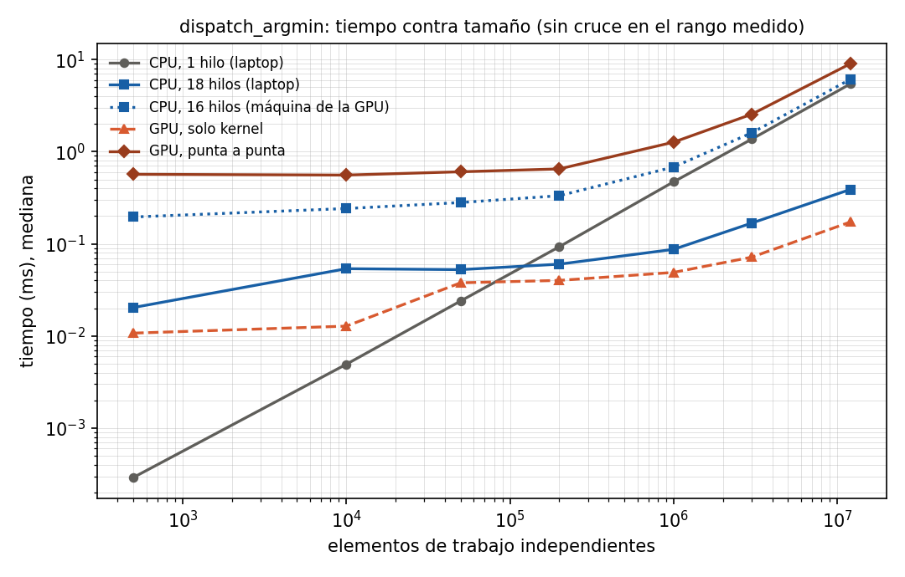
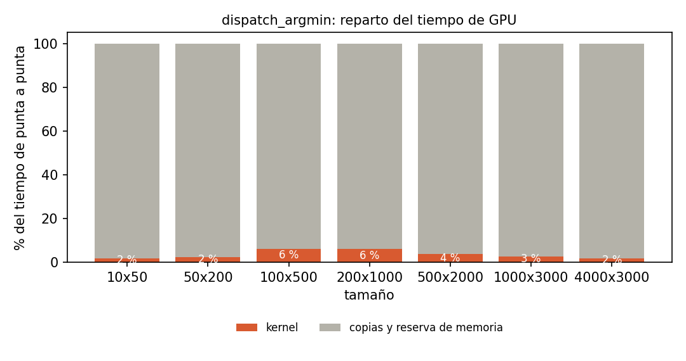
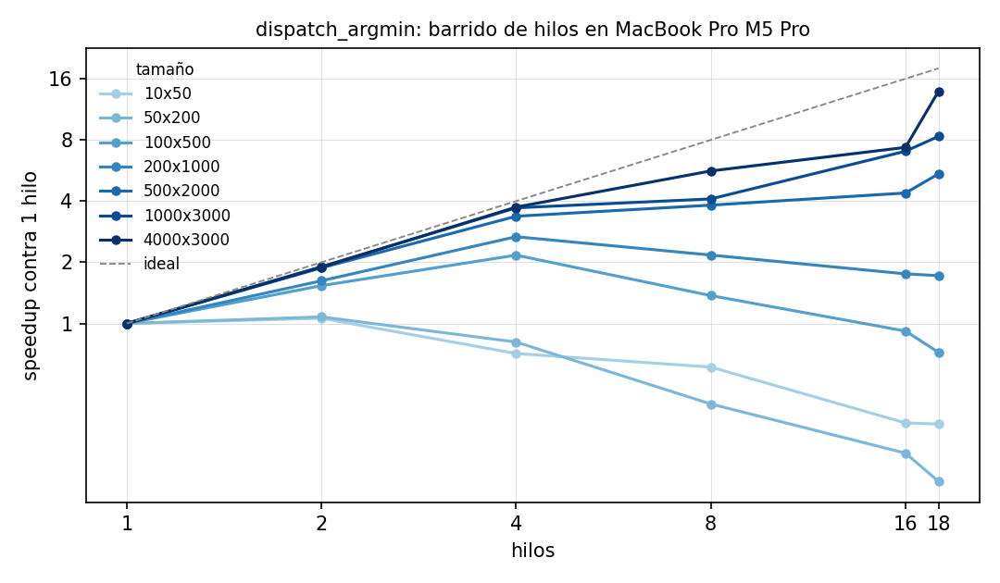

# dispatch_argmin: CPU contra GPU

Generado por `tools/gpu_report.py` a partir de `mac.csv` y `pc.csv`. 10 repeticiones medidas por versión y tamaño, después de una de calentamiento.

### Veredicto: la GPU contra la CPU de la laptop

| Tamaño | CPU 1 hilo (ms) | CPU 18 hilos (ms) | GPU kernel (ms) | GPU punta a punta (ms) | Mejor CPU | Speedup de la GPU contra la mejor CPU (kernel / punta a punta) | ¿Correcto? |
|---|---|---|---|---|---|---|---|
| 10x50 | 0.000 (0.000–0.000) | 0.020 (0.017–0.028) | 0.011 (0.005–0.047) | 0.569 (0.534–0.601) | 0.000 (1 hilo) | 0.03x / 0.00x | sí |
| 50x200 | 0.005 (0.005–0.007) | 0.054 (0.032–0.087) | 0.013 (0.005–0.048) | 0.558 (0.528–0.637) | 0.005 (1 hilo) | 0.39x / 0.01x | sí |
| 100x500 | 0.024 (0.024–0.026) | 0.053 (0.039–0.065) | 0.038 (0.037–0.046) | 0.606 (0.583–0.646) | 0.017 (4 hilos) | 0.46x / 0.03x | sí |
| 200x1000 | 0.093 (0.091–0.102) | 0.060 (0.047–0.070) | 0.040 (0.038–0.057) | 0.650 (0.636–0.940) | 0.039 (4 hilos) | 0.97x / 0.06x | sí |
| 500x2000 | 0.472 (0.445–0.481) | 0.087 (0.077–0.138) | 0.049 (0.048–0.055) | 1.270 (1.246–1.410) | 0.087 (18 hilos) | 1.78x / 0.07x | sí |
| 1000x3000 | 1.369 (1.343–1.469) | 0.168 (0.133–0.195) | 0.072 (0.055–0.174) | 2.552 (2.404–2.937) | 0.168 (18 hilos) | 2.34x / 0.07x | sí |
| 4000x3000 | 5.438 (5.373–5.532) | 0.389 (0.371–0.625) | 0.173 (0.165–0.272) | 9.005 (8.639–9.487) | 0.389 (18 hilos) | 2.25x / 0.04x | sí |

Tiempos de CPU: MacBook Pro M5 Pro. Mediana de las repeticiones y, entre paréntesis, mínimo y máximo.

Cruce de punta a punta contra la mejor CPU de la laptop: **no hay cruce en el rango medido**; la CPU gana en todos los tamaños.

### Misma máquina: la GPU contra la CPU de su propia máquina

| Tamaño | CPU 1 hilo (ms) | CPU 16 hilos (ms) | GPU kernel (ms) | GPU punta a punta (ms) | Mejor CPU | Speedup de la GPU contra la mejor CPU (kernel / punta a punta) | ¿Correcto? |
|---|---|---|---|---|---|---|---|
| 10x50 | 0.002 (0.002–0.003) | 0.196 (0.147–0.237) | 0.011 (0.005–0.047) | 0.569 (0.534–0.601) | 0.002 (1 hilo) | 0.19x / 0.00x | sí |
| 50x200 | 0.035 (0.035–0.040) | 0.242 (0.197–0.339) | 0.013 (0.005–0.048) | 0.558 (0.528–0.637) | 0.035 (1 hilo) | 2.73x / 0.06x | sí |
| 100x500 | 0.174 (0.173–0.181) | 0.281 (0.234–0.313) | 0.038 (0.037–0.046) | 0.606 (0.583–0.646) | 0.144 (2 hilos) | 3.80x / 0.24x | sí |
| 200x1000 | 0.708 (0.694–0.735) | 0.333 (0.319–0.386) | 0.040 (0.038–0.057) | 0.650 (0.636–0.940) | 0.265 (8 hilos) | 6.60x / 0.41x | sí |
| 500x2000 | 3.496 (3.485–3.544) | 0.683 (0.632–0.755) | 0.049 (0.048–0.055) | 1.270 (1.246–1.410) | 0.683 (16 hilos) | 13.92x / 0.54x | sí |
| 1000x3000 | 10.494 (10.365–11.056) | 1.603 (1.500–1.692) | 0.072 (0.055–0.174) | 2.552 (2.404–2.937) | 1.603 (16 hilos) | 22.34x / 0.63x | sí |
| 4000x3000 | 41.391 (41.108–41.680) | 6.103 (5.451–7.341) | 0.173 (0.165–0.272) | 9.005 (8.639–9.487) | 6.103 (16 hilos) | 35.34x / 0.68x | sí |

Tiempos de CPU: PC Ryzen 7 3700X + RTX 3060 Ti. Mediana de las repeticiones y, entre paréntesis, mínimo y máximo.

Cruce de punta a punta contra la mejor CPU de la misma máquina: **no hay cruce en el rango medido**.

### Barrido de hilos, MacBook Pro M5 Pro

Speedup de la versión multihilo contra ella misma con 1 hilo.

| Tamaño | 1 hilo | 2 hilos | 4 hilos | 8 hilos | 16 hilos | 18 hilos |
|---|---|---|---|---|---|---|
| 10x50 | 1.00x | 1.06x | 0.71x | 0.61x | 0.32x | 0.32x |
| 50x200 | 1.00x | 1.08x | 0.81x | 0.40x | 0.23x | 0.17x |
| 100x500 | 1.00x | 1.53x | 2.17x | 1.37x | 0.92x | 0.72x |
| 200x1000 | 1.00x | 1.62x | 2.67x | 2.17x | 1.75x | 1.72x |
| 500x2000 | 1.00x | 1.88x | 3.37x | 3.82x | 4.38x | 5.44x |
| 1000x3000 | 1.00x | 1.90x | 3.71x | 4.10x | 7.04x | 8.33x |
| 4000x3000 | 1.00x | 1.89x | 3.74x | 5.63x | 7.35x | 13.90x |

### Barrido de hilos, PC Ryzen 7 3700X + RTX 3060 Ti

Speedup de la versión multihilo contra ella misma con 1 hilo.

| Tamaño | 1 hilo | 2 hilos | 4 hilos | 8 hilos | 16 hilos |
|---|---|---|---|---|---|
| 10x50 | 1.00x | 1.74x | 1.35x | 0.64x | 0.31x |
| 50x200 | 1.00x | 1.34x | 1.41x | 0.55x | 0.38x |
| 100x500 | 1.00x | 1.67x | 1.51x | 1.09x | 0.86x |
| 200x1000 | 1.00x | 1.76x | 2.60x | 2.94x | 2.34x |
| 500x2000 | 1.00x | 1.84x | 3.36x | 3.95x | 5.30x |
| 1000x3000 | 1.00x | 1.95x | 3.65x | 3.92x | 6.55x |
| 4000x3000 | 1.00x | 1.99x | 3.77x | 3.96x | 6.86x |

### Gráficos

