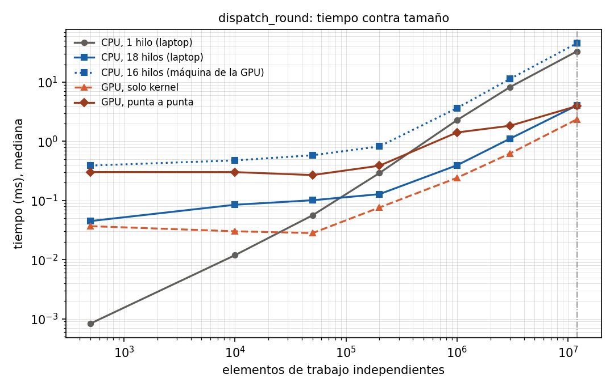
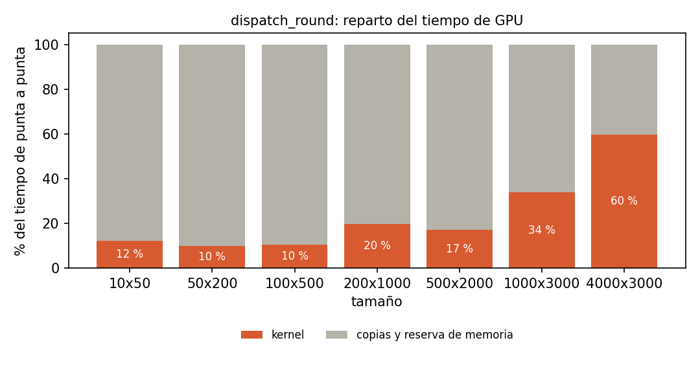
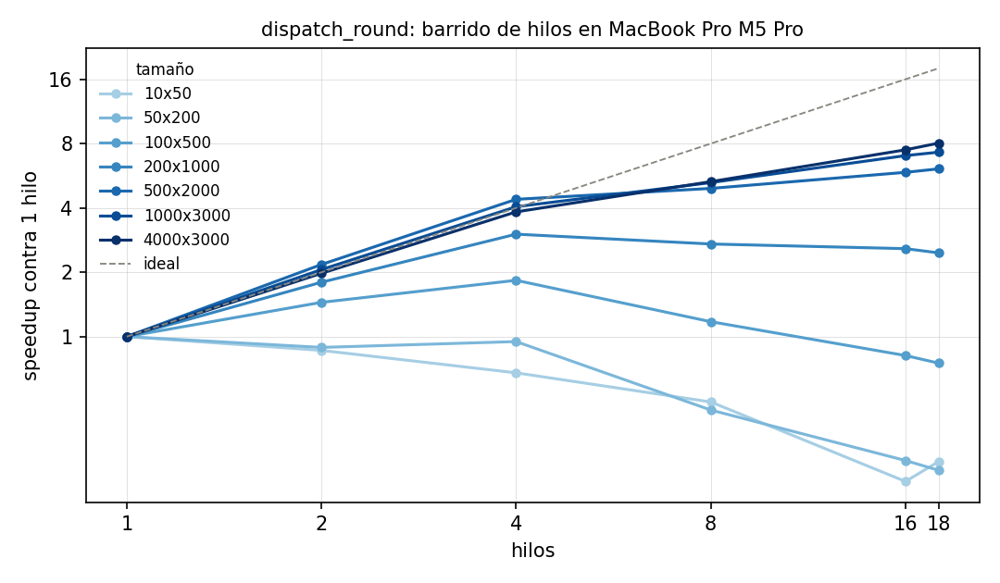

# dispatch_round: CPU contra GPU

Generado por `tools/gpu_report.py` a partir de `mac.csv` y `pc.csv`. 10 repeticiones medidas por versión y tamaño, después de una de calentamiento.

### Veredicto: la GPU contra la CPU de la laptop

| Tamaño | CPU 1 hilo (ms) | CPU 18 hilos (ms) | GPU kernel (ms) | GPU punta a punta (ms) | Mejor CPU | Speedup de la GPU contra la mejor CPU (kernel / punta a punta) | ¿Correcto? |
|---|---|---|---|---|---|---|---|
| 10x50 | 0.001 (0.001–0.001) | 0.045 (0.037–0.061) | 0.037 (0.013–0.066) | 0.303 (0.250–0.579) | 0.001 (1 hilo) | 0.02x / 0.00x | sí |
| 50x200 | 0.012 (0.011–0.014) | 0.085 (0.069–0.098) | 0.030 (0.012–0.050) | 0.302 (0.253–0.481) | 0.012 (1 hilo) | 0.39x / 0.04x | sí |
| 100x500 | 0.056 (0.055–0.061) | 0.101 (0.097–0.116) | 0.028 (0.018–0.034) | 0.269 (0.251–0.287) | 0.041 (4 hilos) | 1.47x / 0.15x | sí |
| 200x1000 | 0.291 (0.281–0.355) | 0.128 (0.103–0.145) | 0.076 (0.052–0.094) | 0.387 (0.357–0.426) | 0.105 (4 hilos) | 1.37x / 0.27x | sí |
| 500x2000 | 2.285 (2.143–2.798) | 0.394 (0.375–0.410) | 0.242 (0.217–0.301) | 1.413 (1.280–2.074) | 0.394 (18 hilos) | 1.63x / 0.28x | sí |
| 1000x3000 | 8.263 (7.891–9.072) | 1.110 (1.074–1.169) | 0.624 (0.580–3.810) | 1.835 (1.705–5.737) | 1.110 (18 hilos) | 1.78x / 0.61x | sí |
| 4000x3000 | 33.210 (30.893–36.547) | 4.045 (3.926–4.230) | 2.355 (2.245–14.986) | 3.949 (3.501–16.753) | 4.045 (18 hilos) | 1.72x / 1.02x | sí |

Tiempos de CPU: MacBook Pro M5 Pro. Mediana de las repeticiones y, entre paréntesis, mínimo y máximo.

Cruce de punta a punta contra la mejor CPU de la laptop: **4000x3000** (12000000 elementos).

### Misma máquina: la GPU contra la CPU de su propia máquina

| Tamaño | CPU 1 hilo (ms) | CPU 16 hilos (ms) | GPU kernel (ms) | GPU punta a punta (ms) | Mejor CPU | Speedup de la GPU contra la mejor CPU (kernel / punta a punta) | ¿Correcto? |
|---|---|---|---|---|---|---|---|
| 10x50 | 0.008 (0.005–0.025) | 0.390 (0.340–0.464) | 0.037 (0.013–0.066) | 0.303 (0.250–0.579) | 0.008 (1 hilo) | 0.23x / 0.03x | sí |
| 50x200 | 0.080 (0.076–0.097) | 0.476 (0.454–0.518) | 0.030 (0.012–0.050) | 0.302 (0.253–0.481) | 0.080 (1 hilo) | 2.65x / 0.27x | sí |
| 100x500 | 0.487 (0.466–0.531) | 0.582 (0.533–0.622) | 0.028 (0.018–0.034) | 0.269 (0.251–0.287) | 0.367 (2 hilos) | 13.02x / 1.36x | sí |
| 200x1000 | 3.347 (3.226–4.190) | 0.821 (0.732–0.863) | 0.076 (0.052–0.094) | 0.387 (0.357–0.426) | 0.821 (16 hilos) | 10.77x / 2.12x | sí |
| 500x2000 | 22.074 (21.194–24.225) | 3.651 (3.375–4.441) | 0.242 (0.217–0.301) | 1.413 (1.280–2.074) | 3.651 (16 hilos) | 15.09x / 2.58x | sí |
| 1000x3000 | 72.448 (67.972–79.851) | 11.361 (10.643–12.628) | 0.624 (0.580–3.810) | 1.835 (1.705–5.737) | 11.361 (16 hilos) | 18.22x / 6.19x | sí |
| 4000x3000 | 271.717 (270.135–279.415) | 45.559 (40.724–53.376) | 2.355 (2.245–14.986) | 3.949 (3.501–16.753) | 45.559 (16 hilos) | 19.35x / 11.54x | sí |

Tiempos de CPU: PC Ryzen 7 3700X + RTX 3060 Ti. Mediana de las repeticiones y, entre paréntesis, mínimo y máximo.

Cruce de punta a punta contra la mejor CPU de la misma máquina: **100x500** (50000 elementos).

### Variantes de GPU

Mediana en ms de cada variante medida en la misma corrida.

| Tamaño | `gpu_kernel` | `gpu_e2e` | `gpu_e2e_matrix` | `gpu_e2e_sustained` | `gpu_kernel_matrix` | `gpu_kernel_sustained` |
|---|---|---|---|---|---|---|
| 10x50 | 0.037 | 0.303 | 0.243 | 0.222 | 0.014 | 0.013 |
| 50x200 | 0.030 | 0.302 | 0.282 | 0.240 | 0.011 | 0.014 |
| 100x500 | 0.028 | 0.269 | 0.449 | 0.230 | 0.018 | 0.021 |
| 200x1000 | 0.076 | 0.387 | 1.098 | 0.265 | 0.049 | 0.053 |
| 500x2000 | 0.242 | 1.413 | 5.355 | 0.939 | 0.207 | 0.218 |
| 1000x3000 | 0.624 | 1.835 | 14.520 | 1.269 | 0.564 | 0.594 |
| 4000x3000 | 2.355 | 3.949 | 52.656 | 3.180 | 2.172 | 2.276 |

### Barrido de hilos, MacBook Pro M5 Pro

Speedup de la versión multihilo contra ella misma con 1 hilo.

| Tamaño | 1 hilo | 2 hilos | 4 hilos | 8 hilos | 16 hilos | 18 hilos |
|---|---|---|---|---|---|---|
| 10x50 | 1.00x | 0.86x | 0.68x | 0.49x | 0.21x | 0.26x |
| 50x200 | 1.00x | 0.89x | 0.95x | 0.45x | 0.26x | 0.24x |
| 100x500 | 1.00x | 1.45x | 1.83x | 1.17x | 0.82x | 0.75x |
| 200x1000 | 1.00x | 1.80x | 3.02x | 2.71x | 2.58x | 2.47x |
| 500x2000 | 1.00x | 2.17x | 4.39x | 4.94x | 5.87x | 6.09x |
| 1000x3000 | 1.00x | 2.06x | 4.05x | 5.25x | 7.03x | 7.29x |
| 4000x3000 | 1.00x | 1.98x | 3.83x | 5.31x | 7.48x | 8.04x |

### Barrido de hilos, PC Ryzen 7 3700X + RTX 3060 Ti

Speedup de la versión multihilo contra ella misma con 1 hilo.

| Tamaño | 1 hilo | 2 hilos | 4 hilos | 8 hilos | 16 hilos |
|---|---|---|---|---|---|
| 10x50 | 1.00x | 1.14x | 0.70x | 0.61x | 0.34x |
| 50x200 | 1.00x | 1.19x | 1.10x | 0.58x | 0.42x |
| 100x500 | 1.00x | 1.58x | 1.55x | 1.48x | 1.00x |
| 200x1000 | 1.00x | 1.91x | 3.02x | 3.36x | 3.43x |
| 500x2000 | 1.00x | 1.93x | 3.54x | 4.12x | 5.91x |
| 1000x3000 | 1.00x | 1.98x | 2.55x | 3.94x | 6.15x |
| 4000x3000 | 1.00x | 1.92x | 3.26x | 3.94x | 6.11x |

### Gráficos

