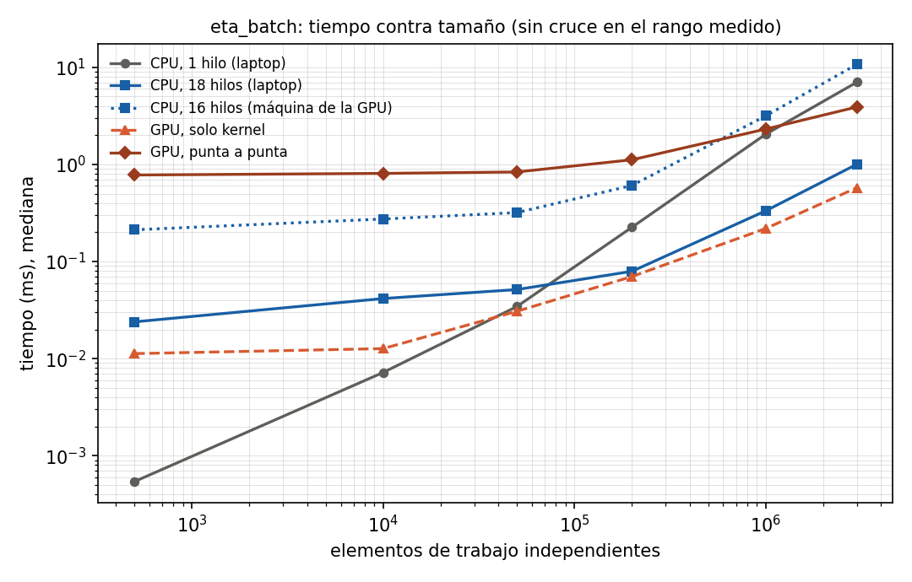
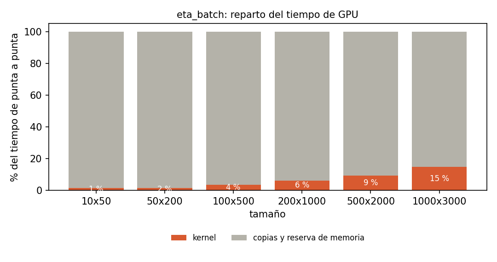

# Estimación de entrega por lote: ¿vale la pena la GPU?

Concepto del curso: 04, rendimiento: accesos agrupados y arreglo de estructuras contra estructura
de arreglos. Primera aplicación de ese concepto. Código: `src/gpu/eta_batch.*` y
`src/eta_service.*`. Datos: `mac.csv`, `pc.csv`. Tabla y gráficos: `tabla.md`.

## La tarea

Para cada pedido pendiente y cada moto, la hora a la que esa moto lo entregaría: sale cuando
queda libre, va al restaurante, espera la comida si hace falta, la recibe, va al cliente y la
entrega. Con la tabla de tiempos ya hecha, cada par son dos lecturas y unas sumas.

Es paralela en datos porque cada par pedido × moto se calcula sin mirar a los demás: `O × C`
celdas independientes, todas con la misma cuenta. Con 157 pedidos en una ronda y 3000 motos son
471 000 celdas.

## Montaje

El mismo de `tools/reports/gpu/travel_table/analisis.md`: los tiempos de CPU del veredicto salen
del MacBook Pro con Apple M5 Pro (18 núcleos, enchufado, `-O3`), y los de GPU de la PC con Ryzen 7
3700X y RTX 3060 Ti (CUDA 12.1, `-O3`, sm_86), que además mide las mismas versiones de CPU.

```sh
./delivery_sim ../config/ciudad.json --headless --bench <maquina>.csv --bench-apps eta_batch --bench-reps 10 --bench-sweep
./delivery_sim ../config/ciudad.json --gpu-info
python3 tools/gpu_report.py --app eta_batch --laptop mac.csv --gpu pc.csv --out tools/reports/gpu/eta_batch
```

Entrada: la tabla de tiempos completa de la ciudad, 4774 × 4774 enteros (87 MiB), y motos y
pedidos al azar con semilla fija. Seis tamaños, de 10 pedidos × 50 motos a 1000 × 3000: de 500 a
3 millones de pares, casi cuatro órdenes de magnitud. Una corrida de calentamiento y 10 medidas
intercaladas. Cada corrida compara la matriz completa con la de CPU de un hilo.

## Diseño

- **Malla y bloques.** Un hilo por par. Bloques de 32 × 8 = 256 hilos: 32 motos seguidas a lo
  ancho, que es un warp entero leyendo motos vecinas, y 8 pedidos a lo alto. La malla es
  `ceil(C/32)` × `ceil(O/8)`: para 1000 × 3000 son 94 × 125 bloques.
- **Dos disposiciones de los datos de las motos.** Como estructura de arreglos, tres arreglos de
  enteros (nodo, hora libre, disponible): los 32 hilos de un warp leen 128 bytes seguidos por
  campo. Como arreglo de estructuras, un registro de 32 bytes por moto, como la foto que ya usa
  el programa: el mismo warp recorre 1024 bytes para usar 20.
- **La tabla de tiempos vive en la tarjeta.** Se sube una vez al arrancar y se queda entre una
  ronda y otra. Por ronda solo suben las motos y los pedidos.
- **Una ronda, un lanzamiento.** Un coordinador junta todos los pedidos que estén esperando, saca
  una sola foto de la flota y hace un lanzamiento para todos. Mientras la tarjeta trabaja, los
  pedidos nuevos se acumulan para la ronda siguiente. Después reparte dentro de la ronda: elige
  la mejor moto de cada pedido descontando los lugares que ya prometió, así dos pedidos de la
  misma ronda no reciben el último lugar de una mochila.
- **Quién es dueño de qué.** El coordinador no toca la tarjeta: le manda el lanzamiento al hilo
  dueño de la GPU. Cada despachador espera su respuesta con `quoteTimeoutMs`; si vence, devuelve
  el pedido al libro y lo cuenta como estimación tardía.

## Corrección

- Las 720 filas de `pc.csv` y las 420 de `mac.csv` tienen `correct = yes`. Son enteros: la matriz
  de GPU es idéntica a la de CPU, con las dos disposiciones.
- `tests/gpu/eta_batch_test.cpp`: un caso calculado a mano y cuatro tamaños que no son múltiplos
  del bloque, con motos llenas y pares sin camino. `tests/gpu/eta_service_test.cpp`: 8 hilos
  pidiendo a la vez, una ronda de 19 pedidos que promete exactamente los 12 lugares que hay, y el
  cierre.
- `compute-sanitizer`: memcheck 0 errores, racecheck 0 hallazgos.
- ThreadSanitizer en la laptop, sobre el hilo dueño de la GPU, el coordinador, el despachador y
  una simulación completa: 0 reportes.
- Simulación de ciudad con el estimador en GPU, cortada con SIGINT: cierra en 0,40 s y el log pasa
  el verificador.

## Resultados

Medianas en ms. La tabla completa, con mínimos y máximos, está en `tabla.md`.

| Pedidos × motos | CPU 1 hilo, laptop | CPU 18 hilos, laptop | GPU kernel | GPU punta a punta | Kernel contra la mejor CPU | Punta a punta contra la mejor CPU |
|---|---|---|---|---|---|---|
| 10 × 50 | 0,001 | 0,024 | 0,011 | 0,778 | 0,05x | 0,00x |
| 100 × 500 | 0,034 | 0,051 | 0,031 | 0,836 | 0,74x | 0,03x |
| 200 × 1000 | 0,225 | 0,079 | 0,070 | 1,116 | 1,05x | 0,07x |
| 500 × 2000 | 2,044 | 0,332 | 0,219 | 2,311 | 1,52x | 0,14x |
| 1000 × 3000 | 7,025 | 1,004 | 0,575 | 3,904 | 1,74x | 0,26x |



- **El kernel solo le gana a la laptop desde 200 × 1000**, 200 000 pares, y llega a 1,74 veces
  con 3 millones.
- **De punta a punta no hay cruce contra la laptop.** La GPU queda entre 4 y 15 veces más lenta
  en los tamaños grandes, aunque la distancia se achica al crecer: 0,07x, 0,14x, 0,26x.
- **En la misma máquina sí hay cruce: 500 × 2000**, un millón de pares. Contra los 16 hilos del
  Ryzen la GPU de punta a punta es 1,37 veces más rápida ahí y 2,75 veces con 3 millones.

Las dos comparaciones difieren porque las dos CPU difieren mucho en esta tarea: con 3 millones de
pares un hilo del M5 Pro tarda 7 ms y uno del Ryzen 60 ms. Cada par es una lectura a una posición
impredecible de una tabla de 87 MiB, y ahí manda la memoria de cada máquina.

### Arreglo de estructuras contra estructura de arreglos

| Pedidos × motos | Kernel, estructura de arreglos | Kernel, arreglo de estructuras | Punta a punta, estructura de arreglos | Punta a punta, arreglo de estructuras |
|---|---|---|---|---|
| 200 × 1000 | 0,070 | 0,050 | 1,116 | 0,809 |
| 500 × 2000 | 0,219 | 0,222 | 2,311 | 2,007 |
| 1000 × 3000 | 0,575 | 0,586 | 3,904 | 3,571 |

Bytes que suben por ronda con 3000 motos: 36 KB como estructura de arreglos y 96 KB como arreglo
de estructuras. Bytes que bajan: la matriz, 12 MB con 1000 pedidos.

**En el kernel no hay diferencia medible** entre las dos disposiciones: 0,575 contra 0,586 ms. La
razón es que las motos no son el tráfico que domina. Cada warp lee sus 32 motos una vez, y esa
lectura, agrupada o no, es poca frente a lo demás: por cada par hay una lectura a la tabla en una
posición que depende del nodo de la moto, y esa no se puede agrupar. Ordenar bien los datos de
las motos mejora una parte que ya era chica.

De punta a punta el arreglo de estructuras sale incluso algo mejor, un 9 %, porque es una sola
reserva y una sola copia en vez de tres. Ese es un costo de la forma de subir los datos, no del
kernel.

### La tabla, residente o recargada

| Pedidos × motos | Punta a punta, tabla residente | Punta a punta, subiendo la tabla cada vez |
|---|---|---|
| 200 × 1000 | 1,116 | 15,03 |
| 1000 × 3000 | 3,904 | 17,84 |

Subir los 87 MiB cuesta 14 ms cada vez; `nsys` lo confirma, la copia más larga del perfil dura
14,2 ms. Dejar la tabla en la tarjeta baja la ronda de 18 a 4 ms. Sin eso, la GPU no tendría
ninguna posibilidad en esta tarea.



## Análisis

**Paralelismo disponible.** `O × C` pares. La tarjeta aloja 58 368 hilos a la vez: 10 × 50 son
500 pares, menos del 1 % de la tarjeta, y 100 × 500 recién la llena. En el tamaño del enunciado,
un pedido por 8 motos, no hay nada que repartir.

**Sobrecostos.** Aquí mandan. El kernel es el 15 % del tiempo de punta a punta con 3 millones de
pares y el 1 % con 500. El resto: seis reservas y seis copias por ronda, que cuestan unos 0,7 ms
aunque no haya casi nada que calcular, y traer la matriz de vuelta, 12 MB con el tamaño mayor.
Por eso el kernel gana desde 200 000 pares y la ronda completa no.

**Límite por memoria.** Por par el kernel hace unas seis operaciones de enteros, lee 4 bytes de
la tabla y escribe 4: menos de una operación por byte. Está limitado por memoria. Con 3 millones
de pares mueve 24 MB útiles en 0,575 ms, 42 GB/s de ancho de banda efectivo. La lectura a la
tabla es dispersa: para usar 4 bytes la tarjeta trae un sector de 32, así que el tráfico real es
varias veces mayor que el útil. Eso, y no la disposición de las motos, es lo que frena al kernel.

**Eficiencia de ejecución.** `--gpu-info`: 26 registros por hilo con estructura de arreglos y 24
con arreglo de estructuras, sin memoria compartida, 6 bloques por multiprocesador y ocupación del
100 % en los dos, limitada por los hilos. La divergencia está en dos lugares: los hilos del borde
de la malla que salen sin hacer nada, y las motos llenas o averiadas, que salen antes de leer la
tabla. Con un 15 % de motos no disponibles, repartidas al azar, casi todos los warps tienen
alguna y ejecutan las dos ramas.

**Contención y sincronización.** El kernel no tiene barreras ni atómicos: cada hilo escribe su
celda. La sincronización está fuera de la tarjeta: la cola del coordinador, la cola del hilo
dueño y un `future` por pedido.

**Corrección bajo paralelismo.** La matriz no depende del orden de los hilos. Lo delicado es la
ventana entre decidir y aplicar: la decisión se toma sobre una foto de la flota y se aplica
después, cuando la moto pudo haber cambiado. Se resuelve en dos niveles. Dentro de la ronda, el
coordinador descuenta cada lugar que promete. Entre rondas, la reserva en la moto sigue siendo
atómica: si ya no hay lugar, falla y el pedido vuelve a pedir estimación. En la simulación de
ciudad hubo 4 reintentos en 3054 asignaciones.

**Efecto en el programa.** Cinco minutos simulados de `config/ciudad.json`:

| Estimador | Pedidos asignados | Estimaciones tardías | Reintentos |
|---|---|---|---|
| `pool`: una ruta por estimación (laptop) | 6 de 2919 | 12,8 millones | 31 |
| `table`: tabla en CPU, un pedido por despachador (PC) | 3057 de 3030 creados, con reasignaciones | 0 | 11 513 |
| `gpu`: tabla en la tarjeta, por rondas (PC) | 3054 de 3030 creados, con reasignaciones | 0 | 4 |

El salto grande no es de la GPU sino de la tabla: dejar de recorrer la red por cada estimación
pasa de 6 pedidos asignados a todos. Entre las dos versiones con tabla, las dos asignan todo; la
de GPU lo hace en 165 rondas, la mayor de 157 pedidos, y casi sin reintentos, porque reparte
dentro de la ronda.

## Veredicto

- **En el tamaño del enunciado, CPU.** Un pedido por 8 motos cuesta menos de un microsegundo en
  un hilo. La GPU tarda 0,8 ms solo en ir y volver.
- **En la configuración de ciudad, como paso aislado que devuelve la matriz entera, CPU en la
  laptop.** El kernel gana desde 200 000 pares, pero bajar la matriz cuesta más que calcularla.
- **La GPU pasa a valer la pena con dos condiciones:** rondas de más de un millón de pares, y que
  el resultado no baje completo. En la misma máquina el cruce de punta a punta ya está en un
  millón de pares. Si la elección de la mejor moto se hace también en la tarjeta, por ronda bajan
  `O` enteros en vez de `O × C`, y el costo que hoy hace perder a la GPU desaparece. Esa es la
  siguiente aplicación.

## Amenazas a la validez

- **Dos máquinas.** Las dos CPU rinden muy distinto en esta tarea, y por eso el cruce existe en la
  misma máquina y no contra la laptop. Se reportan las dos comparaciones.
- **Entradas al azar.** Las motos del benchmark están repartidas al azar por la ciudad. En la
  simulación arrancan todas en el mismo nodo, con horas de entrega iguales.
- **Tiempos muy chicos.** Por debajo de 0,1 ms las medidas tienen dispersión alta: el kernel de
  200 × 1000 va de 0,050 a 0,110 ms. Las diferencias entre disposiciones en esos tamaños están
  dentro del ruido.
- **La PC no estaba en reposo** y corre en un contenedor sobre WSL2. `ncu` no perfila ahí; la
  ocupación sale de `--gpu-info` y el reparto del tiempo de eventos CUDA y de `nsys`.
- **El efecto en el programa** se midió en una sola corrida por estimador, y el estimador `pool`
  en otra máquina. Sirve para el orden de magnitud, no para comparar con precisión.
