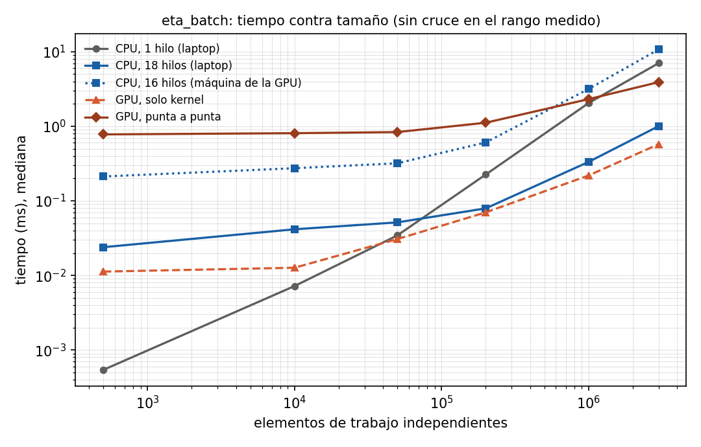
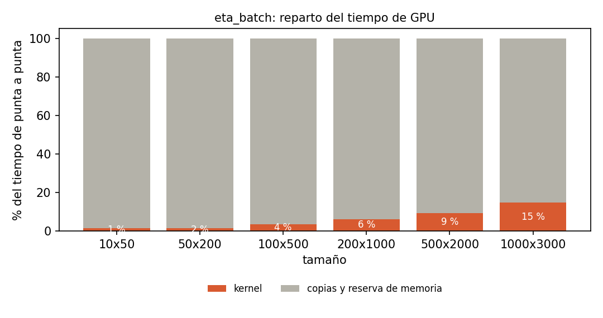
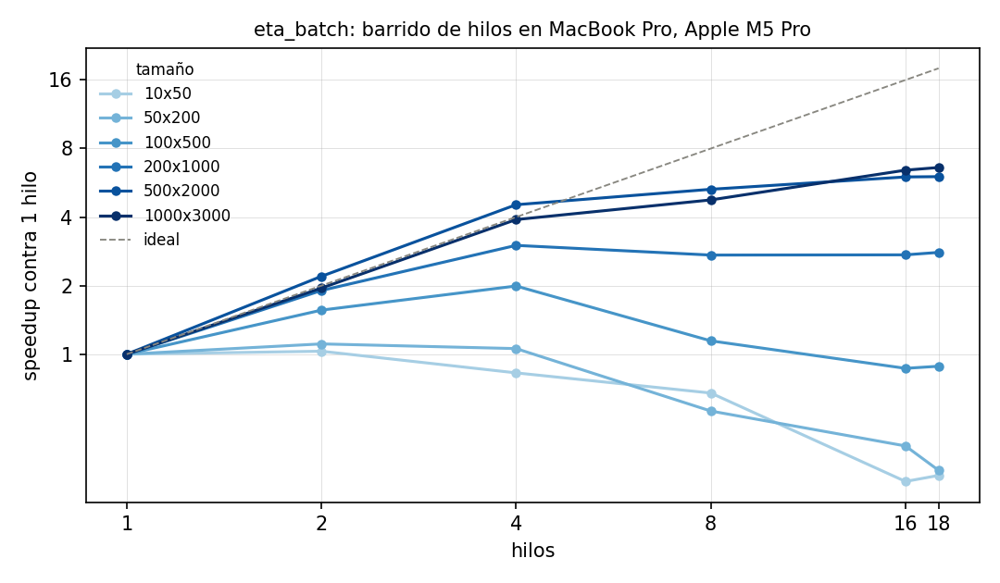

# eta_batch: CPU contra GPU

Generado por `tools/gpu_report.py` a partir de `mac.csv` y `pc.csv`. 10 repeticiones medidas por versión y tamaño, después de una de calentamiento.

### Veredicto: la GPU contra la CPU de la laptop

| Tamaño | CPU 1 hilo (ms) | CPU 18 hilos (ms) | GPU kernel (ms) | GPU punta a punta (ms) | Mejor CPU | Speedup de la GPU contra la mejor CPU (kernel / punta a punta) | ¿Correcto? |
|---|---|---|---|---|---|---|---|
| 10x50 | 0.001 (0.000–0.001) | 0.024 (0.011–0.064) | 0.011 (0.009–0.073) | 0.778 (0.734–1.256) | 0.001 (1 hilo) | 0.05x / 0.00x | sí |
| 50x200 | 0.007 (0.007–0.008) | 0.042 (0.037–0.063) | 0.013 (0.008–0.044) | 0.808 (0.723–1.230) | 0.007 (1 hilo) | 0.57x / 0.01x | sí |
| 100x500 | 0.034 (0.032–0.038) | 0.051 (0.045–0.075) | 0.031 (0.018–0.096) | 0.836 (0.786–1.591) | 0.023 (4 hilos) | 0.74x / 0.03x | sí |
| 200x1000 | 0.225 (0.208–0.290) | 0.079 (0.073–0.100) | 0.070 (0.050–0.110) | 1.116 (1.070–1.185) | 0.074 (4 hilos) | 1.05x / 0.07x | sí |
| 500x2000 | 2.044 (1.956–2.506) | 0.332 (0.315–0.356) | 0.219 (0.195–0.279) | 2.311 (2.108–3.166) | 0.332 (18 hilos) | 1.52x / 0.14x | sí |
| 1000x3000 | 7.025 (6.832–8.059) | 1.004 (0.961–1.193) | 0.575 (0.545–0.626) | 3.904 (3.751–4.704) | 1.004 (18 hilos) | 1.74x / 0.26x | sí |

Tiempos de CPU: MacBook Pro, Apple M5 Pro. Mediana de las repeticiones y, entre paréntesis, mínimo y máximo.

Cruce de punta a punta contra la mejor CPU de la laptop: **no hay cruce en el rango medido**; la CPU gana en todos los tamaños.

### Misma máquina: la GPU contra la CPU de su propia máquina

| Tamaño | CPU 1 hilo (ms) | CPU 16 hilos (ms) | GPU kernel (ms) | GPU punta a punta (ms) | Mejor CPU | Speedup de la GPU contra la mejor CPU (kernel / punta a punta) | ¿Correcto? |
|---|---|---|---|---|---|---|---|
| 10x50 | 0.016 (0.015–0.019) | 0.212 (0.172–0.265) | 0.011 (0.009–0.073) | 0.778 (0.734–1.256) | 0.016 (1 hilo) | 1.45x / 0.02x | sí |
| 50x200 | 0.210 (0.198–0.270) | 0.274 (0.266–0.400) | 0.013 (0.008–0.044) | 0.808 (0.723–1.230) | 0.091 (4 hilos) | 7.14x / 0.11x | sí |
| 100x500 | 1.029 (0.990–1.708) | 0.319 (0.305–0.352) | 0.031 (0.018–0.096) | 0.836 (0.786–1.591) | 0.224 (2 hilos) | 7.28x / 0.27x | sí |
| 200x1000 | 3.660 (3.623–3.740) | 0.607 (0.540–0.670) | 0.070 (0.050–0.110) | 1.116 (1.070–1.185) | 0.607 (16 hilos) | 8.67x / 0.54x | sí |
| 500x2000 | 18.675 (18.415–20.276) | 3.158 (2.977–3.873) | 0.219 (0.195–0.279) | 2.311 (2.108–3.166) | 3.158 (16 hilos) | 14.44x / 1.37x | sí |
| 1000x3000 | 60.124 (58.800–68.052) | 10.737 (9.206–11.327) | 0.575 (0.545–0.626) | 3.904 (3.751–4.704) | 10.737 (16 hilos) | 18.66x / 2.75x | sí |

Tiempos de CPU: PC, Ryzen 7 3700X con RTX 3060 Ti. Mediana de las repeticiones y, entre paréntesis, mínimo y máximo.

Cruce de punta a punta contra la mejor CPU de la misma máquina: **500x2000** (1000000 elementos).

### Variantes de GPU

Mediana en ms de cada variante medida en la misma corrida.

| Tamaño | `gpu_kernel` | `gpu_e2e` | `gpu_e2e_aos` | `gpu_e2e_cold` | `gpu_kernel_aos` | `gpu_kernel_cold` |
|---|---|---|---|---|---|---|
| 10x50 | 0.011 | 0.778 | 0.696 | 14.828 | 0.022 | 0.037 |
| 50x200 | 0.013 | 0.808 | 0.775 | 14.871 | 0.018 | 0.039 |
| 100x500 | 0.031 | 0.836 | 0.676 | 15.053 | 0.020 | 0.048 |
| 200x1000 | 0.070 | 1.116 | 0.809 | 15.027 | 0.050 | 0.074 |
| 500x2000 | 0.219 | 2.311 | 2.007 | 16.073 | 0.222 | 0.221 |
| 1000x3000 | 0.575 | 3.904 | 3.571 | 17.844 | 0.586 | 0.564 |

### Barrido de hilos, MacBook Pro, Apple M5 Pro

Speedup de la versión multihilo contra ella misma con 1 hilo.

| Tamaño | 1 hilo | 2 hilos | 4 hilos | 8 hilos | 16 hilos | 18 hilos |
|---|---|---|---|---|---|---|
| 10x50 | 1.00x | 1.03x | 0.83x | 0.68x | 0.28x | 0.29x |
| 50x200 | 1.00x | 1.11x | 1.06x | 0.56x | 0.40x | 0.31x |
| 100x500 | 1.00x | 1.56x | 1.99x | 1.14x | 0.87x | 0.89x |
| 200x1000 | 1.00x | 1.90x | 3.00x | 2.72x | 2.73x | 2.80x |
| 500x2000 | 1.00x | 2.20x | 4.53x | 5.30x | 6.00x | 6.02x |
| 1000x3000 | 1.00x | 1.95x | 3.90x | 4.76x | 6.43x | 6.60x |

### Barrido de hilos, PC, Ryzen 7 3700X con RTX 3060 Ti

Speedup de la versión multihilo contra ella misma con 1 hilo.

| Tamaño | 1 hilo | 2 hilos | 4 hilos | 8 hilos | 16 hilos |
|---|---|---|---|---|---|
| 10x50 | 1.00x | 1.45x | 0.93x | 0.63x | 0.38x |
| 50x200 | 1.00x | 1.23x | 1.41x | 0.61x | 0.46x |
| 100x500 | 1.00x | 1.60x | 1.16x | 1.55x | 1.12x |
| 200x1000 | 1.00x | 1.88x | 2.30x | 3.23x | 3.41x |
| 500x2000 | 1.00x | 2.14x | 3.67x | 4.22x | 6.43x |
| 1000x3000 | 1.00x | 1.78x | 3.14x | 3.85x | 5.56x |

### Gráficos

