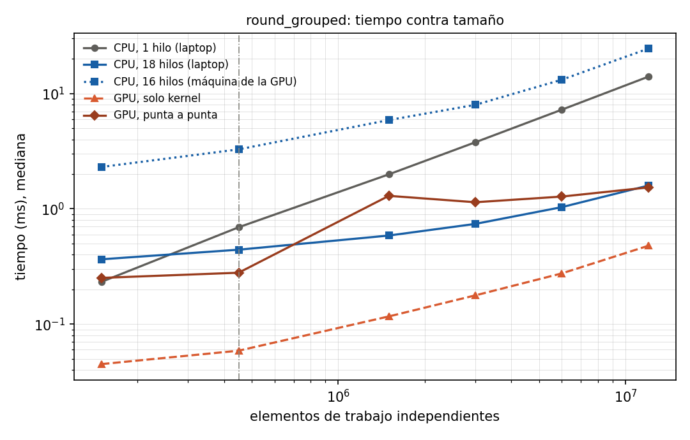
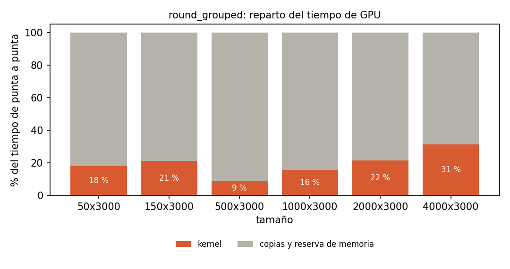
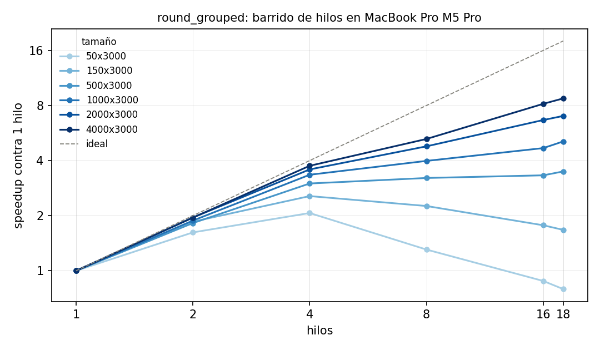

# round_grouped: CPU contra GPU

Generado por `tools/gpu_report.py` a partir de `mac.csv` y `pc.csv`. 10 repeticiones medidas por versión y tamaño, después de una de calentamiento.

### Veredicto: la GPU contra la CPU de la laptop

| Tamaño | CPU 1 hilo (ms) | CPU 18 hilos (ms) | GPU kernel (ms) | GPU punta a punta (ms) | Mejor CPU | Speedup de la GPU contra la mejor CPU (kernel / punta a punta) | ¿Correcto? |
|---|---|---|---|---|---|---|---|
| 50x3000 | 0.233 (0.217–0.240) | 0.365 (0.323–0.397) | 0.045 (0.037–0.051) | 0.252 (0.241–0.313) | 0.140 (4 hilos) | 3.11x / 0.56x | sí |
| 150x3000 | 0.692 (0.666–0.718) | 0.442 (0.404–0.465) | 0.059 (0.054–0.062) | 0.279 (0.272–0.366) | 0.289 (4 hilos) | 4.91x / 1.04x | sí |
| 500x3000 | 1.990 (1.938–2.057) | 0.587 (0.539–0.629) | 0.117 (0.104–0.128) | 1.296 (1.127–1.653) | 0.587 (18 hilos) | 5.03x / 0.45x | sí |
| 1000x3000 | 3.776 (3.730–3.909) | 0.740 (0.702–0.768) | 0.178 (0.167–0.207) | 1.140 (1.095–1.454) | 0.740 (18 hilos) | 4.17x / 0.65x | sí |
| 2000x3000 | 7.237 (7.168–7.400) | 1.034 (0.997–1.159) | 0.275 (0.270–0.296) | 1.277 (1.248–1.341) | 1.034 (18 hilos) | 3.75x / 0.81x | sí |
| 4000x3000 | 13.982 (13.871–14.194) | 1.590 (1.559–2.101) | 0.478 (0.455–0.625) | 1.532 (1.514–1.995) | 1.590 (18 hilos) | 3.33x / 1.04x | sí |

Tiempos de CPU: MacBook Pro M5 Pro. Mediana de las repeticiones y, entre paréntesis, mínimo y máximo.

Cruce de punta a punta contra la mejor CPU de la laptop: **150x3000** (450000 elementos).

### Misma máquina: la GPU contra la CPU de su propia máquina

| Tamaño | CPU 1 hilo (ms) | CPU 16 hilos (ms) | GPU kernel (ms) | GPU punta a punta (ms) | Mejor CPU | Speedup de la GPU contra la mejor CPU (kernel / punta a punta) | ¿Correcto? |
|---|---|---|---|---|---|---|---|
| 50x3000 | 2.561 (2.431–3.871) | 2.307 (2.240–2.357) | 0.045 (0.037–0.051) | 0.252 (0.241–0.313) | 1.279 (4 hilos) | 28.38x / 5.08x | sí |
| 150x3000 | 7.954 (7.870–8.316) | 3.277 (3.183–3.550) | 0.059 (0.054–0.062) | 0.279 (0.272–0.366) | 2.903 (4 hilos) | 49.31x / 10.40x | sí |
| 500x3000 | 21.044 (19.506–22.898) | 5.883 (5.304–7.510) | 0.117 (0.104–0.128) | 1.296 (1.127–1.653) | 5.883 (16 hilos) | 50.41x / 4.54x | sí |
| 1000x3000 | 33.637 (33.353–35.361) | 7.974 (7.843–9.119) | 0.178 (0.167–0.207) | 1.140 (1.095–1.454) | 7.974 (16 hilos) | 44.88x / 6.99x | sí |
| 2000x3000 | 59.440 (59.325–62.912) | 13.163 (12.835–15.957) | 0.275 (0.270–0.296) | 1.277 (1.248–1.341) | 13.163 (16 hilos) | 47.79x / 10.31x | sí |
| 4000x3000 | 113.259 (110.139–114.540) | 24.496 (23.295–26.150) | 0.478 (0.455–0.625) | 1.532 (1.514–1.995) | 24.496 (16 hilos) | 51.23x / 15.99x | sí |

Tiempos de CPU: PC Ryzen 7 3700X + RTX 3060 Ti. Mediana de las repeticiones y, entre paréntesis, mínimo y máximo.

Cruce de punta a punta contra la mejor CPU de la misma máquina: **50x3000** (150000 elementos).

### Variantes de GPU

Mediana en ms de cada variante medida en la misma corrida.

| Tamaño | `gpu_kernel` | `gpu_e2e` | `gpu_e2e_devicegroup` | `gpu_kernel_devicegroup` |
|---|---|---|---|---|
| 50x3000 | 0.045 | 0.252 | 0.440 | 0.040 |
| 150x3000 | 0.059 | 0.279 | 0.472 | 0.058 |
| 500x3000 | 0.117 | 1.296 | 2.092 | 0.110 |
| 1000x3000 | 0.178 | 1.140 | 1.498 | 0.177 |
| 2000x3000 | 0.275 | 1.277 | 1.678 | 0.276 |
| 4000x3000 | 0.478 | 1.532 | 1.985 | 0.458 |

### Barrido de hilos, MacBook Pro M5 Pro

Speedup de la versión multihilo contra ella misma con 1 hilo.

| Tamaño | 1 hilo | 2 hilos | 4 hilos | 8 hilos | 16 hilos | 18 hilos |
|---|---|---|---|---|---|---|
| 50x3000 | 1.00x | 1.62x | 2.07x | 1.31x | 0.88x | 0.79x |
| 150x3000 | 1.00x | 1.85x | 2.56x | 2.26x | 1.77x | 1.67x |
| 500x3000 | 1.00x | 1.82x | 3.00x | 3.21x | 3.32x | 3.49x |
| 1000x3000 | 1.00x | 1.88x | 3.35x | 3.98x | 4.68x | 5.09x |
| 2000x3000 | 1.00x | 1.95x | 3.58x | 4.78x | 6.66x | 7.01x |
| 4000x3000 | 1.00x | 1.95x | 3.75x | 5.25x | 8.17x | 8.74x |

### Barrido de hilos, PC Ryzen 7 3700X + RTX 3060 Ti

Speedup de la versión multihilo contra ella misma con 1 hilo.

| Tamaño | 1 hilo | 2 hilos | 4 hilos | 8 hilos | 16 hilos |
|---|---|---|---|---|---|
| 50x3000 | 1.00x | 1.73x | 2.07x | 1.62x | 1.15x |
| 150x3000 | 1.00x | 1.86x | 3.02x | 2.84x | 2.68x |
| 500x3000 | 1.00x | 1.87x | 3.08x | 2.97x | 3.56x |
| 1000x3000 | 1.00x | 1.86x | 3.43x | 2.79x | 4.27x |
| 2000x3000 | 1.00x | 1.94x | 3.58x | 2.66x | 4.54x |
| 4000x3000 | 1.00x | 1.88x | 3.61x | 2.55x | 4.48x |

### Gráficos

