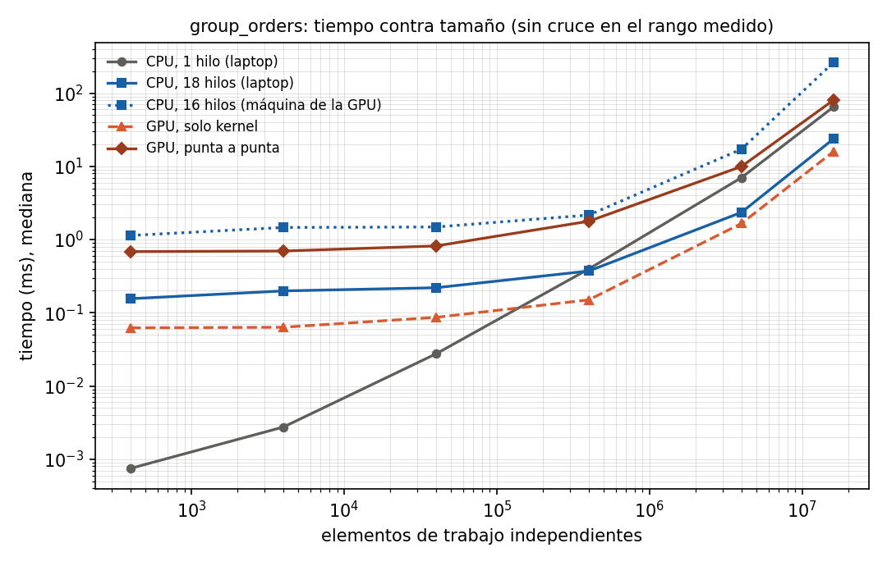
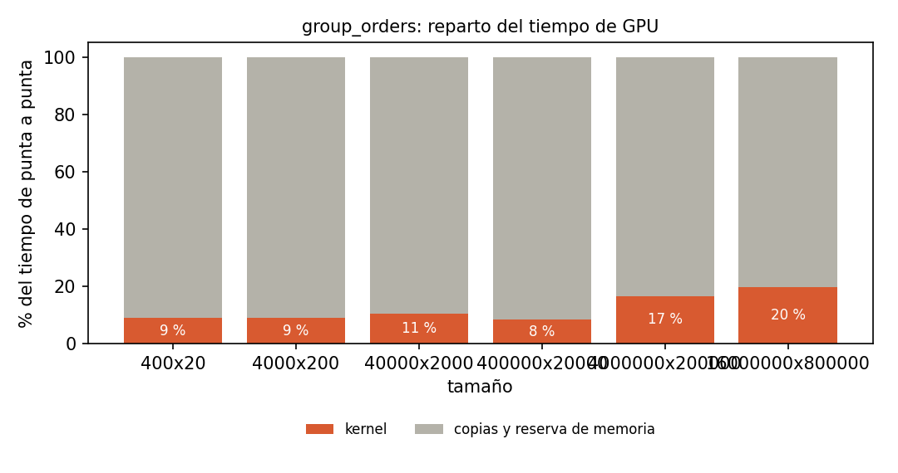
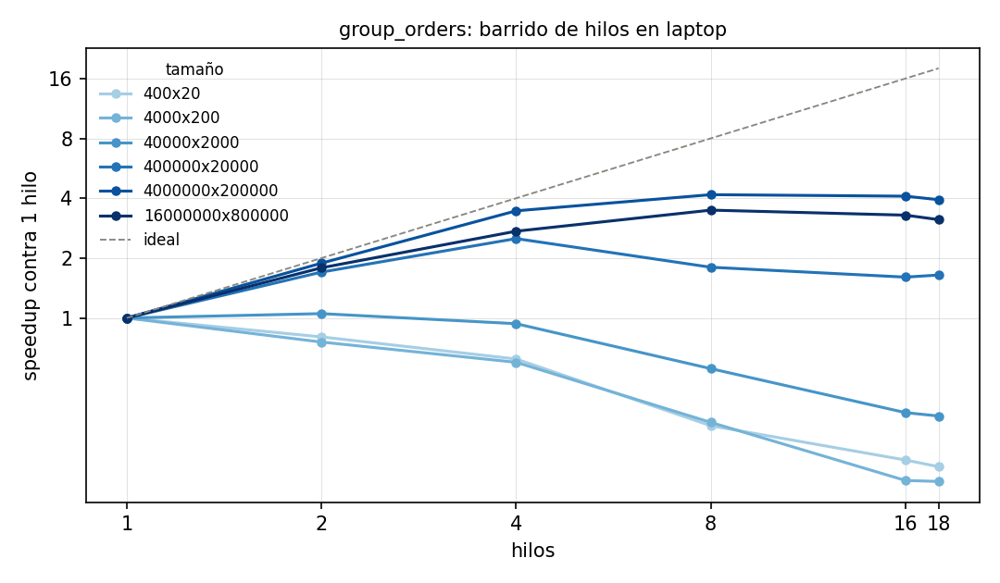

# group_orders: CPU contra GPU

Generado por `tools/gpu_report.py` a partir de `mac.csv` y `pc.csv`. 10 repeticiones medidas por versión y tamaño, después de una de calentamiento.

### Veredicto: la GPU contra la CPU de la laptop

| Tamaño | CPU 1 hilo (ms) | CPU 18 hilos (ms) | GPU kernel (ms) | GPU punta a punta (ms) | Mejor CPU | Speedup de la GPU contra la mejor CPU (kernel / punta a punta) | ¿Correcto? |
|---|---|---|---|---|---|---|---|
| 400x20 | 0.001 (0.001–0.001) | 0.156 (0.134–0.170) | 0.062 (0.052–0.214) | 0.685 (0.661–0.974) | 0.001 (1 hilo) | 0.01x / 0.00x | sí |
| 4000x200 | 0.003 (0.003–0.005) | 0.199 (0.182–0.213) | 0.063 (0.059–0.076) | 0.697 (0.683–0.752) | 0.003 (1 hilo) | 0.04x / 0.00x | sí |
| 40000x2000 | 0.028 (0.026–0.028) | 0.220 (0.201–0.264) | 0.087 (0.074–0.355) | 0.818 (0.760–1.332) | 0.028 (1 hilo) | 0.32x / 0.03x | sí |
| 400000x20000 | 0.397 (0.390–0.424) | 0.372 (0.350–0.392) | 0.150 (0.121–0.335) | 1.777 (1.717–2.662) | 0.244 (4 hilos) | 1.63x / 0.14x | sí |
| 4000000x200000 | 7.005 (6.845–7.195) | 2.350 (2.280–2.420) | 1.657 (1.628–1.690) | 9.949 (9.795–12.004) | 2.217 (8 hilos) | 1.34x / 0.22x | sí |
| 16000000x800000 | 64.542 (63.429–72.544) | 23.637 (23.013–29.488) | 15.871 (15.825–16.010) | 79.931 (78.746–83.756) | 21.177 (8 hilos) | 1.33x / 0.26x | sí |

Tiempos de CPU: laptop. Mediana de las repeticiones y, entre paréntesis, mínimo y máximo.

Cruce de punta a punta contra la mejor CPU de la laptop: **no hay cruce en el rango medido**; la CPU gana en todos los tamaños.

### Misma máquina: la GPU contra la CPU de su propia máquina

| Tamaño | CPU 1 hilo (ms) | CPU 16 hilos (ms) | GPU kernel (ms) | GPU punta a punta (ms) | Mejor CPU | Speedup de la GPU contra la mejor CPU (kernel / punta a punta) | ¿Correcto? |
|---|---|---|---|---|---|---|---|
| 400x20 | 0.002 (0.002–0.004) | 1.136 (1.088–1.142) | 0.062 (0.052–0.214) | 0.685 (0.661–0.974) | 0.002 (1 hilo) | 0.03x / 0.00x | sí |
| 4000x200 | 0.006 (0.006–0.007) | 1.462 (1.442–1.507) | 0.063 (0.059–0.076) | 0.697 (0.683–0.752) | 0.006 (1 hilo) | 0.10x / 0.01x | sí |
| 40000x2000 | 0.086 (0.062–0.109) | 1.484 (1.440–1.554) | 0.087 (0.074–0.355) | 0.818 (0.760–1.332) | 0.086 (1 hilo) | 0.99x / 0.11x | sí |
| 400000x20000 | 1.751 (1.394–2.255) | 2.161 (2.050–2.334) | 0.150 (0.121–0.335) | 1.777 (1.717–2.662) | 0.914 (2 hilos) | 6.09x / 0.51x | sí |
| 4000000x200000 | 75.443 (73.559–76.941) | 17.150 (16.052–21.259) | 1.657 (1.628–1.690) | 9.949 (9.795–12.004) | 17.150 (16 hilos) | 10.35x / 1.72x | sí |
| 16000000x800000 | 509.166 (466.683–511.809) | 261.516 (256.096–283.319) | 15.871 (15.825–16.010) | 79.931 (78.746–83.756) | 207.190 (8 hilos) | 13.05x / 2.59x | sí |

Tiempos de CPU: máquina de la GPU. Mediana de las repeticiones y, entre paréntesis, mínimo y máximo.

Cruce de punta a punta contra la mejor CPU de la misma máquina: **4000000x200000** (4000000 elementos).

### Variantes de GPU

Mediana en ms de cada variante medida en la misma corrida.

| Tamaño | `gpu_kernel` | `gpu_e2e` | `gpu_e2e_scan` | `gpu_kernel_scan` |
|---|---|---|---|---|
| 400x20 | 0.062 | 0.685 | 0.605 | 0.037 |
| 4000x200 | 0.063 | 0.697 | 0.604 | 0.036 |
| 40000x2000 | 0.087 | 0.818 | 0.665 | 0.102 |
| 400000x20000 | 0.150 | 1.777 | 0.727 | 0.103 |
| 4000000x200000 | 1.657 | 9.949 | 1.169 | 0.148 |
| 16000000x800000 | 15.871 | 79.931 | 3.202 | 0.730 |

### Barrido de hilos, laptop

Speedup de la versión multihilo contra ella misma con 1 hilo.

| Tamaño | 1 hilo | 2 hilos | 4 hilos | 8 hilos | 16 hilos | 18 hilos |
|---|---|---|---|---|---|---|
| 400x20 | 1.00x | 0.80x | 0.62x | 0.29x | 0.19x | 0.18x |
| 4000x200 | 1.00x | 0.76x | 0.60x | 0.30x | 0.15x | 0.15x |
| 40000x2000 | 1.00x | 1.05x | 0.94x | 0.56x | 0.33x | 0.32x |
| 400000x20000 | 1.00x | 1.70x | 2.51x | 1.80x | 1.60x | 1.64x |
| 4000000x200000 | 1.00x | 1.89x | 3.46x | 4.17x | 4.10x | 3.93x |
| 16000000x800000 | 1.00x | 1.79x | 2.73x | 3.49x | 3.29x | 3.12x |

### Barrido de hilos, máquina de la GPU

Speedup de la versión multihilo contra ella misma con 1 hilo.

| Tamaño | 1 hilo | 2 hilos | 4 hilos | 8 hilos | 16 hilos |
|---|---|---|---|---|---|
| 400x20 | 1.00x | 0.95x | 0.54x | 0.35x | 0.24x |
| 4000x200 | 1.00x | 0.98x | 0.54x | 0.34x | 0.19x |
| 40000x2000 | 1.00x | 1.06x | 0.63x | 0.42x | 0.25x |
| 400000x20000 | 1.00x | 2.39x | 1.66x | 1.36x | 1.01x |
| 4000000x200000 | 1.00x | 1.98x | 3.50x | 3.95x | 5.38x |
| 16000000x800000 | 1.00x | 1.62x | 2.39x | 3.80x | 3.01x |

### Gráficos

