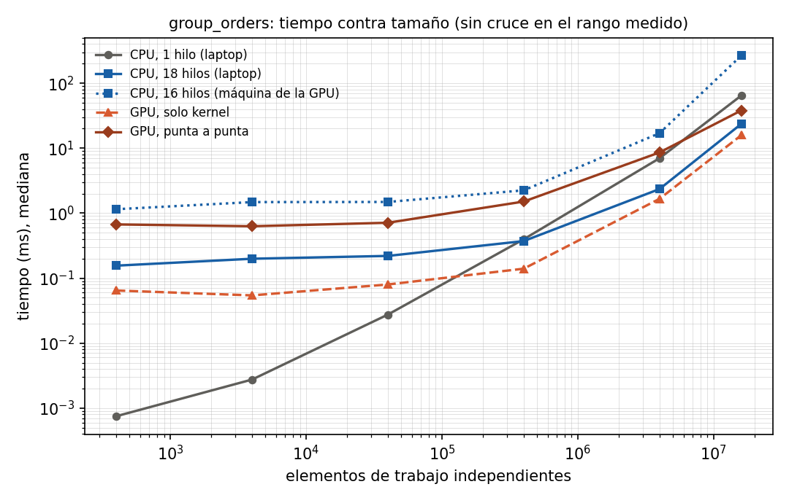
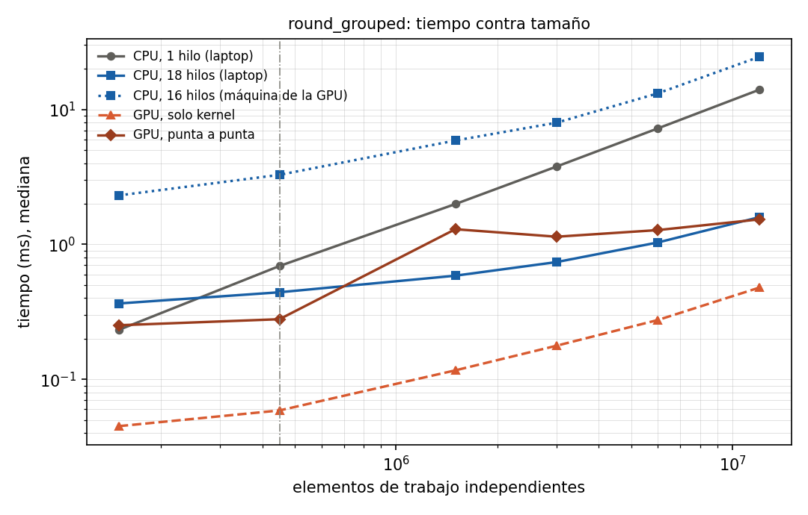

# Pedidos agrupados por restaurante: ¿vale la pena la GPU?

Concepto del curso: 09, scan (suma de prefijos). Primera aplicación de ese concepto. Código:
`src/gpu/group_orders.*` y `src/eta_service.*`. Datos: `mac.csv`, `pc.csv`. Tablas y gráficos:
`agrupar_tabla.md` (el agrupado solo), `llegada_tabla.md` y `agrupada_tabla.md` (la ronda de
estimación con los pedidos en orden de llegada y agrupados).

## La tarea

Dada la lista de pedidos pendientes, cada uno con su restaurante, dejarlos ordenados por
restaurante y saber dónde empieza el tramo de cada uno. Es un ordenamiento por conteo:

1. contar cuántos pedidos tiene cada restaurante;
2. scan exclusivo de los conteos: la suma de todos los anteriores es la posición donde empieza
   cada tramo;
3. escribir cada pedido en el tramo de su restaurante.

Es paralela en datos en los tres pasos. Contar y escribir se hacen pedido por pedido, sin orden.
El scan parece secuencial, porque cada posición depende de todas las anteriores, pero la suma es
asociativa: se puede resolver por trozos y combinar.

## Montaje

El mismo de los experimentos anteriores: CPU del veredicto en el MacBook Pro con Apple M5 Pro (18
núcleos, enchufado, `-O3`); GPU en la PC con Ryzen 7 3700X y RTX 3060 Ti (CUDA 12.1, `-O3`,
sm_86), que además mide las mismas versiones de CPU.

```sh
./delivery_sim ../config/ciudad.json --headless --bench <maquina>.csv --bench-apps group_orders,round_arrival,round_grouped --bench-reps 10 --bench-sweep
./delivery_sim ../config/ciudad.json --gpu-info
python3 tools/gpu_report.py --app group_orders --prefix agrupar_ --laptop mac.csv --gpu pc.csv --out tools/reports/gpu/group_orders
python3 tools/gpu_report.py --app round_arrival --prefix llegada_ --laptop mac.csv --gpu pc.csv --out tools/reports/gpu/group_orders
python3 tools/gpu_report.py --app round_grouped --prefix agrupada_ --laptop mac.csv --gpu pc.csv --out tools/reports/gpu/group_orders
```

Se miden tres cosas:

- `group_orders`: el agrupado solo. Seis tamaños, de 400 pedidos en 20 restaurantes a 16 millones
  en 800 000: más de cuatro órdenes de magnitud, siempre con 20 pedidos por restaurante de
  promedio, que es la proporción de la ciudad (4000 pendientes, 200 restaurantes).
- `round_arrival` y `round_grouped`: la ronda de estimación completa, estimar y elegir la mejor
  moto, con los mismos pedidos en orden de llegada y agrupados por restaurante. De 50 a 4000
  pedidos contra 3000 motos, con 200 restaurantes. La versión agrupada incluye el costo de
  agrupar y el de devolver cada respuesta a su pedido.

Una corrida de calentamiento y 10 medidas intercaladas. Antes de cada medida de GPU el medidor
despierta la tarjeta, como explica el README: las 300 medidas de `pc.csv` se tomaron a régimen.

## Diseño

- **Conteo.** Un hilo por pedido; suma 1 al contador de su restaurante con `atomicAdd`. Dos
  pedidos del mismo restaurante chocan en el mismo contador, y el atómico lo resuelve.
- **Scan jerárquico.** Cada bloque de 256 hilos carga 256 conteos en memoria compartida y los
  escanea con el esquema de Kogge-Stone: 8 pasadas, en cada una cada posición suma la que está
  `stride` lugares antes, con dos barreras por pasada para que nadie lea un valor a medio
  escribir. El bloque deja además su total. Los totales de los bloques se escanean con el mismo
  kernel, y así hacia arriba hasta que queda un solo bloque. Un segundo kernel suma a cada
  posición el desplazamiento de su bloque. Con 800 000 restaurantes son tres niveles: 3126
  bloques, 13 y 1.
- **Reparto.** Un hilo por pedido; pide su lugar con `atomicAdd` sobre un cursor por restaurante
  y escribe su número de pedido en `inicio + lugar`.
- **Orden dentro del tramo.** Las versiones de CPU dejan los pedidos de cada restaurante en orden
  de llegada. En la tarjeta el lugar lo decide quién llega primero al atómico, así que el orden
  dentro del tramo puede cambiar de una corrida a otra. Los tramos sí son siempre los mismos.
- **Dónde entra en el programa.** El coordinador de rondas agrupa los pedidos de la ronda por
  restaurante antes de armar la entrada de la estimación. En la matriz de pedidos × motos, las
  filas vecinas pasan a ser del mismo restaurante y leen las mismas celdas de la tabla de
  tiempos. Las respuestas se devuelven a cada pedido con la permutación inversa, y los lugares de
  las mochilas se siguen prometiendo en orden de llegada.

## Corrección

- Las 1680 filas de `pc.csv` y las 1260 de `mac.csv` tienen `correct = yes`. En el agrupado, los
  inicios de tramo de GPU son idénticos a los de CPU, y cada tramo, puesto en orden, también. En
  las rondas, la moto elegida para cada pedido es la misma con y sin agrupar.
- `tests/gpu/group_orders_test.cpp`: un scan y un agrupado calculados a mano; scans de largos
  que caen justo antes, en y después del borde de un bloque, y uno de 70 000 que usa tres
  niveles; agrupados con restaurantes vacíos, con más restaurantes que pedidos y con un
  restaurante que concentra el 60 % de la demanda; y que ningún pedido se pierde ni se repite.
- `tests/gpu/eta_service_test.cpp`: una ronda con dos restaurantes intercalados, agrupada en CPU
  y en la tarjeta: cada pedido recibe la hora de entrega de su propio restaurante.
- `compute-sanitizer`: memcheck 0 errores y racecheck 0 hallazgos en la prueba del agrupado;
  memcheck 0 errores en la del coordinador.
- ThreadSanitizer en la laptop, sobre la suite completa: 0 reportes.
- Simulación de ciudad con el agrupado en CPU y en la tarjeta: el log pasa el verificador en las
  dos; cortada con SIGINT cierra en 0,34 s.

## Resultados

Medianas en ms. Las tablas completas, con mínimos y máximos, están en los tres `*_tabla.md`.

### El agrupado solo

| Pedidos / restaurantes | CPU 1 hilo, laptop | CPU 18 hilos, laptop | GPU kernel | GPU punta a punta | Kernel contra la mejor CPU | Punta a punta contra la mejor CPU |
|---|---|---|---|---|---|---|
| 400 / 20 | 0,001 | 0,156 | 0,065 | 0,671 | 0,01x | 0,00x |
| 4000 / 200 | 0,003 | 0,199 | 0,054 | 0,629 | 0,05x | 0,00x |
| 40 mil / 2 mil | 0,028 | 0,220 | 0,080 | 0,711 | 0,34x | 0,04x |
| 400 mil / 20 mil | 0,397 | 0,372 | 0,140 | 1,508 | 1,75x | 0,16x |
| 4 millones / 200 mil | 7,005 | 2,350 | 1,662 | 8,595 | 1,33x | 0,26x |
| 16 millones / 800 mil | 64,542 | 23,637 | 15,821 | 38,048 | 1,34x | 0,56x |



- **El kernel le gana a la laptop desde 400 000 pedidos**, entre 1,3 y 1,75 veces.
- **De punta a punta no hay cruce contra la laptop.** La GPU llega a 0,56 veces con 16 millones.
  Suben 64 MB y bajan 67; el kernel es el 42 % del tiempo en ese tamaño y el 10 % en los chicos.
- **En el tamaño de la ciudad, 4000 pedidos, un hilo tarda 3 microsegundos.** La GPU tarda 0,6 ms
  solo en ir y volver: 200 veces más.

En la misma máquina sí hay cruce, en 4 millones de pedidos:

| Pedidos / restaurantes | CPU 1 hilo, PC | CPU 16 hilos, PC | GPU kernel | GPU punta a punta | Punta a punta contra la mejor CPU de la PC |
|---|---|---|---|---|---|
| 400 / 20 | 0,002 | 1,150 | 0,065 | 0,671 | 0,00x |
| 4000 / 200 | 0,007 | 1,480 | 0,054 | 0,629 | 0,01x |
| 40 mil / 2 mil | 0,067 | 1,487 | 0,080 | 0,711 | 0,09x |
| 400 mil / 20 mil | 2,086 | 2,245 | 0,140 | 1,508 | 0,67x |
| 4 millones / 200 mil | 66,470 | 17,001 | 1,662 | 8,595 | 1,98x |
| 16 millones / 800 mil | 495,813 | 265,969 | 15,821 | 38,048 | 5,60x |

La versión multihilo de CPU rinde poco en las dos máquinas: 3,1 veces con 18 hilos en la laptop y
1,9 con 16 en la PC, en el tamaño mayor. Cada hilo cuenta en su propia tabla y después hay que
juntarlas, y el reparto escribe en posiciones salteadas de un arreglo de 64 MB.

### Cuánto del agrupado es el scan

| Pedidos / restaurantes | Los tres pasos, kernel | Solo el scan, kernel | Parte del scan | Punta a punta | Parte del kernel |
|---|---|---|---|---|---|
| 400 / 20 | 0,065 | 0,042 | 65 % | 0,671 | 10 % |
| 4000 / 200 | 0,054 | 0,040 | 74 % | 0,629 | 9 % |
| 40 mil / 2 mil | 0,080 | 0,077 | 97 % | 0,711 | 11 % |
| 400 mil / 20 mil | 0,140 | 0,113 | 81 % | 1,508 | 9 % |
| 4 millones / 200 mil | 1,662 | 0,153 | 9 % | 8,595 | 19 % |
| 16 millones / 800 mil | 15,821 | 0,682 | 4 % | 38,048 | 42 % |

El scan es el paso del concepto y es el barato: 0,68 ms para 800 000 conteos, el 4 % del kernel
en el tamaño mayor. Lo caro son los otros dos pasos, que no recorren la memoria en orden: 16
millones de sumas atómicas sobre contadores elegidos al azar y 16 millones de escrituras
salteadas. En los tamaños chicos pasa al revés: el scan es casi todo el kernel, porque son 17
barreras por bloque aunque haya 20 números que sumar.

### El efecto en la ronda de estimación

| Pedidos × motos | Laptop 1 hilo, llegada | Laptop 1 hilo, agrupada | Laptop 18 hilos, llegada | Laptop 18 hilos, agrupada | GPU kernel, llegada | GPU kernel, agrupada | GPU punta a punta, llegada | GPU punta a punta, agrupada |
|---|---|---|---|---|---|---|---|---|
| 50 × 3000 | 0,229 | 0,233 | 0,129 | 0,365 | 0,085 | 0,045 | 0,531 | 0,252 |
| 150 × 3000 | 0,884 | 0,692 | 0,200 | 0,442 | 0,102 | 0,059 | 0,378 | 0,279 |
| 500 × 3000 | 3,166 | 1,990 | 0,506 | 0,587 | 0,286 | 0,117 | 1,313 | 1,296 |
| 1000 × 3000 | 6,194 | 3,776 | 0,874 | 0,740 | 0,569 | 0,178 | 1,556 | 1,140 |
| 2000 × 3000 | 12,130 | 7,237 | 1,761 | 1,034 | 1,110 | 0,275 | 2,180 | 1,277 |
| 4000 × 3000 | 22,387 | 13,982 | 3,183 | 1,590 | 2,163 | 0,478 | 3,169 | 1,532 |



- **Agrupar baja el kernel de la ronda de 2,16 a 0,48 ms con 4000 pedidos**: 4,5 veces. Con 1000
  pedidos baja de 0,57 a 0,18. El kernel de estimación estaba frenado por la lectura dispersa a
  la tabla de tiempos; con las filas agrupadas, los pedidos vecinos de un bloque son del mismo
  restaurante y leen la misma celda para cada moto.
- **De punta a punta la ronda en GPU baja de 3,17 a 1,53 ms** en ese tamaño.
- **A la CPU también le sirve.** La laptop con 18 hilos baja de 3,18 a 1,59 ms, y con un hilo de
  22,4 a 14,0. Con pocos pedidos la versión multihilo agrupada es más lenta que sin agrupar,
  porque el agrupado multihilo tiene un costo fijo que con 50 pedidos no se recupera; ahí
  conviene agrupar con un hilo.
- **Contra la laptop sigue siendo un empate en el tope**: 1,04 veces con 4000 × 3000. En los
  demás tamaños empata o gana la laptop. Agrupar mejoró a las dos por igual.

### Dónde conviene agrupar la ronda

Ronda completa en la PC, de punta a punta, en ms.

| Pedidos × motos | Ronda con el agrupado en CPU | Ronda con el agrupado en la tarjeta |
|---|---|---|
| 50 × 3000 | 0,252 | 0,440 |
| 150 × 3000 | 0,279 | 0,472 |
| 500 × 3000 | 1,296 | 2,092 |
| 1000 × 3000 | 1,140 | 1,498 |
| 2000 × 3000 | 1,277 | 1,678 |
| 4000 × 3000 | 1,532 | 1,985 |

Agrupar en la tarjeta los pedidos de una ronda cuesta entre 0,2 y 0,8 ms más que agruparlos en
la CPU. Son como mucho 4000 pedidos: el viaje a la tarjeta cuesta más que el trabajo. Por eso el
coordinador agrupa en CPU, y con `--backend gpu` usa los kernels.

## Análisis

**Paralelismo disponible.** Un hilo por pedido en el conteo y en el reparto, y uno por
restaurante en el scan. La tarjeta aloja 58 368 hilos a la vez: recién con 40 000 pedidos tiene
con qué llenarse. Una ronda de la ciudad, 4000 pedidos, ocupa 16 bloques.

**Sobrecostos.** El agrupado en GPU tiene un piso de 0,6 ms: seis reservas o más, dos puestas a
cero, tres copias y tres lanzamientos o más. `nsys` da medianas de 4 µs por reserva, 17 µs por puesta
a cero y 51 µs por copia. En los tamaños grandes pesan las copias: con 16 millones de pedidos el
kernel son 15,8 de los 38 ms.

**Límite por memoria.** El scan lee y escribe en orden: 3,2 MB de conteos en 0,68 ms. El conteo
y el reparto no: cada pedido toca un contador y una posición de salida que dependen de su
restaurante. Con 4 millones de pedidos el kernel procesa 2400 millones de pedidos por segundo;
con 16 millones baja a 1000 millones; lo más probable es que los contadores y la salida ya no
quepan en la caché de la tarjeta. Es el mismo freno que tenía la estimación, y el mismo que el agrupado le quita a
la estimación al ordenar sus filas.

**Eficiencia de ejecución.** `--gpu-info`: los cuatro kernels alojan 6 bloques por
multiprocesador con ocupación del 100 %, limitada por los hilos. Conteo: 10 registros por hilo.
Scan: 12 registros y 1024 bytes de memoria compartida. Desplazamientos: 10. Reparto: 16. La
divergencia es mínima: en el scan, en la pasada de `stride` solo dejan de sumar los primeros
`stride` hilos, y en los otros kernels solo se separan los hilos del borde.

**Contención y sincronización.** El scan tiene 17 barreras por bloque y ningún atómico. El conteo
y el reparto no tienen barreras y dependen de atómicos: la contención crece cuando la demanda se
concentra, porque más hilos pelean por el mismo contador. La prueba cubre un restaurante con el
60 % de los pedidos; la medición usa demanda pareja.

**Corrección bajo paralelismo.** Los conteos y los inicios de tramo no dependen del orden: son
sumas. El orden dentro del tramo sí depende de la carrera por el cursor, y por eso la salida de
GPU no es idéntica byte a byte a la de CPU. Se comprueba lo que sí está garantizado: mismos
inicios, y en cada tramo exactamente los pedidos de ese restaurante, una vez cada uno. En el
programa ese orden no se usa: la respuesta vuelve a cada pedido por su número.

**Efecto en el programa.** Cinco minutos simulados de `config/ciudad.json` en la PC:

| Ronda | Rondas | Ronda más grande | Pedidos asignados | Reintentos | Estimaciones tardías |
|---|---|---|---|---|---|
| En orden de llegada (experimento anterior) | 188 | 151 | 3076 | 48 | 0 |
| Agrupada en CPU | 170 | 155 | 3063 | 53 | 0 |
| Agrupada en la tarjeta | 174 | 157 | 3067 | 42 | 0 |

Las tres asignan todos los pedidos y no hay estimaciones tardías. Con rondas de 150 pedidos el
agrupado ahorra unos 0,1 ms por ronda, que en la simulación no se nota: las diferencias de la
tabla están dentro de lo que cambia de una corrida a otra.

## Veredicto

- **El agrupado solo: CPU.** Contra la laptop la GPU no cruza de punta a punta en ningún tamaño,
  y en los tamaños del programa un hilo lo resuelve en microsegundos. En la misma máquina la GPU
  conviene desde 4 millones de pedidos, mil veces más de lo que el programa junta.
- **El scan en sí: tampoco.** Es el paso más barato de los tres, y con 200 restaurantes son 200
  sumas.
- **Agrupar antes de estimar: sí, y es lo que queda de esta aplicación.** El kernel de estimación
  va 4,5 veces más rápido y la ronda de punta a punta la mitad, en GPU y en CPU. Se hace en CPU
  porque la ronda es chica.
- **Contra la laptop la ronda sigue en empate** en el tope de la configuración.

## Amenazas a la validez

- **Dos máquinas.** El Ryzen es mucho más lento que el M5 Pro en estas tareas de memoria salteada:
  el cruce de la misma máquina no dice nada contra la laptop. Se reportan las dos comparaciones.
- **Demanda pareja.** La medición reparte los pedidos al azar entre restaurantes. Con demanda
  concentrada los atómicos chocan más y los tramos son desiguales; eso se probó pero no se midió.
- **La proporción de 20 pedidos por restaurante es fija.** Con más restaurantes por pedido el
  scan pesa más, y con menos, menos.
- **Tarjeta a régimen.** Las medidas se toman después de despertar la tarjeta. En el programa,
  con rondas chicas y espaciadas, la tarjeta puede estar a baja frecuencia; eso no se midió.
- **Cerca de 1 ms sin explicar en las rondas grandes.** Desde 500 × 3000 hay alrededor de 1 ms
  entre el tiempo del kernel y el de punta a punta que no son copias, porque por ronda suben menos
  de 100 KB. Es tiempo de espera del hilo dueño de la GPU. No se investigó su causa.
- **El efecto en el programa se midió en una corrida por versión.**
- **La PC no estaba en reposo** y corre en un contenedor sobre WSL2. `ncu` no perfila ahí; la
  ocupación sale de `--gpu-info` y el reparto del tiempo de eventos CUDA y de `nsys`.
