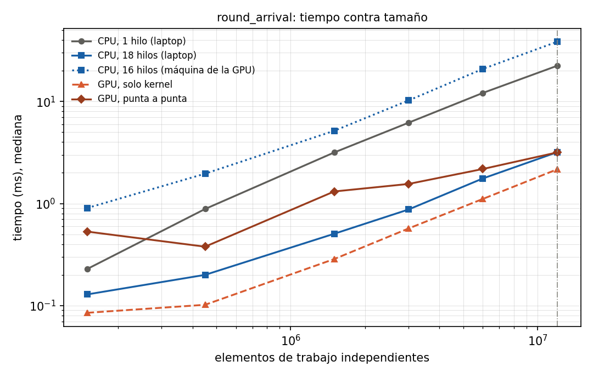
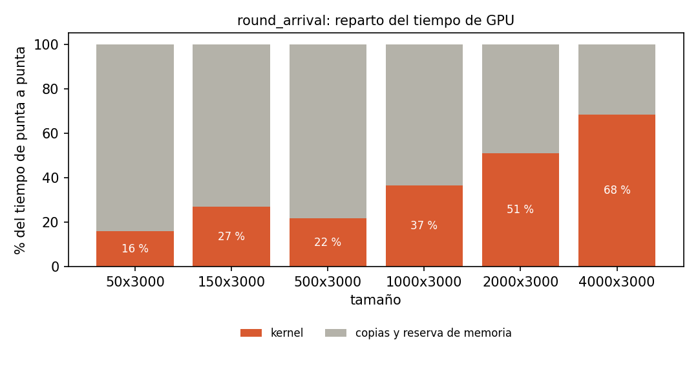
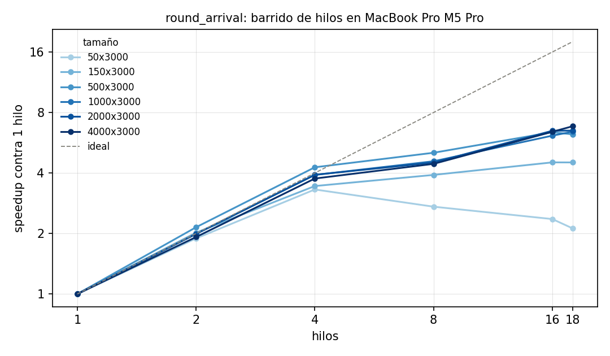

# round_arrival: CPU contra GPU

Generado por `tools/gpu_report.py` a partir de `mac.csv` y `pc.csv`. 10 repeticiones medidas por versión y tamaño, después de una de calentamiento.

### Veredicto: la GPU contra la CPU de la laptop

| Tamaño | CPU 1 hilo (ms) | CPU 18 hilos (ms) | GPU kernel (ms) | GPU punta a punta (ms) | Mejor CPU | Speedup de la GPU contra la mejor CPU (kernel / punta a punta) | ¿Correcto? |
|---|---|---|---|---|---|---|---|
| 50x3000 | 0.229 (0.218–0.238) | 0.129 (0.112–0.152) | 0.085 (0.042–0.186) | 0.531 (0.291–0.786) | 0.082 (4 hilos) | 0.97x / 0.16x | sí |
| 150x3000 | 0.884 (0.855–0.921) | 0.200 (0.182–0.208) | 0.102 (0.094–0.166) | 0.378 (0.349–0.762) | 0.200 (16 hilos) | 1.96x / 0.53x | sí |
| 500x3000 | 3.166 (3.021–3.235) | 0.506 (0.474–0.537) | 0.286 (0.275–0.348) | 1.313 (1.230–1.819) | 0.494 (16 hilos) | 1.73x / 0.38x | sí |
| 1000x3000 | 6.194 (6.051–6.690) | 0.874 (0.841–0.888) | 0.569 (0.562–0.588) | 1.556 (1.524–1.675) | 0.874 (18 hilos) | 1.54x / 0.56x | sí |
| 2000x3000 | 12.130 (11.596–15.688) | 1.761 (1.649–1.900) | 1.110 (1.098–1.166) | 2.180 (2.059–2.480) | 1.761 (18 hilos) | 1.59x / 0.81x | sí |
| 4000x3000 | 22.387 (22.084–22.920) | 3.183 (3.145–3.275) | 2.163 (2.130–2.208) | 3.169 (3.083–3.401) | 3.183 (18 hilos) | 1.47x / 1.00x | sí |

Tiempos de CPU: MacBook Pro M5 Pro. Mediana de las repeticiones y, entre paréntesis, mínimo y máximo.

Cruce de punta a punta contra la mejor CPU de la laptop: **4000x3000** (12000000 elementos).

### Misma máquina: la GPU contra la CPU de su propia máquina

| Tamaño | CPU 1 hilo (ms) | CPU 16 hilos (ms) | GPU kernel (ms) | GPU punta a punta (ms) | Mejor CPU | Speedup de la GPU contra la mejor CPU (kernel / punta a punta) | ¿Correcto? |
|---|---|---|---|---|---|---|---|
| 50x3000 | 2.707 (2.597–4.170) | 0.904 (0.848–0.942) | 0.085 (0.042–0.186) | 0.531 (0.291–0.786) | 0.815 (8 hilos) | 9.58x / 1.53x | sí |
| 150x3000 | 9.506 (9.077–10.014) | 1.962 (1.807–2.191) | 0.102 (0.094–0.166) | 0.378 (0.349–0.762) | 1.962 (16 hilos) | 19.27x / 5.19x | sí |
| 500x3000 | 30.357 (29.684–34.645) | 5.162 (4.861–6.107) | 0.286 (0.275–0.348) | 1.313 (1.230–1.819) | 5.162 (16 hilos) | 18.07x / 3.93x | sí |
| 1000x3000 | 61.946 (60.430–65.486) | 10.237 (9.972–11.101) | 0.569 (0.562–0.588) | 1.556 (1.524–1.675) | 10.237 (16 hilos) | 17.98x / 6.58x | sí |
| 2000x3000 | 126.985 (121.219–131.497) | 20.861 (19.435–23.595) | 1.110 (1.098–1.166) | 2.180 (2.059–2.480) | 20.861 (16 hilos) | 18.80x / 9.57x | sí |
| 4000x3000 | 241.177 (237.764–262.398) | 38.500 (35.241–44.756) | 2.163 (2.130–2.208) | 3.169 (3.083–3.401) | 38.500 (16 hilos) | 17.80x / 12.15x | sí |

Tiempos de CPU: PC Ryzen 7 3700X + RTX 3060 Ti. Mediana de las repeticiones y, entre paréntesis, mínimo y máximo.

Cruce de punta a punta contra la mejor CPU de la misma máquina: **50x3000** (150000 elementos).

### Barrido de hilos, MacBook Pro M5 Pro

Speedup de la versión multihilo contra ella misma con 1 hilo.

| Tamaño | 1 hilo | 2 hilos | 4 hilos | 8 hilos | 16 hilos | 18 hilos |
|---|---|---|---|---|---|---|
| 50x3000 | 1.00x | 1.89x | 3.31x | 2.72x | 2.36x | 2.12x |
| 150x3000 | 1.00x | 2.02x | 3.44x | 3.91x | 4.52x | 4.51x |
| 500x3000 | 1.00x | 2.15x | 4.27x | 5.04x | 6.38x | 6.23x |
| 1000x3000 | 1.00x | 1.99x | 3.91x | 4.58x | 6.14x | 6.42x |
| 2000x3000 | 1.00x | 1.99x | 3.92x | 4.51x | 6.49x | 6.50x |
| 4000x3000 | 1.00x | 1.92x | 3.75x | 4.44x | 6.41x | 6.83x |

### Barrido de hilos, PC Ryzen 7 3700X + RTX 3060 Ti

Speedup de la versión multihilo contra ella misma con 1 hilo.

| Tamaño | 1 hilo | 2 hilos | 4 hilos | 8 hilos | 16 hilos |
|---|---|---|---|---|---|
| 50x3000 | 1.00x | 1.91x | 2.40x | 3.25x | 2.93x |
| 150x3000 | 1.00x | 1.84x | 3.39x | 3.85x | 4.82x |
| 500x3000 | 1.00x | 1.94x | 3.62x | 3.90x | 6.02x |
| 1000x3000 | 1.00x | 2.02x | 3.82x | 4.01x | 6.21x |
| 2000x3000 | 1.00x | 1.85x | 3.71x | 3.97x | 5.92x |
| 4000x3000 | 1.00x | 1.89x | 3.72x | 3.92x | 6.17x |

### Gráficos

