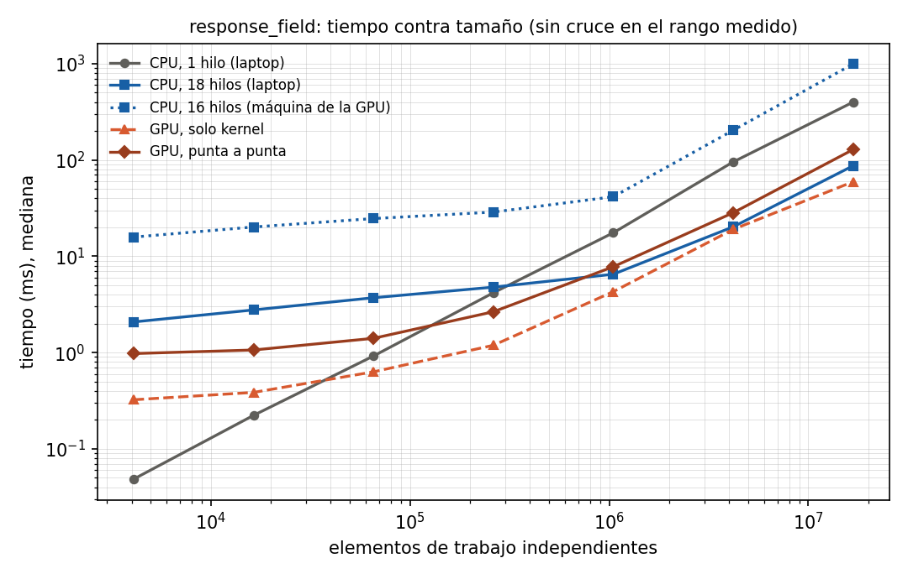
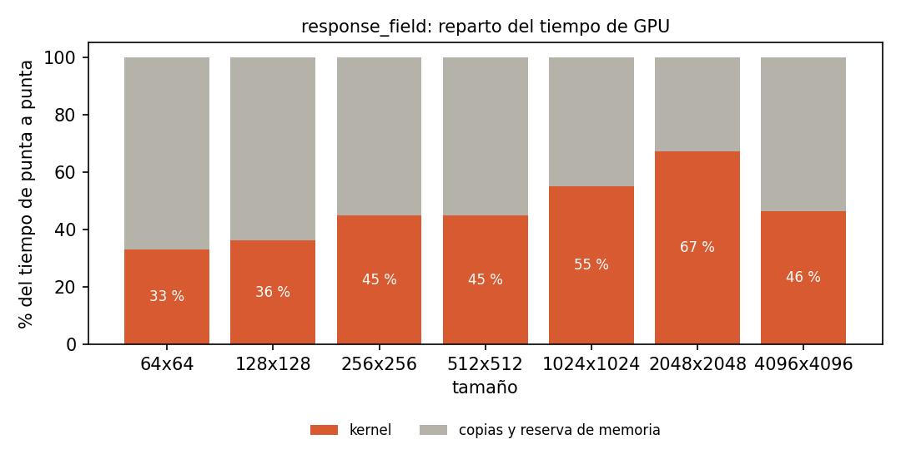
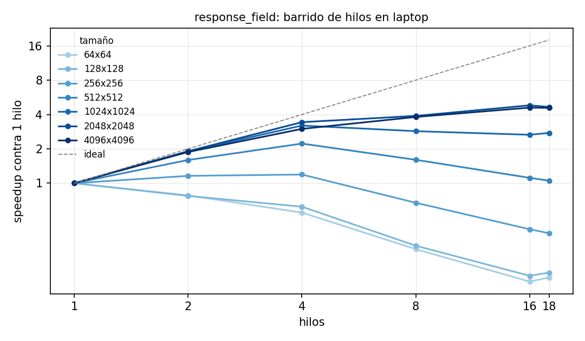

# Campo de respuesta con motos ocupadas: ¿vale la pena la GPU?

Concepto del curso: 06, stencil, aquí con varias pasadas por lanzamiento dentro de shared memory.
Segunda aplicación de ese concepto; la primera fue el campo de cobertura de las motos libres.
Código: `src/gpu/response_field.*`, sobre las pasadas de `src/gpu/coverage_field.*`. Datos:
`mac.csv`, `pc.csv`. Tabla y gráficos: `tabla.md`.

## La tarea

El campo de cobertura solo mira las motos libres. Pero una moto ocupada que termina su viaje en
dos minutos, cerca de una zona, la atiende antes que una libre que está lejos. El campo de
respuesta cuenta a las dos: una moto libre vale cero y una ocupada arranca con el tiempo que le
falta para terminar su viaje, en el lugar donde va a quedar. El resto es igual: en cada pasada,
cada celda con calle toma el menor entre su valor y el de sus cuatro vecinas más el tiempo de
cruzar una celda, hasta que nada cambia. El resultado es cuánto tardaría en llegar a cada zona la
primera moto disponible.

## Montaje

El mismo de los experimentos anteriores: CPU del veredicto en el MacBook Pro con Apple M5 Pro (18
núcleos, enchufado, `-O3`); GPU en la PC con Ryzen 7 3700X y RTX 3060 Ti (CUDA 12.1, `-O3`,
sm_86), que además mide las mismas versiones de CPU.

```sh
./delivery_sim ../config/ciudad.json --headless --bench <maquina>.csv --bench-apps response_field --bench-reps 10 --bench-sweep
./delivery_sim ../config/ciudad.json --gpu-info
python3 tools/gpu_report.py --app response_field --laptop mac.csv --gpu pc.csv --out tools/reports/gpu/response_field
```

Siete cuadrículas, de 64 × 64 a 4096 × 4096. La de 64 × 64 es la que usa el programa. Una de cada
siete celdas no tiene calle y hay una moto cada 1024 celdas, la mitad libres y la mitad ocupadas
con una espera al azar. Una corrida de calentamiento y 10 medidas intercaladas, con la tarjeta
despierta antes de cada medida de GPU. El tiempo de punta a punta de la GPU cuenta también la
reserva del arreglo de salida en la CPU.

## Diseño

El campo de cobertura dejó dos cosas medidas: con cuadrículas chicas el kernel no bajaba de 1 ms
porque cada pasada es un lanzamiento, y cargar un tile en shared memory para una sola pasada no
servía. Esta aplicación junta las dos: carga el tile una vez y hace varias pasadas sobre él.

- **8 pasadas por lanzamiento.** Cada bloque de 16 × 16 hilos carga en shared memory su tile de
  16 × 16 celdas con un borde de 8 a cada lado: 32 × 32, 1024 celdas, cuatro por hilo. Hace las 8
  pasadas ahí, con dos arreglos que se intercambian y una barrera entre pasadas, y escribe a
  memoria global solo las 16 × 16 de adentro.
- **Por qué el borde es de 8.** En cada pasada la información avanza una celda. Las celdas del
  borde no ven a sus vecinas de afuera, así que después de una pasada la fila exterior ya no es
  confiable, después de dos las dos exteriores, y así. Con un borde de 8 y 8 pasadas, lo que no
  es confiable se queda en el borde y las 16 × 16 de adentro salen exactas.
- **El costo.** Para entregar 256 celdas el bloque calcula 1024, cuatro veces más trabajo. A
  cambio hace 8 veces menos lanzamientos y lee y escribe memoria global una vez cada 8 pasadas.
- **Convergencia.** Como en la primera aplicación, cada 16 pasadas un kernel compara los dos
  arreglos con una reducción y baja un número. Aquí los arreglos que se comparan están a 8
  pasadas de distancia y no a una, así que puede hacer falta una revisión más para confirmar que
  nada cambia.
- **El kernel de comparación** es el de la primera aplicación: una pasada por lanzamiento, sin
  tile.

Las versiones de CPU son las pasadas de la primera aplicación, que no dependen de si los orígenes
valen cero o no.

**En el programa:** al cierre se toman las motos libres y las ocupadas con un viaje en curso, y
se informa la zona peor atendida. Corre en CPU con un hilo, o en la tarjeta con `--backend gpu`.

## Corrección

- Las 700 filas de `pc.csv` y las 490 de `mac.csv` tienen `correct = yes`: el campo idéntico,
  celda por celda y sin tolerancia, al de la versión de un hilo.
- `tests/gpu/response_field_test.cpp`: cada celda arranca con la espera de su moto más pronta;
  una moto ocupada cubre su zona recién después de su espera; contar las ocupadas nunca empeora
  una zona; Dijkstra, las pasadas de CPU y los dos kernels coinciden en cuadrículas menores,
  iguales y mayores que un tile; y con 8 pasadas por lanzamiento hacen falta menos lanzamientos.
- `compute-sanitizer`: memcheck 0 errores, racecheck 0 hallazgos.
- ThreadSanitizer en la laptop, sobre la suite completa: 0 reportes.
- Una hora de `config/equipetrol.json` con el campo en CPU y en la tarjeta: el log pasa el
  verificador. En la corrida de GPU, con una moto libre al cierre la zona peor cubierta quedaba a
  360 s; contando además tres motos ocupadas, la peor atendida queda a 174 s.

## Resultados

Medianas en ms. La columna de GPU es el kernel de 8 pasadas por lanzamiento. La tabla completa
está en `tabla.md`.

| Cuadrícula | Pasadas en CPU | CPU 1 hilo, laptop | CPU 18 hilos, laptop | GPU kernel | GPU punta a punta | Kernel contra la mejor CPU | Punta a punta contra la mejor CPU |
|---|---|---|---|---|---|---|---|
| 64 × 64 | 55 | 0,048 | 2,079 | 0,323 | 0,976 | 0,15x | 0,05x |
| 128 × 128 | 69 | 0,223 | 2,771 | 0,385 | 1,063 | 0,58x | 0,21x |
| 256 × 256 | 77 | 0,921 | 3,708 | 0,630 | 1,405 | 1,46x | 0,66x |
| 512 × 512 | 89 | 4,175 | 4,777 | 1,190 | 2,652 | 1,90x | 0,85x |
| 1024 × 1024 | 92 | 17,5 | 6,506 | 4,289 | 7,783 | 1,31x | 0,72x |
| 2048 × 2048 | 111 | 95,5 | 20,2 | 19,0 | 28,3 | 1,03x | 0,69x |
| 4096 × 4096 | 101 | 398,9 | 87,0 | 59,4 | 128,3 | 1,46x | 0,68x |



- **El kernel le gana a la laptop desde 256 × 256**, entre 1,0 y 1,9 veces.
- **De punta a punta no hay cruce contra la laptop.** Lo más cerca que llega es 0,85 veces, en
  512 × 512.
- **En la cuadrícula del programa la laptop gana por 20 veces**: un hilo tarda 0,05 ms y la
  tarjeta 0,98 ms.

### Misma máquina

| Cuadrícula | CPU 1 hilo, PC | CPU 16 hilos, PC | GPU kernel | GPU punta a punta | Punta a punta contra la mejor CPU de la PC | Parte del kernel en la punta a punta |
|---|---|---|---|---|---|---|
| 64 × 64 | 0,235 | 15,8 | 0,323 | 0,976 | 0,24x | 33 % |
| 128 × 128 | 0,991 | 20,1 | 0,385 | 1,063 | 0,93x | 36 % |
| 256 × 256 | 4,020 | 24,6 | 0,630 | 1,405 | 2,86x | 45 % |
| 512 × 512 | 17,7 | 28,8 | 1,190 | 2,652 | 5,54x | 45 % |
| 1024 × 1024 | 76,9 | 41,5 | 4,289 | 7,783 | 4,23x | 55 % |
| 2048 × 2048 | 407,3 | 203,5 | 19,0 | 28,3 | 6,86x | 67 % |
| 4096 × 4096 | 1471,9 | 993,3 | 59,4 | 128,3 | 7,38x | 46 % |



- **Contra la CPU de su propia máquina el cruce está en 256 × 256** y la ventaja llega a 7,4
  veces en 4096 × 4096.
- **El kernel es entre el 33 y el 67 % del tiempo de punta a punta**, mucho más que en las
  aplicaciones de un solo lanzamiento, porque los datos suben una vez y se usan en unas 100
  pasadas.

### Una pasada por lanzamiento contra 8

Tiempo de los kernels en la PC.

| Cuadrícula | Una pasada, kernel (ms) | 8 pasadas, kernel (ms) | 8 pasadas contra una | Pasadas, una / 8 | Lanzamientos, una / 8 | Microsegundos por pasada, una / 8 | Punta a punta, una / 8 (ms) |
|---|---|---|---|---|---|---|---|
| 64 × 64 | 0,829 | 0,323 | 2,56x | 64 / 64 | 68 / 12 | 13,0 / 5,1 | 1,447 / 0,976 |
| 128 × 128 | 1,024 | 0,385 | 2,66x | 80 / 80 | 85 / 15 | 12,8 / 4,8 | 1,629 / 1,063 |
| 256 × 256 | 1,015 | 0,630 | 1,61x | 80 / 96 | 85 / 18 | 12,7 / 6,6 | 1,765 / 1,405 |
| 512 × 512 | 1,289 | 1,190 | 1,08x | 96 / 96 | 102 / 18 | 13,4 / 12,4 | 2,511 / 2,652 |
| 1024 × 1024 | 3,249 | 4,289 | 0,76x | 96 / 112 | 102 / 21 | 33,8 / 38,3 | 6,116 / 7,783 |
| 2048 × 2048 | 12,5 | 19,0 | 0,66x | 112 / 128 | 119 / 24 | 111,7 / 148,6 | 21,2 / 28,3 |
| 4096 × 4096 | 47,3 | 59,4 | 0,80x | 112 / 112 | 119 / 21 | 422,3 / 530,5 | 115,3 / 128,3 |

- **Con cuadrículas chicas, 8 pasadas por lanzamiento ganan hasta 2,7 veces.** Ahí cada pasada
  cuesta lo que cuesta lanzar, unos 13 microsegundos, sin importar cuántas celdas haya. Con 8
  pasadas por lanzamiento ese costo se reparte: en 64 × 64 son 12 lanzamientos en vez de 68, y
  cada pasada sale a 5 microsegundos.
- **El empate está en 512 × 512.**
- **Con cuadrículas grandes pierde: tarda entre un 26 y un 52 % más**, y por pasada entre un 13 y
  un 33 % más. Ahí lanzar ya no pesa y lo que cuenta es el trabajo, y el kernel de 8 pasadas hace
  cuatro veces más cálculo por celda que entrega.
- **De punta a punta pasa lo mismo.** En la cuadrícula del programa la ronda completa baja de
  1,45 a 0,98 ms; desde 1024 × 1024 conviene el de una pasada.
- **A veces hace más pasadas.** En tres cuadrículas el kernel de 8 necesitó una revisión más, 16
  pasadas, para confirmar la convergencia. El resultado es el mismo.



En la laptop el multihilo sirve desde 512 × 512 y llega a 4,6 veces en 4096 × 4096, igual que en
la primera aplicación: el reparto al pool se repite en cada pasada.

## Análisis

**Paralelismo disponible.** Una celda por hilo y pasada. La cuadrícula del programa tiene 4096
celdas, el 7 % de los hilos que aloja la tarjeta.

**Sobrecostos.** Hay dos, y esta aplicación ataca uno. El costo de lanzar domina en las
cuadrículas chicas y es el que baja con 8 pasadas por lanzamiento. El de copiar y reservar no
cambia: con 4096 × 4096 la punta a punta es de 128 ms con un kernel de 59 ms.

**Límite por memoria o por cómputo.** El kernel de una pasada está limitado por memoria: lee y
escribe memoria global en cada pasada. El de 8 pasadas mueve por memoria global la tercera parte
y a cambio calcula cuatro veces más, en shared memory. En cuadrículas grandes ese cálculo de más
cuesta más que la memoria que ahorra.

**Eficiencia de ejecución.** `--gpu-info`: 6 bloques por multiprocesador y ocupación del 100 %,
limitada por los hilos. El kernel de 8 pasadas usa 40 registros por hilo y 9216 bytes de shared
memory por bloque: dos arreglos de 1024 enteros y uno de 1024 bytes con las celdas que tienen
calle. No hay divergencia por datos fuera de los bordes del tile.

**Contención y sincronización.** Sin atómicos en las pasadas. Nueve barreras por lanzamiento: una
después de cargar el tile y una por pasada.

**Corrección bajo paralelismo.** Cada pasada lee un arreglo y escribe el otro, tanto en memoria
global como dentro del tile; sin eso una celda leería vecinas ya actualizadas y otras no. La
barrera entre pasadas evita que un hilo empiece la siguiente antes de que sus vecinos terminen la
anterior. Son enteros, así que la tarjeta da exactamente lo mismo que la CPU.

## Veredicto

- **En el programa, CPU con un hilo.** Con 64 × 64 tarda 0,05 ms; la tarjeta, con su mejor
  kernel, 0,98 ms.
- **Contra la laptop, CPU en todo el rango**, aunque el kernel gana desde 256 × 256.
- **En la misma máquina, GPU desde 256 × 256.**
- **Qué kernel usar depende del tamaño.** Hasta 512 × 512, 8 pasadas por lanzamiento; desde
  1024 × 1024, una. La misma técnica gana o pierde según qué limita al kernel: el costo de lanzar
  o el trabajo por celda.

## Amenazas a la validez

- **Dos máquinas.** El veredicto contra la laptop compara una CPU mucho más rápida que la de la
  PC. Por eso se informa también la comparación en la misma máquina.
- **Un solo ancho de borde.** Se midió con 8 pasadas por lanzamiento. Con menos pasadas el
  trabajo de más sería menor y el empate se movería a cuadrículas más grandes; no se midió.
- **Las ocupadas se cuentan solo si tienen un viaje en curso**, y se supone que quedan libres al
  terminarlo. Una moto con más entregas pendientes tardaría más de lo que el campo dice.
- **La reserva de memoria pesa mucho en la PC**, dentro del contenedor sobre WSL2, y afecta a la
  punta a punta en las cuadrículas grandes.
