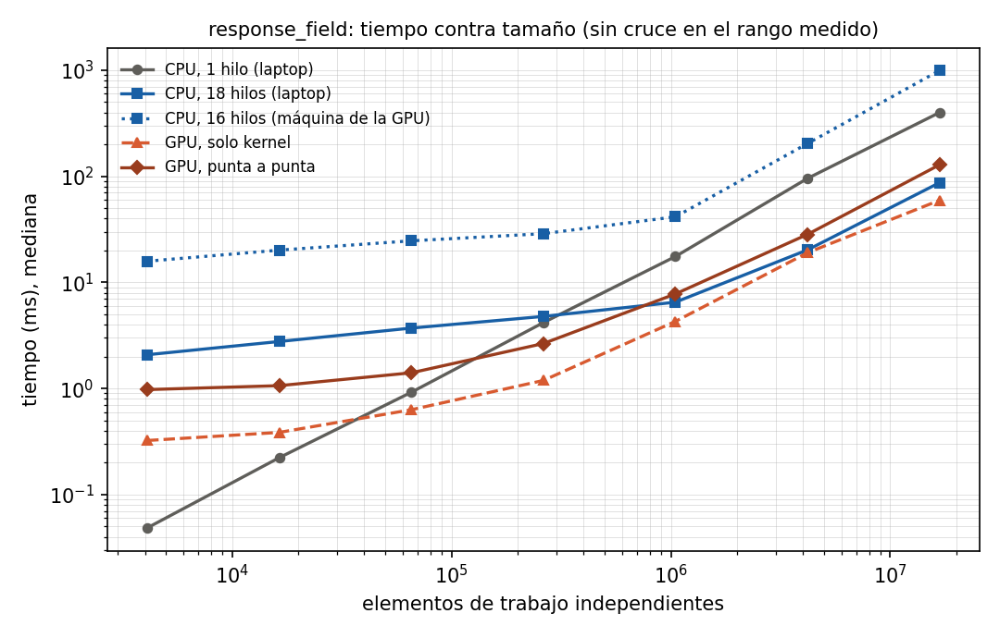
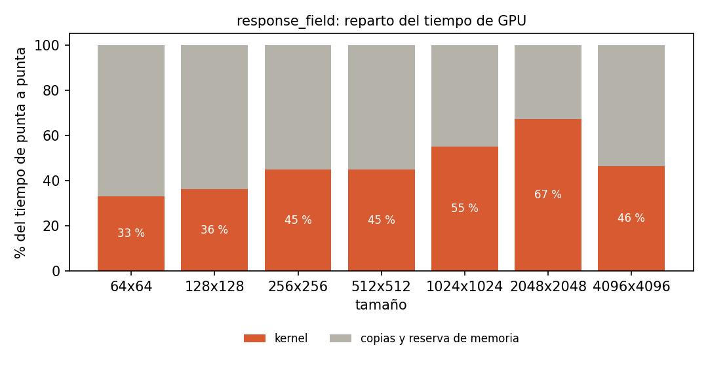
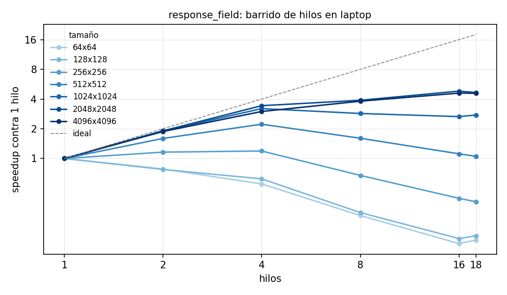

# response_field: CPU contra GPU

Generado por `tools/gpu_report.py` a partir de `mac.csv` y `pc.csv`. 10 repeticiones medidas por versión y tamaño, después de una de calentamiento.

### Veredicto: la GPU contra la CPU de la laptop

| Tamaño | CPU 1 hilo (ms) | CPU 18 hilos (ms) | GPU kernel (ms) | GPU punta a punta (ms) | Mejor CPU | Speedup de la GPU contra la mejor CPU (kernel / punta a punta) | ¿Correcto? |
|---|---|---|---|---|---|---|---|
| 64x64 | 0.048 (0.048–0.059) | 2.079 (1.971–2.225) | 0.323 (0.294–0.371) | 0.976 (0.920–1.224) | 0.048 (1 hilo) | 0.15x / 0.05x | sí |
| 128x128 | 0.223 (0.216–0.255) | 2.771 (2.653–3.378) | 0.385 (0.348–0.439) | 1.063 (1.017–1.261) | 0.223 (1 hilo) | 0.58x / 0.21x | sí |
| 256x256 | 0.921 (0.880–1.003) | 3.708 (3.595–4.137) | 0.630 (0.567–1.044) | 1.405 (1.315–1.874) | 0.921 (1 hilo) | 1.46x / 0.66x | sí |
| 512x512 | 4.175 (4.131–5.881) | 4.777 (4.617–5.130) | 1.190 (1.166–1.213) | 2.652 (2.507–2.784) | 2.261 (4 hilos) | 1.90x / 0.85x | sí |
| 1024x1024 | 17.534 (17.203–18.333) | 6.506 (6.349–6.924) | 4.289 (4.263–4.866) | 7.783 (7.547–9.894) | 5.605 (4 hilos) | 1.31x / 0.72x | sí |
| 2048x2048 | 95.477 (94.526–97.323) | 20.228 (19.762–20.556) | 19.021 (18.128–21.228) | 28.324 (26.761–30.607) | 19.565 (16 hilos) | 1.03x / 0.69x | sí |
| 4096x4096 | 398.852 (397.495–411.347) | 87.023 (86.136–87.326) | 59.418 (59.355–59.440) | 128.297 (126.375–128.447) | 86.629 (16 hilos) | 1.46x / 0.68x | sí |

Tiempos de CPU: laptop. Mediana de las repeticiones y, entre paréntesis, mínimo y máximo.

Cruce de punta a punta contra la mejor CPU de la laptop: **no hay cruce en el rango medido**; la CPU gana en todos los tamaños.

### Misma máquina: la GPU contra la CPU de su propia máquina

| Tamaño | CPU 1 hilo (ms) | CPU 16 hilos (ms) | GPU kernel (ms) | GPU punta a punta (ms) | Mejor CPU | Speedup de la GPU contra la mejor CPU (kernel / punta a punta) | ¿Correcto? |
|---|---|---|---|---|---|---|---|
| 64x64 | 0.235 (0.233–0.268) | 15.824 (15.668–16.435) | 0.323 (0.294–0.371) | 0.976 (0.920–1.224) | 0.235 (1 hilo) | 0.73x / 0.24x | sí |
| 128x128 | 0.991 (0.983–1.038) | 20.134 (19.542–21.437) | 0.385 (0.348–0.439) | 1.063 (1.017–1.261) | 0.991 (1 hilo) | 2.57x / 0.93x | sí |
| 256x256 | 4.020 (3.987–4.083) | 24.639 (23.964–25.230) | 0.630 (0.567–1.044) | 1.405 (1.315–1.874) | 4.020 (1 hilo) | 6.38x / 2.86x | sí |
| 512x512 | 17.741 (17.558–18.001) | 28.768 (28.224–31.967) | 1.190 (1.166–1.213) | 2.652 (2.507–2.784) | 14.683 (4 hilos) | 12.34x / 5.54x | sí |
| 1024x1024 | 76.919 (75.884–92.056) | 41.505 (40.517–44.290) | 4.289 (4.263–4.866) | 7.783 (7.547–9.894) | 32.926 (8 hilos) | 7.68x / 4.23x | sí |
| 2048x2048 | 407.260 (401.928–449.933) | 203.533 (197.850–239.677) | 19.021 (18.128–21.228) | 28.324 (26.761–30.607) | 194.273 (8 hilos) | 10.21x / 6.86x | sí |
| 4096x4096 | 1471.922 (1440.546–1505.537) | 993.280 (975.020–1024.145) | 59.418 (59.355–59.440) | 128.297 (126.375–128.447) | 947.252 (4 hilos) | 15.94x / 7.38x | sí |

Tiempos de CPU: máquina de la GPU. Mediana de las repeticiones y, entre paréntesis, mínimo y máximo.

Cruce de punta a punta contra la mejor CPU de la misma máquina: **256x256** (65536 elementos).

### Variantes de GPU

Mediana en ms de cada variante medida en la misma corrida.

| Tamaño | `gpu_kernel` | `gpu_e2e` | `gpu_e2e_onesweep` | `gpu_kernel_onesweep` |
|---|---|---|---|---|
| 64x64 | 0.323 | 0.976 | 1.447 | 0.829 |
| 128x128 | 0.385 | 1.063 | 1.629 | 1.024 |
| 256x256 | 0.630 | 1.405 | 1.765 | 1.015 |
| 512x512 | 1.190 | 2.652 | 2.511 | 1.289 |
| 1024x1024 | 4.289 | 7.783 | 6.116 | 3.249 |
| 2048x2048 | 19.021 | 28.324 | 21.250 | 12.509 |
| 4096x4096 | 59.418 | 128.297 | 115.338 | 47.295 |

### Barrido de hilos, laptop

Speedup de la versión multihilo contra ella misma con 1 hilo.

| Tamaño | 1 hilo | 2 hilos | 4 hilos | 8 hilos | 16 hilos | 18 hilos |
|---|---|---|---|---|---|---|
| 64x64 | 1.00x | 0.78x | 0.55x | 0.26x | 0.14x | 0.15x |
| 128x128 | 1.00x | 0.77x | 0.62x | 0.28x | 0.15x | 0.16x |
| 256x256 | 1.00x | 1.16x | 1.19x | 0.67x | 0.39x | 0.36x |
| 512x512 | 1.00x | 1.60x | 2.22x | 1.60x | 1.11x | 1.05x |
| 1024x1024 | 1.00x | 1.90x | 3.20x | 2.86x | 2.66x | 2.76x |
| 2048x2048 | 1.00x | 1.91x | 3.43x | 3.89x | 4.81x | 4.66x |
| 4096x4096 | 1.00x | 1.88x | 2.99x | 3.81x | 4.59x | 4.57x |

### Barrido de hilos, máquina de la GPU

Speedup de la versión multihilo contra ella misma con 1 hilo.

| Tamaño | 1 hilo | 2 hilos | 4 hilos | 8 hilos | 16 hilos |
|---|---|---|---|---|---|
| 64x64 | 1.00x | 1.11x | 0.60x | 0.36x | 0.21x |
| 128x128 | 1.00x | 1.09x | 0.67x | 0.43x | 0.24x |
| 256x256 | 1.00x | 1.26x | 0.97x | 0.61x | 0.35x |
| 512x512 | 1.00x | 1.57x | 1.58x | 1.26x | 0.81x |
| 1024x1024 | 1.00x | 1.73x | 2.37x | 2.48x | 1.97x |
| 2048x2048 | 1.00x | 1.48x | 1.74x | 2.15x | 2.05x |
| 4096x4096 | 1.00x | 1.48x | 1.57x | 1.53x | 1.50x |

### Gráficos

