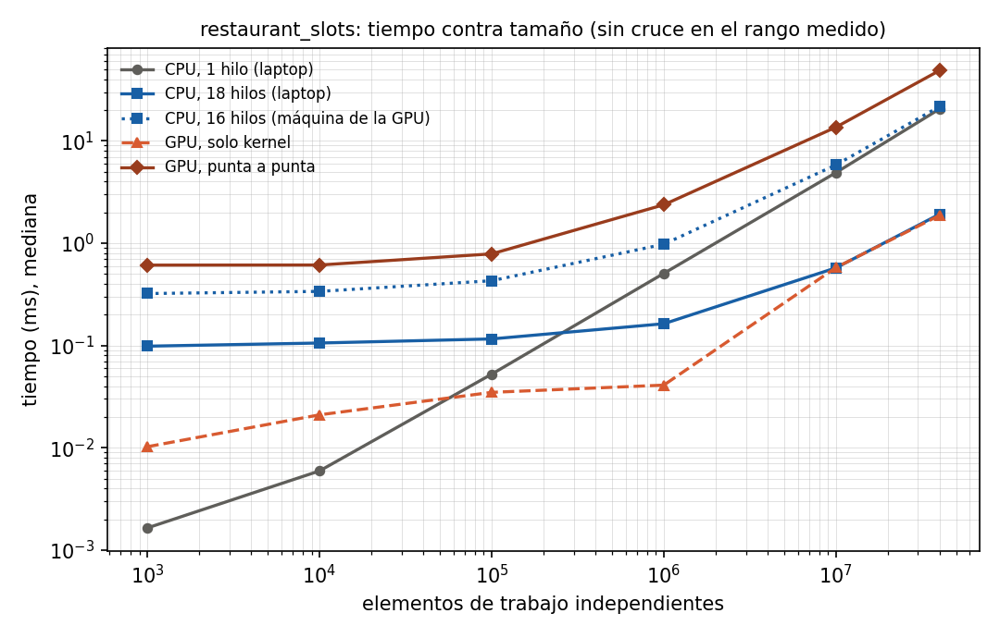
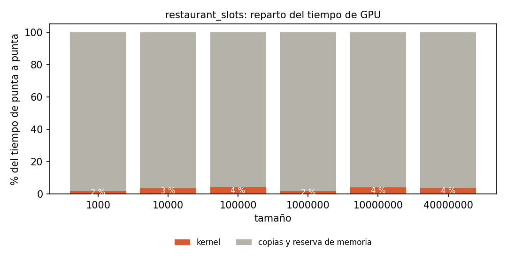
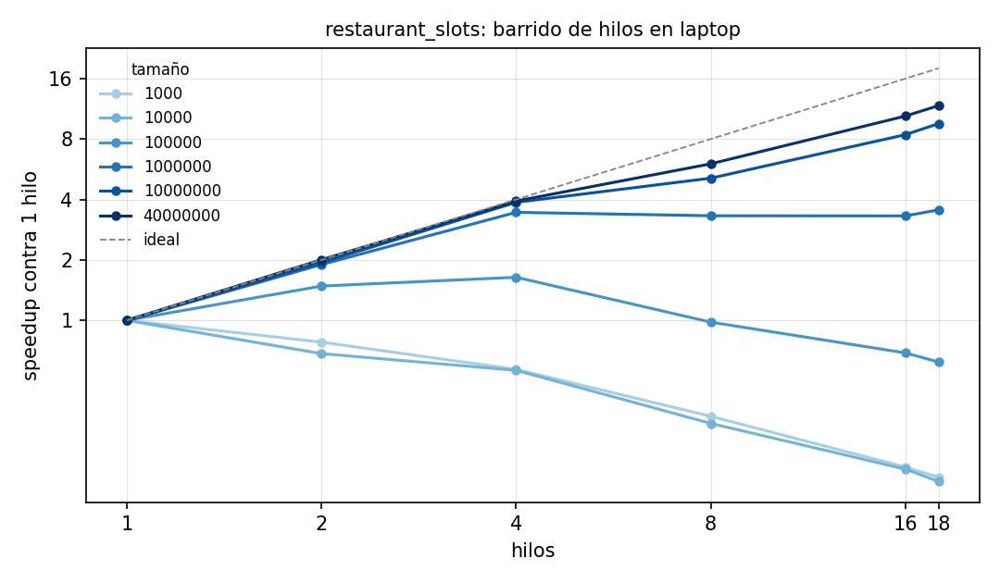

# Pedidos por restaurante y franja horaria: ¿vale la pena la GPU?

Concepto del curso: 07, histograma con atómicos, lectura intercalada y agregación de repetidos.
Segunda aplicación de ese concepto; la primera fue el histograma de tiempos de entrega. Código:
`src/gpu/restaurant_slots.*`. Datos: `mac.csv`, `pc.csv`. Tabla y gráficos: `tabla.md`.

## La tarea

Contar cuántos pedidos recibió cada restaurante en cada franja de diez minutos. Es un histograma
de dos dimensiones: una fila por restaurante y una columna por franja. De ahí sale la celda más
cargada: qué restaurante y en qué momento tuvo su pico.

Es paralela en datos porque cada pedido se clasifica solo. Lo que comparten los hilos son los
contadores. La diferencia con el primer histograma es cuántos hay: allá eran 120 y casi todos los
pedidos caían en unos pocos; aquí son miles.

## Montaje

El mismo de los experimentos anteriores: CPU del veredicto en el MacBook Pro con Apple M5 Pro (18
núcleos, enchufado, `-O3`); GPU en la PC con Ryzen 7 3700X y RTX 3060 Ti (CUDA 12.1, `-O3`,
sm_86), que además mide las mismas versiones de CPU.

```sh
./delivery_sim ../config/ciudad.json --headless --bench <maquina>.csv --bench-apps restaurant_slots --bench-reps 10 --bench-sweep
./delivery_sim ../config/ciudad.json --gpu-info
python3 tools/gpu_report.py --app restaurant_slots --laptop mac.csv --gpu pc.csv --out tools/reports/gpu/restaurant_slots
```

Seis tamaños, de mil a 40 millones de pedidos. 200 restaurantes por 144 franjas, un día entero:
28 800 contadores. Los pedidos van en orden de llegada, con el restaurante al azar. Una corrida
de calentamiento y 10 medidas intercaladas, con la tarjeta despierta antes de cada medida de GPU.
El tiempo de punta a punta de la GPU cuenta también la reserva de la tabla de salida en la CPU.

## Diseño

- **Por qué no contadores privados por bloque.** Fue lo que ganó en el primer histograma, pero
  aquí no se puede: 28 800 contadores son 115 KB y la shared memory de un bloque llega a 48 KB.
- **Atómicos globales con lectura intercalada.** Cada bloque de 256 hilos atiende 16 384 pedidos,
  64 por hilo. El hilo `t` lee las posiciones `t`, `t + 256`, `t + 512`…, así los 32 hilos de un
  warp leen posiciones seguidas. Cada pedido es un `atomicAdd` en su contador.
- **La variante: juntar repetidos.** Cada hilo lee 64 pedidos seguidos y recuerda el último
  contador que tocó. Mientras el siguiente pedido cae en el mismo, solo suma en un registro;
  cuando cambia, vuelca lo acumulado con un solo `atomicAdd`. Ahorra atómicos si hay repetidos
  seguidos, pero obliga a que cada hilo lea su propio tramo.
- **Los mismos datos, agrupados.** Las dos versiones se midieron también con los pedidos
  agrupados por restaurante, que es el orden en que la agregación encuentra repetidos: con 40
  millones, unos 1400 pedidos seguidos caen en el mismo contador.

La versión multihilo de CPU le da a cada hilo una tabla propia de 28 800 contadores y al final
las suma.

**En el programa:** el registro de eventos guarda el restaurante y la hora de cada pedido creado.
Al terminar la simulación se arma la tabla y se imprime la celda más cargada: el restaurante, la
franja y cuántos pedidos tuvo. Se calcula en CPU con un hilo, o en la tarjeta con `--backend gpu`.

## Corrección

- Las 840 filas de `pc.csv` y las 420 de `mac.csv` tienen `correct = yes`: conteos idénticos a
  los de CPU de un hilo, con los dos kernels y los dos órdenes de los datos.
- `tests/gpu/restaurant_slots_test.cpp`: un caso a mano con los bordes de cada franja; tamaños
  antes, en y después del borde de un hilo y de un bloque; datos en orden de llegada y agrupados;
  todos los pedidos en la misma celda; y que el total sea el número de pedidos.
- `compute-sanitizer`: memcheck 0 errores, racecheck 0 hallazgos.
- ThreadSanitizer en la laptop, sobre la suite completa: 0 reportes.
- Una hora de `config/equipetrol.json` con la tabla en CPU y en la tarjeta: las dos cuentan 452
  pedidos, los mismos que el resumen del programa, y dan la misma celda más cargada. El log pasa
  el verificador.

## Resultados

Medianas en ms. La tabla completa está en `tabla.md`.

| Pedidos | CPU 1 hilo, laptop | CPU 18 hilos, laptop | GPU kernel | GPU punta a punta | Kernel contra la mejor CPU | Punta a punta contra la mejor CPU |
|---|---|---|---|---|---|---|
| Mil | 0,0016 | 0,098 | 0,010 | 0,610 | 0,16x | 0,00x |
| 10 mil | 0,0059 | 0,106 | 0,021 | 0,612 | 0,28x | 0,01x |
| 100 mil | 0,052 | 0,116 | 0,035 | 0,786 | 1,26x | 0,06x |
| 1 millón | 0,506 | 0,163 | 0,041 | 2,373 | 3,98x | 0,07x |
| 10 millones | 4,894 | 0,574 | 0,577 | 13,6 | 0,99x | 0,04x |
| 40 millones | 20,5 | 1,920 | 1,871 | 48,8 | 1,03x | 0,04x |



- **El kernel le gana a la laptop entre 100 mil y un millón de pedidos**, hasta 4 veces. Con 10 y
  40 millones empata: la versión multihilo de la laptop escala muy bien en esta tarea.
- **De punta a punta no hay cruce.** La GPU queda unas 25 veces más lenta que la laptop con 40
  millones. El kernel es el 4 % del tiempo: el resto es subir dos arreglos, 320 MB.
- **En la misma máquina tampoco hay cruce**: 0,44 veces con 40 millones. Sin contar las copias,
  el kernel le gana entre 10 y 24 veces a la CPU de la PC desde un millón de pedidos.

| Pedidos | CPU 1 hilo, PC | CPU 16 hilos, PC | GPU kernel | GPU punta a punta | Kernel contra la mejor CPU | Punta a punta contra la mejor CPU |
|---|---|---|---|---|---|---|
| Mil | 0,0068 | 0,322 | 0,010 | 0,610 | 0,66x | 0,01x |
| 10 mil | 0,042 | 0,338 | 0,021 | 0,612 | 2,02x | 0,07x |
| 100 mil | 0,407 | 0,429 | 0,035 | 0,786 | 7,37x | 0,33x |
| 1 millón | 4,877 | 0,977 | 0,041 | 2,373 | 23,85x | 0,41x |
| 10 millones | 50,3 | 5,824 | 0,577 | 13,6 | 10,09x | 0,43x |
| 40 millones | 201,6 | 21,7 | 1,871 | 48,8 | 11,58x | 0,44x |



### Con muchos contadores, los atómicos ya no pelean

En el primer histograma, con 120 contadores y los datos concentrados, los atómicos globales
tardaban 12,3 ms con 40 millones de entregas. Aquí, con 28 800 contadores y los pedidos
repartidos, el mismo esquema tarda 1,9 ms con 40 millones de pedidos, y eso leyendo el doble de
datos. La contención depende de cuántos hilos quieren el mismo contador a la vez, no de usar
atómicos.

### Juntar repetidos

Tiempo del kernel en la PC, en ms.

| Pedidos | Atómicos, orden de llegada | Juntando repetidos, orden de llegada | Atómicos, agrupados | Juntando repetidos, agrupados | Juntar repetidos contra atómicos, orden de llegada |
|---|---|---|---|---|---|
| Mil | 0,010 | 0,019 | 0,010 | 0,019 | 0,54x |
| 10 mil | 0,021 | 0,028 | 0,020 | 0,026 | 0,76x |
| 100 mil | 0,035 | 0,035 | 0,032 | 0,025 | 1,00x |
| 1 millón | 0,041 | 0,069 | 0,059 | 0,051 | 0,60x |
| 10 millones | 0,577 | 2,383 | 0,487 | 2,437 | 0,24x |
| 40 millones | 1,871 | 9,571 | 2,387 | 9,755 | 0,20x |

- **Juntar repetidos no ayuda; con muchos datos es entre 4 y 5 veces más lento.** Y da lo mismo que haya
  repetidos o no: con los pedidos agrupados, donde cada hilo hace un solo atómico en vez de 64,
  tarda igual que en orden de llegada.
- **La causa es la lectura, no los atómicos.** Para juntar repetidos cada hilo lee su propio
  tramo de 64 pedidos, así que los 32 hilos de un warp leen posiciones separadas por 256 bytes.
  La lectura deja de ser coalesced y el kernel, que está limitado por memoria, lo paga entero.
- **Agrupar los datos tampoco cambia al kernel con atómicos** de forma clara: un 16 % más rápido
  con 10 millones y un 28 % más lento con 40 millones, donde muchos hilos vecinos piden el mismo
  contador.



En la laptop la versión multihilo conviene desde 100 mil pedidos y llega a 10,7 veces con 18
hilos: la tabla propia de cada hilo pesa 115 KB y entra en su caché.

## Análisis

**Paralelismo disponible.** Un elemento de trabajo por pedido. Cada bloque atiende 16 384 y la
tarjeta aloja 228 bloques a la vez: se llena con unos 3,7 millones de pedidos. Una simulación de
ciudad produce unos miles.

**Sobrecostos.** Dominan en todos los tamaños. El piso es de 0,6 ms con mil pedidos. Con 40
millones suben 320 MB y el kernel tarda 1,9 ms de los 48,8 ms de punta a punta. Baja la tabla,
115 KB.

**Límite por memoria.** Por pedido el kernel lee 8 bytes, hace una división y un atómico: está
limitado por memoria. Con lectura intercalada lee 320 MB en 1,87 ms, 171 GB/s, el 38 % del ancho
de banda nominal; la parte que falta se la llevan los atómicos, que caen en posiciones salteadas
de la tabla. Con lectura por tramos baja a 33 GB/s.

**Eficiencia de ejecución.** `--gpu-info`: 6 bloques por multiprocesador y ocupación del 100 % en
los dos kernels, limitada por los hilos; 18 registros por hilo con atómicos y 21 juntando
repetidos; ninguno usa shared memory. El kernel con atómicos no tiene divergencia por datos. El
que junta repetidos sí: cada hilo decide en cada pedido si acumula o vuelca.

**Contención y sincronización.** No hay barreras. La sincronización son los atómicos sobre la
tabla global. Con 28 800 contadores y restaurantes al azar, los hilos de un bloque casi nunca
coinciden. Con los datos agrupados sí coinciden, y con 40 millones se nota.

**Corrección bajo paralelismo.** Los conteos son sumas de enteros y no dependen del orden. Sin
el atómico se perderían sumas cuando dos hilos leen el mismo valor viejo; racecheck confirma que
no pasa, y la prueba con todos los pedidos en la misma celda cuenta los 5000.

## Veredicto

- **Tabla sobre datos que están en la CPU: CPU, siempre.** 18 hilos de la laptop cuentan 40
  millones de pedidos en 1,9 ms; a la GPU subirlos le cuesta más de 40 ms.
- **En el programa: CPU con un hilo.** Con unos miles de pedidos tarda pocos microsegundos.
- **Dentro de la GPU, atómicos globales con lectura intercalada.** Con miles de contadores no hay
  contención que justifique otra cosa, y no hay shared memory que alcance para privatizar.
- **Juntar repetidos, no.** Rompe la lectura coalesced y sale entre 4 y 5 veces más lento, haya
  o no repetidos.
- **La GPU valdría la pena si los pedidos ya estuvieran en la tarjeta**, entre 100 mil y un millón
  de pedidos, que es donde el kernel le gana a la laptop.

## Amenazas a la validez

- **Dos máquinas.** El veredicto contra la laptop compara una CPU mucho más rápida que la de la
  PC. Por eso se informa también la comparación en la misma máquina.
- **Restaurantes al azar.** En el benchmark todos los restaurantes reciben la misma demanda. Con
  unos pocos restaurantes muy pedidos habría más contención en sus contadores.
- **Los tamaños grandes no salen del programa.** Una simulación produce unos miles de pedidos;
  los millones son datos generados para ver hasta dónde llega cada versión.
- **Medidas muy cortas.** Con mil y diez mil pedidos los tiempos están cerca del costo de lanzar
  y de la resolución del reloj.
- **La PC no estaba en reposo** y corre en un contenedor sobre WSL2. Se usaron medianas de 10
  repeticiones y la tarjeta estaba en régimen en las 240 medidas.
