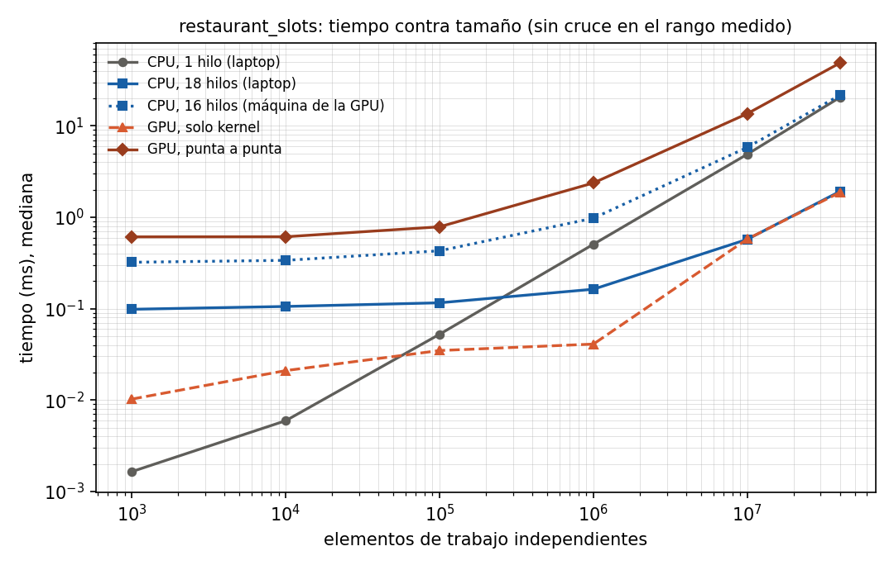
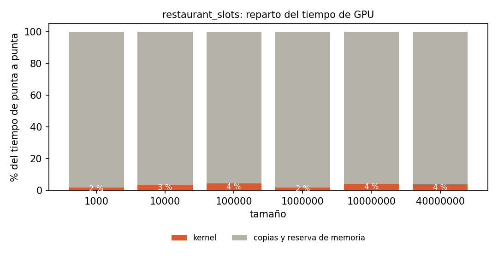
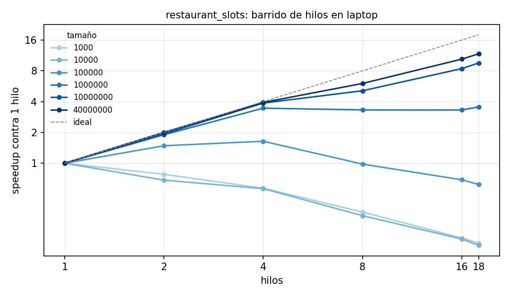

# restaurant_slots: CPU contra GPU

Generado por `tools/gpu_report.py` a partir de `mac.csv` y `pc.csv`. 10 repeticiones medidas por versión y tamaño, después de una de calentamiento.

### Veredicto: la GPU contra la CPU de la laptop

| Tamaño | CPU 1 hilo (ms) | CPU 18 hilos (ms) | GPU kernel (ms) | GPU punta a punta (ms) | Mejor CPU | Speedup de la GPU contra la mejor CPU (kernel / punta a punta) | ¿Correcto? |
|---|---|---|---|---|---|---|---|
| 1000 | 0.002 (0.001–0.007) | 0.098 (0.091–0.123) | 0.010 (0.008–0.069) | 0.610 (0.598–1.024) | 0.002 (1 hilo) | 0.16x / 0.00x | sí |
| 10000 | 0.006 (0.006–0.006) | 0.106 (0.097–0.118) | 0.021 (0.018–0.024) | 0.612 (0.596–0.642) | 0.006 (1 hilo) | 0.28x / 0.01x | sí |
| 100000 | 0.052 (0.050–0.058) | 0.116 (0.112–0.126) | 0.035 (0.034–0.037) | 0.786 (0.748–0.834) | 0.044 (4 hilos) | 1.26x / 0.06x | sí |
| 1000000 | 0.506 (0.499–0.548) | 0.163 (0.149–0.195) | 0.041 (0.040–0.041) | 2.373 (2.322–2.816) | 0.163 (18 hilos) | 3.98x / 0.07x | sí |
| 10000000 | 4.894 (4.852–5.123) | 0.574 (0.550–0.857) | 0.577 (0.490–0.588) | 13.612 (13.116–14.395) | 0.574 (18 hilos) | 0.99x / 0.04x | sí |
| 40000000 | 20.509 (19.724–21.152) | 1.920 (1.889–2.506) | 1.871 (1.800–2.536) | 48.782 (48.250–51.461) | 1.920 (18 hilos) | 1.03x / 0.04x | sí |

Tiempos de CPU: laptop. Mediana de las repeticiones y, entre paréntesis, mínimo y máximo.

Cruce de punta a punta contra la mejor CPU de la laptop: **no hay cruce en el rango medido**; la CPU gana en todos los tamaños.

### Misma máquina: la GPU contra la CPU de su propia máquina

| Tamaño | CPU 1 hilo (ms) | CPU 16 hilos (ms) | GPU kernel (ms) | GPU punta a punta (ms) | Mejor CPU | Speedup de la GPU contra la mejor CPU (kernel / punta a punta) | ¿Correcto? |
|---|---|---|---|---|---|---|---|
| 1000 | 0.007 (0.006–0.015) | 0.322 (0.316–0.391) | 0.010 (0.008–0.069) | 0.610 (0.598–1.024) | 0.007 (1 hilo) | 0.66x / 0.01x | sí |
| 10000 | 0.042 (0.042–0.043) | 0.338 (0.328–0.366) | 0.021 (0.018–0.024) | 0.612 (0.596–0.642) | 0.042 (1 hilo) | 2.02x / 0.07x | sí |
| 100000 | 0.407 (0.399–0.454) | 0.429 (0.397–0.468) | 0.035 (0.034–0.037) | 0.786 (0.748–0.834) | 0.256 (4 hilos) | 7.37x / 0.33x | sí |
| 1000000 | 4.877 (4.676–5.049) | 0.977 (0.914–1.049) | 0.041 (0.040–0.041) | 2.373 (2.322–2.816) | 0.977 (16 hilos) | 23.85x / 0.41x | sí |
| 10000000 | 50.331 (49.797–51.017) | 5.824 (5.644–7.678) | 0.577 (0.490–0.588) | 13.612 (13.116–14.395) | 5.824 (16 hilos) | 10.09x / 0.43x | sí |
| 40000000 | 201.554 (199.612–204.188) | 21.671 (21.395–27.911) | 1.871 (1.800–2.536) | 48.782 (48.250–51.461) | 21.671 (16 hilos) | 11.58x / 0.44x | sí |

Tiempos de CPU: máquina de la GPU. Mediana de las repeticiones y, entre paréntesis, mínimo y máximo.

Cruce de punta a punta contra la mejor CPU de la misma máquina: **no hay cruce en el rango medido**.

### Variantes de GPU

Mediana en ms de cada variante medida en la misma corrida.

| Tamaño | `gpu_kernel` | `gpu_e2e` | `gpu_e2e_aggregated` | `gpu_e2e_grouped` | `gpu_e2e_grouped_aggregated` | `gpu_kernel_aggregated` | `gpu_kernel_grouped` | `gpu_kernel_grouped_aggregated` |
|---|---|---|---|---|---|---|---|---|
| 1000 | 0.010 | 0.610 | 0.607 | 0.597 | 0.608 | 0.019 | 0.010 | 0.019 |
| 10000 | 0.021 | 0.612 | 0.607 | 0.599 | 0.605 | 0.028 | 0.020 | 0.026 |
| 100000 | 0.035 | 0.786 | 0.748 | 0.734 | 0.729 | 0.035 | 0.032 | 0.025 |
| 1000000 | 0.041 | 2.373 | 2.319 | 2.549 | 2.363 | 0.069 | 0.059 | 0.051 |
| 10000000 | 0.577 | 13.612 | 14.916 | 12.991 | 14.922 | 2.383 | 0.487 | 2.437 |
| 40000000 | 1.871 | 48.782 | 56.621 | 48.964 | 56.366 | 9.571 | 2.387 | 9.755 |

### Barrido de hilos, laptop

Speedup de la versión multihilo contra ella misma con 1 hilo.

| Tamaño | 1 hilo | 2 hilos | 4 hilos | 8 hilos | 16 hilos | 18 hilos |
|---|---|---|---|---|---|---|
| 1000 | 1.00x | 0.78x | 0.57x | 0.33x | 0.19x | 0.17x |
| 10000 | 1.00x | 0.68x | 0.56x | 0.31x | 0.18x | 0.16x |
| 100000 | 1.00x | 1.48x | 1.64x | 0.98x | 0.69x | 0.62x |
| 1000000 | 1.00x | 1.90x | 3.45x | 3.32x | 3.31x | 3.55x |
| 10000000 | 1.00x | 1.94x | 3.87x | 5.11x | 8.41x | 9.55x |
| 40000000 | 1.00x | 2.00x | 3.93x | 6.02x | 10.41x | 11.73x |

### Barrido de hilos, máquina de la GPU

Speedup de la versión multihilo contra ella misma con 1 hilo.

| Tamaño | 1 hilo | 2 hilos | 4 hilos | 8 hilos | 16 hilos |
|---|---|---|---|---|---|
| 1000 | 1.00x | 0.82x | 0.75x | 0.42x | 0.22x |
| 10000 | 1.00x | 1.14x | 1.24x | 0.56x | 0.32x |
| 100000 | 1.00x | 1.74x | 1.84x | 1.80x | 1.10x |
| 1000000 | 1.00x | 2.07x | 3.61x | 4.62x | 5.37x |
| 10000000 | 1.00x | 1.96x | 3.84x | 5.21x | 9.04x |
| 40000000 | 1.00x | 1.96x | 3.80x | 5.27x | 9.72x |

### Gráficos

