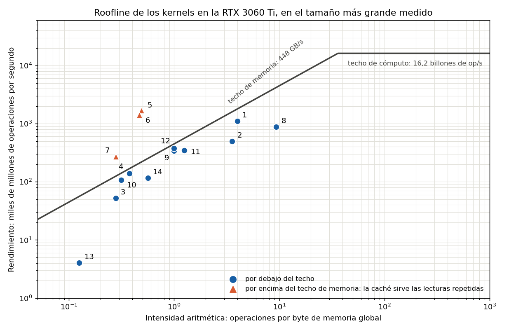

# Roofline de los kernels

Generado por `tools/gpu_roofline.py`. Los tiempos son la mediana del kernel en el tamaño más grande de cada `pc.csv`; las operaciones y los bytes por elemento salen de contar el código de cada kernel.

| N.º | Aplicación | Tamaño | Elementos | Veces | Operaciones por elemento | Bytes por elemento | Intensidad (op/B) | Kernel (ms) | Rendimiento (miles de millones de op/s) | Techo a esa intensidad | Parte del techo |
|---|---|---|---|---|---|---|---|---|---|---|---|
| 1 | Tabla de tiempos | 4096x4096 | 16777216 | 9 | 8192 | 2056 | 3,98 | 1116,028 | 1108 | 1785 | 62 % |
| 2 | Restaurante mejor ubicado | 4096x4096 | 16777216 | 1 | 400 | 112 | 3,57 | 13,530 | 496 | 1600 | 31 % |
| 3 | Estimación por lote | 1000x3000 | 3000000 | 1 | 10 | 36 | 0,28 | 0,575 | 52 | 124 | 42 % |
| 4 | Mejor esquina para un restaurante | 4096x4096 | 16777216 | 1 | 3 | 8 | 0,38 | 0,363 | 139 | 168 | 82 % |
| 5 | Mapa de calor | 4096x4096 | 16777216 | 1 | 98 | 200 | 0,49 | 0,969 | 1697 | 220 | 773 % |
| 6 | Tendencia de la demanda | 40000000 | 40000000 | 1 | 30 | 64 | 0,47 | 0,844 | 1422 | 210 | 677 % |
| 7 | Campo de cobertura | 4096x4096 | 16777216 | 96 | 7 | 25 | 0,28 | 41,180 | 274 | 125 | 218 % |
| 8 | Campo de respuesta | 4096x4096 | 16777216 | 14 | 224 | 24 | 9,33 | 59,418 | 885 | 4181 | 21 % |
| 9 | Histograma de entregas | 40000000 | 40000000 | 1 | 4 | 4 | 1,00 | 0,468 | 342 | 448 | 76 % |
| 10 | Pedidos por restaurante y franja | 40000000 | 40000000 | 1 | 5 | 16 | 0,31 | 1,871 | 107 | 140 | 76 % |
| 11 | Mejor moto | 4000x3000 | 12000000 | 1 | 5 | 4 | 1,25 | 0,173 | 347 | 560 | 62 % |
| 12 | Indicadores de entrega | 40000000 | 40000000 | 1 | 4 | 4 | 1,00 | 0,427 | 375 | 448 | 84 % |
| 13 | Agrupado por restaurante | 16000000x800000 | 16000000 | 1 | 4 | 32 | 0,12 | 15,871 | 4 | 56 | 7 % |
| 14 | Curva de pedidos en espera | 40000000 | 40000000 | 1 | 9 | 16 | 0,56 | 3,094 | 116 | 252 | 46 % |

De dónde sale cada cuenta:

- **1. Tabla de tiempos:** 256 fases; por fase 2 lecturas de 4 B y 16 sumas con su comparación; 9 elevaciones al cuadrado.
- **2. Restaurante mejor ubicado:** 13 fases con 2 lecturas de 4 B y un atómico de 8 B; 200 sumas con su comparación.
- **3. Estimación por lote:** 12 B de la moto, 12 B del pedido, 2 lecturas de la tabla y 4 B de salida; 10 operaciones de enteros.
- **4. Mejor esquina para un restaurante:** 2 lecturas de 4 B; suma, comparación y conteo.
- **5. Mapa de calor:** 49 lecturas de vecinas de 4 B y 4 B de salida; 49 multiplicaciones y 49 sumas.
- **6. Tendencia de la demanda:** 15 lecturas de 4 B y 4 B de salida; 15 multiplicaciones y 15 sumas.
- **7. Campo de cobertura:** 5 lecturas de 4 B, 1 B de calle y 4 B de salida; 2 sumas y 5 comparaciones; 96 pasadas.
- **8. Campo de respuesta:** por celda entregada: 4 celdas del tile de 5 B y 4 B de salida; 4 celdas por 8 pasadas por 7 operaciones; 14 lanzamientos.
- **9. Histograma de entregas:** una lectura de 4 B; división, dos comparaciones y una suma en shared memory.
- **10. Pedidos por restaurante y franja:** 8 B de lectura y un atómico de 8 B; división, comparación, producto y dos sumas.
- **11. Mejor moto:** una lectura de 4 B; rotación, clave y comparación.
- **12. Indicadores de entrega:** una lectura de 4 B; suma, máximo, comparación y conteo.
- **13. Agrupado por restaurante:** contar: 4 B y un atómico de 8 B; repartir: 8 B de lectura, un atómico de 8 B y 4 B de salida.
- **14. Curva de pedidos en espera:** leer y escribir 4 B en el scan y otra vez al sumar los totales; 8 sumas del scan y una más.

