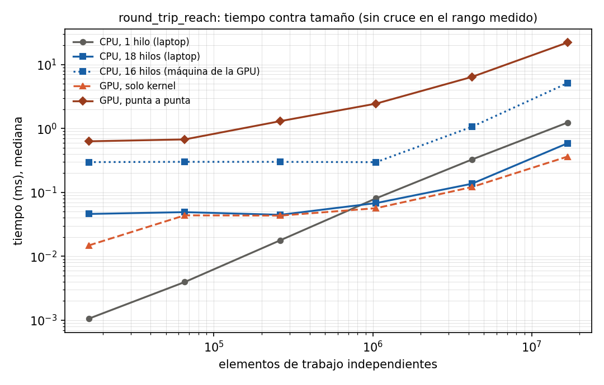
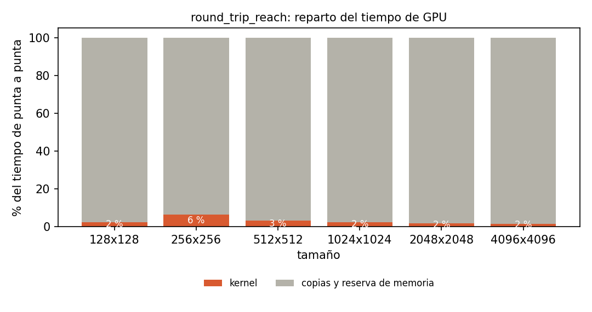
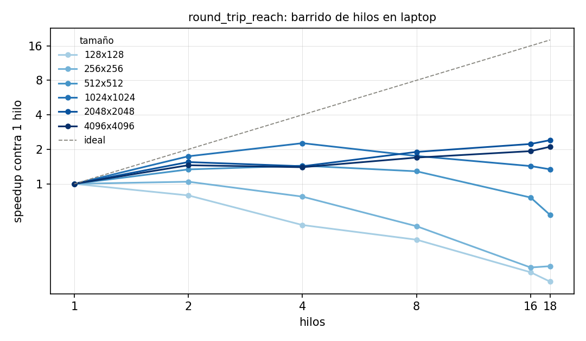

# Mejor esquina para un restaurante nuevo: ¿vale la pena la GPU?

Concepto del curso: 04, accesos agrupados y corner turning. Segunda aplicación de ese concepto; la
primera fue la estimación de entrega por lote. Código: `src/gpu/round_trip_reach.*`. Datos:
`mac.csv`, `pc.csv`. Tabla y gráficos: `tabla.md`.

## La tarea

Para cada esquina de la ciudad, contar a cuántas otras se llega ida y vuelta en menos de 10
minutos. La esquina con más alcance es el mejor lugar para abrir un restaurante nuevo.

La ida de la esquina `i` a la `j` está en la fila `i` de la tabla de tiempos. La vuelta, de `j` a
`i`, está en la columna `i`. Recorrer una fila es leer memoria seguida. Recorrer una columna es
saltar una fila entera entre lectura y lectura: con 4096 esquinas, 16 KB por salto. Ese es el
problema del concepto, y la solución es el corner turning: guardar una copia girada de la tabla,
donde la columna `i` queda como fila `i`, para que la vuelta también se lea seguida.

Es paralela en datos porque cada par se evalúa solo.

## Montaje

El mismo de los experimentos anteriores: CPU del veredicto en el MacBook Pro con Apple M5 Pro (18
núcleos, enchufado, `-O3`); GPU en la PC con Ryzen 7 3700X y RTX 3060 Ti (CUDA 12.1, `-O3`,
sm_86), que además mide las mismas versiones de CPU.

```sh
./delivery_sim ../config/ciudad.json --headless --bench <maquina>.csv --bench-apps round_trip_reach --bench-reps 10 --bench-sweep
./delivery_sim ../config/ciudad.json --gpu-info
python3 tools/gpu_report.py --app round_trip_reach --laptop mac.csv --gpu pc.csv --out tools/reports/gpu/round_trip_reach
```

Seis tamaños, de 128 a 4096 esquinas, recortados de la red de la ciudad. Con 4096 la tabla pesa
64 MB y son 16,8 millones de pares. Las versiones `cpu_1`, `cpu_n` y la de GPU reciben la tabla y
su copia girada ya armadas. Aparte se midieron, en un hilo de CPU, la versión que lee por
columnas (`cpu_ref_column`) y lo que cuesta girar la tabla (`cpu_ref_turn`). Una corrida de
calentamiento y 10 medidas intercaladas, con la tarjeta despierta antes de cada medida de GPU.

## Diseño

- **Un bloque por esquina de salida, 256 hilos.** El hilo `t` evalúa las esquinas de llegada `t`,
  `t + 256`, `t + 512`…, cuenta en un registro y el bloque suma los 256 parciales con un árbol en
  shared memory. Baja un contador por esquina.
- **Kernel con la tabla girada.** La ida y la vuelta se leen de la misma posición de dos arreglos.
  Los 32 hilos de un warp leen 32 posiciones seguidas de cada uno: lectura agrupada.
- **Kernel por columnas.** La vuelta se lee de la tabla original. Los 32 hilos de un warp leen 32
  posiciones separadas por una fila entera: lectura salteada. Es la comparación del concepto.
- **Lo que cuesta cada uno.** El de la tabla girada necesita la copia: hay que armarla y subir el
  doble de datos. El de columnas sube solo la tabla.

La versión de CPU con la tabla girada recorre dos filas en paralelo, y el compilador vectoriza el
lazo. La copia girada se arma por bloques de 64 × 64 para no saltar tanto al escribirla.

**En el programa:** al arrancar, después de armar la tabla de tiempos, se informa la mejor esquina
para un restaurante nuevo. Se calcula en CPU sobre el pool, o en la tarjeta con `--backend gpu`.

## Corrección

- Las 720 filas de `pc.csv` y las 540 de `mac.csv` tienen `correct = yes`: los conteos idénticos a
  los de la versión por columnas de un hilo.
- `tests/gpu/round_trip_reach_test.cpp`: un caso a mano con tres esquinas, con un par justo en el
  límite; que la tabla girada cambia filas por columnas; tablas al azar con tramos sin camino en
  tamaños antes, en y después del borde de un bloque; y que dos tramos sin camino no desbordan la
  suma.
- `compute-sanitizer`: memcheck 0 errores, racecheck 0 hallazgos.
- ThreadSanitizer en la laptop, sobre la suite completa: 0 reportes.
- Simulación de `config/equipetrol.json` en CPU y en la tarjeta: las dos dan la misma esquina,
  con 297 de 320 esquinas a menos de 10 minutos ida y vuelta, y el log pasa el verificador.

## Resultados

Medianas en ms. La columna de GPU es el kernel con la tabla girada. La tabla completa está en
`tabla.md`.

| Esquinas | CPU 1 hilo, laptop | CPU 18 hilos, laptop | GPU kernel | GPU punta a punta | Kernel contra la mejor CPU | Punta a punta contra la mejor CPU |
|---|---|---|---|---|---|---|
| 128 | 0,0011 | 0,046 | 0,015 | 0,630 | 0,07x | 0,00x |
| 256 | 0,0040 | 0,049 | 0,044 | 0,674 | 0,09x | 0,01x |
| 512 | 0,018 | 0,045 | 0,043 | 1,303 | 0,38x | 0,01x |
| 1024 | 0,081 | 0,068 | 0,057 | 2,448 | 0,71x | 0,02x |
| 2048 | 0,326 | 0,136 | 0,121 | 6,393 | 1,13x | 0,02x |
| 4096 | 1,236 | 0,586 | 0,363 | 22,1 | 1,61x | 0,03x |



- **De punta a punta no hay cruce, y la distancia es grande.** Con 4096 esquinas los 18 hilos de
  la laptop tardan 0,59 ms y la tarjeta 22 ms: subir la tabla y su copia, 128 MB, cuesta mucho
  más que recorrerlas.
- **El kernel solo le gana a la laptop desde 2048 esquinas**, 1,1 veces, y 1,6 con 4096.
- **En la misma máquina tampoco hay cruce**: 0,23 veces con 4096.

| Esquinas | CPU 1 hilo, PC | CPU 16 hilos, PC | GPU kernel | GPU punta a punta | Kernel contra la mejor CPU | Punta a punta contra la mejor CPU |
|---|---|---|---|---|---|---|
| 128 | 0,0037 | 0,298 | 0,015 | 0,630 | 0,25x | 0,01x |
| 256 | 0,011 | 0,301 | 0,044 | 0,674 | 0,25x | 0,02x |
| 512 | 0,040 | 0,301 | 0,043 | 1,303 | 0,93x | 0,03x |
| 1024 | 0,230 | 0,297 | 0,057 | 2,448 | 2,59x | 0,06x |
| 2048 | 1,948 | 1,061 | 0,121 | 6,393 | 8,76x | 0,17x |
| 4096 | 7,700 | 5,125 | 0,363 | 22,1 | 13,78x | 0,23x |



### Leer por columnas o girar la tabla

Tiempos en ms.

| Esquinas | CPU laptop, por columnas | CPU laptop, tabla girada | Cuánto gana en CPU | Girar la tabla, laptop | Kernel, por columnas | Kernel, tabla girada | Cuánto gana en GPU | Punta a punta GPU, por columnas | Punta a punta GPU, tabla girada |
|---|---|---|---|---|---|---|---|---|---|
| 128 | 0,0043 | 0,0011 | 4,02x | 0,0049 | 0,034 | 0,015 | 2,27x | 0,604 | 0,630 |
| 256 | 0,035 | 0,0040 | 8,91x | 0,019 | 0,048 | 0,044 | 1,10x | 0,623 | 0,674 |
| 512 | 0,171 | 0,018 | 9,60x | 0,101 | 0,045 | 0,043 | 1,04x | 0,715 | 1,303 |
| 1024 | 1,170 | 0,081 | 14,49x | 0,660 | 0,065 | 0,057 | 1,15x | 1,425 | 2,448 |
| 2048 | 7,340 | 0,326 | 22,50x | 3,202 | 0,145 | 0,121 | 1,19x | 3,319 | 6,393 |
| 4096 | 52,7 | 1,236 | 42,68x | 20,0 | 0,638 | 0,363 | 1,76x | 11,5 | 22,1 |

- **En la CPU, girar la tabla lo cambia todo.** Con 4096 esquinas un hilo de la laptop tarda 52,7
  ms leyendo por columnas y 1,2 ms con la tabla girada: 43 veces menos. En la PC, 65 veces.
  Leyendo por columnas cada lectura cae en otra página de memoria y el procesador no puede
  adelantarse; con la tabla girada son dos recorridos seguidos.
- **En la GPU ayuda mucho menos.** Entre 256 y 2048 esquinas la diferencia es de un 20 % o menos;
  con 4096, el kernel por columnas tarda 1,8 veces más. Con 128 los dos tiempos son tan cortos
  que la diferencia está dentro de la dispersión.
- **Por qué tan poco.** Los bloques vecinos leen columnas vecinas, y la tarjeta trae la memoria de
  a tramos de 32 bytes, 8 tiempos seguidos. El tramo que un bloque trae para leer su columna les
  sirve a los 7 bloques de al lado, y la caché de la tarjeta lo guarda. Mientras la tabla es
  chica, casi todo sale de la caché. Recién con 64 MB empieza a notarse.
- **Girar la tabla no es gratis.** A la laptop le cuesta 20 ms con 4096 esquinas, 16 veces lo que
  tarda después en contar; a la PC, 323 ms. Conviene igual, porque es menos que lo que ahorra, y
  porque se hace una vez y sirve para todos los cálculos que lean la vuelta.
- **En la GPU, de punta a punta gana el kernel por columnas.** Con 4096 esquinas tarda 11,5 ms
  contra 22,1 ms del que usa la tabla girada. Su kernel es más lento, pero sube la mitad de los
  datos, y aquí manda lo que se sube.



En la laptop el multihilo recién ayuda desde 1024 esquinas y llega a 2,1 veces con 18 hilos. No
escala más porque el límite es la memoria y no el cálculo.

## Análisis

**Paralelismo disponible.** Un elemento de trabajo por par de esquinas. Con 256 esquinas ya hay
más pares que hilos aloja la tarjeta.

**Sobrecostos.** Dominan del todo. El kernel es menos del 7 % del tiempo de punta a punta.
Con 4096 esquinas suben 128 MB y bajan 16 KB.

**Límite por memoria.** Por par hay una suma y una comparación sobre 8 bytes: está limitado por
memoria. Con la tabla girada el kernel lee 128 MB en 0,36 ms, 370 GB/s, el 82 % del ancho de
banda nominal. Por columnas baja a 210 GB/s contando solo los bytes útiles: la tarjeta trae más
memoria de la que usa.

**Eficiencia de ejecución.** `--gpu-info`: 6 bloques por multiprocesador y ocupación del 100 % en
los dos kernels, limitada por los hilos; 37 registros por hilo con la tabla girada y 40 por
columnas; 1024 bytes de shared memory para el árbol. No hay divergencia por datos: la comparación
se suma como cero o uno.

**Contención y sincronización.** Sin atómicos: cada bloque escribe su contador. Nueve barreras
por bloque, las del árbol.

**Corrección bajo paralelismo.** Los conteos son sumas de enteros y no dependen del orden. La
suma de dos tramos sin camino no desborda porque el valor que marca "sin camino" es menor que la
mitad del mayor entero.

## Veredicto

- **Mejor esquina sobre una tabla que está en la CPU: CPU, con la tabla girada.** Los 18 hilos de
  la laptop tardan 0,59 ms con 4096 esquinas; la tarjeta, 11 ms en el mejor caso.
- **El corner turning sirve sobre todo en la CPU**, entre 43 y 65 veces con 4096 esquinas. En la
  GPU, hasta 1,8 veces, porque su caché ya junta las lecturas de los bloques vecinos.
- **En la GPU depende de dónde estén los datos.** Si hay que subirlos, conviene el kernel por
  columnas, que sube la mitad. Si la tabla y su copia ya están en la tarjeta, conviene el de la
  tabla girada.
- **La GPU valdría la pena con la tabla residente.** El estimador de entregas ya la deja en la
  tarjeta; sobre ella, el kernel por columnas tarda 0,64 ms con 4096 esquinas, lo mismo que los
  18 hilos de la laptop.

## Amenazas a la validez

- **Dos máquinas.** El veredicto contra la laptop compara una CPU mucho más rápida que la de la
  PC. Por eso se informa también la comparación en la misma máquina.
- **Las versiones con la tabla girada no pagan el giro.** Reciben la copia ya armada. El costo de
  girar está medido aparte y hay que sumarlo si la copia se usa una sola vez.
- **Un solo recorrido de la tabla.** El efecto de la caché de la tarjeta depende de que los
  bloques vecinos lean columnas vecinas. Con otro orden de los bloques, leer por columnas saldría
  peor.
- **Medidas muy cortas.** Hasta 512 esquinas los tiempos de CPU están por debajo de 0,05 ms y los
  del kernel cerca del costo de lanzar.
- **La PC no estaba en reposo** y corre en un contenedor sobre WSL2. Se usaron medianas de 10
  repeticiones y la tarjeta estaba en régimen en las 120 medidas.
