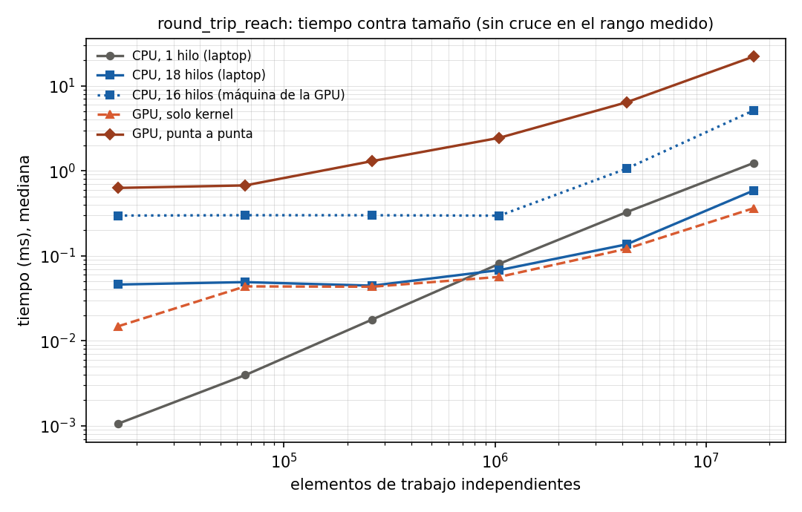
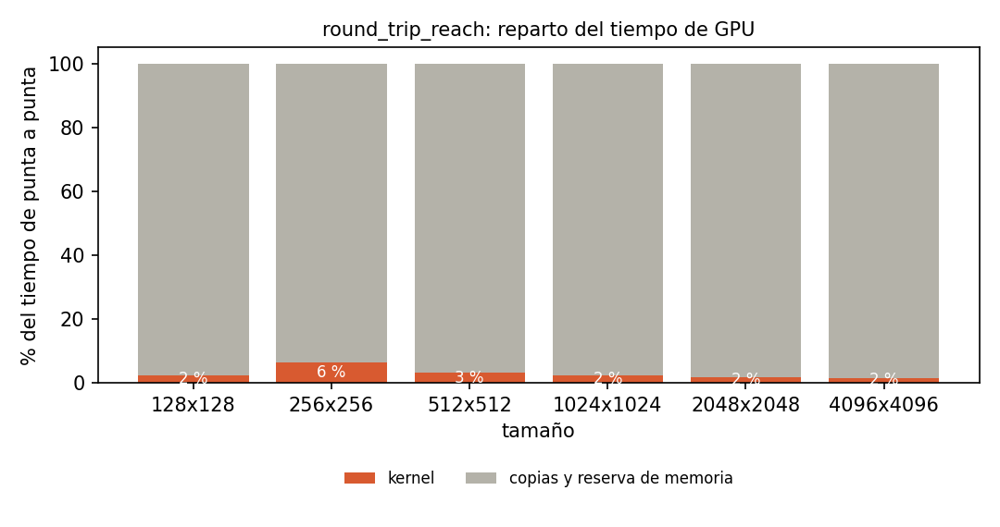
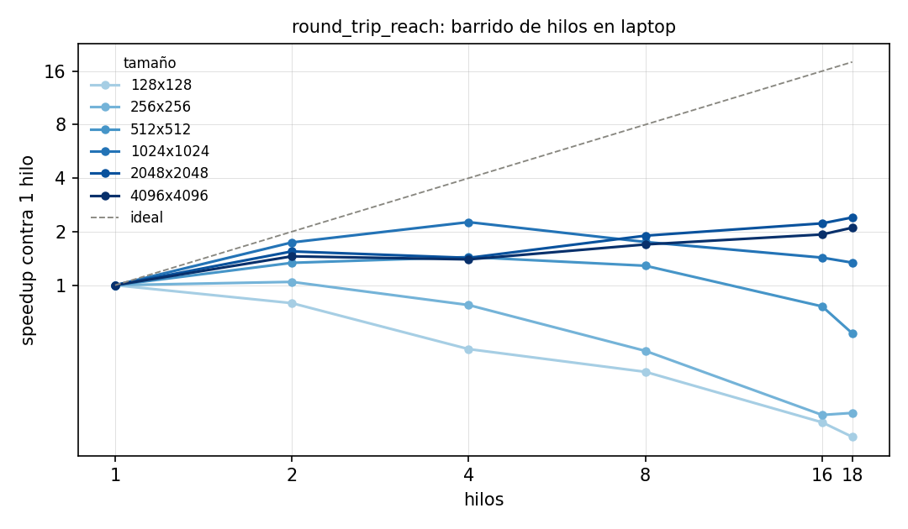

# round_trip_reach: CPU contra GPU

Generado por `tools/gpu_report.py` a partir de `mac.csv` y `pc.csv`. 10 repeticiones medidas por versión y tamaño, después de una de calentamiento.

### Veredicto: la GPU contra la CPU de la laptop

| Tamaño | CPU 1 hilo (ms) | CPU 18 hilos (ms) | GPU kernel (ms) | GPU punta a punta (ms) | Mejor CPU | Speedup de la GPU contra la mejor CPU (kernel / punta a punta) | ¿Correcto? |
|---|---|---|---|---|---|---|---|
| 128x128 | 0.001 (0.001–0.002) | 0.046 (0.025–0.068) | 0.015 (0.007–0.023) | 0.630 (0.609–0.849) | 0.001 (1 hilo) | 0.07x / 0.00x | sí |
| 256x256 | 0.004 (0.004–0.004) | 0.049 (0.028–0.066) | 0.044 (0.040–0.053) | 0.674 (0.666–0.707) | 0.004 (1 hilo) | 0.09x / 0.01x | sí |
| 512x512 | 0.018 (0.017–0.018) | 0.045 (0.031–0.083) | 0.043 (0.041–0.045) | 1.303 (1.250–1.356) | 0.017 (4 hilos) | 0.38x / 0.01x | sí |
| 1024x1024 | 0.081 (0.074–0.143) | 0.068 (0.059–0.112) | 0.057 (0.053–0.068) | 2.448 (2.174–2.650) | 0.040 (4 hilos) | 0.71x / 0.02x | sí |
| 2048x2048 | 0.326 (0.300–0.598) | 0.136 (0.119–0.165) | 0.121 (0.116–0.128) | 6.393 (6.237–7.086) | 0.136 (18 hilos) | 1.13x / 0.02x | sí |
| 4096x4096 | 1.236 (1.194–1.297) | 0.586 (0.566–0.626) | 0.363 (0.353–0.387) | 22.087 (21.507–22.500) | 0.586 (18 hilos) | 1.61x / 0.03x | sí |

Tiempos de CPU: laptop. Mediana de las repeticiones y, entre paréntesis, mínimo y máximo.

Cruce de punta a punta contra la mejor CPU de la laptop: **no hay cruce en el rango medido**; la CPU gana en todos los tamaños.

### Misma máquina: la GPU contra la CPU de su propia máquina

| Tamaño | CPU 1 hilo (ms) | CPU 16 hilos (ms) | GPU kernel (ms) | GPU punta a punta (ms) | Mejor CPU | Speedup de la GPU contra la mejor CPU (kernel / punta a punta) | ¿Correcto? |
|---|---|---|---|---|---|---|---|
| 128x128 | 0.004 (0.003–0.005) | 0.298 (0.287–0.307) | 0.015 (0.007–0.023) | 0.630 (0.609–0.849) | 0.004 (1 hilo) | 0.25x / 0.01x | sí |
| 256x256 | 0.011 (0.010–0.012) | 0.301 (0.290–0.342) | 0.044 (0.040–0.053) | 0.674 (0.666–0.707) | 0.011 (1 hilo) | 0.25x / 0.02x | sí |
| 512x512 | 0.040 (0.038–0.055) | 0.301 (0.297–0.378) | 0.043 (0.041–0.045) | 1.303 (1.250–1.356) | 0.040 (1 hilo) | 0.93x / 0.03x | sí |
| 1024x1024 | 0.230 (0.207–0.285) | 0.297 (0.265–0.419) | 0.057 (0.053–0.068) | 2.448 (2.174–2.650) | 0.147 (2 hilos) | 2.59x / 0.06x | sí |
| 2048x2048 | 1.948 (1.748–2.120) | 1.061 (0.862–1.190) | 0.121 (0.116–0.128) | 6.393 (6.237–7.086) | 1.061 (16 hilos) | 8.76x / 0.17x | sí |
| 4096x4096 | 7.700 (7.469–7.908) | 5.125 (5.043–5.278) | 0.363 (0.353–0.387) | 22.087 (21.507–22.500) | 5.005 (8 hilos) | 13.78x / 0.23x | sí |

Tiempos de CPU: máquina de la GPU. Mediana de las repeticiones y, entre paréntesis, mínimo y máximo.

Cruce de punta a punta contra la mejor CPU de la misma máquina: **no hay cruce en el rango medido**.

### Variantes de GPU

Mediana en ms de cada variante medida en la misma corrida.

| Tamaño | `gpu_kernel` | `gpu_e2e` | `gpu_e2e_column` | `gpu_kernel_column` |
|---|---|---|---|---|
| 128x128 | 0.015 | 0.630 | 0.604 | 0.034 |
| 256x256 | 0.044 | 0.674 | 0.623 | 0.048 |
| 512x512 | 0.043 | 1.303 | 0.715 | 0.045 |
| 1024x1024 | 0.057 | 2.448 | 1.425 | 0.065 |
| 2048x2048 | 0.121 | 6.393 | 3.319 | 0.145 |
| 4096x4096 | 0.363 | 22.087 | 11.474 | 0.638 |

### Barrido de hilos, laptop

Speedup de la versión multihilo contra ella misma con 1 hilo.

| Tamaño | 1 hilo | 2 hilos | 4 hilos | 8 hilos | 16 hilos | 18 hilos |
|---|---|---|---|---|---|---|
| 128x128 | 1.00x | 0.79x | 0.44x | 0.33x | 0.17x | 0.14x |
| 256x256 | 1.00x | 1.04x | 0.77x | 0.43x | 0.19x | 0.19x |
| 512x512 | 1.00x | 1.34x | 1.44x | 1.29x | 0.76x | 0.54x |
| 1024x1024 | 1.00x | 1.74x | 2.26x | 1.75x | 1.43x | 1.34x |
| 2048x2048 | 1.00x | 1.55x | 1.42x | 1.90x | 2.23x | 2.40x |
| 4096x4096 | 1.00x | 1.45x | 1.40x | 1.70x | 1.93x | 2.11x |

### Barrido de hilos, máquina de la GPU

Speedup de la versión multihilo contra ella misma con 1 hilo.

| Tamaño | 1 hilo | 2 hilos | 4 hilos | 8 hilos | 16 hilos |
|---|---|---|---|---|---|
| 128x128 | 1.00x | 0.86x | 0.97x | 0.38x | 0.22x |
| 256x256 | 1.00x | 1.15x | 1.08x | 0.42x | 0.24x |
| 512x512 | 1.00x | 1.20x | 1.47x | 0.69x | 0.33x |
| 1024x1024 | 1.00x | 1.65x | 1.40x | 1.32x | 0.81x |
| 2048x2048 | 1.00x | 1.51x | 1.65x | 1.73x | 1.94x |
| 4096x4096 | 1.00x | 1.49x | 1.54x | 1.57x | 1.53x |

### Gráficos

