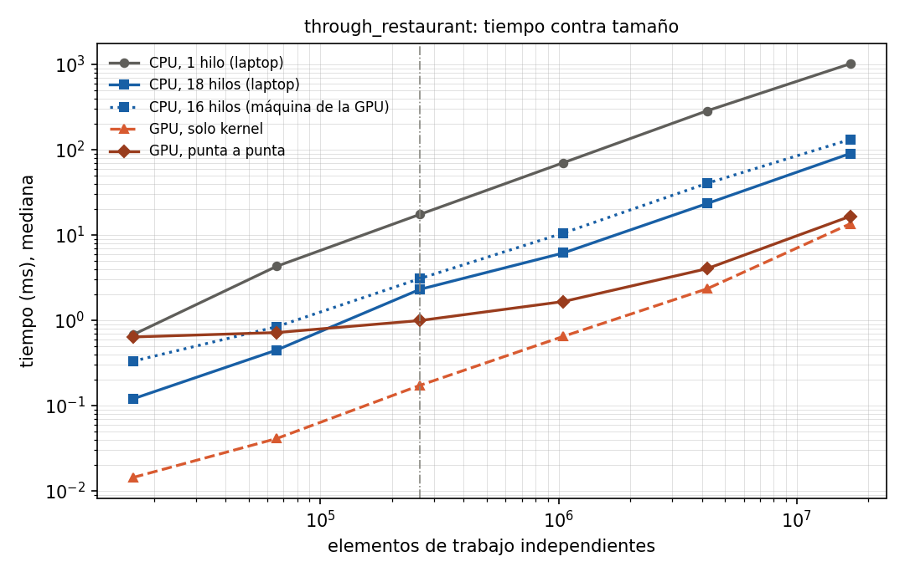
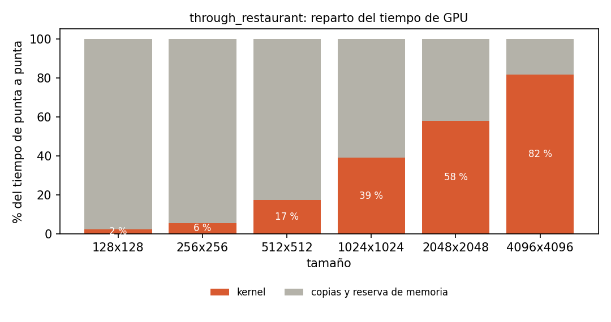
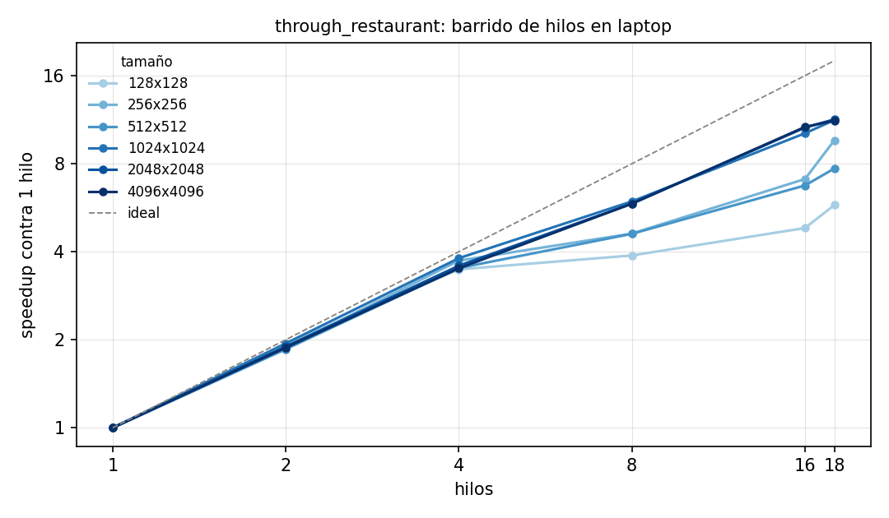

# Restaurante mejor ubicado: ¿vale la pena la GPU?

Concepto del curso: 03, producto de matrices con tiles en shared memory. Segunda aplicación de
ese concepto; la primera fue la tabla de tiempos de todos contra todos. Código:
`src/gpu/through_restaurant.*`. Datos: `mac.csv`, `pc.csv`. Tabla y gráficos: `tabla.md`.

## La tarea

Un viaje de reparto tiene dos tramos: de donde está la moto al restaurante y del restaurante al
cliente. Para cada par de esquinas, la de la moto y la del cliente, se busca el restaurante que
hace más corto el viaje completo. Contando cuántos pares gana cada restaurante sale el mejor
ubicado: el que queda de paso en más viajes.

Con `N` esquinas y `R` restaurantes son `N × N` pares y, para cada uno, `R` sumas y
comparaciones. Es un producto de matrices donde la multiplicación es una suma y la suma es un
mínimo: una matriz de `N × R` con los tiempos de cada esquina a cada restaurante, por otra de
`R × N` con los tiempos de cada restaurante a cada esquina. Las dos salen de la tabla de tiempos.

Es paralela en datos porque cada par se calcula solo.

## Montaje

El mismo de los experimentos anteriores: CPU del veredicto en el MacBook Pro con Apple M5 Pro (18
núcleos, enchufado, `-O3`); GPU en la PC con Ryzen 7 3700X y RTX 3060 Ti (CUDA 12.1, `-O3`,
sm_86), que además mide las mismas versiones de CPU.

```sh
./delivery_sim ../config/ciudad.json --headless --bench <maquina>.csv --bench-apps through_restaurant --bench-reps 10 --bench-sweep
./delivery_sim ../config/ciudad.json --gpu-info
python3 tools/gpu_report.py --app through_restaurant --laptop mac.csv --gpu pc.csv --out tools/reports/gpu/through_restaurant
```

Seis tamaños, de 128 a 4096 esquinas, recortados de la red de la ciudad igual que en la tabla de
tiempos. 200 restaurantes en esquinas al azar, 128 en el tamaño menor. Con 4096 esquinas son 16,8
millones de pares y 3400 millones de sumas. Una corrida de calentamiento y 10 medidas
intercaladas, con la tarjeta despierta antes de cada medida de GPU. El tiempo de punta a punta de
la GPU cuenta también la reserva del resultado en la CPU.

## Diseño

- **Un hilo por par de esquinas**, en bloques de 16 × 16.
- **Kernel con tiles.** Los restaurantes se recorren de a 16. En cada fase el bloque carga en
  shared memory un tile de 16 × 16 de cada matriz, espera en la barrera, y cada hilo combina su
  fila de un tile con su columna del otro. Es el producto de matrices por tiles del concepto, con
  mínimo y suma.
- **Kernel sin tiles.** Cada hilo recorre los 200 restaurantes leyendo las dos matrices de
  memoria global. Es la comparación del concepto.
- **El conteo se hace en la tarjeta.** Cada hilo, al terminar, suma uno al contador de su
  restaurante con `atomicAdd`. No baja la matriz de `N × N`: bajan `R` contadores, 800 bytes.
- **Empates.** Gana el restaurante de menor índice, en todas las versiones, para que el conteo sea
  comparable sin tolerancia.

La versión de CPU recorre, para cada esquina de salida, los restaurantes por fuera y las esquinas
de llegada por dentro: así el lazo interno lee memoria seguida y el compilador lo vectoriza. La
multihilo reparte las esquinas de salida y suma los conteos al final.

**En el programa:** al arrancar, después de armar la tabla de tiempos, se informa el restaurante
mejor ubicado y en qué parte de los viajes queda de paso. Se calcula en CPU sobre el pool, o en la
tarjeta con `--backend gpu`.

## Corrección

- Las 600 filas de `pc.csv` y las 420 de `mac.csv` tienen `correct = yes`: los conteos idénticos a
  los de CPU de un hilo, con los dos kernels.
- `tests/gpu/through_restaurant_test.cpp`: un caso a mano con cuatro esquinas en línea y dos
  restaurantes, con empates; matrices al azar con tramos sin camino, en tamaños menores, iguales y
  mayores que un tile, tanto en esquinas como en restaurantes; y el caso en que no se llega a
  ningún restaurante.
- `compute-sanitizer`: memcheck 0 errores, racecheck 0 hallazgos.
- ThreadSanitizer en la laptop, sobre la suite completa: 0 reportes.
- Simulación de `config/equipetrol.json` en CPU y en la tarjeta: las dos dan el mismo restaurante,
  con 30 460 de 95 170 viajes, y el log pasa el verificador.

## Resultados

Medianas en ms. La tabla completa está en `tabla.md`.

| Esquinas | CPU 1 hilo, laptop | CPU 18 hilos, laptop | GPU kernel | GPU punta a punta | Kernel contra la mejor CPU | Punta a punta contra la mejor CPU |
|---|---|---|---|---|---|---|
| 128 | 0,678 | 0,120 | 0,014 | 0,637 | 8,36x | 0,19x |
| 256 | 4,290 | 0,447 | 0,041 | 0,717 | 10,91x | 0,62x |
| 512 | 17,5 | 2,305 | 0,173 | 0,992 | 13,36x | 2,32x |
| 1024 | 70,4 | 6,155 | 0,647 | 1,657 | 9,51x | 3,71x |
| 2048 | 285,1 | 23,3 | 2,332 | 4,020 | 10,00x | 5,80x |
| 4096 | 1018,4 | 90,3 | 13,5 | 16,6 | 6,67x | 5,45x |



- **La tarjeta gana de punta a punta contra la laptop desde 512 × 512.** 2,3 veces ahí, 3,7 con
  1024 esquinas, 5,8 con 2048 y 5,4 con 4096, donde tarda 16,6 ms contra 90,3 ms de los 18 hilos.
  Es la primera aplicación en la que la GPU gana con las copias incluidas contra la CPU de la
  laptop.
- **El kernel solo gana en todos los tamaños**, entre 6,7 y 13,4 veces.
- **Con 128 y 256 esquinas gana la laptop**, porque la tarjeta no baja de 0,6 ms por reservar
  memoria y copiar.

### Misma máquina

| Esquinas | CPU 1 hilo, PC | CPU 16 hilos, PC | GPU kernel | GPU punta a punta | Kernel contra la mejor CPU | Punta a punta contra la mejor CPU | Parte del kernel en la punta a punta |
|---|---|---|---|---|---|---|---|
| 128 | 0,642 | 0,331 | 0,014 | 0,637 | 16,99x | 0,38x | 2 % |
| 256 | 3,908 | 0,839 | 0,041 | 0,717 | 20,49x | 1,17x | 6 % |
| 512 | 15,9 | 3,084 | 0,173 | 0,992 | 17,87x | 3,11x | 17 % |
| 1024 | 62,5 | 10,5 | 0,647 | 1,657 | 16,28x | 6,36x | 39 % |
| 2048 | 248,5 | 40,3 | 2,332 | 4,020 | 17,26x | 10,01x | 58 % |
| 4096 | 1009,7 | 131,9 | 13,5 | 16,6 | 9,75x | 7,96x | 82 % |



- **Contra la CPU de su propia máquina el cruce está en 256 × 256** y la ventaja llega a 10 veces.
- **El kernel pasa de ser el 2 % del tiempo de punta a punta al 82 %.** En las demás aplicaciones
  de un solo lanzamiento no pasaba del 15 %. Aquí las copias casi no pesan: suben 6,5
  MB y bajan 800 bytes, y el cálculo crece con `N × N × R`.

### Con tiles o sin tiles

Tiempo del kernel en la PC, en ms.

| Esquinas | Con tiles | Sin tiles | Sin tiles contra con tiles |
|---|---|---|---|
| 128 | 0,014 | 0,014 | 1,00x |
| 256 | 0,041 | 0,044 | 0,93x |
| 512 | 0,173 | 0,165 | 1,04x |
| 1024 | 0,647 | 0,662 | 0,98x |
| 2048 | 2,332 | 2,385 | 0,98x |
| 4096 | 13,5 | 11,6 | 1,16x |

Los tiles no cambian nada: los dos kernels tardan lo mismo, con diferencias de menos del 8 %
hasta 2048 esquinas. Con 4096 el kernel sin tiles salió un 14 % mejor en la mediana, pero ahí las
medidas de los dos se dispersan entre 10 y 15 ms y se solapan.

La razón es que este kernel no está limitado por memoria. Las dos matrices juntas pesan 6,5 MB, y
los hilos de un bloque leen casi las mismas posiciones: la fila de la esquina de salida es la
misma para los 16 hilos de una fila del bloque, y las columnas vecinas están seguidas. La caché de
la tarjeta resuelve esas lecturas sin el tile. Lo que cuesta es el cálculo, y ese es el mismo en
los dos kernels.

En la tabla de tiempos, con una matriz de 64 MB que no entra en ninguna caché, el tile sí era
necesario. La diferencia entre las dos aplicaciones es el tamaño de los datos.



En la laptop la versión multihilo escala bien, 11,3 veces con 18 hilos, porque cada hilo trabaja
sobre datos chicos que entran en su caché. Aun así la tarjeta le gana.

## Análisis

**Paralelismo disponible.** Un elemento de trabajo por par de esquinas, y cada uno hace `R` sumas.
Con 256 esquinas ya hay más pares que hilos aloja la tarjeta.

**Sobrecostos.** Por primera vez no deciden. El piso de 0,6 ms sigue ahí y por eso pierde en los
dos tamaños menores, pero las copias no crecen con el trabajo: con 4096 esquinas todo lo que no
es kernel suma 3 ms de 16,6.

**Límite por memoria o por cómputo.** Está limitado por cómputo. Con 4096 esquinas son 3400
millones de sumas y comparaciones sobre 6,5 MB de entrada: más de 500 operaciones por byte, contra
menos de una en la estimación de entrega y unas 12 en el mapa de calor. El kernel hace unos 250
mil millones de sumas por segundo y los 18 hilos de la laptop, 37 mil millones.

**Eficiencia de ejecución.** `--gpu-info`: 6 bloques por multiprocesador y ocupación del 100 % en
los dos kernels, limitada por los hilos. Con tiles, 38 registros por hilo y 2048 bytes de shared
memory; sin tiles, 40 registros. La divergencia está en la comparación de cada suma con el mejor
hasta ahora, que el compilador resuelve sin saltos, y en los bloques del borde.

**Contención y sincronización.** Con tiles, dos barreras por fase, 26 en total con 200
restaurantes. El conteo final es un `atomicAdd` por par sobre 200 contadores: 16,8 millones de
sumas atómicas con 4096 esquinas, incluidas en el tiempo del kernel.

**Corrección bajo paralelismo.** El mínimo no depende del orden, pero el ganador de un empate sí:
por eso todas las versiones recorren los restaurantes de menor a mayor y se quedan con el primero.
Sin el atómico se perderían conteos; racecheck confirma que no pasa.

## Veredicto

- **Con la red de la ciudad, GPU.** Desde 512 esquinas la tarjeta gana de punta a punta, y con
  4096 es 5,4 veces más rápida que los 18 hilos de la laptop y 8 veces más que la CPU de su
  propia máquina.
- **Con la red del enunciado, CPU.** Con 320 esquinas y 9 restaurantes la laptop tarda menos de
  un milisegundo y la tarjeta no baja de 0,6.
- **Sin tiles o con tiles, da igual.** Con matrices de pocos MB la caché de la tarjeta alcanza.
- **Por qué aquí sí gana la GPU.** Se juntan las tres condiciones que faltaban en las otras
  aplicaciones: mucho cálculo por cada byte que sube, casi nada que bajar, y el mismo algoritmo en
  las dos máquinas.

## Amenazas a la validez

- **Dos máquinas.** El veredicto contra la laptop compara una CPU mucho más rápida que la de la
  PC; en este experimento la tarjeta gana contra las dos.
- **Las medidas del kernel con 4096 esquinas se dispersan** entre 10 y 15 ms. La conclusión no
  depende de eso: aun con el peor valor la tarjeta gana por más de 5 veces a la laptop en el
  kernel.
- **Restaurantes al azar.** En el benchmark los 200 restaurantes están en esquinas elegidas al
  azar. El tiempo no depende de dónde estén, pero el conteo sí.
- **La versión de CPU podría afinarse más**, con instrucciones vectoriales escritas a mano. Ya
  está vectorizada por el compilador y escala 11 veces con 18 hilos.
- **La PC no estaba en reposo** y corre en un contenedor sobre WSL2. Se usaron medianas de 10
  repeticiones y la tarjeta estaba en régimen en las 120 medidas.
