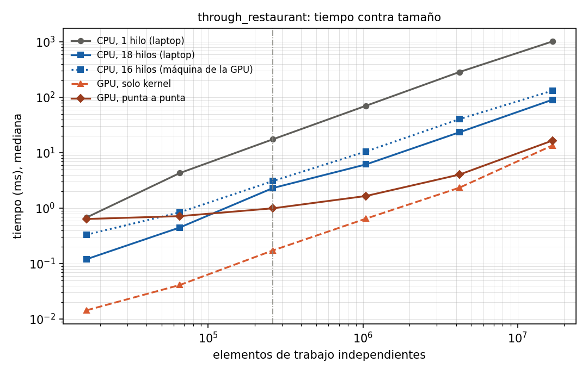
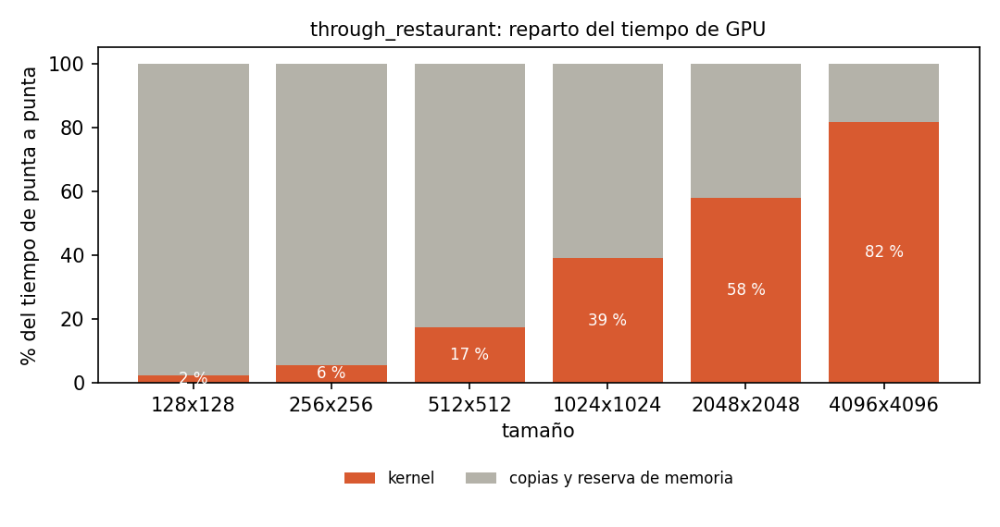
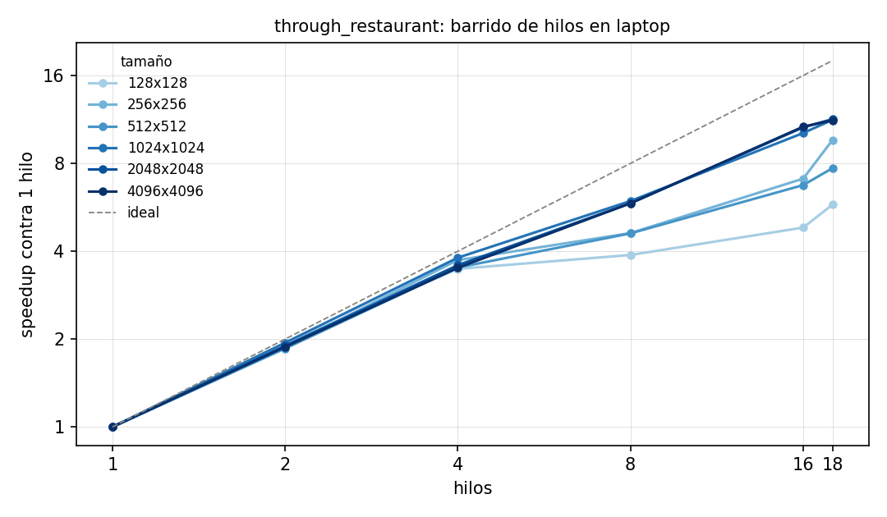

# through_restaurant: CPU contra GPU

Generado por `tools/gpu_report.py` a partir de `mac.csv` y `pc.csv`. 10 repeticiones medidas por versión y tamaño, después de una de calentamiento.

### Veredicto: la GPU contra la CPU de la laptop

| Tamaño | CPU 1 hilo (ms) | CPU 18 hilos (ms) | GPU kernel (ms) | GPU punta a punta (ms) | Mejor CPU | Speedup de la GPU contra la mejor CPU (kernel / punta a punta) | ¿Correcto? |
|---|---|---|---|---|---|---|---|
| 128x128 | 0.678 (0.673–0.690) | 0.120 (0.113–0.136) | 0.014 (0.013–0.066) | 0.637 (0.602–0.818) | 0.120 (18 hilos) | 8.36x / 0.19x | sí |
| 256x256 | 4.290 (4.131–5.616) | 0.447 (0.437–0.628) | 0.041 (0.040–0.073) | 0.717 (0.658–0.805) | 0.447 (18 hilos) | 10.91x / 0.62x | sí |
| 512x512 | 17.461 (17.145–19.193) | 2.305 (1.807–2.637) | 0.173 (0.143–0.231) | 0.992 (0.868–1.199) | 2.305 (18 hilos) | 13.36x / 2.32x | sí |
| 1024x1024 | 70.442 (69.304–72.177) | 6.155 (5.784–6.535) | 0.647 (0.545–0.677) | 1.657 (1.478–1.709) | 6.155 (18 hilos) | 9.51x / 3.71x | sí |
| 2048x2048 | 285.107 (266.154–298.951) | 23.317 (22.367–28.323) | 2.332 (2.316–3.507) | 4.020 (3.894–5.391) | 23.317 (18 hilos) | 10.00x / 5.80x | sí |
| 4096x4096 | 1018.415 (1017.114–1032.934) | 90.301 (88.292–92.363) | 13.530 (10.332–14.832) | 16.571 (13.357–17.700) | 90.301 (18 hilos) | 6.67x / 5.45x | sí |

Tiempos de CPU: laptop. Mediana de las repeticiones y, entre paréntesis, mínimo y máximo.

Cruce de punta a punta contra la mejor CPU de la laptop: **512x512** (262144 elementos).

### Misma máquina: la GPU contra la CPU de su propia máquina

| Tamaño | CPU 1 hilo (ms) | CPU 16 hilos (ms) | GPU kernel (ms) | GPU punta a punta (ms) | Mejor CPU | Speedup de la GPU contra la mejor CPU (kernel / punta a punta) | ¿Correcto? |
|---|---|---|---|---|---|---|---|
| 128x128 | 0.642 (0.626–0.648) | 0.331 (0.316–0.360) | 0.014 (0.013–0.066) | 0.637 (0.602–0.818) | 0.244 (8 hilos) | 16.99x / 0.38x | sí |
| 256x256 | 3.908 (3.892–3.926) | 0.839 (0.807–0.870) | 0.041 (0.040–0.073) | 0.717 (0.658–0.805) | 0.839 (16 hilos) | 20.49x / 1.17x | sí |
| 512x512 | 15.940 (15.722–16.485) | 3.084 (2.706–3.395) | 0.173 (0.143–0.231) | 0.992 (0.868–1.199) | 3.084 (16 hilos) | 17.87x / 3.11x | sí |
| 1024x1024 | 62.474 (62.285–64.057) | 10.534 (9.329–11.966) | 0.647 (0.545–0.677) | 1.657 (1.478–1.709) | 10.534 (16 hilos) | 16.28x / 6.36x | sí |
| 2048x2048 | 248.504 (246.788–250.375) | 40.259 (36.038–44.155) | 2.332 (2.316–3.507) | 4.020 (3.894–5.391) | 40.259 (16 hilos) | 17.26x / 10.01x | sí |
| 4096x4096 | 1009.694 (988.258–1016.389) | 131.885 (129.557–150.952) | 13.530 (10.332–14.832) | 16.571 (13.357–17.700) | 131.885 (16 hilos) | 9.75x / 7.96x | sí |

Tiempos de CPU: máquina de la GPU. Mediana de las repeticiones y, entre paréntesis, mínimo y máximo.

Cruce de punta a punta contra la mejor CPU de la misma máquina: **256x256** (65536 elementos).

### Variantes de GPU

Mediana en ms de cada variante medida en la misma corrida.

| Tamaño | `gpu_kernel` | `gpu_e2e` | `gpu_e2e_global` | `gpu_kernel_global` |
|---|---|---|---|---|
| 128x128 | 0.014 | 0.637 | 0.620 | 0.014 |
| 256x256 | 0.041 | 0.717 | 0.671 | 0.044 |
| 512x512 | 0.173 | 0.992 | 0.895 | 0.165 |
| 1024x1024 | 0.647 | 1.657 | 1.530 | 0.662 |
| 2048x2048 | 2.332 | 4.020 | 3.824 | 2.385 |
| 4096x4096 | 13.530 | 16.571 | 14.234 | 11.623 |

### Barrido de hilos, laptop

Speedup de la versión multihilo contra ella misma con 1 hilo.

| Tamaño | 1 hilo | 2 hilos | 4 hilos | 8 hilos | 16 hilos | 18 hilos |
|---|---|---|---|---|---|---|
| 128x128 | 1.00x | 1.93x | 3.48x | 3.88x | 4.82x | 5.78x |
| 256x256 | 1.00x | 1.88x | 3.73x | 4.61x | 7.09x | 9.62x |
| 512x512 | 1.00x | 1.86x | 3.52x | 4.60x | 6.74x | 7.70x |
| 1024x1024 | 1.00x | 1.94x | 3.80x | 5.94x | 10.16x | 11.28x |
| 2048x2048 | 1.00x | 1.90x | 3.58x | 5.84x | 10.63x | 11.34x |
| 4096x4096 | 1.00x | 1.88x | 3.51x | 5.84x | 10.68x | 11.23x |

### Barrido de hilos, máquina de la GPU

Speedup de la versión multihilo contra ella misma con 1 hilo.

| Tamaño | 1 hilo | 2 hilos | 4 hilos | 8 hilos | 16 hilos |
|---|---|---|---|---|---|
| 128x128 | 1.00x | 1.79x | 2.50x | 2.91x | 2.14x |
| 256x256 | 1.00x | 1.95x | 3.39x | 3.81x | 4.76x |
| 512x512 | 1.00x | 1.97x | 3.85x | 4.08x | 5.23x |
| 1024x1024 | 1.00x | 2.00x | 3.92x | 4.06x | 6.02x |
| 2048x2048 | 1.00x | 1.99x | 3.89x | 4.04x | 6.24x |
| 4096x4096 | 1.00x | 1.99x | 2.94x | 4.03x | 7.55x |

### Gráficos

