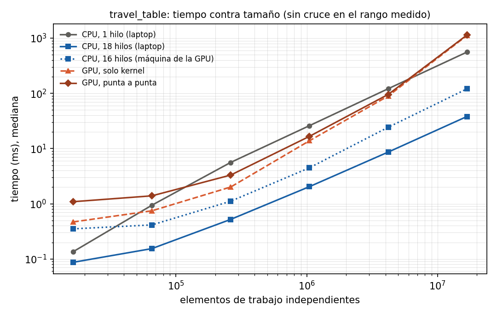
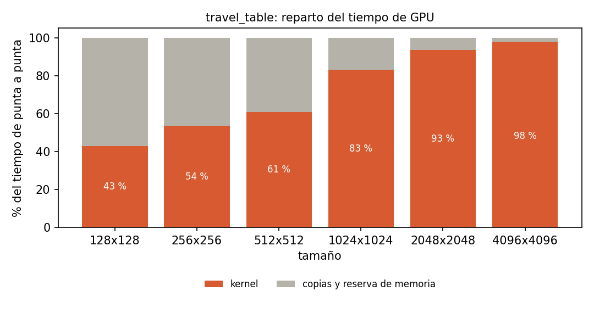

# Tabla de tiempos de todos contra todos: ¿vale la pena la GPU?

Concepto del curso: 03, tiling y memoria compartida. Primera aplicación de ese concepto.
Código: `src/gpu/travel_table.*`. Datos: `mac.csv`, `pc.csv`. Tabla y gráficos: `tabla.md`,
generados por `tools/gpu_report.py`.

## La tarea

Calcular, para cada par de intersecciones, lo que tarda una moto en ir de una a otra respetando
los sentidos, en milisegundos enteros. Con la tabla hecha, cada estimación de entrega deja de
recorrer la red y pasa a ser dos lecturas.

Es paralela en datos porque cada celda de la tabla se puede calcular sin mirar el resultado de
las demás. En CPU cada fila es un Dijkstra independiente desde un nodo. En GPU cada celda es un
hilo: el producto de matrices min-plus `C[i][j] = min sobre k de (A[i][k] + A[k][j])` duplica en
cada pasada el número de tramos que un camino puede usar, y repitiéndolo hasta que nada cambia
sale el camino más corto de cada par.

## Montaje

| | Laptop: de aquí salen los tiempos de CPU | Máquina de la GPU |
|---|---|---|
| Equipo | MacBook Pro, Apple M5 Pro | PC de escritorio, AMD Ryzen 7 3700X |
| Núcleos | 18 físicos y lógicos: 6 "super" y 12 de rendimiento | 8 físicos, 16 lógicos |
| Memoria | 24 GB | 32 GB, 15 GB visibles en el contenedor |
| GPU | no tiene GPU NVIDIA | NVIDIA GeForce RTX 3060 Ti, 8 GB, 38 multiprocesadores, reloj máximo 2130 MHz |
| Sistema | macOS 26.6.2 | Windows 10; contenedor Docker con Ubuntu 20.04 sobre WSL2, kernel 6.6.87 |
| Compilador | Apple clang 21.0.0, `-O3 -DNDEBUG` | g++ 9.4.0 y nvcc 12.1.105, `-O3 -DNDEBUG`, arquitectura `native` (sm_86) |
| CUDA | emulación, no se cronometra | toolkit 12.1, driver 596.49 |

Las dos máquinas compilan en Release con CMake. La laptop midió enchufada y sin modo de bajo
consumo (`pmset`: `AC Power`, `powermode 0`).

Comandos, desde `build`:

```sh
cmake -DCMAKE_BUILD_TYPE=Release .. && make                    # laptop
cmake -DUSE_CUDA=ON -DCMAKE_BUILD_TYPE=Release .. && make      # máquina de la GPU
./delivery_sim ../config/ciudad.json --headless --bench <maquina>.csv --bench-apps travel_table --bench-reps 10 --bench-sweep
python3 tools/gpu_report.py --app travel_table --laptop mac.csv --gpu pc.csv --out tools/reports/gpu/travel_table
```

Entrada: la red de `config/ciudad.json` recortada a 128, 256, 512, 1024, 2048 y 4096 nodos,
tomando los primeros nodos en un recorrido en anchura desde el punto de partida de la flota. El
tamaño del problema es el número de pares, de 16 384 a 16,8 millones: tres órdenes de magnitud.
Una corrida de calentamiento y 10 medidas por versión, intercaladas en cada repetición. En cada
corrida la tabla se compara celda por celda con la de Dijkstra de un hilo.

## Diseño del kernel

- **Malla y bloques.** Un hilo por celda. Bloques de 16 × 16 = 256 hilos y una malla de
  `ceil(n/16)` × `ceil(n/16)` bloques: 8 × 8 para 128 nodos, 256 × 256 para 4096. El bloque
  coincide con el tile: cada bloque calcula un cuadrado de 16 × 16 celdas de la tabla.
- **Por qué 16.** Es el mayor tile cuadrado cuyo bloque no pasa de 256 hilos con margen para
  la ocupación completa (abajo). Con 32 × 32 serían 1024 hilos por bloque y solo cabría un bloque
  por multiprocesador.
- **Memoria compartida.** En cada fase el bloque carga un tile de la fila y uno de la columna,
  2 × 16 × 16 enteros = 2048 bytes, con lecturas consecutivas en memoria global, y hace las 16
  combinaciones de esa fase leyendo solo memoria compartida. Cada valor traído de memoria global
  se usa 16 veces. Sin tiles, cada combinación costaría dos lecturas globales, y la de la
  columna saltaría de fila en fila, sin agruparse.
- **Bordes.** Las celdas fuera de la tabla se cargan como "inalcanzable", que es el neutro del
  mínimo, así todos los hilos del bloque pasan por las mismas barreras.
- **Los datos se quedan en la tarjeta.** La tabla sube una vez, las pasadas alternan dos buffers
  en el dispositivo, y baja una vez. Por cada pasada solo viaja un entero: la bandera de "algo
  cambió", escrita con un atómico relajado solo si todavía está en cero.
- **Quién es dueño de qué.** Todo el cálculo se envía al hilo dueño de la GPU por su cola y el
  que lo pide espera un `future`.

## Corrección

- En las 480 filas de `pc.csv` y las 420 de `mac.csv` la columna `correct` es `yes`: la tabla de
  GPU es idéntica, celda por celda, a Dijkstra desde cada nodo. Son enteros, no hay tolerancia.
- `tests/gpu/travel_table_test.cpp`: redes de 3, 17, 37 y 64 nodos con calles de un sentido y un
  nodo al que nadie llega; los pares sin camino quedan marcados. Pasa en la emulación y en la GPU.
- `compute-sanitizer --tool memcheck`: 0 errores. `--tool racecheck`: 0 hallazgos.

## Resultados

La tabla completa está en `tabla.md`. Las medianas que importan para el veredicto, en ms:

| Nodos | CPU 1 hilo, laptop | CPU 18 hilos, laptop | GPU kernel | GPU punta a punta | GPU contra la mejor CPU de la laptop |
|---|---|---|---|---|---|
| 128 | 0,136 | 0,087 | 0,470 | 1,092 | 0,05x |
| 512 | 5,618 | 0,522 | 2,015 | 3,316 | 0,16x |
| 1024 | 26,02 | 2,046 | 13,86 | 16,67 | 0,12x |
| 4096 | 559,9 | 38,12 | 1116 | 1140 | 0,03x |



**No hay cruce.** La GPU de punta a punta pierde contra la mejor CPU de la laptop en los seis
tamaños, entre 6 y 30 veces más lenta. Con redes chicas pierde por los costos fijos, 19 veces con
128 nodos; desde 512 nodos la distancia vuelve a crecer con el tamaño, de 6 veces a 30 con 4096.
En la misma máquina, contra los 16 hilos del Ryzen, tampoco hay cruce: de 3 a 9 veces más lenta.

Contra un solo hilo de CPU la GPU sí gana entre 512 y 2048 nodos, hasta 1,7 veces. Pero la
comparación que cuenta es contra la mejor versión de CPU.



## Análisis

**Paralelismo disponible.** Hay `n²` celdas independientes por pasada. La 3060 Ti aloja 38 × 1536
= 58 368 hilos a la vez. Con 128 nodos son 16 384 celdas: no llenan la tarjeta, y por eso ahí el
kernel apenas baja de medio milisegundo. Desde 256 nodos, 65 536 celdas, la tarjeta está llena.
No es falta de paralelismo lo que hace perder a la GPU.

**Sobrecostos.** Con redes chicas mandan los costos fijos: con 128 nodos el kernel es el 43 % del
tiempo de punta a punta y el resto son reservas y copias. Con 4096 el kernel es el 98 %: las
copias de 64 MB de ida y de vuelta ya no pesan. El perfil de `nsys` muestra además que la primera
reserva de memoria paga la creación del contexto de CUDA, unos 293 ms; por eso la corrida de
calentamiento no se cuenta.

**Lo que decide el resultado es el algoritmo, no la máquina.** El producto de matrices hace `n³`
combinaciones por pasada y necesita varias pasadas, sin importar cuántas calles tenga la red.
Dijkstra hace un trabajo proporcional a las calles, y una red de calles es dispersa: cada
intersección tiene tres o cuatro vecinos, así que todos los Dijkstra juntos crecen como `n²` por
un logaritmo. Se ve en la tabla: desde 1024 nodos, cada vez que se duplican, el tiempo de la CPU
de 18 hilos se multiplica por 3,9 a 4,4 y el del kernel por 6,5 a 12,5. La GPU hace mucho más
trabajo por segundo, pero le toca muchísimo más trabajo.

**Límite por memoria o por cómputo.** Por fase y por hilo el kernel lee 8 bytes de memoria global
y hace 16 sumas y 16 comparaciones de enteros sobre memoria compartida: 4 operaciones por byte
global, contra 0,25 de la versión sin tiles. Los tiles sacan al kernel del límite de
memoria; lo que lo limita es el volumen de cómputo.

**Eficiencia de ejecución.** El compilador (`nvcc -Xptxas -v`) informa 36 registros por hilo y
2048 bytes de memoria compartida por bloque. Con bloques de 256 hilos caben 6 bloques por
multiprocesador por el límite de 1536 hilos; los registros permitirían 7 (65 536 / (36 × 256)) y
la memoria compartida no limita. La ocupación es del 100 % y el limitante son los hilos. La
divergencia es mínima: los saltos dependientes de datos son la actualización del mínimo, que el
compilador resuelve sin bifurcar, y la carga de los bordes, que solo afecta a los bloques de la
última fila y columna.

**Contención y sincronización.** Dos barreras por fase dentro del bloque, sin atómicos en el
camino caliente. La bandera de cambio es el único dato que comparten todos los bloques; se
escribe una sola vez por pasada en la práctica, porque cada hilo la consulta antes de escribir.

**Corrección bajo paralelismo.** Enteros, mínimo y suma: el resultado no depende del orden en que
terminen los hilos y es igual bit a bit al de la CPU. La tabla se calcula una vez al arrancar,
antes de que existan motos o pedidos, así que no hay ventana entre calcular en GPU y aplicar en
CPU.

## Veredicto

**Para la tabla de tiempos, quedarse con la CPU**, tanto en el tamaño del enunciado como en la
configuración de ciudad. Con 320 intersecciones la laptop la arma en menos de un milisegundo; con
4096, en 38 ms con 18 hilos, contra 1140 ms de la GPU. No existe un tamaño dentro del rango donde
la GPU alcance a la versión multihilo, y la tendencia se aleja.

La GPU valdría la pena si la red fuera densa, con casi todos los nodos conectados entre sí: ahí
Dijkstra también costaría `n³` y la ventaja de cómputo de la tarjeta decidiría. Una red de calles
no es ese caso. El programa usa por defecto la versión de CPU; la de GPU queda disponible con
`--backend gpu` y da exactamente la misma tabla.

## Amenazas a la validez

- **Dos máquinas distintas.** El veredicto compara la CPU de la laptop con la GPU de la PC. Por
  eso `tabla.md` trae también la comparación en la misma máquina, que llega a la misma conclusión.
- **Laptop con batería o enchufada.** Los datos del reporte son con la laptop enchufada. La misma
  medición con batería está en `mac_bateria.csv`: con un hilo no cambia (menos de 0,3 % desde 1024
  nodos) y con 18 hilos en redes de 2048 y 4096 nodos sale un 3 % más lenta, contra un 0,2 % de
  diferencia entre dos corridas enchufadas. No altera ningún resultado.
- **La PC no estaba en reposo.** Corren otros contenedores del dueño del equipo. La dispersión de
  la GPU con 4096 nodos, de 1053 a 1140 ms, y una medida aislada de 132 ms con 2048, son de ese
  ruido. No cambia el orden de los resultados.
- **GPU distinta a la del curso.** Se midió en una RTX 3060 Ti y no en la T4 de Colab. La 3060 Ti
  es más rápida, lo que refuerza el veredicto.
- **Perfiladores.** `ncu` no perfila en esta PC: "Profiling is not supported on device 0 as it uses
  the Windows Subsystem for Linux". `nsys` registra las llamadas al API de CUDA, pero no los datos
  internos de la tarjeta. La ocupación se derivó de los recursos que informa el compilador y de
  las propiedades del dispositivo; el tiempo de kernel sale de eventos CUDA.
- **Tamaños no alcanzados.** No se midió por encima de 4096 nodos. La tabla ocuparía más memoria
  y la tendencia medida no sugiere que el resultado cambie.
