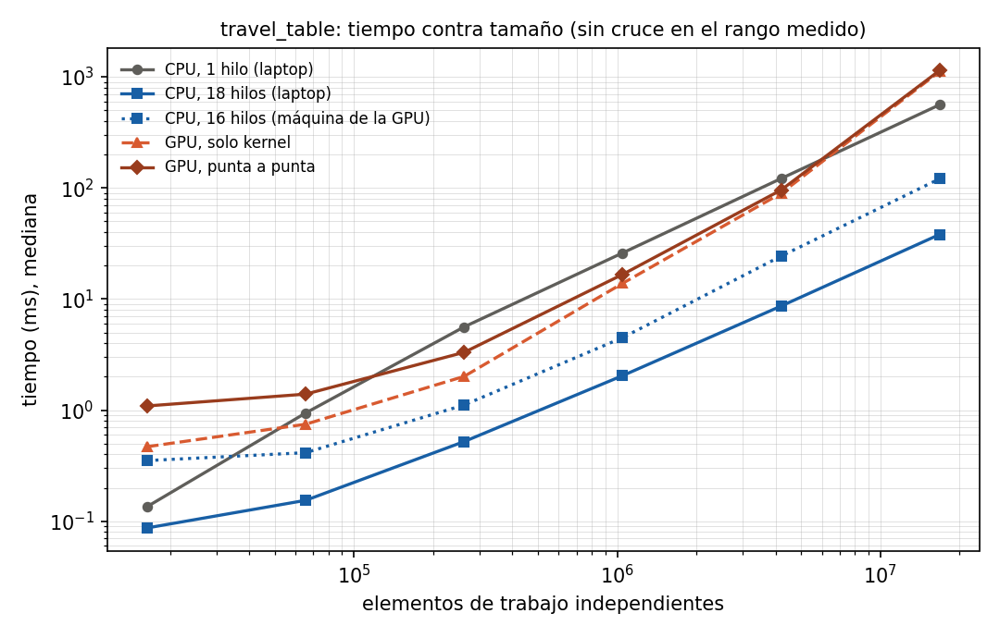
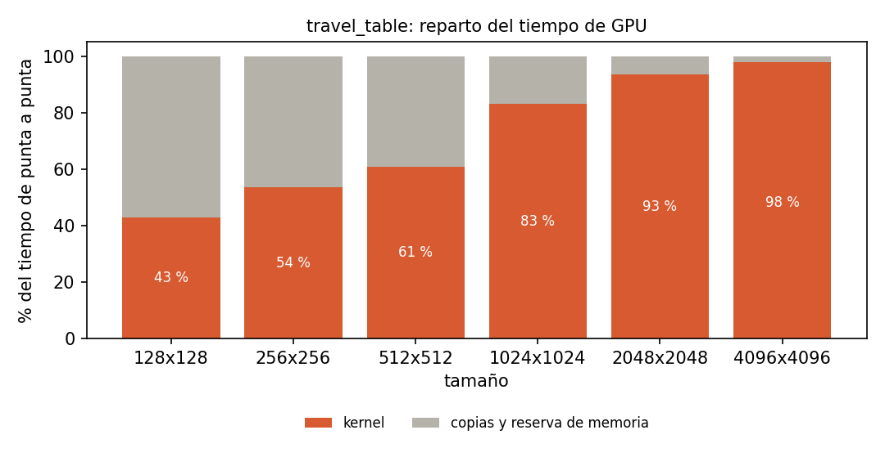
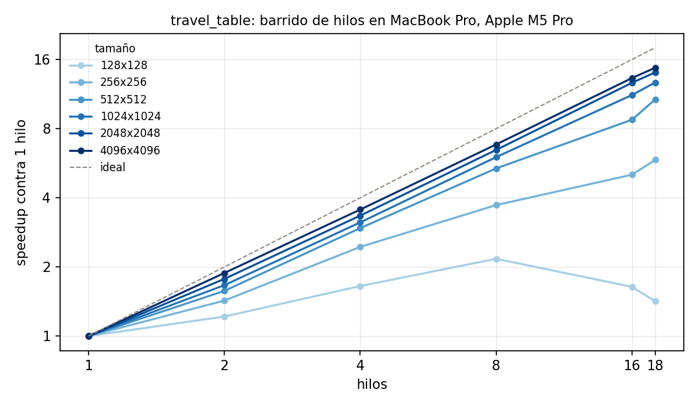

# travel_table: CPU contra GPU

Generado por `tools/gpu_report.py` a partir de `mac.csv` y `pc.csv`. 10 repeticiones medidas por versión y tamaño, después de una de calentamiento.

### Veredicto: la GPU contra la CPU de la laptop

| Tamaño | CPU 1 hilo (ms) | CPU 18 hilos (ms) | GPU kernel (ms) | GPU punta a punta (ms) | Mejor CPU | Speedup de la GPU contra la mejor CPU (kernel / punta a punta) | ¿Correcto? |
|---|---|---|---|---|---|---|---|
| 128x128 | 0.136 (0.115–0.241) | 0.087 (0.069–0.095) | 0.470 (0.353–0.660) | 1.092 (0.949–1.371) | 0.057 (8 hilos) | 0.12x / 0.05x | sí |
| 256x256 | 0.944 (0.833–1.252) | 0.155 (0.124–0.193) | 0.748 (0.717–0.787) | 1.395 (1.313–1.506) | 0.155 (18 hilos) | 0.21x / 0.11x | sí |
| 512x512 | 5.618 (5.463–5.899) | 0.522 (0.490–0.597) | 2.015 (1.993–2.403) | 3.316 (3.280–4.279) | 0.522 (18 hilos) | 0.26x / 0.16x | sí |
| 1024x1024 | 26.016 (25.546–26.964) | 2.046 (1.990–2.212) | 13.859 (13.775–13.986) | 16.665 (16.383–28.367) | 2.046 (18 hilos) | 0.15x / 0.12x | sí |
| 2048x2048 | 121.479 (121.095–122.279) | 8.650 (8.467–10.468) | 89.526 (88.774–125.811) | 95.750 (94.850–132.413) | 8.650 (18 hilos) | 0.10x / 0.09x | sí |
| 4096x4096 | 559.857 (557.016–565.783) | 38.122 (37.739–40.006) | 1116.028 (1052.601–1140.228) | 1139.760 (1076.337–1163.663) | 38.122 (18 hilos) | 0.03x / 0.03x | sí |

Tiempos de CPU: MacBook Pro, Apple M5 Pro. Mediana de las repeticiones y, entre paréntesis, mínimo y máximo.

Cruce de punta a punta contra la mejor CPU de la laptop: **no hay cruce en el rango medido**; la CPU gana en todos los tamaños.

### Misma máquina: la GPU contra la CPU de su propia máquina

| Tamaño | CPU 1 hilo (ms) | CPU 16 hilos (ms) | GPU kernel (ms) | GPU punta a punta (ms) | Mejor CPU | Speedup de la GPU contra la mejor CPU (kernel / punta a punta) | ¿Correcto? |
|---|---|---|---|---|---|---|---|
| 128x128 | 0.425 (0.412–0.451) | 0.352 (0.318–0.372) | 0.470 (0.353–0.660) | 1.092 (0.949–1.371) | 0.178 (8 hilos) | 0.38x / 0.16x | sí |
| 256x256 | 2.082 (2.053–2.135) | 0.415 (0.396–0.440) | 0.748 (0.717–0.787) | 1.395 (1.313–1.506) | 0.415 (16 hilos) | 0.55x / 0.30x | sí |
| 512x512 | 10.169 (10.063–10.500) | 1.114 (1.076–1.239) | 2.015 (1.993–2.403) | 3.316 (3.280–4.279) | 1.114 (16 hilos) | 0.55x / 0.34x | sí |
| 1024x1024 | 46.104 (44.910–50.255) | 4.495 (4.192–5.174) | 13.859 (13.775–13.986) | 16.665 (16.383–28.367) | 4.495 (16 hilos) | 0.32x / 0.27x | sí |
| 2048x2048 | 204.445 (202.088–213.532) | 24.331 (21.282–25.261) | 89.526 (88.774–125.811) | 95.750 (94.850–132.413) | 24.331 (16 hilos) | 0.27x / 0.25x | sí |
| 4096x4096 | 973.081 (962.728–1012.608) | 120.816 (119.369–135.992) | 1116.028 (1052.601–1140.228) | 1139.760 (1076.337–1163.663) | 120.816 (16 hilos) | 0.11x / 0.11x | sí |

Tiempos de CPU: PC, Ryzen 7 3700X con RTX 3060 Ti. Mediana de las repeticiones y, entre paréntesis, mínimo y máximo.

Cruce de punta a punta contra la mejor CPU de la misma máquina: **no hay cruce en el rango medido**.

### Barrido de hilos, MacBook Pro, Apple M5 Pro

Speedup de la versión multihilo contra ella misma con 1 hilo.

| Tamaño | 1 hilo | 2 hilos | 4 hilos | 8 hilos | 16 hilos | 18 hilos |
|---|---|---|---|---|---|---|
| 128x128 | 1.00x | 1.22x | 1.65x | 2.17x | 1.64x | 1.42x |
| 256x256 | 1.00x | 1.43x | 2.45x | 3.72x | 5.04x | 5.85x |
| 512x512 | 1.00x | 1.57x | 2.95x | 5.37x | 8.75x | 10.72x |
| 1024x1024 | 1.00x | 1.67x | 3.13x | 6.01x | 11.21x | 12.70x |
| 2048x2048 | 1.00x | 1.77x | 3.35x | 6.46x | 12.67x | 14.05x |
| 4096x4096 | 1.00x | 1.88x | 3.55x | 6.83x | 13.28x | 14.71x |

### Barrido de hilos, PC, Ryzen 7 3700X con RTX 3060 Ti

Speedup de la versión multihilo contra ella misma con 1 hilo.

| Tamaño | 1 hilo | 2 hilos | 4 hilos | 8 hilos | 16 hilos |
|---|---|---|---|---|---|
| 128x128 | 1.00x | 1.39x | 2.25x | 2.71x | 1.37x |
| 256x256 | 1.00x | 1.59x | 2.91x | 4.81x | 5.28x |
| 512x512 | 1.00x | 1.70x | 3.27x | 5.78x | 9.16x |
| 1024x1024 | 1.00x | 1.74x | 3.36x | 5.77x | 10.03x |
| 2048x2048 | 1.00x | 1.83x | 3.41x | 5.79x | 8.36x |
| 4096x4096 | 1.00x | 1.86x | 3.14x | 5.09x | 8.02x |

### Gráficos

